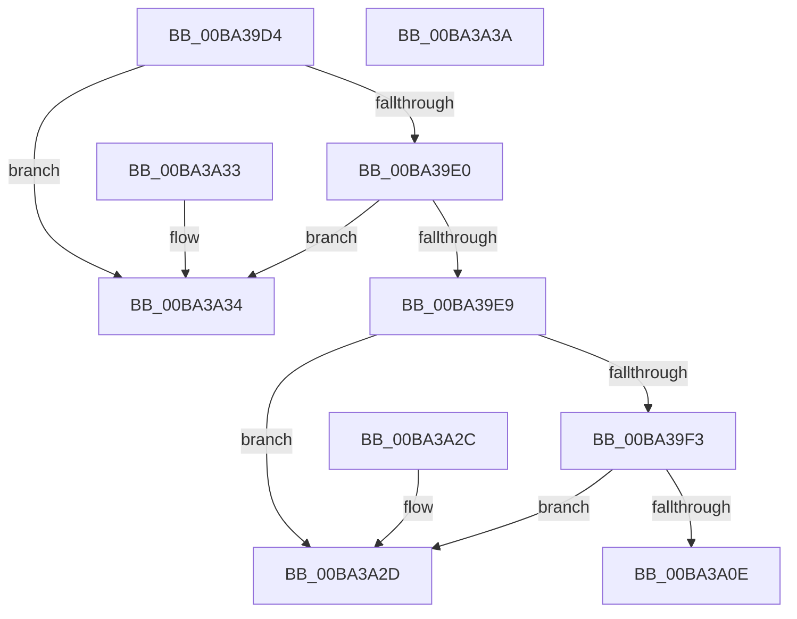

# VfStopBranchTracing

- RVA: `0x00BA39D4`–`0x00BA3A3B` (길이 `103` bytes)
- VA: `0x0000000140BA39D4`
- 실행 섹션: `PAGEVRFY`
- PDB 이름 있음: `예`; PDB Function 태그: `아니요`
- unwind 정보 RVA: `0x000DB714`
- 디코드: `29`개 명령, `103/103` bytes 표시
- 미해석 바이트: `0` (있으면 어셈블리에 `.byte`로 보존)

> 이 문서는 커널 이미지의 기계어와 PDB 기호를 분석해 생성했습니다. 4번과 5번은 함수 원형과 자료형을 바이너리 사용 방식에서 추정한 C 해석이며 원본 소스 복구 결과는 아닙니다.

## 1. Dependencies

- 직접 호출 지점: **0**; 고유 호출 대상: **0**
- 직접 호출자로 확인된 함수: **2**
- RIP 상대 이미지 참조: **4**

### Outgoing calls
- 직접 디코드된 call 명령이 없습니다.

### Direct callers
- [KiFreezeTargetExecution](../../text/5C/KiFreezeTargetExecution_function_005C30A0.md) at `0x005C3108`
- [VfNotifyVerifierOfEvent](../B9/VfNotifyVerifierOfEvent_function_00B92E90.md) at `0x00B92F59`
- [VfNotifyVerifierOfEvent](../B9/VfNotifyVerifierOfEvent_function_00B92E90.md) at `0x00B92F75`

### Static image references
- `0x00BA39D4` → RVA `0x00F04A20` (`.data`; read)
- `0x00BA39E0` → RVA `0x00FFDAE8` (`PAGEVRFD`; read)
- `0x00BA39E9` → RVA `0x00FFDAA4` (`PAGEVRFD`; read)
- `0x00BA39FC` → RVA `0x01005C50` (`PAGEVRFD`; read)

## 2. Other-region calls and transfers

- 다른 실행 섹션으로 향하는 call: **0**
- 별도 외부 분기/꼬리 이동을 확인하지 못했습니다.

## 3. Assembly (complete function range)

```asm
00BA39D4  F7 05 42 10 36 00 00 00 00 08   test dword ptr [rip + 0x361042], 0x8000000
00BA39DE  74 54                           je 0x140ba3a34
00BA39E0  83 3D 01 A1 45 00 00            cmp dword ptr [rip + 0x45a101], 0
00BA39E7  74 4B                           je 0x140ba3a34
00BA39E9  8B 05 B5 A0 45 00               mov eax, dword ptr [rip + 0x45a0b5]
00BA39EF  85 C0                           test eax, eax
00BA39F1  74 3A                           je 0x140ba3a2d
00BA39F3  65 48 8B 04 25 20 00 00 00      mov rax, qword ptr gs:[0x20]
00BA39FC  4C 8D 05 4D 22 46 00            lea r8, [rip + 0x46224d]
00BA3A03  8B 40 24                        mov eax, dword ptr [rax + 0x24]
00BA3A06  41 8B 04 80                     mov eax, dword ptr [r8 + rax*4]
00BA3A0A  85 C0                           test eax, eax
00BA3A0C  74 1F                           je 0x140ba3a2d
00BA3A0E  33 C0                           xor eax, eax
00BA3A10  B9 D9 01 00 00                  mov ecx, 0x1d9
00BA3A15  33 D2                           xor edx, edx
00BA3A17  0F 30                           wrmsr
00BA3A19  65 48 8B 04 25 20 00 00 00      mov rax, qword ptr gs:[0x20]
00BA3A22  8B 48 24                        mov ecx, dword ptr [rax + 0x24]
00BA3A25  33 C0                           xor eax, eax
00BA3A27  41 89 14 88                     mov dword ptr [r8 + rcx*4], edx
00BA3A2B  C3                              ret
00BA3A2C  CC                              int3
00BA3A2D  B8 2A 04 00 C0                  mov eax, 0xc000042a
00BA3A32  C3                              ret
00BA3A33  CC                              int3
00BA3A34  B8 02 00 00 C0                  mov eax, 0xc0000002
00BA3A39  C3                              ret
00BA3A3A  CC                              int3
```

## 4. C-style interpretation (structured pseudocode)

```c
__int64 __fastcall VfStopBranchTracing(__int64 a1, int a2)
{
    __int64 result;

    if (((*(unsigned int *)(v_rip + 3543106)) & (0x8000000ULL)) == 0) goto loc_00BA3A34;
    if ((*(unsigned int *)(v_rip + 4563201)) == 0) goto loc_00BA3A34;
    if ((unsigned int)((unsigned int)(*(unsigned int *)(v_rip + 4563125))) == 0) goto loc_00BA3A2D;
    if ((unsigned int)((unsigned int)(*(unsigned int *)(v_rip + 4596301 + (unsigned int)(*(unsigned int *)(*(unsigned __int64 *)(gs_base + (0 + 32)) + 36)) * 4))) == 0) goto loc_00BA3A2D;
    result = 0;
    a2 = 0;
    result = 0;
    *(unsigned int *)(v_rip + 4596301 + (unsigned int)(*(unsigned int *)(*(unsigned __int64 *)(gs_base + (0 + 32)) + 36)) * 4) = 0;
    return result;
loc_00BA3A2D:
    return (unsigned int)(0xC000042AULL);
loc_00BA3A34:
    return (unsigned int)(0xC0000002ULL);
}
```

## 5. (Beta) C Style

```c
int64_t VfStopBranchTracing(int64_t Arg1, int32_t Arg2)
{
    int64_t result;

    if (((*(uint32_t *)(v_rip + 0x361042)) & (0x8000000ULL)) == 0) goto loc_00BA3A34;
    if ((*(uint32_t *)(v_rip + 0x45A101)) == 0) goto loc_00BA3A34;
    if ((uint32_t)((uint32_t)(*(uint32_t *)(v_rip + 0x45A0B5))) == 0) goto loc_00BA3A2D;
    if ((uint32_t)((uint32_t)(*(uint32_t *)(v_rip + 0x46224D + (uint32_t)(*(uint32_t *)(*(uint64_t *)(gs_base + (0 + 0x20)) + 0x24)) * 4))) == 0) goto loc_00BA3A2D;
    result = 0;
    Arg2 = 0;
    result = 0;
    *(uint32_t *)(v_rip + 0x46224D + (uint32_t)(*(uint32_t *)(*(uint64_t *)(gs_base + (0 + 0x20)) + 0x24)) * 4) = 0;
    return result;
loc_00BA3A2D:
    return (uint32_t)(0xC000042AULL);
loc_00BA3A34:
    return (uint32_t)(0xC0000002ULL);
}
```

## 6. Execution-region graph

[열기: 2D/3D 그래프와 함수 탐색 컨트롤 패널](../../../control-panel.html?section=pagevrfy&rva=0x00BA39D4&view=graph)

- 2D 그래프는 위에서 아래로 흐르고, 3D 그래프는 빈 공간을 드래그해 회전합니다. Shift+드래그는 이동, 휠은 확대·축소, 함수 노드 선택은 대상 보고서 이동입니다.

### Static fallback


