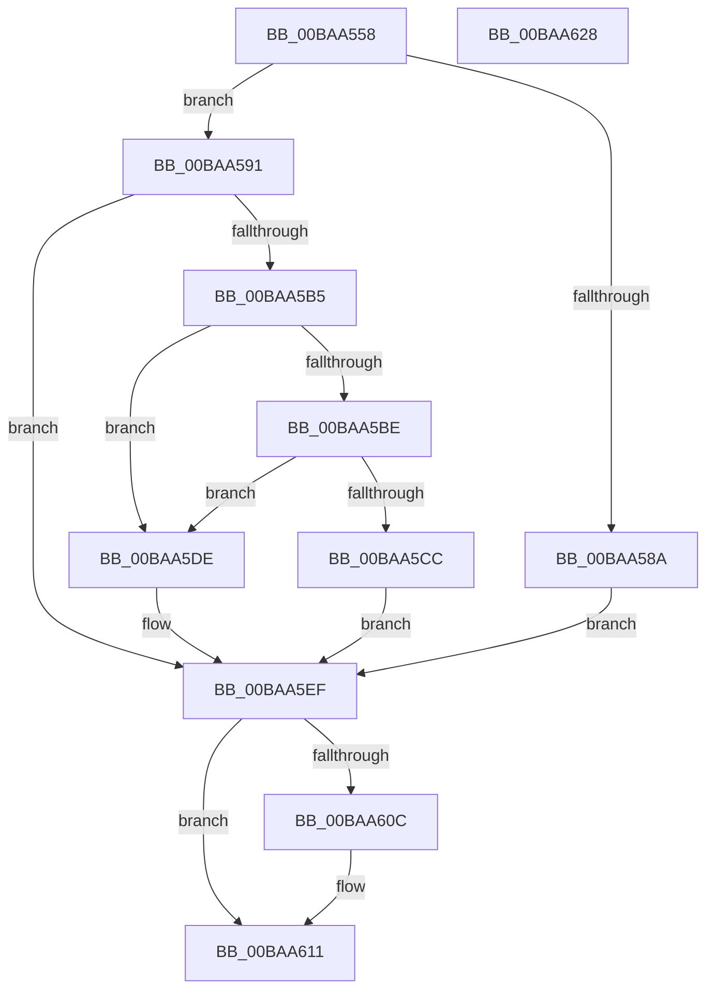

# VfSuspectApplyDifVolatileVerification

- RVA: `0x00BAA558`–`0x00BAA629` (길이 `209` bytes)
- VA: `0x0000000140BAA558`
- 실행 섹션: `PAGEVRFY`
- PDB 이름 있음: `예`; PDB Function 태그: `아니요`
- unwind 정보 RVA: `0x0005C954`
- 디코드: `57`개 명령, `209/209` bytes 표시
- 미해석 바이트: `0` (있으면 어셈블리에 `.byte`로 보존)

> 이 문서는 커널 이미지의 기계어와 PDB 기호를 분석해 생성했습니다. 4번과 5번은 함수 원형과 자료형을 바이너리 사용 방식에서 추정한 C 해석이며 원본 소스 복구 결과는 아닙니다.

## 1. Dependencies

- 직접 호출 지점: **8**; 고유 호출 대상: **8**
- 직접 호출자로 확인된 함수: **2**
- RIP 상대 이미지 참조: **6**

### Outgoing calls
- `0x00BAA576` → [VfDriverLock](../B9/VfDriverLock_function_00B9A4A4.md) (function, `0x00B9A4A4`)
- `0x00BAA581` → [VfTargetDriversEnableVerifier](../B9/VfTargetDriversEnableVerifier_function_00B9B354.md) (function, `0x00B9B354`)
- `0x00BAA5AA` → [ViThunkApplyWdmThunksCurrentSession](ViThunkApplyWdmThunksCurrentSession_function_00BA7414.md) (function, `0x00BA7414`)
- `0x00BAA5B5` → [VfDifCallbackReplacementRequested](../../text/61/VfDifCallbackReplacementRequested_function_00615F68.md) (function, `0x00615F68`)
- `0x00BAA5C1` → [VfTargetReplaceIoCallbacks](../../text/61/VfTargetReplaceIoCallbacks_function_00613260.md) (function, `0x00613260`)
- `0x00BAA5CF` → [VfThunkApplyPristineToAllSession](VfThunkApplyPristineToAllSession_function_00BA7174.md) (function, `0x00BA7174`)
- `0x00BAA5D7` → [VfTargetDriversDisableVerifier](../B9/VfTargetDriversDisableVerifier_function_00B9B2CC.md) (function, `0x00B9B2CC`)
- `0x00BAA603` → [KeReleaseMutex](../../text/39/KeReleaseMutex_function_00396810.md) (function, `0x00396810`)

### Direct callers
- [VfDriverApplyDifVerification](../B9/VfDriverApplyDifVerification_function_00B9A028.md) at `0x00B9A133`
- [VfDriverEnableVerifier](../B9/VfDriverEnableVerifier_function_00B9A240.md) at `0x00B9A352`

### Static image references
- `0x00BAA59B` → RVA `0x00FFDAA8` (`PAGEVRFD`; read/write)
- `0x00BAA5A1` → RVA `0x00FFDA9C` (`PAGEVRFD`; read/write)
- `0x00BAA5DE` → RVA `0x00F04A54` (`.data`; read)
- `0x00BAA5E6` → RVA `0x00F04A54` (`.data`; write)
- `0x00BAA5F1` → RVA `0x00F04938` (`.data`; write)
- `0x00BAA5FC` → RVA `0x00F04900` (`.data`; read)

## 2. Other-region calls and transfers

- 다른 실행 섹션으로 향하는 call: **3**
  - `0x00BAA5B5` → [VfDifCallbackReplacementRequested](../../text/61/VfDifCallbackReplacementRequested_function_00615F68.md) (`PAGEVRFY` → `.text`)
  - `0x00BAA5C1` → [VfTargetReplaceIoCallbacks](../../text/61/VfTargetReplaceIoCallbacks_function_00613260.md) (`PAGEVRFY` → `.text`)
  - `0x00BAA603` → [KeReleaseMutex](../../text/39/KeReleaseMutex_function_00396810.md) (`PAGEVRFY` → `.text`)
- 별도 외부 분기/꼬리 이동을 확인하지 못했습니다.

## 3. Assembly (complete function range)

```asm
00BAA558  48 89 5C 24 08                  mov qword ptr [rsp + 8], rbx
00BAA55D  48 89 6C 24 10                  mov qword ptr [rsp + 0x10], rbp
00BAA562  48 89 74 24 18                  mov qword ptr [rsp + 0x18], rsi
00BAA567  57                              push rdi
00BAA568  48 83 EC 20                     sub rsp, 0x20
00BAA56C  48 8B 69 30                     mov rbp, qword ptr [rcx + 0x30]
00BAA570  48 8B F2                        mov rsi, rdx
00BAA573  48 8B F9                        mov rdi, rcx
00BAA576  E8 29 FF FE FF                  call 0x140b9a4a4
00BAA57B  48 8B D6                        mov rdx, rsi
00BAA57E  48 8B CD                        mov rcx, rbp
00BAA581  E8 CE 0D FF FF                  call 0x140b9b354
00BAA586  85 C0                           test eax, eax
00BAA588  75 07                           jne 0x140baa591
00BAA58A  BB 17 00 00 C0                  mov ebx, 0xc0000017
00BAA58F  EB 5E                           jmp 0x140baa5ef
00BAA591  B8 01 00 00 00                  mov eax, 1
00BAA596  BA 01 00 00 00                  mov edx, 1
00BAA59B  87 05 07 35 45 00               xchg dword ptr [rip + 0x453507], eax
00BAA5A1  87 15 F5 34 45 00               xchg dword ptr [rip + 0x4534f5], edx
00BAA5A7  48 8B CF                        mov rcx, rdi
00BAA5AA  E8 65 CE FF FF                  call 0x140ba7414
00BAA5AF  8B D8                           mov ebx, eax
00BAA5B1  85 C0                           test eax, eax
00BAA5B3  78 3A                           js 0x140baa5ef
00BAA5B5  E8 AE B9 A6 FF                  call 0x140615f68
00BAA5BA  84 C0                           test al, al
00BAA5BC  74 20                           je 0x140baa5de
00BAA5BE  48 8B CD                        mov rcx, rbp
00BAA5C1  E8 9A 8C A6 FF                  call 0x140613260
00BAA5C6  8B D8                           mov ebx, eax
00BAA5C8  85 C0                           test eax, eax
00BAA5CA  79 12                           jns 0x140baa5de
00BAA5CC  48 8B CF                        mov rcx, rdi
00BAA5CF  E8 A0 CB FF FF                  call 0x140ba7174
00BAA5D4  48 8B CF                        mov rcx, rdi
00BAA5D7  E8 F0 0C FF FF                  call 0x140b9b2cc
00BAA5DC  EB 11                           jmp 0x140baa5ef
00BAA5DE  8B 05 70 A4 35 00               mov eax, dword ptr [rip + 0x35a470]
00BAA5E4  FF C0                           inc eax
00BAA5E6  89 05 68 A4 35 00               mov dword ptr [rip + 0x35a468], eax
00BAA5EC  FF 46 10                        inc dword ptr [rsi + 0x10]
00BAA5EF  33 D2                           xor edx, edx
00BAA5F1  48 C7 05 3C A3 35 00 00 00 00 00  mov qword ptr [rip + 0x35a33c], 0
00BAA5FC  48 8D 0D FD A2 35 00            lea rcx, [rip + 0x35a2fd]
00BAA603  E8 08 C2 7E FF                  call 0x140396810
00BAA608  85 DB                           test ebx, ebx
00BAA60A  78 05                           js 0x140baa611
00BAA60C  0F BA 6F 68 19                  bts dword ptr [rdi + 0x68], 0x19
00BAA611  48 8B 6C 24 38                  mov rbp, qword ptr [rsp + 0x38]
00BAA616  8B C3                           mov eax, ebx
00BAA618  48 8B 5C 24 30                  mov rbx, qword ptr [rsp + 0x30]
00BAA61D  48 8B 74 24 40                  mov rsi, qword ptr [rsp + 0x40]
00BAA622  48 83 C4 20                     add rsp, 0x20
00BAA626  5F                              pop rdi
00BAA627  C3                              ret
00BAA628  CC                              int3
```

## 4. C-style interpretation (structured pseudocode)

```c
__int64 __fastcall VfSuspectApplyDifVolatileVerification(__int64 a1, __int64 a2)
{
    __int64 result;
    __int64 v_rsp;
    unsigned __int64 v_stack_p10;
    unsigned __int64 v_stack_p18;
    unsigned __int64 v_stack_p8;

    v_stack_p8 = v_rbx;
    v_stack_p10 = v_rbp;
    v_stack_p18 = v_rsi;
    v_rsp = (v_rsp) - (32);
    result = VfDriverLock(a1, a2, a3, a4);
    result = VfTargetDriversEnableVerifier(*(unsigned __int64 *)(a1 + 48), a2, a3, a4);
    if ((unsigned int)(result) != 0) goto loc_00BAA591;
    goto loc_00BAA5EF;
loc_00BAA591:
    result = ViThunkApplyWdmThunksCurrentSession(a1, 1, a3, a4);
    if (sign_flag) goto loc_00BAA5EF;
    result = VfDifCallbackReplacementRequested(a1, 1, a3, a4);
    if ((unsigned __int8)(result) == 0) goto loc_00BAA5DE;
    result = VfTargetReplaceIoCallbacks(*(unsigned __int64 *)(a1 + 48), 1, a3, a4);
    if (!sign_flag) goto loc_00BAA5DE;
    result = VfThunkApplyPristineToAllSession(a1, 1, a3, a4);
    result = VfTargetDriversDisableVerifier(a1, 1, a3, a4);
    goto loc_00BAA5EF;
loc_00BAA5DE:
    result = (unsigned int)(((unsigned int)(*(unsigned int *)(v_rip + 3515504))) + 1);
    *(unsigned int *)(v_rip + 3515496) = (unsigned int)(result);
loc_00BAA5EF:
    a2 = 0;
    *(unsigned __int64 *)(v_rip + 3515196) = 0;
    result = KeReleaseMutex(v_rip + 3515133, a2, a3, a4);
    if (!(sign_flag)) {
    }
    v_rsp = (v_rsp) + (32);
    return (unsigned int)((unsigned int)((unsigned int)((unsigned int)(result))));
}
```

## 5. (Beta) C Style

```c
int64_t VfSuspectApplyDifVolatileVerification(void *Arg1, void *Arg2)
{
    uint8_t *arg1 = (uint8_t *)Arg1;
    uint8_t *arg2 = (uint8_t *)Arg2;

    int64_t result;
    int64_t local_rsp;
    uint64_t v_stack_p10;
    uint64_t v_stack_p18;
    uint64_t v_stack_p8;

    v_stack_p8 = local_rbx;
    v_stack_p10 = local_rbp;
    v_stack_p18 = local_rsi;
    local_rsp = (local_rsp) - (32);
    result = VfDriverLock(Arg1, Arg2, a3, a4);
    result = VfTargetDriversEnableVerifier(*(uint64_t *)(arg1 + 0x30), Arg2, a3, a4);
    if ((uint32_t)(result) != 0) goto loc_00BAA591;
    goto loc_00BAA5EF;
loc_00BAA591:
    result = ViThunkApplyWdmThunksCurrentSession(Arg1, 1, a3, a4);
    if (sign_flag) goto loc_00BAA5EF;
    result = VfDifCallbackReplacementRequested(Arg1, 1, a3, a4);
    if ((uint8_t)(result) == 0) goto loc_00BAA5DE;
    result = VfTargetReplaceIoCallbacks(*(uint64_t *)(arg1 + 0x30), 1, a3, a4);
    if (!sign_flag) goto loc_00BAA5DE;
    result = VfThunkApplyPristineToAllSession(Arg1, 1, a3, a4);
    result = VfTargetDriversDisableVerifier(Arg1, 1, a3, a4);
    goto loc_00BAA5EF;
loc_00BAA5DE:
    result = (uint32_t)(((uint32_t)(*(uint32_t *)(v_rip + 0x35A470))) + 1);
    *(uint32_t *)(v_rip + 0x35A468) = (uint32_t)(result);
loc_00BAA5EF:
    Arg2 = 0;
    *(uint64_t *)(v_rip + 0x35A33C) = 0;
    result = KeReleaseMutex(v_rip + 3515133, Arg2, a3, a4);
    if (!(sign_flag)) {
    }
    local_rsp = (local_rsp) + (32);
    return (uint32_t)((uint32_t)((uint32_t)((uint32_t)(result))));
}
```

### 관측된 메모리 오프셋

구조체 형식이 확인되지 않은 접근은 인자 기준의 오프셋으로만 기록했습니다.

| 기준 인자 | 오프셋 표현 | 폭 (bit) | 접근 |
|---|---:|---:|---|
| `Arg1` | `+ 0x30` | `64` | `R` |
| `Arg1` | `+ 0x68` | `32` | `R/W` |
| `Arg2` | `+ 0x10` | `32` | `R/W` |

## 6. Execution-region graph

[열기: 2D/3D 그래프와 함수 탐색 컨트롤 패널](../../../control-panel.html?section=pagevrfy&rva=0x00BAA558&view=graph)

- 2D 그래프는 위에서 아래로 흐르고, 3D 그래프는 빈 공간을 드래그해 회전합니다. Shift+드래그는 이동, 휠은 확대·축소, 함수 노드 선택은 대상 보고서 이동입니다.

### Static fallback


