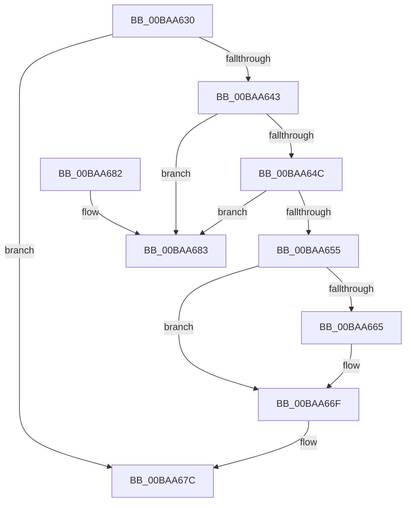

# VfSuspectDifRemoveEntry

- RVA: `0x00BAA630`–`0x00BAA68A` (길이 `90` bytes)
- VA: `0x0000000140BAA630`
- 실행 섹션: `PAGEVRFY`
- PDB 이름 있음: `예`; PDB Function 태그: `아니요`
- unwind 정보 RVA: `0x0005DAC8`
- 디코드: `28`개 명령, `90/90` bytes 표시
- 미해석 바이트: `0` (있으면 어셈블리에 `.byte`로 보존)

> 이 문서는 커널 이미지의 기계어와 PDB 기호를 분석해 생성했습니다. 4번과 5번은 함수 원형과 자료형을 바이너리 사용 방식에서 추정한 C 해석이며 원본 소스 복구 결과는 아닙니다.

## 1. Dependencies

- 직접 호출 지점: **3**; 고유 호출 대상: **2**
- 직접 호출자로 확인된 함수: **3**
- RIP 상대 이미지 참조: **0**

### Outgoing calls
- `0x00BAA636` → [ViSuspectDriversLookupEntry](ViSuspectDriversLookupEntry_function_00BAB194.md) (function, `0x00BAB194`)
- `0x00BAA66A` → [ExFreePoolWithTag](../../poolcode/B8/ExFreePoolWithTag_function_00B82870.md) (function, `0x00B82870`)
- `0x00BAA677` → [ExFreePoolWithTag](../../poolcode/B8/ExFreePoolWithTag_function_00B82870.md) (function, `0x00B82870`)

### Direct callers
- [VfVolatileApplyDifVerification](../../text/61/VfVolatileApplyDifVerification_function_00616874.md) at `0x006168C6`
- [VfDriverRemoveDifVerification](../B9/VfDriverRemoveDifVerification_function_00B9A4E0.md) at `0x00B9A532`
- [VfSuspectRemoveDifVolatileVerification](VfSuspectRemoveDifVolatileVerification_function_00BAB128.md) at `0x00BAB160`

### Static image references
- 디코드된 RIP-relative 메모리 참조가 없습니다.

## 2. Other-region calls and transfers

- 다른 실행 섹션으로 향하는 call: **2**
  - `0x00BAA66A` → [ExFreePoolWithTag](../../poolcode/B8/ExFreePoolWithTag_function_00B82870.md) (`PAGEVRFY` → `POOLCODE`)
  - `0x00BAA677` → [ExFreePoolWithTag](../../poolcode/B8/ExFreePoolWithTag_function_00B82870.md) (`PAGEVRFY` → `POOLCODE`)
- 별도 외부 분기/꼬리 이동을 확인하지 못했습니다.

## 3. Assembly (complete function range)

```asm
00BAA630  40 53                           push rbx
00BAA632  48 83 EC 20                     sub rsp, 0x20
00BAA636  E8 59 0B 00 00                  call 0x140bab194
00BAA63B  48 8B D8                        mov rbx, rax
00BAA63E  48 85 C0                        test rax, rax
00BAA641  74 39                           je 0x140baa67c
00BAA643  48 8B 08                        mov rcx, qword ptr [rax]
00BAA646  48 39 41 08                     cmp qword ptr [rcx + 8], rax
00BAA64A  75 37                           jne 0x140baa683
00BAA64C  48 8B 40 08                     mov rax, qword ptr [rax + 8]
00BAA650  48 39 18                        cmp qword ptr [rax], rbx
00BAA653  75 2E                           jne 0x140baa683
00BAA655  48 89 08                        mov qword ptr [rax], rcx
00BAA658  48 89 41 08                     mov qword ptr [rcx + 8], rax
00BAA65C  48 8B 4B 20                     mov rcx, qword ptr [rbx + 0x20]
00BAA660  48 85 C9                        test rcx, rcx
00BAA663  74 0A                           je 0x140baa66f
00BAA665  BA 56 66 53 44                  mov edx, 0x44536656
00BAA66A  E8 01 82 FD FF                  call 0x140b82870
00BAA66F  BA 56 66 53 44                  mov edx, 0x44536656
00BAA674  48 8B CB                        mov rcx, rbx
00BAA677  E8 F4 81 FD FF                  call 0x140b82870
00BAA67C  48 83 C4 20                     add rsp, 0x20
00BAA680  5B                              pop rbx
00BAA681  C3                              ret
00BAA682  CC                              int3
00BAA683  B9 03 00 00 00                  mov ecx, 3
00BAA688  CD 29                           int 0x29
```

## 4. C-style interpretation (structured pseudocode)

```c
__int64 __fastcall VfSuspectDifRemoveEntry(void)
{
    __int64 result;
    __int64 v_rsp;

    v_rsp = (v_rsp) - (32);
    result = ViSuspectDriversLookupEntry(a1, a2, a3, a4);
    if (result == 0) goto loc_00BAA67C;
    if ((*(unsigned __int64 *)(*(unsigned __int64 *)(result) + 8)) != result) goto loc_00BAA683;
    if ((*(unsigned __int64 *)(*(unsigned __int64 *)(result + 8))) != result) goto loc_00BAA683;
    *(unsigned __int64 *)(*(unsigned __int64 *)(result + 8)) = *(unsigned __int64 *)(result);
    *(unsigned __int64 *)(*(unsigned __int64 *)(result) + 8) = *(unsigned __int64 *)(result + 8);
    result = *(unsigned __int64 *)(result + 8);
    if (*(unsigned __int64 *)(result + 32) != 0) {
        a2 = 0x44536656ULL;
        result = ExFreePoolWithTag(*(unsigned __int64 *)(result + 32), a2, a3, a4);
    }
    result = ExFreePoolWithTag(result, (unsigned int)(0x44536656ULL), a3, a4);
loc_00BAA67C:
    v_rsp = (v_rsp) + (32);
    return result;
loc_00BAA683:
    return result;
}
```

## 5. (Beta) C Style

```c
void VfSuspectDifRemoveEntry(void)
{
    int64_t result;
    int64_t local_rsp;

    local_rsp = (local_rsp) - (32);
    result = ViSuspectDriversLookupEntry(a1, a2, a3, a4);
    if (result == 0) goto loc_00BAA67C;
    if ((*(uint64_t *)(*(uint64_t *)(result) + 0x8)) != result) goto loc_00BAA683;
    if ((*(uint64_t *)(*(uint64_t *)(result + 0x8))) != result) goto loc_00BAA683;
    *(uint64_t *)(*(uint64_t *)(result + 0x8)) = *(uint64_t *)(result);
    *(uint64_t *)(*(uint64_t *)(result) + 0x8) = *(uint64_t *)(result + 0x8);
    result = *(uint64_t *)(result + 0x8);
    if (*(uint64_t *)(result + 0x20) != 0) {
        a2 = 0x44536656ULL;
        result = ExFreePoolWithTag(*(uint64_t *)(result + 0x20), a2, a3, a4);
    }
    result = ExFreePoolWithTag(result, (uint32_t)(0x44536656ULL), a3, a4);
loc_00BAA67C:
    local_rsp = (local_rsp) + (32);
    return result;
loc_00BAA683:
    return result;
}
```

## 6. Execution-region graph

[열기: 2D/3D 그래프와 함수 탐색 컨트롤 패널](../../../control-panel.html?section=pagevrfy&rva=0x00BAA630&view=graph)

- 2D 그래프는 위에서 아래로 흐르고, 3D 그래프는 빈 공간을 드래그해 회전합니다. Shift+드래그는 이동, 휠은 확대·축소, 함수 노드 선택은 대상 보고서 이동입니다.

### Static fallback


