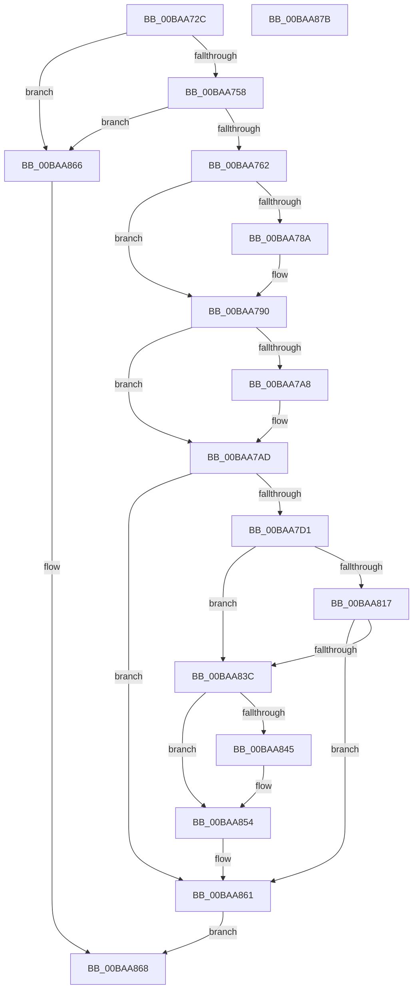

# VfSuspectDriversAllocateEntryEx

- RVA: `0x00BAA72C`–`0x00BAA87C` (길이 `336` bytes)
- VA: `0x0000000140BAA72C`
- 실행 섹션: `PAGEVRFY`
- PDB 이름 있음: `예`; PDB Function 태그: `아니요`
- unwind 정보 RVA: `0x000CB744`
- 디코드: `91`개 명령, `336/336` bytes 표시
- 미해석 바이트: `0` (있으면 어셈블리에 `.byte`로 보존)

> 이 문서는 커널 이미지의 기계어와 PDB 기호를 분석해 생성했습니다. 4번과 5번은 함수 원형과 자료형을 바이너리 사용 방식에서 추정한 C 해석이며 원본 소스 복구 결과는 아닙니다.

## 1. Dependencies

- 직접 호출 지점: **8**; 고유 호출 대상: **4**
- 직접 호출자로 확인된 함수: **1**
- RIP 상대 이미지 참조: **0**

### Outgoing calls
- `0x00BAA771` → [RtlUShortAdd](../../text/47/RtlUShortAdd_function_00474F70.md) (function, `0x00474F70`)
- `0x00BAA79C` → [RtlUShortAdd](../../text/47/RtlUShortAdd_function_00474F70.md) (function, `0x00474F70`)
- `0x00BAA7C0` → [ExAllocatePool2](../../poolcode/B8/ExAllocatePool2_function_00B820F0.md) (function, `0x00B820F0`)
- `0x00BAA7F6` → [memcpy](../../text/6C/memcpy_function_006C6840.md) (function, `0x006C6840`)
- `0x00BAA809` → [ExAllocatePool2](../../poolcode/B8/ExAllocatePool2_function_00B820F0.md) (function, `0x00B820F0`)
- `0x00BAA833` → [memcpy](../../text/6C/memcpy_function_006C6840.md) (function, `0x006C6840`)
- `0x00BAA847` → [ExFreePoolWithTag](../../poolcode/B8/ExFreePoolWithTag_function_00B82870.md) (function, `0x00B82870`)
- `0x00BAA859` → [ExFreePoolWithTag](../../poolcode/B8/ExFreePoolWithTag_function_00B82870.md) (function, `0x00B82870`)

### Direct callers
- [VfDriverEnableVerifierForAll](../B9/VfDriverEnableVerifierForAll_function_00B9A3A4.md) at `0x00B9A407`

### Static image references
- 디코드된 RIP-relative 메모리 참조가 없습니다.

## 2. Other-region calls and transfers

- 다른 실행 섹션으로 향하는 call: **8**
  - `0x00BAA771` → [RtlUShortAdd](../../text/47/RtlUShortAdd_function_00474F70.md) (`PAGEVRFY` → `.text`)
  - `0x00BAA79C` → [RtlUShortAdd](../../text/47/RtlUShortAdd_function_00474F70.md) (`PAGEVRFY` → `.text`)
  - `0x00BAA7C0` → [ExAllocatePool2](../../poolcode/B8/ExAllocatePool2_function_00B820F0.md) (`PAGEVRFY` → `POOLCODE`)
  - `0x00BAA7F6` → [memcpy](../../text/6C/memcpy_function_006C6840.md) (`PAGEVRFY` → `.text`)
  - `0x00BAA809` → [ExAllocatePool2](../../poolcode/B8/ExAllocatePool2_function_00B820F0.md) (`PAGEVRFY` → `POOLCODE`)
  - `0x00BAA833` → [memcpy](../../text/6C/memcpy_function_006C6840.md) (`PAGEVRFY` → `.text`)
  - `0x00BAA847` → [ExFreePoolWithTag](../../poolcode/B8/ExFreePoolWithTag_function_00B82870.md) (`PAGEVRFY` → `POOLCODE`)
  - `0x00BAA859` → [ExFreePoolWithTag](../../poolcode/B8/ExFreePoolWithTag_function_00B82870.md) (`PAGEVRFY` → `POOLCODE`)
- 별도 외부 분기/꼬리 이동을 확인하지 못했습니다.

## 3. Assembly (complete function range)

```asm
00BAA72C  48 8B C4                        mov rax, rsp
00BAA72F  48 89 58 18                     mov qword ptr [rax + 0x18], rbx
00BAA733  48 89 68 20                     mov qword ptr [rax + 0x20], rbp
00BAA737  56                              push rsi
00BAA738  57                              push rdi
00BAA739  41 56                           push r14
00BAA73B  48 83 EC 20                     sub rsp, 0x20
00BAA73F  45 33 F6                        xor r14d, r14d
00BAA742  48 8B F9                        mov rdi, rcx
00BAA745  66 44 89 70 08                  mov word ptr [rax + 8], r14w
00BAA74A  66 44 89 70 10                  mov word ptr [rax + 0x10], r14w
00BAA74F  48 85 C9                        test rcx, rcx
00BAA752  0F 84 0E 01 00 00               je 0x140baa866
00BAA758  4C 39 71 60                     cmp qword ptr [rcx + 0x60], r14
00BAA75C  0F 84 04 01 00 00               je 0x140baa866
00BAA762  0F B7 49 5A                     movzx ecx, word ptr [rcx + 0x5a]
00BAA766  45 8D 56 02                     lea r10d, [r14 + 2]
00BAA76A  41 8B D2                        mov edx, r10d
00BAA76D  4C 8D 40 08                     lea r8, [rax + 8]
00BAA771  E8 FA A7 8C FF                  call 0x140474f70
00BAA776  41 BB 95 00 00 C0               mov r11d, 0xc0000095
00BAA77C  BE FF FF 00 00                  mov esi, 0xffff
00BAA781  44 0F B7 CE                     movzx r9d, si
00BAA785  41 3B C3                        cmp eax, r11d
00BAA788  74 06                           je 0x140baa790
00BAA78A  44 0F B7 4C 24 40               movzx r9d, word ptr [rsp + 0x40]
00BAA790  0F B7 4F 4A                     movzx ecx, word ptr [rdi + 0x4a]
00BAA794  4C 8D 44 24 48                  lea r8, [rsp + 0x48]
00BAA799  41 8B D2                        mov edx, r10d
00BAA79C  E8 CF A7 8C FF                  call 0x140474f70
00BAA7A1  8B E8                           mov ebp, eax
00BAA7A3  41 3B C3                        cmp eax, r11d
00BAA7A6  74 05                           je 0x140baa7ad
00BAA7A8  0F B7 74 24 48                  movzx esi, word ptr [rsp + 0x48]
00BAA7AD  41 0F B7 D1                     movzx edx, r9w
00BAA7B1  B9 40 00 00 00                  mov ecx, 0x40
00BAA7B6  48 83 C2 38                     add rdx, 0x38
00BAA7BA  41 B8 56 66 53 44               mov r8d, 0x44536656
00BAA7C0  E8 2B 79 FD FF                  call 0x140b820f0
00BAA7C5  48 8B D8                        mov rbx, rax
00BAA7C8  48 85 C0                        test rax, rax
00BAA7CB  0F 84 90 00 00 00               je 0x140baa861
00BAA7D1  4C 89 70 10                     mov qword ptr [rax + 0x10], r14
00BAA7D5  48 8D 48 38                     lea rcx, [rax + 0x38]
00BAA7D9  0F B7 57 58                     movzx edx, word ptr [rdi + 0x58]
00BAA7DD  66 89 50 28                     mov word ptr [rax + 0x28], dx
00BAA7E1  0F B7 57 5A                     movzx edx, word ptr [rdi + 0x5a]
00BAA7E5  66 89 50 2A                     mov word ptr [rax + 0x2a], dx
00BAA7E9  48 89 48 30                     mov qword ptr [rax + 0x30], rcx
00BAA7ED  44 0F B7 47 58                  movzx r8d, word ptr [rdi + 0x58]
00BAA7F2  48 8B 57 60                     mov rdx, qword ptr [rdi + 0x60]
00BAA7F6  E8 45 C0 B1 FF                  call 0x1406c6840
00BAA7FB  0F B7 D6                        movzx edx, si
00BAA7FE  B9 40 00 00 00                  mov ecx, 0x40
00BAA803  41 B8 56 66 53 44               mov r8d, 0x44536656
00BAA809  E8 E2 78 FD FF                  call 0x140b820f0
00BAA80E  48 89 43 20                     mov qword ptr [rbx + 0x20], rax
00BAA812  48 85 C0                        test rax, rax
00BAA815  74 25                           je 0x140baa83c
00BAA817  0F B7 4F 48                     movzx ecx, word ptr [rdi + 0x48]
00BAA81B  66 89 4B 18                     mov word ptr [rbx + 0x18], cx
00BAA81F  0F B7 4F 4A                     movzx ecx, word ptr [rdi + 0x4a]
00BAA823  66 89 4B 18                     mov word ptr [rbx + 0x18], cx
00BAA827  48 8B C8                        mov rcx, rax
00BAA82A  44 0F B7 47 48                  movzx r8d, word ptr [rdi + 0x48]
00BAA82F  48 8B 57 50                     mov rdx, qword ptr [rdi + 0x50]
00BAA833  E8 08 C0 B1 FF                  call 0x1406c6840
00BAA838  85 ED                           test ebp, ebp
00BAA83A  79 25                           jns 0x140baa861
00BAA83C  48 8B 4B 20                     mov rcx, qword ptr [rbx + 0x20]
00BAA840  48 85 C9                        test rcx, rcx
00BAA843  74 0F                           je 0x140baa854
00BAA845  33 D2                           xor edx, edx
00BAA847  E8 24 80 FD FF                  call 0x140b82870
00BAA84C  4C 89 73 20                     mov qword ptr [rbx + 0x20], r14
00BAA850  44 89 73 18                     mov dword ptr [rbx + 0x18], r14d
00BAA854  33 D2                           xor edx, edx
00BAA856  48 8B CB                        mov rcx, rbx
00BAA859  E8 12 80 FD FF                  call 0x140b82870
00BAA85E  49 8B DE                        mov rbx, r14
00BAA861  48 8B C3                        mov rax, rbx
00BAA864  EB 02                           jmp 0x140baa868
00BAA866  33 C0                           xor eax, eax
00BAA868  48 8B 5C 24 50                  mov rbx, qword ptr [rsp + 0x50]
00BAA86D  48 8B 6C 24 58                  mov rbp, qword ptr [rsp + 0x58]
00BAA872  48 83 C4 20                     add rsp, 0x20
00BAA876  41 5E                           pop r14
00BAA878  5F                              pop rdi
00BAA879  5E                              pop rsi
00BAA87A  C3                              ret
00BAA87B  CC                              int3
```

## 4. C-style interpretation (structured pseudocode)

```c
__int64 __fastcall VfSuspectDriversAllocateEntryEx(__int64 a1)
{
    __int64 result;
    __int64 v_r14;
    __int64 v_rsi;
    __int64 v_rsp;
    unsigned __int64 v_stack_p10;
    unsigned __int64 v_stack_p18;
    unsigned __int64 v_stack_p20;
    unsigned __int16 v_stack_p8;

    *(unsigned __int64 *)(v_rsp + 24) = v_rbx;
    *(unsigned __int64 *)(v_rsp + 32) = v_rbp;
    v_rsp = (v_rsp) - (32);
    v_r14 = 0;
    *(unsigned __int16 *)(v_rsp + 8) = 0;
    *(unsigned __int16 *)(v_rsp + 16) = 0;
    if (a1 == 0) goto loc_00BAA866;
    if ((*(unsigned __int64 *)(a1 + 96)) == 0) goto loc_00BAA866;
    result = RtlUShortAdd(*(unsigned __int16 *)(a1 + 90), (unsigned int)((unsigned int)(v_r14 + 2)), v_rsp + 8, a4);
    if (((unsigned int)(result)) != ((unsigned int)((unsigned int)(0xC0000095ULL)))) {
        a4 = v_stack_p8;
    }
    result = RtlUShortAdd(*(unsigned __int16 *)(a1 + 74), (unsigned int)((unsigned int)(v_r14 + 2)), v_stack_p10, a4);
    v_rsi = (unsigned int)(0xFFFFULL);
    if (((unsigned int)(result)) != ((unsigned int)((unsigned int)(0xC0000095ULL)))) {
        v_rsi = v_stack_p10;
    }
    a2 = ((unsigned __int16)(a4)) + (56);
    result = ExAllocatePool2(64, a2, (unsigned int)(0x44536656ULL), a4);
    if (result == 0) goto loc_00BAA861;
    *(unsigned __int64 *)(result + 16) = 0;
    *(unsigned __int16 *)(result + 40) = (unsigned __int16)(*(unsigned __int16 *)(a1 + 88));
    *(unsigned __int16 *)(result + 42) = (unsigned __int16)(*(unsigned __int16 *)(a1 + 90));
    *(unsigned __int64 *)(result + 48) = result + 56;
    result = memcpy(result + 56, *(unsigned __int64 *)(a1 + 96), *(unsigned __int16 *)(a1 + 88), a4);
    result = ExAllocatePool2(64, (unsigned __int16)(v_rsi), (unsigned int)(0x44536656ULL), a4);
    *(unsigned __int64 *)(result + 32) = result;
    if (result == 0) goto loc_00BAA83C;
    *(unsigned __int16 *)(result + 24) = (unsigned __int16)(*(unsigned __int16 *)(a1 + 72));
    *(unsigned __int16 *)(result + 24) = (unsigned __int16)(*(unsigned __int16 *)(a1 + 74));
    result = memcpy(result, *(unsigned __int64 *)(a1 + 80), *(unsigned __int16 *)(a1 + 72), a4);
    if (!sign_flag) goto loc_00BAA861;
loc_00BAA83C:
    if (*(unsigned __int64 *)(result + 32) != 0) {
        a2 = 0;
        result = ExFreePoolWithTag(*(unsigned __int64 *)(result + 32), a2, *(unsigned __int16 *)(a1 + 72), a4);
        *(unsigned __int64 *)(result + 32) = 0;
        *(unsigned int *)(result + 24) = 0;
    }
    a2 = 0;
    result = ExFreePoolWithTag(result, a2, *(unsigned __int16 *)(a1 + 72), a4);
loc_00BAA861:
    goto loc_00BAA868;
loc_00BAA866:
    result = 0;
loc_00BAA868:
    v_rsp = (v_rsp) + (32);
    return result;
}
```

## 5. (Beta) C Style

```c
int64_t VfSuspectDriversAllocateEntryEx(void *Arg1)
{
    uint8_t *arg1 = (uint8_t *)Arg1;

    int64_t result;
    int64_t local_r14;
    int64_t local_rsi;
    int64_t local_rsp;
    uint64_t v_stack_p10;
    uint64_t v_stack_p18;
    uint64_t v_stack_p20;
    uint16_t v_stack_p8;

    *(uint64_t *)(local_rsp + 0x18) = local_rbx;
    *(uint64_t *)(local_rsp + 0x20) = local_rbp;
    local_rsp = (local_rsp) - (32);
    local_r14 = 0;
    *(uint16_t *)(local_rsp + 0x8) = 0;
    *(uint16_t *)(local_rsp + 0x10) = 0;
    if (Arg1 == NULL) goto loc_00BAA866;
    if ((*(uint64_t *)(arg1 + 0x60)) == 0) goto loc_00BAA866;
    result = RtlUShortAdd(*(uint16_t *)(arg1 + 0x5A), (uint32_t)((uint32_t)(local_r14 + 2)), local_rsp + 8, a4);
    if (((uint32_t)(result)) != ((uint32_t)((uint32_t)(0xC0000095ULL)))) {
        a4 = v_stack_p8;
    }
    result = RtlUShortAdd(*(uint16_t *)(arg1 + 0x4A), (uint32_t)((uint32_t)(local_r14 + 2)), v_stack_p10, a4);
    local_rsi = (uint32_t)(0xFFFFULL);
    if (((uint32_t)(result)) != ((uint32_t)((uint32_t)(0xC0000095ULL)))) {
        local_rsi = v_stack_p10;
    }
    a2 = ((uint16_t)(a4)) + (56);
    result = ExAllocatePool2(64, a2, (uint32_t)(0x44536656ULL), a4);
    if (result == 0) goto loc_00BAA861;
    *(uint64_t *)(result + 0x10) = 0;
    *(uint16_t *)(result + 0x28) = (uint16_t)(*(uint16_t *)(arg1 + 0x58));
    *(uint16_t *)(result + 0x2A) = (uint16_t)(*(uint16_t *)(arg1 + 0x5A));
    *(uint64_t *)(result + 0x30) = result + 56;
    result = memcpy(result + 56, *(uint64_t *)(arg1 + 0x60), *(uint16_t *)(arg1 + 0x58), a4);
    result = ExAllocatePool2(64, (uint16_t)(local_rsi), (uint32_t)(0x44536656ULL), a4);
    *(uint64_t *)(result + 0x20) = result;
    if (result == 0) goto loc_00BAA83C;
    *(uint16_t *)(result + 0x18) = (uint16_t)(*(uint16_t *)(arg1 + 0x48));
    *(uint16_t *)(result + 0x18) = (uint16_t)(*(uint16_t *)(arg1 + 0x4A));
    result = memcpy(result, *(uint64_t *)(arg1 + 0x50), *(uint16_t *)(arg1 + 0x48), a4);
    if (!sign_flag) goto loc_00BAA861;
loc_00BAA83C:
    if (*(uint64_t *)(result + 0x20) != 0) {
        a2 = 0;
        result = ExFreePoolWithTag(*(uint64_t *)(result + 0x20), a2, *(uint16_t *)(arg1 + 0x48), a4);
        *(uint64_t *)(result + 0x20) = 0;
        *(uint32_t *)(result + 0x18) = 0;
    }
    a2 = 0;
    result = ExFreePoolWithTag(result, a2, *(uint16_t *)(arg1 + 0x48), a4);
loc_00BAA861:
    goto loc_00BAA868;
loc_00BAA866:
    result = 0;
loc_00BAA868:
    local_rsp = (local_rsp) + (32);
    return result;
}
```

### 관측된 메모리 오프셋

구조체 형식이 확인되지 않은 접근은 인자 기준의 오프셋으로만 기록했습니다.

| 기준 인자 | 오프셋 표현 | 폭 (bit) | 접근 |
|---|---:|---:|---|
| `Arg1` | `+ 0x48` | `16` | `R` |
| `Arg1` | `+ 0x4A` | `16` | `R` |
| `Arg1` | `+ 0x50` | `64` | `R` |
| `Arg1` | `+ 0x58` | `16` | `R` |
| `Arg1` | `+ 0x5A` | `16` | `R` |
| `Arg1` | `+ 0x60` | `64` | `R` |

## 6. Execution-region graph

[열기: 2D/3D 그래프와 함수 탐색 컨트롤 패널](../../../control-panel.html?section=pagevrfy&rva=0x00BAA72C&view=graph)

- 2D 그래프는 위에서 아래로 흐르고, 3D 그래프는 빈 공간을 드래그해 회전합니다. Shift+드래그는 이동, 휠은 확대·축소, 함수 노드 선택은 대상 보고서 이동입니다.

### Static fallback


