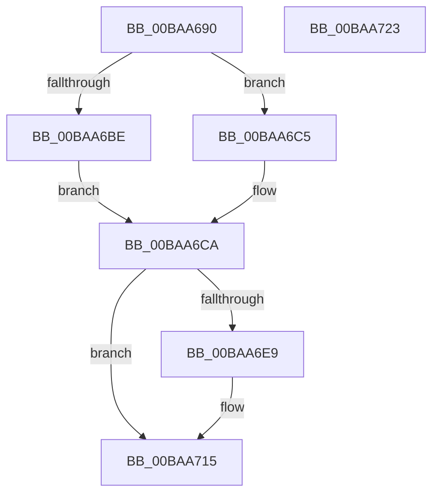

# VfSuspectDriversAllocateEntry

- RVA: `0x00BAA690`–`0x00BAA724` (길이 `148` bytes)
- VA: `0x0000000140BAA690`
- 실행 섹션: `PAGEVRFY`
- PDB 이름 있음: `예`; PDB Function 태그: `아니요`
- unwind 정보 RVA: `0x00068D5C`
- 디코드: `40`개 명령, `148/148` bytes 표시
- 미해석 바이트: `0` (있으면 어셈블리에 `.byte`로 보존)

> 이 문서는 커널 이미지의 기계어와 PDB 기호를 분석해 생성했습니다. 4번과 5번은 함수 원형과 자료형을 바이너리 사용 방식에서 추정한 C 해석이며 원본 소스 복구 결과는 아닙니다.

## 1. Dependencies

- 직접 호출 지점: **3**; 고유 호출 대상: **3**
- 직접 호출자로 확인된 함수: **4**
- RIP 상대 이미지 참조: **0**

### Outgoing calls
- `0x00BAA6B2` → [RtlUShortAdd](../../text/47/RtlUShortAdd_function_00474F70.md) (function, `0x00474F70`)
- `0x00BAA6DC` → [ExAllocatePool2](../../poolcode/B8/ExAllocatePool2_function_00B820F0.md) (function, `0x00B820F0`)
- `0x00BAA710` → [memcpy](../../text/6C/memcpy_function_006C6840.md) (function, `0x006C6840`)

### Direct callers
- [VfVolatileApplyDifVerification](../../text/61/VfVolatileApplyDifVerification_function_00616874.md) at `0x00616896`
- [VfSuspectDriversLoadCallback](VfSuspectDriversLoadCallback_function_00BAAB2C.md) at `0x00BAAD9A`
- [VfAddVerifierEntry](VfAddVerifierEntry_function_00BAC31C.md) at `0x00BAC3F7`
- [VfSuspectDriversParseRegistryString](../../init/C4/VfSuspectDriversParseRegistryString_function_00C4C820.md) at `0x00C4C93D`

### Static image references
- 디코드된 RIP-relative 메모리 참조가 없습니다.

## 2. Other-region calls and transfers

- 다른 실행 섹션으로 향하는 call: **3**
  - `0x00BAA6B2` → [RtlUShortAdd](../../text/47/RtlUShortAdd_function_00474F70.md) (`PAGEVRFY` → `.text`)
  - `0x00BAA6DC` → [ExAllocatePool2](../../poolcode/B8/ExAllocatePool2_function_00B820F0.md) (`PAGEVRFY` → `POOLCODE`)
  - `0x00BAA710` → [memcpy](../../text/6C/memcpy_function_006C6840.md) (`PAGEVRFY` → `.text`)
- 별도 외부 분기/꼬리 이동을 확인하지 못했습니다.

## 3. Assembly (complete function range)

```asm
00BAA690  48 89 5C 24 10                  mov qword ptr [rsp + 0x10], rbx
00BAA695  57                              push rdi
00BAA696  48 83 EC 20                     sub rsp, 0x20
00BAA69A  48 8B F9                        mov rdi, rcx
00BAA69D  4C 8D 44 24 30                  lea r8, [rsp + 0x30]
00BAA6A2  0F B7 09                        movzx ecx, word ptr [rcx]
00BAA6A5  BA 02 00 00 00                  mov edx, 2
00BAA6AA  66 03 CA                        add cx, dx
00BAA6AD  66 89 4C 24 30                  mov word ptr [rsp + 0x30], cx
00BAA6B2  E8 B9 A8 8C FF                  call 0x140474f70
00BAA6B7  3D 95 00 00 C0                  cmp eax, 0xc0000095
00BAA6BC  75 07                           jne 0x140baa6c5
00BAA6BE  B8 FF FF 00 00                  mov eax, 0xffff
00BAA6C3  EB 05                           jmp 0x140baa6ca
00BAA6C5  0F B7 44 24 30                  movzx eax, word ptr [rsp + 0x30]
00BAA6CA  0F B7 D0                        movzx edx, ax
00BAA6CD  B9 40 00 00 00                  mov ecx, 0x40
00BAA6D2  48 83 C2 38                     add rdx, 0x38
00BAA6D6  41 B8 56 66 53 44               mov r8d, 0x44536656
00BAA6DC  E8 0F 7A FD FF                  call 0x140b820f0
00BAA6E1  48 8B D8                        mov rbx, rax
00BAA6E4  48 85 C0                        test rax, rax
00BAA6E7  74 2C                           je 0x140baa715
00BAA6E9  83 60 10 00                     and dword ptr [rax + 0x10], 0
00BAA6ED  48 8D 48 38                     lea rcx, [rax + 0x38]
00BAA6F1  83 60 14 00                     and dword ptr [rax + 0x14], 0
00BAA6F5  48 89 48 30                     mov qword ptr [rax + 0x30], rcx
00BAA6F9  0F B7 17                        movzx edx, word ptr [rdi]
00BAA6FC  66 89 50 28                     mov word ptr [rax + 0x28], dx
00BAA700  0F B7 57 02                     movzx edx, word ptr [rdi + 2]
00BAA704  66 89 50 2A                     mov word ptr [rax + 0x2a], dx
00BAA708  44 0F B7 07                     movzx r8d, word ptr [rdi]
00BAA70C  48 8B 57 08                     mov rdx, qword ptr [rdi + 8]
00BAA710  E8 2B C1 B1 FF                  call 0x1406c6840
00BAA715  48 8B C3                        mov rax, rbx
00BAA718  48 8B 5C 24 38                  mov rbx, qword ptr [rsp + 0x38]
00BAA71D  48 83 C4 20                     add rsp, 0x20
00BAA721  5F                              pop rdi
00BAA722  C3                              ret
00BAA723  CC                              int3
```

## 4. C-style interpretation (structured pseudocode)

```c
__int64 __fastcall VfSuspectDriversAllocateEntry(__int64 a1)
{
    __int64 result;
    __int64 v_rsp;
    unsigned __int64 v_stack_p10;
    unsigned __int64 v_stack_p8;

    v_stack_p10 = v_rbx;
    v_rsp = (v_rsp) - (32);
    a1 = (unsigned __int16)((*(unsigned __int16 *)(a1)) + (2));
    v_stack_p8 = (unsigned __int16)(a1);
    result = RtlUShortAdd(a1, 2, v_stack_p8, a4);
    if (((unsigned int)(result)) != 0xC0000095ULL) goto loc_00BAA6C5;
    goto loc_00BAA6CA;
loc_00BAA6C5:
loc_00BAA6CA:
    a2 = ((unsigned __int16)(v_stack_p8)) + (56);
    result = ExAllocatePool2(64, a2, (unsigned int)(0x44536656ULL), a4);
    if (result != 0) {
        a1 = result + 56;
        *(unsigned __int64 *)(result + 48) = a1;
        a2 = *(unsigned __int16 *)(a1);
        *(unsigned __int16 *)(result + 40) = (unsigned __int16)(a2);
        a2 = *(unsigned __int16 *)(a1 + 2);
        *(unsigned __int16 *)(result + 42) = (unsigned __int16)(a2);
        a3 = *(unsigned __int16 *)(a1);
        a2 = *(unsigned __int64 *)(a1 + 8);
        result = memcpy(a1, a2, a3, a4);
    }
    v_rsp = (v_rsp) + (32);
    return result;
}
```

## 5. (Beta) C Style

```c
int64_t VfSuspectDriversAllocateEntry(void *Arg1)
{
    uint8_t *arg1 = (uint8_t *)Arg1;

    int64_t result;
    int64_t local_rsp;
    uint64_t v_stack_p10;
    uint64_t v_stack_p8;

    v_stack_p10 = local_rbx;
    local_rsp = (local_rsp) - (32);
    Arg1 = (uint16_t)((*(uint16_t *)(arg1)) + (2));
    v_stack_p8 = (uint16_t)(Arg1);
    result = RtlUShortAdd(Arg1, 2, v_stack_p8, a4);
    if (((uint32_t)(result)) != 0xC0000095ULL) goto loc_00BAA6C5;
    goto loc_00BAA6CA;
loc_00BAA6C5:
loc_00BAA6CA:
    a2 = ((uint16_t)(v_stack_p8)) + (56);
    result = ExAllocatePool2(64, a2, (uint32_t)(0x44536656ULL), a4);
    if (result != 0) {
        Arg1 = result + 56;
        *(void **)(result + 0x30) = Arg1;
        a2 = *(uint16_t *)(arg1);
        *(uint16_t *)(result + 0x28) = (uint16_t)(a2);
        a2 = *(uint16_t *)(arg1 + 0x2);
        *(uint16_t *)(result + 0x2A) = (uint16_t)(a2);
        a3 = *(uint16_t *)(arg1);
        a2 = *(uint64_t *)(arg1 + 0x8);
        result = memcpy(Arg1, a2, a3, a4);
    }
    local_rsp = (local_rsp) + (32);
    return result;
}
```

### 관측된 메모리 오프셋

구조체 형식이 확인되지 않은 접근은 인자 기준의 오프셋으로만 기록했습니다.

| 기준 인자 | 오프셋 표현 | 폭 (bit) | 접근 |
|---|---:|---:|---|
| `Arg1` | `+ 0x0` | `16` | `R` |
| `Arg1` | `+ 0x2` | `16` | `R` |
| `Arg1` | `+ 0x8` | `64` | `R` |

## 6. Execution-region graph

[열기: 2D/3D 그래프와 함수 탐색 컨트롤 패널](../../../control-panel.html?section=pagevrfy&rva=0x00BAA690&view=graph)

- 2D 그래프는 위에서 아래로 흐르고, 3D 그래프는 빈 공간을 드래그해 회전합니다. Shift+드래그는 이동, 휠은 확대·축소, 함수 노드 선택은 대상 보고서 이동입니다.

### Static fallback


