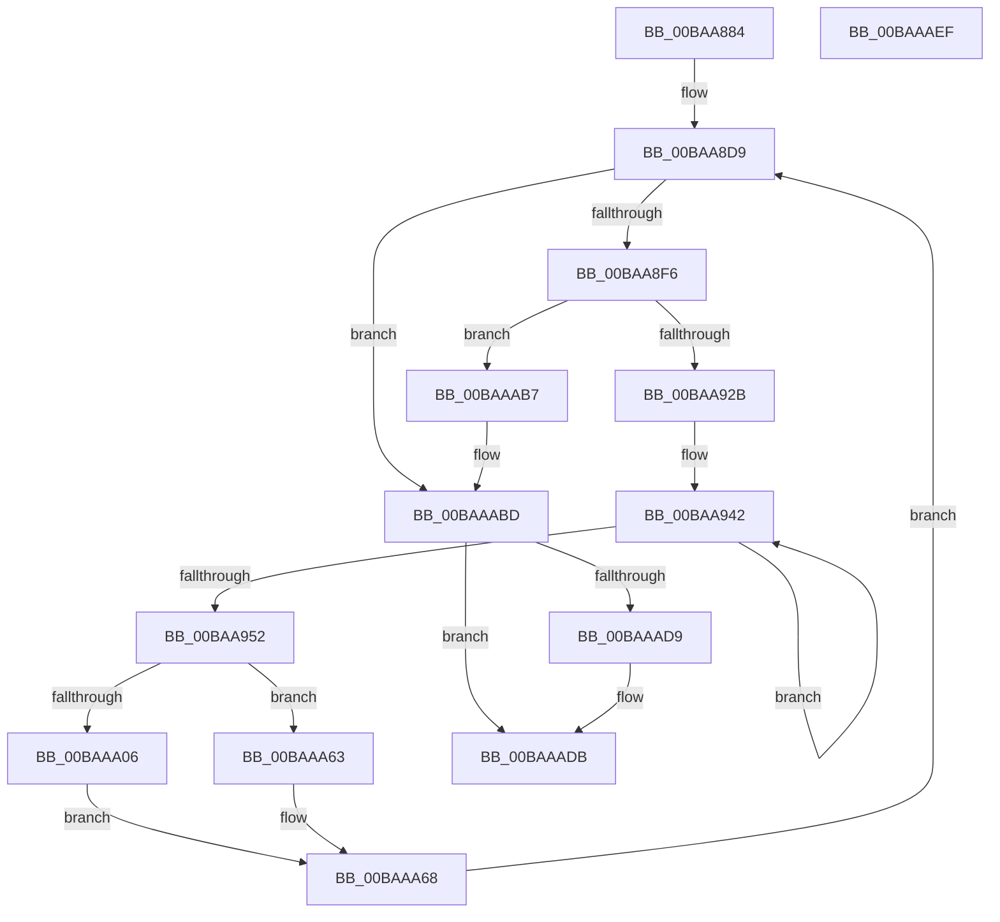

# VfSuspectDriversGetVerifierInformation

- RVA: `0x00BAA884`–`0x00BAAAF0` (길이 `620` bytes)
- VA: `0x0000000140BAA884`
- 실행 섹션: `PAGEVRFY`
- PDB 이름 있음: `예`; PDB Function 태그: `아니요`
- unwind 정보 RVA: `0x000D26B4`
- 디코드: `161`개 명령, `620/620` bytes 표시
- 미해석 바이트: `0` (있으면 어셈블리에 `.byte`로 보존)

> 이 문서는 커널 이미지의 기계어와 PDB 기호를 분석해 생성했습니다. 4번과 5번은 함수 원형과 자료형을 바이너리 사용 방식에서 추정한 C 해석이며 원본 소스 복구 결과는 아닙니다.

## 1. Dependencies

- 직접 호출 지점: **8**; 고유 호출 대상: **7**
- 직접 호출자로 확인된 함수: **1**
- RIP 상대 이미지 참조: **21**

### Outgoing calls
- `0x00BAA8CD` → [VfDriverLock](../B9/VfDriverLock_function_00B9A4A4.md) (function, `0x00B9A4A4`)
- `0x00BAAA19` → [VfTargetDriversGetZeroCounters](../B9/VfTargetDriversGetZeroCounters_function_00B9B400.md) (function, `0x00B9B400`)
- `0x00BAAA36` → [VfAvlInitializeLockContext](../../text/4A/VfAvlInitializeLockContext_function_004A686C.md) (function, `0x004A686C`)
- `0x00BAAA4C` → [VfAvlEnumerateNodes](../B9/VfAvlEnumerateNodes_function_00B93C14.md) (function, `0x00B93C14`)
- `0x00BAAA56` → [VfAvlCleanupLockContext](../../text/3E/VfAvlCleanupLockContext_function_003EF56C.md) (function, `0x003EF56C`)
- `0x00BAAA63` → [VfTargetDriversGetZeroCounters](../B9/VfTargetDriversGetZeroCounters_function_00B9B400.md) (function, `0x00B9B400`)
- `0x00BAAA8C` → [memcpy](../../text/6C/memcpy_function_006C6840.md) (function, `0x006C6840`)
- `0x00BAAACF` → [KeReleaseMutex](../../text/39/KeReleaseMutex_function_00396810.md) (function, `0x00396810`)

### Direct callers
- [VfGetVerifierInformation](../../text/61/VfGetVerifierInformation_function_006167C4.md) at `0x00616825`

### Static image references
- `0x00BAA8D2` → RVA `0x00F049E0` (`.data`; read)
- `0x00BAA8E6` → RVA `0x00E681A0` (`.data`; read)
- `0x00BAA930` → RVA `0x00F04A20` (`.data`; read)
- `0x00BAA952` → RVA `0x00F049D8` (`.data`; read)
- `0x00BAA95B` → RVA `0x00F04350` (`.data`; read)
- `0x00BAA971` → RVA `0x00F04A04` (`.data`; read)
- `0x00BAA982` → RVA `0x00F04A24` (`.data`; read)
- `0x00BAA98B` → RVA `0x00F04A28` (`.data`; read)
- `0x00BAA994` → RVA `0x00F04A5C` (`.data`; read)
- `0x00BAA99D` → RVA `0x00F04A2C` (`.data`; read)
- `0x00BAA9A6` → RVA `0x00F04A30` (`.data`; read)
- `0x00BAA9AF` → RVA `0x00F04A34` (`.data`; read)
- `0x00BAA9B8` → RVA `0x00F04A38` (`.data`; read)
- `0x00BAA9C1` → RVA `0x00F04A3C` (`.data`; read)
- `0x00BAA9CA` → RVA `0x00F04A40` (`.data`; read)
- `0x00BAA9D3` → RVA `0x00F04A44` (`.data`; read)
- `0x00BAA9DC` → RVA `0x00F04A48` (`.data`; read)
- `0x00BAA9E5` → RVA `0x00F04A4C` (`.data`; read)
- `0x00BAAA40` → RVA `0x00B9B7F0` (`ViTargetAddCountersCallback`; read)
- `0x00BAAABF` → RVA `0x00F04900` (`.data`; read)
- `0x00BAAAC8` → RVA `0x00F04938` (`.data`; write)

## 2. Other-region calls and transfers

- 다른 실행 섹션으로 향하는 call: **4**
  - `0x00BAAA36` → [VfAvlInitializeLockContext](../../text/4A/VfAvlInitializeLockContext_function_004A686C.md) (`PAGEVRFY` → `.text`)
  - `0x00BAAA56` → [VfAvlCleanupLockContext](../../text/3E/VfAvlCleanupLockContext_function_003EF56C.md) (`PAGEVRFY` → `.text`)
  - `0x00BAAA8C` → [memcpy](../../text/6C/memcpy_function_006C6840.md) (`PAGEVRFY` → `.text`)
  - `0x00BAAACF` → [KeReleaseMutex](../../text/39/KeReleaseMutex_function_00396810.md) (`PAGEVRFY` → `.text`)
- 별도 외부 분기/꼬리 이동을 확인하지 못했습니다.

## 3. Assembly (complete function range)

```asm
00BAA884  4C 89 4C 24 20                  mov qword ptr [rsp + 0x20], r9
00BAA889  89 54 24 10                     mov dword ptr [rsp + 0x10], edx
00BAA88D  48 89 4C 24 08                  mov qword ptr [rsp + 8], rcx
00BAA892  53                              push rbx
00BAA893  55                              push rbp
00BAA894  56                              push rsi
00BAA895  57                              push rdi
00BAA896  41 54                           push r12
00BAA898  41 55                           push r13
00BAA89A  41 56                           push r14
00BAA89C  41 57                           push r15
00BAA89E  48 83 EC 58                     sub rsp, 0x58
00BAA8A2  44 8B AC 24 C0 00 00 00         mov r13d, dword ptr [rsp + 0xc0]
00BAA8AA  4D 8B E0                        mov r12, r8
00BAA8AD  41 8B C5                        mov eax, r13d
00BAA8B0  48 8B F9                        mov rdi, rcx
00BAA8B3  F7 D8                           neg eax
00BAA8B5  1B F6                           sbb esi, esi
00BAA8B7  33 DB                           xor ebx, ebx
00BAA8B9  81 E6 80 00 00 00               and esi, 0x80
00BAA8BF  41 89 18                        mov dword ptr [r8], ebx
00BAA8C2  81 C6 90 00 00 00               add esi, 0x90
00BAA8C8  8B EB                           mov ebp, ebx
00BAA8CA  44 8B F3                        mov r14d, ebx
00BAA8CD  E8 D2 FB FE FF                  call 0x140b9a4a4
00BAA8D2  4C 8B 3D 07 A1 35 00            mov r15, qword ptr [rip + 0x35a107]
00BAA8D9  48 8D 05 00 A1 35 00            lea rax, [rip + 0x35a100]
00BAA8E0  41 BA 02 00 00 00               mov r10d, 2
00BAA8E6  4C 8D 0D B3 D8 2B 00            lea r9, [rip + 0x2bd8b3]
00BAA8ED  4C 3B F8                        cmp r15, rax
00BAA8F0  0F 84 C7 01 00 00               je 0x140baaabd
00BAA8F6  8B C5                           mov eax, ebp
00BAA8F8  4D 8B C7                        mov r8, r15
00BAA8FB  48 03 F8                        add rdi, rax
00BAA8FE  4C 89 BC 24 B0 00 00 00         mov qword ptr [rsp + 0xb0], r15
00BAA906  4D 8B 3F                        mov r15, qword ptr [r15]
00BAA909  8D 6E 09                        lea ebp, [rsi + 9]
00BAA90C  41 0F B7 58 28                  movzx ebx, word ptr [r8 + 0x28]
00BAA911  03 EB                           add ebp, ebx
00BAA913  83 E5 F8                        and ebp, 0xfffffff8
00BAA916  41 01 2C 24                     add dword ptr [r12], ebp
00BAA91A  41 8B 04 24                     mov eax, dword ptr [r12]
00BAA91E  3B 84 24 A8 00 00 00            cmp eax, dword ptr [rsp + 0xa8]
00BAA925  0F 87 8C 01 00 00               ja 0x140baaab7
00BAA92B  48 8B D7                        mov rdx, rdi
00BAA92E  89 2F                           mov dword ptr [rdi], ebp
00BAA930  8B 05 EA A0 35 00               mov eax, dword ptr [rip + 0x35a0ea]
00BAA936  49 2B D1                        sub rdx, r9
00BAA939  49 8B C9                        mov rcx, r9
00BAA93C  89 47 04                        mov dword ptr [rdi + 4], eax
00BAA93F  45 8B CA                        mov r9d, r10d
00BAA942  8B 01                           mov eax, dword ptr [rcx]
00BAA944  89 44 0A 08                     mov dword ptr [rdx + rcx + 8], eax
00BAA948  48 8D 49 04                     lea rcx, [rcx + 4]
00BAA94C  49 83 E9 01                     sub r9, 1
00BAA950  75 F0                           jne 0x140baa942
00BAA952  8B 05 80 A0 35 00               mov eax, dword ptr [rip + 0x35a080]
00BAA958  41 8B D5                        mov edx, r13d
00BAA95B  8B 0D EF 99 35 00               mov ecx, dword ptr [rip + 0x3599ef]
00BAA961  89 47 10                        mov dword ptr [rdi + 0x10], eax
00BAA964  83 E1 01                        and ecx, 1
00BAA967  8B 47 14                        mov eax, dword ptr [rdi + 0x14]
00BAA96A  03 C9                           add ecx, ecx
00BAA96C  83 E0 FC                        and eax, 0xfffffffc
00BAA96F  0B C8                           or ecx, eax
00BAA971  8B 05 8D A0 35 00               mov eax, dword ptr [rip + 0x35a08d]
00BAA977  83 E0 01                        and eax, 1
00BAA97A  0B C8                           or ecx, eax
00BAA97C  89 4F 14                        mov dword ptr [rdi + 0x14], ecx
00BAA97F  48 8B CF                        mov rcx, rdi
00BAA982  8B 05 9C A0 35 00               mov eax, dword ptr [rip + 0x35a09c]
00BAA988  89 47 28                        mov dword ptr [rdi + 0x28], eax
00BAA98B  8B 05 97 A0 35 00               mov eax, dword ptr [rip + 0x35a097]
00BAA991  89 47 2C                        mov dword ptr [rdi + 0x2c], eax
00BAA994  8B 05 C2 A0 35 00               mov eax, dword ptr [rip + 0x35a0c2]
00BAA99A  89 47 5C                        mov dword ptr [rdi + 0x5c], eax
00BAA99D  8B 05 89 A0 35 00               mov eax, dword ptr [rip + 0x35a089]
00BAA9A3  89 47 30                        mov dword ptr [rdi + 0x30], eax
00BAA9A6  8B 05 84 A0 35 00               mov eax, dword ptr [rip + 0x35a084]
00BAA9AC  89 47 34                        mov dword ptr [rdi + 0x34], eax
00BAA9AF  8B 05 7F A0 35 00               mov eax, dword ptr [rip + 0x35a07f]
00BAA9B5  89 47 38                        mov dword ptr [rdi + 0x38], eax
00BAA9B8  8B 05 7A A0 35 00               mov eax, dword ptr [rip + 0x35a07a]
00BAA9BE  89 47 3C                        mov dword ptr [rdi + 0x3c], eax
00BAA9C1  8B 05 75 A0 35 00               mov eax, dword ptr [rip + 0x35a075]
00BAA9C7  89 47 40                        mov dword ptr [rdi + 0x40], eax
00BAA9CA  8B 05 70 A0 35 00               mov eax, dword ptr [rip + 0x35a070]
00BAA9D0  89 47 44                        mov dword ptr [rdi + 0x44], eax
00BAA9D3  8B 05 6B A0 35 00               mov eax, dword ptr [rip + 0x35a06b]
00BAA9D9  89 47 48                        mov dword ptr [rdi + 0x48], eax
00BAA9DC  8B 05 66 A0 35 00               mov eax, dword ptr [rip + 0x35a066]
00BAA9E2  89 47 4C                        mov dword ptr [rdi + 0x4c], eax
00BAA9E5  8B 05 61 A0 35 00               mov eax, dword ptr [rip + 0x35a061]
00BAA9EB  89 47 50                        mov dword ptr [rdi + 0x50], eax
00BAA9EE  41 8B 40 10                     mov eax, dword ptr [r8 + 0x10]
00BAA9F2  89 47 54                        mov dword ptr [rdi + 0x54], eax
00BAA9F5  41 8B 40 14                     mov eax, dword ptr [r8 + 0x14]
00BAA9F9  89 47 58                        mov dword ptr [rdi + 0x58], eax
00BAA9FC  41 8B 40 14                     mov eax, dword ptr [r8 + 0x14]
00BAAA00  41 39 40 10                     cmp dword ptr [r8 + 0x10], eax
00BAAA04  76 5D                           jbe 0x140baaa63
00BAAA06  33 C0                           xor eax, eax
00BAAA08  0F 57 C0                        xorps xmm0, xmm0
00BAAA0B  0F 11 44 24 38                  movups xmmword ptr [rsp + 0x38], xmm0
00BAAA10  48 89 44 24 48                  mov qword ptr [rsp + 0x48], rax
00BAAA15  89 44 24 34                     mov dword ptr [rsp + 0x34], eax
00BAAA19  E8 E2 09 FF FF                  call 0x140b9b400
00BAAA1E  41 8D 51 01                     lea edx, [r9 + 1]
00BAAA22  4C 89 44 24 20                  mov qword ptr [rsp + 0x20], r8
00BAAA27  48 8D 4C 24 38                  lea rcx, [rsp + 0x38]
00BAAA2C  48 89 7C 24 28                  mov qword ptr [rsp + 0x28], rdi
00BAAA31  44 89 6C 24 30                  mov dword ptr [rsp + 0x30], r13d
00BAAA36  E8 31 BE 8F FF                  call 0x1404a686c
00BAAA3B  4C 8D 4C 24 20                  lea r9, [rsp + 0x20]
00BAAA40  4C 8D 05 A9 0D FF FF            lea r8, [rip - 0xf257]
00BAAA47  48 8D 54 24 38                  lea rdx, [rsp + 0x38]
00BAAA4C  E8 C3 91 FE FF                  call 0x140b93c14
00BAAA51  48 8D 4C 24 38                  lea rcx, [rsp + 0x38]
00BAAA56  E8 11 4B 84 FF                  call 0x1403ef56c
00BAAA5B  41 BA 02 00 00 00               mov r10d, 2
00BAAA61  EB 05                           jmp 0x140baaa68
00BAAA63  E8 98 09 FF FF                  call 0x140b9b400
00BAAA68  48 8B 94 24 B0 00 00 00         mov rdx, qword ptr [rsp + 0xb0]
00BAAA70  41 8D 04 1A                     lea eax, [r10 + rbx]
00BAAA74  66 89 5F 18                     mov word ptr [rdi + 0x18], bx
00BAAA78  4C 8B C3                        mov r8, rbx
00BAAA7B  66 89 47 1A                     mov word ptr [rdi + 0x1a], ax
00BAAA7F  8B CE                           mov ecx, esi
00BAAA81  48 03 CF                        add rcx, rdi
00BAAA84  48 89 4F 20                     mov qword ptr [rdi + 0x20], rcx
00BAAA88  48 8B 52 30                     mov rdx, qword ptr [rdx + 0x30]
00BAAA8C  E8 AF BD B1 FF                  call 0x1406c6840
00BAAA91  48 8B 47 20                     mov rax, qword ptr [rdi + 0x20]
00BAAA95  33 C9                           xor ecx, ecx
00BAAA97  48 D1 EB                        shr rbx, 1
00BAAA9A  66 89 0C 58                     mov word ptr [rax + rbx*2], cx
00BAAA9E  48 8B 84 24 B8 00 00 00         mov rax, qword ptr [rsp + 0xb8]
00BAAAA6  48 2B 84 24 A0 00 00 00         sub rax, qword ptr [rsp + 0xa0]
00BAAAAE  48 01 47 20                     add qword ptr [rdi + 0x20], rax
00BAAAB2  E9 22 FE FF FF                  jmp 0x140baa8d9
00BAAAB7  41 BE 04 00 00 C0               mov r14d, 0xc0000004
00BAAABD  33 DB                           xor ebx, ebx
00BAAABF  48 8D 0D 3A 9E 35 00            lea rcx, [rip + 0x359e3a]
00BAAAC6  33 D2                           xor edx, edx
00BAAAC8  48 89 1D 69 9E 35 00            mov qword ptr [rip + 0x359e69], rbx
00BAAACF  E8 3C BD 7E FF                  call 0x140396810
00BAAAD4  45 85 F6                        test r14d, r14d
00BAAAD7  78 02                           js 0x140baaadb
00BAAAD9  89 1F                           mov dword ptr [rdi], ebx
00BAAADB  41 8B C6                        mov eax, r14d
00BAAADE  48 83 C4 58                     add rsp, 0x58
00BAAAE2  41 5F                           pop r15
00BAAAE4  41 5E                           pop r14
00BAAAE6  41 5D                           pop r13
00BAAAE8  41 5C                           pop r12
00BAAAEA  5F                              pop rdi
00BAAAEB  5E                              pop rsi
00BAAAEC  5D                              pop rbp
00BAAAED  5B                              pop rbx
00BAAAEE  C3                              ret
00BAAAEF  CC                              int3
```

## 4. C-style interpretation (structured pseudocode)

```c
__int64 __fastcall VfSuspectDriversGetVerifierInformation(__int64 a1, int a2, __int64 a3, __int64 a4, unsigned int a5)
{
    __int64 result;
    __int64 v_rbp;
    __int64 v_rbx;
    __int64 v_rdi;
    __int64 v_rsi;
    __int64 v_rsp;
    unsigned __int64 v_stack_m50;
    unsigned __int64 v_stack_m60;
    unsigned int v_stack_m64;
    unsigned int v_stack_m68;
    unsigned __int64 v_stack_m70;
    unsigned __int64 v_stack_m78;
    unsigned int v_stack_p10;
    unsigned __int64 v_stack_p18;
    unsigned __int64 v_stack_p20;
    unsigned __int64 v_stack_p8;

    v_stack_p20 = a4;
    v_stack_p10 = a2;
    v_stack_p8 = a1;
    v_rsp = (v_rsp) - (88);
    result = (unsigned int)(-((unsigned int)((unsigned int)((unsigned int)(a5)))));
    v_rbx = 0;
    v_rsi = (unsigned int)((v_rsi) & (128));
    *(unsigned int *)(a3) = 0;
    v_rsi = (unsigned int)((v_rsi) + (144));
    result = VfDriverLock(a1, a2, a3, a4);
loc_00BAA8D9:
    if ((*(unsigned __int64 *)(v_rip + 3514631)) == (v_rip + 3514624)) goto loc_00BAAABD;
    v_rdi = (a1) + (0);
    v_stack_p18 = *(unsigned __int64 *)(v_rip + 3514631);
    v_rbp = (unsigned int)((v_rsi + 9) + ((unsigned int)(*(unsigned __int16 *)(*(unsigned __int64 *)(v_rip + 3514631) + 40))));
    v_rbp = (unsigned int)((v_rbp) & (0xFFFFFFF8ULL));
    if (((unsigned int)((unsigned int)(*(unsigned int *)(a3)))) > v_stack_p10) goto loc_00BAAAB7;
    *(unsigned int *)(v_rdi) = (unsigned int)(v_rbp);
    a2 = (v_rdi) - (v_rip + 2873523);
    *(unsigned int *)(v_rdi + 4) = (unsigned int)((unsigned int)(*(unsigned int *)(v_rip + 3514602)));
loc_00BAA942:
    *(unsigned int *)(a2 + v_rip + 2873523 * 1 + 8) = (unsigned int)((unsigned int)(*(unsigned int *)(v_rip + 2873523)));
    a4 = (2) - (1);
    if (condition_is_not_equal) goto loc_00BAA942;
    *(unsigned int *)(v_rdi + 16) = (unsigned int)((unsigned int)(*(unsigned int *)(v_rip + 3514496)));
    a1 = (unsigned int)(((unsigned int)(*(unsigned int *)(v_rip + 3512815))) & (1));
    a1 = (unsigned int)((a1) + ((unsigned int)(a1)));
    result = (unsigned int)(((unsigned int)(*(unsigned int *)(v_rdi + 20))) & (0xFFFFFFFCULL));
    a1 = (unsigned int)((a1) | ((unsigned int)(result)));
    result = (unsigned int)(((unsigned int)(*(unsigned int *)(v_rip + 3514509))) & (1));
    a1 = (unsigned int)((a1) | ((unsigned int)(result)));
    *(unsigned int *)(v_rdi + 20) = (unsigned int)(a1);
    *(unsigned int *)(v_rdi + 40) = (unsigned int)((unsigned int)(*(unsigned int *)(v_rip + 3514524)));
    *(unsigned int *)(v_rdi + 44) = (unsigned int)((unsigned int)(*(unsigned int *)(v_rip + 3514519)));
    *(unsigned int *)(v_rdi + 92) = (unsigned int)((unsigned int)(*(unsigned int *)(v_rip + 3514562)));
    *(unsigned int *)(v_rdi + 48) = (unsigned int)((unsigned int)(*(unsigned int *)(v_rip + 3514505)));
    *(unsigned int *)(v_rdi + 52) = (unsigned int)((unsigned int)(*(unsigned int *)(v_rip + 3514500)));
    *(unsigned int *)(v_rdi + 56) = (unsigned int)((unsigned int)(*(unsigned int *)(v_rip + 3514495)));
    *(unsigned int *)(v_rdi + 60) = (unsigned int)((unsigned int)(*(unsigned int *)(v_rip + 3514490)));
    *(unsigned int *)(v_rdi + 64) = (unsigned int)((unsigned int)(*(unsigned int *)(v_rip + 3514485)));
    *(unsigned int *)(v_rdi + 68) = (unsigned int)((unsigned int)(*(unsigned int *)(v_rip + 3514480)));
    *(unsigned int *)(v_rdi + 72) = (unsigned int)((unsigned int)(*(unsigned int *)(v_rip + 3514475)));
    *(unsigned int *)(v_rdi + 76) = (unsigned int)((unsigned int)(*(unsigned int *)(v_rip + 3514470)));
    *(unsigned int *)(v_rdi + 80) = (unsigned int)((unsigned int)(*(unsigned int *)(v_rip + 3514465)));
    *(unsigned int *)(v_rdi + 84) = (unsigned int)((unsigned int)(*(unsigned int *)(*(unsigned __int64 *)(v_rip + 3514631) + 16)));
    *(unsigned int *)(v_rdi + 88) = (unsigned int)((unsigned int)(*(unsigned int *)(*(unsigned __int64 *)(v_rip + 3514631) + 20)));
    if ((*(unsigned int *)(*(unsigned __int64 *)(v_rip + 3514631) + 16)) <= ((unsigned int)((unsigned int)(*(unsigned int *)(*(unsigned __int64 *)(v_rip + 3514631) + 20))))) goto loc_00BAAA63;
    result = 0;
    v_stack_m60 = v_xmm0;
    v_stack_m50 = 0;
    v_stack_m64 = 0;
    result = VfTargetDriversGetZeroCounters(v_rdi, (unsigned int)((unsigned int)((unsigned int)(a5))), *(unsigned __int64 *)(v_rip + 3514631), a4);
    v_stack_m78 = *(unsigned __int64 *)(v_rip + 3514631);
    v_stack_m70 = v_rdi;
    v_stack_m68 = (unsigned int)((unsigned int)(a5));
    result = VfAvlInitializeLockContext(v_stack_m60, a4 + 1, *(unsigned __int64 *)(v_rip + 3514631), a4);
    result = VfAvlEnumerateNodes(v_stack_m60, v_stack_m60, v_rip - 62039, v_stack_m78);
    result = VfAvlCleanupLockContext(v_stack_m60, v_stack_m60, v_rip - 62039, v_stack_m78);
    goto loc_00BAAA68;
loc_00BAAA63:
    result = VfTargetDriversGetZeroCounters(v_stack_m60, v_stack_m60, v_rip - 62039, v_stack_m78);
loc_00BAAA68:
    *(unsigned __int16 *)(v_rdi + 24) = (unsigned __int16)(*(unsigned __int16 *)(*(unsigned __int64 *)(v_rip + 3514631) + 40));
    *(unsigned __int16 *)(v_rdi + 26) = (unsigned __int16)(2 + *(unsigned __int16 *)(*(unsigned __int64 *)(v_rip + 3514631) + 40) * 1);
    a1 = ((unsigned int)((unsigned int)(v_rsi))) + (v_rdi);
    *(unsigned __int64 *)(v_rdi + 32) = a1;
    result = memcpy(a1, *(unsigned __int64 *)(v_stack_p18 + 48), *(unsigned __int16 *)(*(unsigned __int64 *)(v_rip + 3514631) + 40), v_stack_m78);
    a1 = 0;
    v_rbx = (*(unsigned __int16 *)(*(unsigned __int64 *)(v_rip + 3514631) + 40)) >> (1);
    *(unsigned __int16 *)(*(unsigned __int64 *)(v_rdi + 32) + v_rbx * 2) = 0;
    result = (v_stack_p20) - (v_stack_p8);
    goto loc_00BAA8D9;
loc_00BAAAB7:
loc_00BAAABD:
    v_rbx = 0;
    a2 = 0;
    *(unsigned __int64 *)(v_rip + 3513961) = 0;
    result = KeReleaseMutex(v_rip + 3513914, a2, *(unsigned __int16 *)(*(unsigned __int64 *)(v_rip + 3514631) + 40), v_stack_m78);
    if (!(sign_flag)) {
        *(unsigned int *)(v_rdi) = 0;
    }
    v_rsp = (v_rsp) + (88);
    return (unsigned int)((unsigned int)((unsigned int)(0xC0000004ULL)));
}
```

## 5. (Beta) C Style

```c
int64_t VfSuspectDriversGetVerifierInformation(void *Arg1, int32_t Arg2, void *Arg3, int64_t Arg4, uint32_t Arg5)
{
    uint8_t *arg1 = (uint8_t *)Arg1;
    uint8_t *arg3 = (uint8_t *)Arg3;

    int64_t result;
    int64_t local_rbp;
    int64_t local_rbx;
    int64_t local_rdi;
    int64_t local_rsi;
    int64_t local_rsp;
    uint64_t v_stack_m50;
    uint64_t v_stack_m60;
    uint32_t v_stack_m64;
    uint32_t v_stack_m68;
    uint64_t v_stack_m70;
    uint64_t v_stack_m78;
    uint32_t v_stack_p10;
    uint64_t v_stack_p18;
    uint64_t v_stack_p20;
    uint64_t v_stack_p8;

    v_stack_p20 = Arg4;
    v_stack_p10 = Arg2;
    v_stack_p8 = Arg1;
    local_rsp = (local_rsp) - (88);
    result = (uint32_t)(-((uint32_t)((uint32_t)((uint32_t)(Arg5)))));
    local_rbx = 0;
    local_rsi = (uint32_t)((local_rsi) & (128));
    *(uint32_t *)(arg3) = 0;
    local_rsi = (uint32_t)((local_rsi) + (144));
    result = VfDriverLock(Arg1, Arg2, Arg3, Arg4);
loc_00BAA8D9:
    if ((*(uint64_t *)(v_rip + 0x35A107)) == (v_rip + 3514624)) goto loc_00BAAABD;
    local_rdi = (Arg1) + (0);
    v_stack_p18 = *(uint64_t *)(v_rip + 0x35A107);
    local_rbp = (uint32_t)((local_rsi + 9) + ((uint32_t)(*(uint16_t *)(*(uint64_t *)(v_rip + 0x35A107) + 0x28))));
    local_rbp = (uint32_t)((local_rbp) & (0xFFFFFFF8ULL));
    if (((uint32_t)((uint32_t)(*(uint32_t *)(arg3)))) > v_stack_p10) goto loc_00BAAAB7;
    *(uint32_t *)(local_rdi) = (uint32_t)(local_rbp);
    Arg2 = (local_rdi) - (v_rip + 2873523);
    *(uint32_t *)(local_rdi + 0x4) = (uint32_t)((uint32_t)(*(uint32_t *)(v_rip + 0x35A0EA)));
loc_00BAA942:
    *(uint32_t *)(Arg2 + v_rip + 0x2BD8B3 * 1 + 0x8) = (uint32_t)((uint32_t)(*(uint32_t *)(v_rip + 0x2BD8B3)));
    Arg4 = (2) - (1);
    if (condition_is_not_equal) goto loc_00BAA942;
    *(uint32_t *)(local_rdi + 0x10) = (uint32_t)((uint32_t)(*(uint32_t *)(v_rip + 0x35A080)));
    Arg1 = (uint32_t)(((uint32_t)(*(uint32_t *)(v_rip + 0x3599EF))) & (1));
    Arg1 = (uint32_t)((Arg1) + ((uint32_t)(Arg1)));
    result = (uint32_t)(((uint32_t)(*(uint32_t *)(local_rdi + 0x14))) & (0xFFFFFFFCULL));
    Arg1 = (uint32_t)((Arg1) | ((uint32_t)(result)));
    result = (uint32_t)(((uint32_t)(*(uint32_t *)(v_rip + 0x35A08D))) & (1));
    Arg1 = (uint32_t)((Arg1) | ((uint32_t)(result)));
    *(uint32_t *)(local_rdi + 0x14) = (uint32_t)(Arg1);
    *(uint32_t *)(local_rdi + 0x28) = (uint32_t)((uint32_t)(*(uint32_t *)(v_rip + 0x35A09C)));
    *(uint32_t *)(local_rdi + 0x2C) = (uint32_t)((uint32_t)(*(uint32_t *)(v_rip + 0x35A097)));
    *(uint32_t *)(local_rdi + 0x5C) = (uint32_t)((uint32_t)(*(uint32_t *)(v_rip + 0x35A0C2)));
    *(uint32_t *)(local_rdi + 0x30) = (uint32_t)((uint32_t)(*(uint32_t *)(v_rip + 0x35A089)));
    *(uint32_t *)(local_rdi + 0x34) = (uint32_t)((uint32_t)(*(uint32_t *)(v_rip + 0x35A084)));
    *(uint32_t *)(local_rdi + 0x38) = (uint32_t)((uint32_t)(*(uint32_t *)(v_rip + 0x35A07F)));
    *(uint32_t *)(local_rdi + 0x3C) = (uint32_t)((uint32_t)(*(uint32_t *)(v_rip + 0x35A07A)));
    *(uint32_t *)(local_rdi + 0x40) = (uint32_t)((uint32_t)(*(uint32_t *)(v_rip + 0x35A075)));
    *(uint32_t *)(local_rdi + 0x44) = (uint32_t)((uint32_t)(*(uint32_t *)(v_rip + 0x35A070)));
    *(uint32_t *)(local_rdi + 0x48) = (uint32_t)((uint32_t)(*(uint32_t *)(v_rip + 0x35A06B)));
    *(uint32_t *)(local_rdi + 0x4C) = (uint32_t)((uint32_t)(*(uint32_t *)(v_rip + 0x35A066)));
    *(uint32_t *)(local_rdi + 0x50) = (uint32_t)((uint32_t)(*(uint32_t *)(v_rip + 0x35A061)));
    *(uint32_t *)(local_rdi + 0x54) = (uint32_t)((uint32_t)(*(uint32_t *)(*(uint64_t *)(v_rip + 0x35A107) + 0x10)));
    *(uint32_t *)(local_rdi + 0x58) = (uint32_t)((uint32_t)(*(uint32_t *)(*(uint64_t *)(v_rip + 0x35A107) + 0x14)));
    if ((*(uint32_t *)(*(uint64_t *)(v_rip + 0x35A107) + 0x10)) <= ((uint32_t)((uint32_t)(*(uint32_t *)(*(uint64_t *)(v_rip + 0x35A107) + 0x14))))) goto loc_00BAAA63;
    result = 0;
    v_stack_m60 = v_xmm0;
    v_stack_m50 = 0;
    v_stack_m64 = 0;
    result = VfTargetDriversGetZeroCounters(local_rdi, (uint32_t)((uint32_t)((uint32_t)(Arg5))), *(uint64_t *)(v_rip + 0x35A107), Arg4);
    v_stack_m78 = *(uint64_t *)(v_rip + 0x35A107);
    v_stack_m70 = local_rdi;
    v_stack_m68 = (uint32_t)((uint32_t)(Arg5));
    result = VfAvlInitializeLockContext(v_stack_m60, Arg4 + 1, *(uint64_t *)(v_rip + 0x35A107), Arg4);
    result = VfAvlEnumerateNodes(v_stack_m60, v_stack_m60, v_rip - 62039, v_stack_m78);
    result = VfAvlCleanupLockContext(v_stack_m60, v_stack_m60, v_rip - 62039, v_stack_m78);
    goto loc_00BAAA68;
loc_00BAAA63:
    result = VfTargetDriversGetZeroCounters(v_stack_m60, v_stack_m60, v_rip - 62039, v_stack_m78);
loc_00BAAA68:
    *(uint16_t *)(local_rdi + 0x18) = (uint16_t)(*(uint16_t *)(*(uint64_t *)(v_rip + 0x35A107) + 0x28));
    *(uint16_t *)(local_rdi + 0x1A) = (uint16_t)(2 + *(uint16_t *)(*(uint64_t *)(v_rip + 0x35A107) + 0x28) * 1);
    Arg1 = ((uint32_t)((uint32_t)(local_rsi))) + (local_rdi);
    *(void **)(local_rdi + 0x20) = Arg1;
    result = memcpy(Arg1, *(uint64_t *)(v_stack_p18 + 0x30), *(uint16_t *)(*(uint64_t *)(v_rip + 0x35A107) + 0x28), v_stack_m78);
    Arg1 = 0;
    local_rbx = (*(uint16_t *)(*(uint64_t *)(v_rip + 0x35A107) + 0x28)) >> (1);
    *(uint16_t *)(*(uint64_t *)(local_rdi + 0x20) + local_rbx * 2) = 0;
    result = (v_stack_p20) - (v_stack_p8);
    goto loc_00BAA8D9;
loc_00BAAAB7:
loc_00BAAABD:
    local_rbx = 0;
    Arg2 = 0;
    *(uint64_t *)(v_rip + 0x359E69) = 0;
    result = KeReleaseMutex(v_rip + 3513914, Arg2, *(uint16_t *)(*(uint64_t *)(v_rip + 0x35A107) + 0x28), v_stack_m78);
    if (!(sign_flag)) {
        *(uint32_t *)(local_rdi) = 0;
    }
    local_rsp = (local_rsp) + (88);
    return (uint32_t)((uint32_t)((uint32_t)(0xC0000004ULL)));
}
```

### 관측된 메모리 오프셋

구조체 형식이 확인되지 않은 접근은 인자 기준의 오프셋으로만 기록했습니다.

| 기준 인자 | 오프셋 표현 | 폭 (bit) | 접근 |
|---|---:|---:|---|
| `Arg1` | `+ 0x0` | `32` | `W` |
| `Arg1` | `+ 0x4` | `32` | `W` |
| `Arg1` | `+ 0x8 + rcx*1` | `32` | `W` |
| `Arg1` | `+ 0x10` | `32` | `W` |
| `Arg1` | `+ 0x14` | `32` | `R` |
| `Arg1` | `+ 0x14` | `32` | `W` |
| `Arg1` | `+ 0x18` | `16` | `W` |
| `Arg1` | `+ 0x1A` | `16` | `W` |
| `Arg1` | `+ 0x20` | `64` | `R` |
| `Arg1` | `+ 0x20` | `64` | `R/W` |
| `Arg1` | `+ 0x20` | `64` | `W` |
| `Arg1` | `+ 0x28` | `32` | `W` |
| `Arg1` | `+ 0x2C` | `32` | `W` |
| `Arg1` | `+ 0x30` | `32` | `W` |
| `Arg1` | `+ 0x34` | `32` | `W` |
| `Arg1` | `+ 0x38` | `32` | `W` |
| `Arg1` | `+ 0x3C` | `32` | `W` |
| `Arg1` | `+ 0x40` | `32` | `W` |
| `Arg1` | `+ 0x44` | `32` | `W` |
| `Arg1` | `+ 0x48` | `32` | `W` |
| `Arg1` | `+ 0x4C` | `32` | `W` |
| `Arg1` | `+ 0x50` | `32` | `W` |
| `Arg1` | `+ 0x54` | `32` | `W` |
| `Arg1` | `+ 0x58` | `32` | `W` |
| `Arg1` | `+ 0x5C` | `32` | `W` |
| `Arg3` | `+ 0x0` | `32` | `R` |
| `Arg3` | `+ 0x0` | `32` | `R/W` |
| `Arg3` | `+ 0x0` | `32` | `W` |

## 6. Execution-region graph

[열기: 2D/3D 그래프와 함수 탐색 컨트롤 패널](../../../control-panel.html?section=pagevrfy&rva=0x00BAA884&view=graph)

- 2D 그래프는 위에서 아래로 흐르고, 3D 그래프는 빈 공간을 드래그해 회전합니다. Shift+드래그는 이동, 휠은 확대·축소, 함수 노드 선택은 대상 보고서 이동입니다.

### Static fallback


