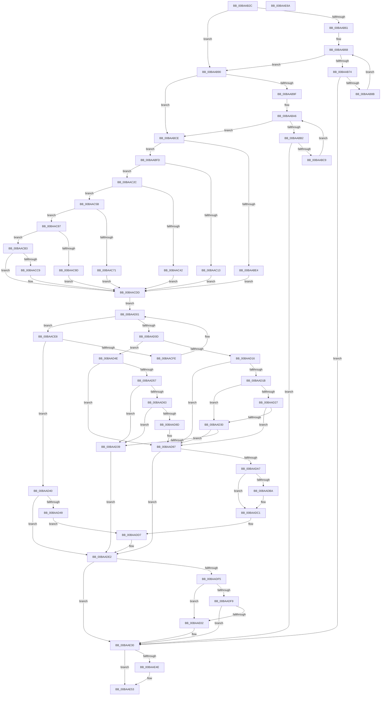

# VfSuspectDriversLoadCallback

- RVA: `0x00BAAB2C`–`0x00BAAE6B` (길이 `831` bytes)
- VA: `0x0000000140BAAB2C`
- 실행 섹션: `PAGEVRFY`
- PDB 이름 있음: `예`; PDB Function 태그: `아니요`
- unwind 정보 RVA: `0x0008DF5C`
- 디코드: `215`개 명령, `831/831` bytes 표시
- 미해석 바이트: `0` (있으면 어셈블리에 `.byte`로 보존)

> 이 문서는 커널 이미지의 기계어와 PDB 기호를 분석해 생성했습니다. 4번과 5번은 함수 원형과 자료형을 바이너리 사용 방식에서 추정한 C 해석이며 원본 소스 복구 결과는 아닙니다.

## 1. Dependencies

- 직접 호출 지점: **17**; 고유 호출 대상: **9**
- 직접 호출자로 확인된 함수: **1**
- RIP 상대 이미지 참조: **37**

### Outgoing calls
- `0x00BAAB4E` → [VfDriverLock](../B9/VfDriverLock_function_00B9A4A4.md) (function, `0x00B9A4A4`)
- `0x00BAAB7E` → [RtlEqualUnicodeString](../../page/93/RtlEqualUnicodeString_function_00932A20.md) (function, `0x00932A20`)
- `0x00BAABBC` → [RtlEqualUnicodeString](../../page/93/RtlEqualUnicodeString_function_00932A20.md) (function, `0x00932A20`)
- `0x00BAABDB` → [RtlEqualUnicodeString](../../page/93/RtlEqualUnicodeString_function_00932A20.md) (function, `0x00932A20`)
- `0x00BAAC0A` → [RtlEqualUnicodeString](../../page/93/RtlEqualUnicodeString_function_00932A20.md) (function, `0x00932A20`)
- `0x00BAAC39` → [RtlEqualUnicodeString](../../page/93/RtlEqualUnicodeString_function_00932A20.md) (function, `0x00932A20`)
- `0x00BAAC68` → [RtlEqualUnicodeString](../../page/93/RtlEqualUnicodeString_function_00932A20.md) (function, `0x00932A20`)
- `0x00BAAC94` → [RtlEqualUnicodeString](../../page/93/RtlEqualUnicodeString_function_00932A20.md) (function, `0x00932A20`)
- `0x00BAACC0` → [RtlEqualUnicodeString](../../page/93/RtlEqualUnicodeString_function_00932A20.md) (function, `0x00932A20`)
- `0x00BAACF2` → [RtlEqualUnicodeString](../../page/93/RtlEqualUnicodeString_function_00932A20.md) (function, `0x00932A20`)
- `0x00BAAD9A` → [VfSuspectDriversAllocateEntry](VfSuspectDriversAllocateEntry_function_00BAA690.md) (function, `0x00BAA690`)
- `0x00BAADDD` → [VfTargetDriversAllocateFullName](../B9/VfTargetDriversAllocateFullName_function_00B9B224.md) (function, `0x00B9B224`)
- `0x00BAADEB` → [VfTargetDriversAdd](../../text/3E/VfTargetDriversAdd_function_003EE2F4.md) (function, `0x003EE2F4`)
- `0x00BAAE05` → [VfThunkApplyThunksCurrentSession](VfThunkApplyThunksCurrentSession_function_00BA719C.md) (function, `0x00BA719C`)
- `0x00BAAE12` → [VfUtilPrintCheckinString](../B9/VfUtilPrintCheckinString_function_00B934D4.md) (function, `0x00B934D4`)
- `0x00BAAE2B` → [CarLoadImageHandler](../../text/61/CarLoadImageHandler_function_00618128.md) (function, `0x00618128`)
- `0x00BAAE44` → [KeReleaseMutex](../../text/39/KeReleaseMutex_function_00396810.md) (function, `0x00396810`)

### Direct callers
- [VfDriverLoadImage](../BB/VfDriverLoadImage_function_00BB7DE4.md) at `0x00BB7E44`

### Static image references
- `0x00BAAB53` → RVA `0x00F04980` (`.data`; read)
- `0x00BAAB61` → RVA `0x00F04940` (`.data`; read)
- `0x00BAAB90` → RVA `0x00E0E950` (`.data`; read)
- `0x00BAAB9F` → RVA `0x00F048C0` (`.data`; read)
- `0x00BAABD1` → RVA `0x00B8B098` (`VfTcpIpName`; read)
- `0x00BAABE8` → RVA `0x00FFDB48` (`PAGEVRFD`; write)
- `0x00BAABF2` → RVA `0x00FFDB6C` (`PAGEVRFD`; write)
- `0x00BAAC00` → RVA `0x00B8B058` (`VfTdxName`; read)
- `0x00BAAC17` → RVA `0x00FFDB40` (`PAGEVRFD`; write)
- `0x00BAAC21` → RVA `0x00FFDB70` (`PAGEVRFD`; write)
- `0x00BAAC2F` → RVA `0x00B8B068` (`VfMrxsmbName`; read)
- `0x00BAAC46` → RVA `0x00FFDB30` (`PAGEVRFD`; write)
- `0x00BAAC50` → RVA `0x00FFDB64` (`PAGEVRFD`; write)
- `0x00BAAC5E` → RVA `0x00B8B048` (`VfTmName`; read)
- `0x00BAAC75` → RVA `0x00FFDB28` (`PAGEVRFD`; write)
- `0x00BAAC7F` → RVA `0x00FFDB60` (`PAGEVRFD`; write)
- `0x00BAAC8A` → RVA `0x00B8B088` (`VfWin32kName`; read)
- `0x00BAACA1` → RVA `0x00FFDAC0` (`PAGEVRFD`; write)
- `0x00BAACAB` → RVA `0x00FFDAEC` (`PAGEVRFD`; write)
- `0x00BAACB6` → RVA `0x00B8B078` (`VfKsName`; read)
- `0x00BAACCD` → RVA `0x00FFDB38` (`PAGEVRFD`; write)
- `0x00BAACD7` → RVA `0x00FFDB68` (`PAGEVRFD`; write)
- `0x00BAACDD` → RVA `0x00F049E0` (`.data`; read)
- `0x00BAAD0D` → RVA `0x00F04ABC` (`.data`; read)
- `0x00BAAD27` → RVA `0x00F04A04` (`.data`; read)
- `0x00BAAD30` → RVA `0x00F044F8` (`.data`; read)
- `0x00BAAD57` → RVA `0x00FFDA08` (`PAGEVRFD`; read)
- `0x00BAAD63` → RVA `0x00FF400C` (`PAGEVRFD`; read)
- `0x00BAAD71` → RVA `0x00FF400C` (`PAGEVRFD`; write)
- `0x00BAAD79` → RVA `0x00FFDBF8` (`PAGEVRFD`; read)
- `0x00BAAD90` → RVA `0x00FFDA08` (`PAGEVRFD`; write)
- `0x00BAADA7` → RVA `0x00F049E8` (`.data`; read)
- `0x00BAADD0` → RVA `0x00F049E8` (`.data`; write)
- `0x00BAAE17` → RVA `0x00F04A54` (`.data`; read)
- `0x00BAAE1F` → RVA `0x00F04A54` (`.data`; write)
- `0x00BAAE32` → RVA `0x00F04938` (`.data`; write)
- `0x00BAAE3D` → RVA `0x00F04900` (`.data`; read)

## 2. Other-region calls and transfers

- 다른 실행 섹션으로 향하는 call: **12**
  - `0x00BAAB7E` → [RtlEqualUnicodeString](../../page/93/RtlEqualUnicodeString_function_00932A20.md) (`PAGEVRFY` → `PAGE`)
  - `0x00BAABBC` → [RtlEqualUnicodeString](../../page/93/RtlEqualUnicodeString_function_00932A20.md) (`PAGEVRFY` → `PAGE`)
  - `0x00BAABDB` → [RtlEqualUnicodeString](../../page/93/RtlEqualUnicodeString_function_00932A20.md) (`PAGEVRFY` → `PAGE`)
  - `0x00BAAC0A` → [RtlEqualUnicodeString](../../page/93/RtlEqualUnicodeString_function_00932A20.md) (`PAGEVRFY` → `PAGE`)
  - `0x00BAAC39` → [RtlEqualUnicodeString](../../page/93/RtlEqualUnicodeString_function_00932A20.md) (`PAGEVRFY` → `PAGE`)
  - `0x00BAAC68` → [RtlEqualUnicodeString](../../page/93/RtlEqualUnicodeString_function_00932A20.md) (`PAGEVRFY` → `PAGE`)
  - `0x00BAAC94` → [RtlEqualUnicodeString](../../page/93/RtlEqualUnicodeString_function_00932A20.md) (`PAGEVRFY` → `PAGE`)
  - `0x00BAACC0` → [RtlEqualUnicodeString](../../page/93/RtlEqualUnicodeString_function_00932A20.md) (`PAGEVRFY` → `PAGE`)
  - `0x00BAACF2` → [RtlEqualUnicodeString](../../page/93/RtlEqualUnicodeString_function_00932A20.md) (`PAGEVRFY` → `PAGE`)
  - `0x00BAADEB` → [VfTargetDriversAdd](../../text/3E/VfTargetDriversAdd_function_003EE2F4.md) (`PAGEVRFY` → `.text`)
  - `0x00BAAE2B` → [CarLoadImageHandler](../../text/61/CarLoadImageHandler_function_00618128.md) (`PAGEVRFY` → `.text`)
  - `0x00BAAE44` → [KeReleaseMutex](../../text/39/KeReleaseMutex_function_00396810.md) (`PAGEVRFY` → `.text`)
- 별도 외부 분기/꼬리 이동을 확인하지 못했습니다.

## 3. Assembly (complete function range)

```asm
00BAAB2C  48 89 5C 24 08                  mov qword ptr [rsp + 8], rbx
00BAAB31  48 89 6C 24 10                  mov qword ptr [rsp + 0x10], rbp
00BAAB36  56                              push rsi
00BAAB37  57                              push rdi
00BAAB38  41 54                           push r12
00BAAB3A  41 56                           push r14
00BAAB3C  41 57                           push r15
00BAAB3E  48 83 EC 20                     sub rsp, 0x20
00BAAB42  45 8B F0                        mov r14d, r8d
00BAAB45  44 8A E2                        mov r12b, dl
00BAAB48  48 8B F9                        mov rdi, rcx
00BAAB4B  45 33 FF                        xor r15d, r15d
00BAAB4E  E8 51 F9 FE FF                  call 0x140b9a4a4
00BAAB53  8B 05 27 9E 35 00               mov eax, dword ptr [rip + 0x359e27]
00BAAB59  48 8D 6F 58                     lea rbp, [rdi + 0x58]
00BAAB5D  A8 01                           test al, 1
00BAAB5F  74 2F                           je 0x140baab90
00BAAB61  48 8B 1D D8 9D 35 00            mov rbx, qword ptr [rip + 0x359dd8]
00BAAB68  48 8D 05 D1 9D 35 00            lea rax, [rip + 0x359dd1]
00BAAB6F  48 3B D8                        cmp rbx, rax
00BAAB72  74 1C                           je 0x140baab90
00BAAB74  48 8D 4B 10                     lea rcx, [rbx + 0x10]
00BAAB78  41 B0 01                        mov r8b, 1
00BAAB7B  48 8B D5                        mov rdx, rbp
00BAAB7E  E8 9D 7E D8 FF                  call 0x140932a20
00BAAB83  84 C0                           test al, al
00BAAB85  0F 85 A5 02 00 00               jne 0x140baae30
00BAAB8B  48 8B 1B                        mov rbx, qword ptr [rbx]
00BAAB8E  EB D8                           jmp 0x140baab68
00BAAB90  F7 05 B6 3D 26 00 00 80 EF 00   test dword ptr [rip + 0x263db6], 0xef8000
00BAAB9A  48 8B DD                        mov rbx, rbp
00BAAB9D  74 2F                           je 0x140baabce
00BAAB9F  48 8B 35 1A 9D 35 00            mov rsi, qword ptr [rip + 0x359d1a]
00BAABA6  48 8D 05 13 9D 35 00            lea rax, [rip + 0x359d13]
00BAABAD  48 3B F0                        cmp rsi, rax
00BAABB0  74 1C                           je 0x140baabce
00BAABB2  48 8D 4E 10                     lea rcx, [rsi + 0x10]
00BAABB6  41 B0 01                        mov r8b, 1
00BAABB9  48 8B D5                        mov rdx, rbp
00BAABBC  E8 5F 7E D8 FF                  call 0x140932a20
00BAABC1  84 C0                           test al, al
00BAABC3  0F 85 67 02 00 00               jne 0x140baae30
00BAABC9  48 8B 36                        mov rsi, qword ptr [rsi]
00BAABCC  EB D8                           jmp 0x140baaba6
00BAABCE  41 B0 01                        mov r8b, 1
00BAABD1  48 8D 0D C0 04 FE FF            lea rcx, [rip - 0x1fb40]
00BAABD8  48 8B D3                        mov rdx, rbx
00BAABDB  E8 40 7E D8 FF                  call 0x140932a20
00BAABE0  3C 01                           cmp al, 1
00BAABE2  75 19                           jne 0x140baabfd
00BAABE4  48 8B 47 30                     mov rax, qword ptr [rdi + 0x30]
00BAABE8  48 89 05 59 2F 45 00            mov qword ptr [rip + 0x452f59], rax
00BAABEF  8B 47 40                        mov eax, dword ptr [rdi + 0x40]
00BAABF2  89 05 74 2F 45 00               mov dword ptr [rip + 0x452f74], eax
00BAABF8  E9 E0 00 00 00                  jmp 0x140baacdd
00BAABFD  41 B0 01                        mov r8b, 1
00BAAC00  48 8D 0D 51 04 FE FF            lea rcx, [rip - 0x1fbaf]
00BAAC07  48 8B D3                        mov rdx, rbx
00BAAC0A  E8 11 7E D8 FF                  call 0x140932a20
00BAAC0F  3C 01                           cmp al, 1
00BAAC11  75 19                           jne 0x140baac2c
00BAAC13  48 8B 47 30                     mov rax, qword ptr [rdi + 0x30]
00BAAC17  48 89 05 22 2F 45 00            mov qword ptr [rip + 0x452f22], rax
00BAAC1E  8B 47 40                        mov eax, dword ptr [rdi + 0x40]
00BAAC21  89 05 49 2F 45 00               mov dword ptr [rip + 0x452f49], eax
00BAAC27  E9 B1 00 00 00                  jmp 0x140baacdd
00BAAC2C  41 B0 01                        mov r8b, 1
00BAAC2F  48 8D 0D 32 04 FE FF            lea rcx, [rip - 0x1fbce]
00BAAC36  48 8B D3                        mov rdx, rbx
00BAAC39  E8 E2 7D D8 FF                  call 0x140932a20
00BAAC3E  3C 01                           cmp al, 1
00BAAC40  75 19                           jne 0x140baac5b
00BAAC42  48 8B 47 30                     mov rax, qword ptr [rdi + 0x30]
00BAAC46  48 89 05 E3 2E 45 00            mov qword ptr [rip + 0x452ee3], rax
00BAAC4D  8B 47 40                        mov eax, dword ptr [rdi + 0x40]
00BAAC50  89 05 0E 2F 45 00               mov dword ptr [rip + 0x452f0e], eax
00BAAC56  E9 82 00 00 00                  jmp 0x140baacdd
00BAAC5B  41 B0 01                        mov r8b, 1
00BAAC5E  48 8D 0D E3 03 FE FF            lea rcx, [rip - 0x1fc1d]
00BAAC65  48 8B D3                        mov rdx, rbx
00BAAC68  E8 B3 7D D8 FF                  call 0x140932a20
00BAAC6D  3C 01                           cmp al, 1
00BAAC6F  75 16                           jne 0x140baac87
00BAAC71  48 8B 47 30                     mov rax, qword ptr [rdi + 0x30]
00BAAC75  48 89 05 AC 2E 45 00            mov qword ptr [rip + 0x452eac], rax
00BAAC7C  8B 47 40                        mov eax, dword ptr [rdi + 0x40]
00BAAC7F  89 05 DB 2E 45 00               mov dword ptr [rip + 0x452edb], eax
00BAAC85  EB 56                           jmp 0x140baacdd
00BAAC87  41 B0 01                        mov r8b, 1
00BAAC8A  48 8D 0D F7 03 FE FF            lea rcx, [rip - 0x1fc09]
00BAAC91  48 8B D3                        mov rdx, rbx
00BAAC94  E8 87 7D D8 FF                  call 0x140932a20
00BAAC99  3C 01                           cmp al, 1
00BAAC9B  75 16                           jne 0x140baacb3
00BAAC9D  48 8B 47 30                     mov rax, qword ptr [rdi + 0x30]
00BAACA1  48 89 05 18 2E 45 00            mov qword ptr [rip + 0x452e18], rax
00BAACA8  8B 47 40                        mov eax, dword ptr [rdi + 0x40]
00BAACAB  89 05 3B 2E 45 00               mov dword ptr [rip + 0x452e3b], eax
00BAACB1  EB 2A                           jmp 0x140baacdd
00BAACB3  41 B0 01                        mov r8b, 1
00BAACB6  48 8D 0D BB 03 FE FF            lea rcx, [rip - 0x1fc45]
00BAACBD  48 8B D3                        mov rdx, rbx
00BAACC0  E8 5B 7D D8 FF                  call 0x140932a20
00BAACC5  3C 01                           cmp al, 1
00BAACC7  75 14                           jne 0x140baacdd
00BAACC9  48 8B 47 30                     mov rax, qword ptr [rdi + 0x30]
00BAACCD  48 89 05 64 2E 45 00            mov qword ptr [rip + 0x452e64], rax
00BAACD4  8B 47 40                        mov eax, dword ptr [rdi + 0x40]
00BAACD7  89 05 8B 2E 45 00               mov dword ptr [rip + 0x452e8b], eax
00BAACDD  48 8B 1D FC 9C 35 00            mov rbx, qword ptr [rip + 0x359cfc]
00BAACE4  33 F6                           xor esi, esi
00BAACE6  EB 19                           jmp 0x140baad01
00BAACE8  48 8D 4B 28                     lea rcx, [rbx + 0x28]
00BAACEC  41 B0 01                        mov r8b, 1
00BAACEF  48 8B D5                        mov rdx, rbp
00BAACF2  E8 29 7D D8 FF                  call 0x140932a20
00BAACF7  0F B6 F0                        movzx esi, al
00BAACFA  84 C0                           test al, al
00BAACFC  75 42                           jne 0x140baad40
00BAACFE  48 8B 1B                        mov rbx, qword ptr [rbx]
00BAAD01  48 8D 05 D8 9C 35 00            lea rax, [rip + 0x359cd8]
00BAAD08  48 3B D8                        cmp rbx, rax
00BAAD0B  75 DB                           jne 0x140baace8
00BAAD0D  44 39 3D A8 9D 35 00            cmp dword ptr [rip + 0x359da8], r15d
00BAAD14  74 38                           je 0x140baad4e
00BAAD16  45 85 F6                        test r14d, r14d
00BAAD19  75 7C                           jne 0x140baad97
00BAAD1B  F7 05 5B 9C 35 00 00 20 00 00   test dword ptr [rip + 0x359c5b], 0x2000
00BAAD25  74 09                           je 0x140baad30
00BAAD27  83 3D D6 9C 35 00 01            cmp dword ptr [rip + 0x359cd6], 1
00BAAD2E  74 67                           je 0x140baad97
00BAAD30  44 39 3D C1 97 35 00            cmp dword ptr [rip + 0x3597c1], r15d
00BAAD37  75 5E                           jne 0x140baad97
00BAAD39  33 DB                           xor ebx, ebx
00BAAD3B  E9 A2 00 00 00                  jmp 0x140baade2
00BAAD40  48 85 DB                        test rbx, rbx
00BAAD43  0F 84 99 00 00 00               je 0x140baade2
00BAAD49  E9 89 00 00 00                  jmp 0x140baadd7
00BAAD4E  83 3D AF 9C 35 00 01            cmp dword ptr [rip + 0x359caf], 1
00BAAD55  74 40                           je 0x140baad97
00BAAD57  44 8B 05 AA 2C 45 00            mov r8d, dword ptr [rip + 0x452caa]
00BAAD5E  45 85 C0                        test r8d, r8d
00BAAD61  74 D6                           je 0x140baad39
00BAAD63  8B 05 A3 92 44 00               mov eax, dword ptr [rip + 0x4492a3]
00BAAD69  FF C0                           inc eax
00BAAD6B  8B D0                           mov edx, eax
00BAAD6D  48 C1 EA 03                     shr rdx, 3
00BAAD71  89 05 95 92 44 00               mov dword ptr [rip + 0x449295], eax
00BAAD77  8B C8                           mov ecx, eax
00BAAD79  48 8B 05 78 2E 45 00            mov rax, qword ptr [rip + 0x452e78]
00BAAD80  80 E1 07                        and cl, 7
00BAAD83  8A 14 02                        mov dl, byte ptr [rdx + rax]
00BAAD86  D2 FA                           sar dl, cl
00BAAD88  F6 C2 01                        test dl, 1
00BAAD8B  74 AC                           je 0x140baad39
00BAAD8D  41 FF C8                        dec r8d
00BAAD90  44 89 05 71 2C 45 00            mov dword ptr [rip + 0x452c71], r8d
00BAAD97  48 8B CD                        mov rcx, rbp
00BAAD9A  E8 F1 F8 FF FF                  call 0x140baa690
00BAAD9F  48 8B D8                        mov rbx, rax
00BAADA2  48 85 C0                        test rax, rax
00BAADA5  74 3B                           je 0x140baade2
00BAADA7  48 8B 05 3A 9C 35 00            mov rax, qword ptr [rip + 0x359c3a]
00BAADAE  48 8D 0D 2B 9C 35 00            lea rcx, [rip + 0x359c2b]
00BAADB5  48 39 08                        cmp qword ptr [rax], rcx
00BAADB8  74 07                           je 0x140baadc1
00BAADBA  B9 03 00 00 00                  mov ecx, 3
00BAADBF  CD 29                           int 0x29
00BAADC1  48 89 0B                        mov qword ptr [rbx], rcx
00BAADC4  BE 01 00 00 00                  mov esi, 1
00BAADC9  48 89 43 08                     mov qword ptr [rbx + 8], rax
00BAADCD  48 89 18                        mov qword ptr [rax], rbx
00BAADD0  48 89 1D 11 9C 35 00            mov qword ptr [rip + 0x359c11], rbx
00BAADD7  48 8B D7                        mov rdx, rdi
00BAADDA  48 8B CB                        mov rcx, rbx
00BAADDD  E8 42 04 FF FF                  call 0x140b9b224
00BAADE2  4C 8B C3                        mov r8, rbx
00BAADE5  41 8A D4                        mov dl, r12b
00BAADE8  48 8B CF                        mov rcx, rdi
00BAADEB  E8 04 35 84 FF                  call 0x1403ee2f4
00BAADF0  48 85 DB                        test rbx, rbx
00BAADF3  74 3B                           je 0x140baae30
00BAADF5  85 F6                           test esi, esi
00BAADF7  75 09                           jne 0x140baae02
00BAADF9  44 39 3D BC 9C 35 00            cmp dword ptr [rip + 0x359cbc], r15d
00BAAE00  74 2E                           je 0x140baae30
00BAAE02  48 8B CF                        mov rcx, rdi
00BAAE05  E8 92 C3 FF FF                  call 0x140ba719c
00BAAE0A  33 D2                           xor edx, edx
00BAAE0C  48 8B CD                        mov rcx, rbp
00BAAE0F  44 8B F8                        mov r15d, eax
00BAAE12  E8 BD 86 FE FF                  call 0x140b934d4
00BAAE17  8B 0D 37 9C 35 00               mov ecx, dword ptr [rip + 0x359c37]
00BAAE1D  FF C1                           inc ecx
00BAAE1F  89 0D 2F 9C 35 00               mov dword ptr [rip + 0x359c2f], ecx
00BAAE25  48 8B CF                        mov rcx, rdi
00BAAE28  FF 43 10                        inc dword ptr [rbx + 0x10]
00BAAE2B  E8 F8 D2 A6 FF                  call 0x140618128
00BAAE30  33 D2                           xor edx, edx
00BAAE32  48 C7 05 FB 9A 35 00 00 00 00 00  mov qword ptr [rip + 0x359afb], 0
00BAAE3D  48 8D 0D BC 9A 35 00            lea rcx, [rip + 0x359abc]
00BAAE44  E8 C7 B9 7E FF                  call 0x140396810
00BAAE49  45 85 FF                        test r15d, r15d
00BAAE4C  74 05                           je 0x140baae53
00BAAE4E  0F BA 6F 68 19                  bts dword ptr [rdi + 0x68], 0x19
00BAAE53  48 8B 5C 24 50                  mov rbx, qword ptr [rsp + 0x50]
00BAAE58  48 8B 6C 24 58                  mov rbp, qword ptr [rsp + 0x58]
00BAAE5D  48 83 C4 20                     add rsp, 0x20
00BAAE61  41 5F                           pop r15
00BAAE63  41 5E                           pop r14
00BAAE65  41 5C                           pop r12
00BAAE67  5F                              pop rdi
00BAAE68  5E                              pop rsi
00BAAE69  C3                              ret
00BAAE6A  CC                              int3
```

## 4. C-style interpretation (structured pseudocode)

```c
__int64 __fastcall VfSuspectDriversLoadCallback(__int64 a1, unsigned __int8 a2, int a3)
{
    __int64 result;
    __int64 v_r15;
    __int64 v_rbx;
    __int64 v_rsi;
    __int64 v_rsp;
    unsigned __int64 v_stack_p10;
    unsigned __int64 v_stack_p8;

    v_stack_p8 = v_rbx;
    v_stack_p10 = v_rbp;
    v_rsp = (v_rsp) - (32);
    v_r15 = 0;
    result = VfDriverLock(a1, a2, a3, a4);
    if ((((unsigned __int8)((unsigned int)(*(unsigned int *)(v_rip + 3513895)))) & (1)) == 0) goto loc_00BAAB90;
loc_00BAAB68:
    if ((*(unsigned __int64 *)(v_rip + 3513816)) == (v_rip + 3513809)) goto loc_00BAAB90;
    result = RtlEqualUnicodeString(*(unsigned __int64 *)(v_rip + 3513816) + 16, a1 + 88, 1, a4);
    if ((unsigned __int8)(result) != 0) goto loc_00BAAE30;
    goto loc_00BAAB68;
loc_00BAAB90:
    if (((*(unsigned int *)(v_rip + 2506166)) & (0xEF8000ULL)) == 0) goto loc_00BAABCE;
loc_00BAABA6:
    if ((*(unsigned __int64 *)(v_rip + 3513626)) == (v_rip + 3513619)) goto loc_00BAABCE;
    result = RtlEqualUnicodeString(*(unsigned __int64 *)(v_rip + 3513626) + 16, a1 + 88, 1, a4);
    if ((unsigned __int8)(result) != 0) goto loc_00BAAE30;
    goto loc_00BAABA6;
loc_00BAABCE:
    result = RtlEqualUnicodeString(v_rip - 129856, a1 + 88, 1, a4);
    if (((unsigned __int8)(result)) != 1) goto loc_00BAABFD;
    *(unsigned __int64 *)(v_rip + 4534105) = *(unsigned __int64 *)(a1 + 48);
    *(unsigned int *)(v_rip + 4534132) = (unsigned int)((unsigned int)(*(unsigned int *)(a1 + 64)));
    goto loc_00BAACDD;
loc_00BAABFD:
    result = RtlEqualUnicodeString(v_rip - 129967, a1 + 88, 1, a4);
    if (((unsigned __int8)(result)) != 1) goto loc_00BAAC2C;
    *(unsigned __int64 *)(v_rip + 4534050) = *(unsigned __int64 *)(a1 + 48);
    *(unsigned int *)(v_rip + 4534089) = (unsigned int)((unsigned int)(*(unsigned int *)(a1 + 64)));
    goto loc_00BAACDD;
loc_00BAAC2C:
    result = RtlEqualUnicodeString(v_rip - 129998, a1 + 88, 1, a4);
    if (((unsigned __int8)(result)) != 1) goto loc_00BAAC5B;
    *(unsigned __int64 *)(v_rip + 4533987) = *(unsigned __int64 *)(a1 + 48);
    *(unsigned int *)(v_rip + 4534030) = (unsigned int)((unsigned int)(*(unsigned int *)(a1 + 64)));
    goto loc_00BAACDD;
loc_00BAAC5B:
    result = RtlEqualUnicodeString(v_rip - 130077, a1 + 88, 1, a4);
    if (((unsigned __int8)(result)) != 1) goto loc_00BAAC87;
    *(unsigned __int64 *)(v_rip + 4533932) = *(unsigned __int64 *)(a1 + 48);
    *(unsigned int *)(v_rip + 4533979) = (unsigned int)((unsigned int)(*(unsigned int *)(a1 + 64)));
    goto loc_00BAACDD;
loc_00BAAC87:
    result = RtlEqualUnicodeString(v_rip - 130057, a1 + 88, 1, a4);
    if (((unsigned __int8)(result)) != 1) goto loc_00BAACB3;
    *(unsigned __int64 *)(v_rip + 4533784) = *(unsigned __int64 *)(a1 + 48);
    *(unsigned int *)(v_rip + 4533819) = (unsigned int)((unsigned int)(*(unsigned int *)(a1 + 64)));
    goto loc_00BAACDD;
loc_00BAACB3:
    result = RtlEqualUnicodeString(v_rip - 130117, a1 + 88, 1, a4);
    if (((unsigned __int8)(result)) == 1) {
        result = *(unsigned __int64 *)(a1 + 48);
        *(unsigned __int64 *)(v_rip + 4533860) = result;
        result = *(unsigned int *)(a1 + 64);
        *(unsigned int *)(v_rip + 4533899) = (unsigned int)(result);
    }
    v_rsi = 0;
    goto loc_00BAAD01;
loc_00BAACE8:
    result = RtlEqualUnicodeString(*(unsigned __int64 *)(v_rip + 3513596) + 40, a1 + 88, 1, a4);
    if ((unsigned __int8)(result) != 0) goto loc_00BAAD40;
loc_00BAAD01:
    if ((*(unsigned __int64 *)(*(unsigned __int64 *)(v_rip + 3513596))) != (v_rip + 3513560)) goto loc_00BAACE8;
    if ((*(unsigned int *)(v_rip + 3513768)) == 0) goto loc_00BAAD4E;
    if ((unsigned int)((unsigned int)(a3)) != 0) goto loc_00BAAD97;
    if (((*(unsigned int *)(v_rip + 3513435)) & (0x2000ULL)) == 0) goto loc_00BAAD30;
    if ((*(unsigned int *)(v_rip + 3513558)) == 1) goto loc_00BAAD97;
loc_00BAAD30:
    if ((*(unsigned int *)(v_rip + 3512257)) != 0) goto loc_00BAAD97;
loc_00BAAD39:
    v_rbx = 0;
    goto loc_00BAADE2;
loc_00BAAD40:
    if (0 == 0) goto loc_00BAADE2;
    goto loc_00BAADD7;
loc_00BAAD4E:
    if ((*(unsigned int *)(v_rip + 3513519)) == 1) goto loc_00BAAD97;
    if ((unsigned int)((unsigned int)(*(unsigned int *)(v_rip + 4533418))) == 0) goto loc_00BAAD39;
    result = (unsigned int)(((unsigned int)(*(unsigned int *)(v_rip + 4493987))) + 1);
    a2 = ((unsigned int)((unsigned int)(result))) >> (3);
    *(unsigned int *)(v_rip + 4493973) = (unsigned int)(result);
    a1 = (unsigned __int8)(((unsigned int)((unsigned int)(result))) & (7));
    a2 = (unsigned __int8)((*(unsigned __int8 *)(a2 + *(unsigned __int64 *)(v_rip + 4533880) * 1)) >> ((unsigned __int8)(a1)));
    if (((a2) & (1)) == 0) goto loc_00BAAD39;
    a3 = (unsigned int)(((unsigned int)(*(unsigned int *)(v_rip + 4533418))) - 1);
    *(unsigned int *)(v_rip + 4533361) = a3;
loc_00BAAD97:
    result = VfSuspectDriversAllocateEntry(a1 + 88, a2, a3, a4);
    if (result == 0) goto loc_00BAADE2;
    if ((*(unsigned __int64 *)(*(unsigned __int64 *)(v_rip + 3513402))) != (v_rip + 3513387)) {
        a1 = 3;
    }
    *(unsigned __int64 *)(result) = a1;
    *(unsigned __int64 *)(result + 8) = *(unsigned __int64 *)(v_rip + 3513402);
    *(unsigned __int64 *)(*(unsigned __int64 *)(v_rip + 3513402)) = result;
    *(unsigned __int64 *)(v_rip + 3513361) = result;
loc_00BAADD7:
    result = VfTargetDriversAllocateFullName(result, a1, a3, a4);
loc_00BAADE2:
    result = VfTargetDriversAdd(a1, a2, result, a4);
    if (result == 0) goto loc_00BAAE30;
    if (1 != 0) goto loc_00BAAE02;
    if ((*(unsigned int *)(v_rip + 3513532)) != 0) {
        a1 = a1;
        result = VfThunkApplyThunksCurrentSession(a1, a2, result, a4);
        a2 = 0;
        a1 = a1 + 88;
        v_r15 = (unsigned int)(result);
        result = VfUtilPrintCheckinString(a1, a2, result, a4);
        a1 = *(unsigned int *)(v_rip + 3513399);
        a1 = (unsigned int)((a1) + 1);
        *(unsigned int *)(v_rip + 3513391) = (unsigned int)(a1);
        a1 = a1;
        result = CarLoadImageHandler(a1, a2, result, a4);
    }
    a2 = 0;
    *(unsigned __int64 *)(v_rip + 3513083) = 0;
    result = KeReleaseMutex(v_rip + 3513020, a2, result, a4);
    if ((unsigned int)(v_r15) != 0) {
    }
    v_rsp = (v_rsp) + (32);
    return result;
}
```

## 5. (Beta) C Style

```c
int64_t VfSuspectDriversLoadCallback(void *Arg1, uint8_t Arg2, int32_t Arg3)
{
    uint8_t *arg1 = (uint8_t *)Arg1;

    int64_t result;
    int64_t local_r15;
    int64_t local_rbx;
    int64_t local_rsi;
    int64_t local_rsp;
    uint64_t v_stack_p10;
    uint64_t v_stack_p8;

    v_stack_p8 = local_rbx;
    v_stack_p10 = local_rbp;
    local_rsp = (local_rsp) - (32);
    local_r15 = 0;
    result = VfDriverLock(Arg1, Arg2, Arg3, a4);
    if ((((uint8_t)((uint32_t)(*(uint32_t *)(v_rip + 0x359E27)))) & (1)) == 0) goto loc_00BAAB90;
loc_00BAAB68:
    if ((*(uint64_t *)(v_rip + 0x359DD8)) == (v_rip + 3513809)) goto loc_00BAAB90;
    result = RtlEqualUnicodeString(*(uint64_t *)(v_rip + 0x359DD8) + 16, Arg1 + 88, 1, a4);
    if ((uint8_t)(result) != 0) goto loc_00BAAE30;
    goto loc_00BAAB68;
loc_00BAAB90:
    if (((*(uint32_t *)(v_rip + 0x263DB6)) & (0xEF8000ULL)) == 0) goto loc_00BAABCE;
loc_00BAABA6:
    if ((*(uint64_t *)(v_rip + 0x359D1A)) == (v_rip + 3513619)) goto loc_00BAABCE;
    result = RtlEqualUnicodeString(*(uint64_t *)(v_rip + 0x359D1A) + 16, Arg1 + 88, 1, a4);
    if ((uint8_t)(result) != 0) goto loc_00BAAE30;
    goto loc_00BAABA6;
loc_00BAABCE:
    result = RtlEqualUnicodeString(v_rip - 129856, Arg1 + 88, 1, a4);
    if (((uint8_t)(result)) != 1) goto loc_00BAABFD;
    *(uint64_t *)(v_rip + 0x452F59) = *(uint64_t *)(arg1 + 0x30);
    *(uint32_t *)(v_rip + 0x452F74) = (uint32_t)((uint32_t)(*(uint32_t *)(arg1 + 0x40)));
    goto loc_00BAACDD;
loc_00BAABFD:
    result = RtlEqualUnicodeString(v_rip - 129967, Arg1 + 88, 1, a4);
    if (((uint8_t)(result)) != 1) goto loc_00BAAC2C;
    *(uint64_t *)(v_rip + 0x452F22) = *(uint64_t *)(arg1 + 0x30);
    *(uint32_t *)(v_rip + 0x452F49) = (uint32_t)((uint32_t)(*(uint32_t *)(arg1 + 0x40)));
    goto loc_00BAACDD;
loc_00BAAC2C:
    result = RtlEqualUnicodeString(v_rip - 129998, Arg1 + 88, 1, a4);
    if (((uint8_t)(result)) != 1) goto loc_00BAAC5B;
    *(uint64_t *)(v_rip + 0x452EE3) = *(uint64_t *)(arg1 + 0x30);
    *(uint32_t *)(v_rip + 0x452F0E) = (uint32_t)((uint32_t)(*(uint32_t *)(arg1 + 0x40)));
    goto loc_00BAACDD;
loc_00BAAC5B:
    result = RtlEqualUnicodeString(v_rip - 130077, Arg1 + 88, 1, a4);
    if (((uint8_t)(result)) != 1) goto loc_00BAAC87;
    *(uint64_t *)(v_rip + 0x452EAC) = *(uint64_t *)(arg1 + 0x30);
    *(uint32_t *)(v_rip + 0x452EDB) = (uint32_t)((uint32_t)(*(uint32_t *)(arg1 + 0x40)));
    goto loc_00BAACDD;
loc_00BAAC87:
    result = RtlEqualUnicodeString(v_rip - 130057, Arg1 + 88, 1, a4);
    if (((uint8_t)(result)) != 1) goto loc_00BAACB3;
    *(uint64_t *)(v_rip + 0x452E18) = *(uint64_t *)(arg1 + 0x30);
    *(uint32_t *)(v_rip + 0x452E3B) = (uint32_t)((uint32_t)(*(uint32_t *)(arg1 + 0x40)));
    goto loc_00BAACDD;
loc_00BAACB3:
    result = RtlEqualUnicodeString(v_rip - 130117, Arg1 + 88, 1, a4);
    if (((uint8_t)(result)) == 1) {
        result = *(uint64_t *)(arg1 + 0x30);
        *(uint64_t *)(v_rip + 0x452E64) = result;
        result = *(uint32_t *)(arg1 + 0x40);
        *(uint32_t *)(v_rip + 0x452E8B) = (uint32_t)(result);
    }
    local_rsi = 0;
    goto loc_00BAAD01;
loc_00BAACE8:
    result = RtlEqualUnicodeString(*(uint64_t *)(v_rip + 0x359CFC) + 40, Arg1 + 88, 1, a4);
    if ((uint8_t)(result) != 0) goto loc_00BAAD40;
loc_00BAAD01:
    if ((*(uint64_t *)(*(uint64_t *)(v_rip + 0x359CFC))) != (v_rip + 3513560)) goto loc_00BAACE8;
    if ((*(uint32_t *)(v_rip + 0x359DA8)) == 0) goto loc_00BAAD4E;
    if ((uint32_t)((uint32_t)(Arg3)) != 0) goto loc_00BAAD97;
    if (((*(uint32_t *)(v_rip + 0x359C5B)) & (0x2000ULL)) == 0) goto loc_00BAAD30;
    if ((*(uint32_t *)(v_rip + 0x359CD6)) == 1) goto loc_00BAAD97;
loc_00BAAD30:
    if ((*(uint32_t *)(v_rip + 0x3597C1)) != 0) goto loc_00BAAD97;
loc_00BAAD39:
    local_rbx = 0;
    goto loc_00BAADE2;
loc_00BAAD40:
    if (0 == 0) goto loc_00BAADE2;
    goto loc_00BAADD7;
loc_00BAAD4E:
    if ((*(uint32_t *)(v_rip + 0x359CAF)) == 1) goto loc_00BAAD97;
    if ((uint32_t)((uint32_t)(*(uint32_t *)(v_rip + 0x452CAA))) == 0) goto loc_00BAAD39;
    result = (uint32_t)(((uint32_t)(*(uint32_t *)(v_rip + 0x4492A3))) + 1);
    Arg2 = ((uint32_t)((uint32_t)(result))) >> (3);
    *(uint32_t *)(v_rip + 0x449295) = (uint32_t)(result);
    Arg1 = (uint8_t)(((uint32_t)((uint32_t)(result))) & (7));
    Arg2 = (uint8_t)((*(uint8_t *)(Arg2 + *(uint64_t *)(v_rip + 0x452E78) * 1)) >> ((uint8_t)(Arg1)));
    if (((Arg2) & (1)) == 0) goto loc_00BAAD39;
    Arg3 = (uint32_t)(((uint32_t)(*(uint32_t *)(v_rip + 0x452CAA))) - 1);
    *(uint32_t *)(v_rip + 0x452C71) = Arg3;
loc_00BAAD97:
    result = VfSuspectDriversAllocateEntry(Arg1 + 88, Arg2, Arg3, a4);
    if (result == 0) goto loc_00BAADE2;
    if ((*(uint64_t *)(*(uint64_t *)(v_rip + 0x359C3A))) != (v_rip + 3513387)) {
        Arg1 = 3;
    }
    *(void **)(result) = Arg1;
    *(uint64_t *)(result + 0x8) = *(uint64_t *)(v_rip + 0x359C3A);
    *(uint64_t *)(*(uint64_t *)(v_rip + 0x359C3A)) = result;
    *(uint64_t *)(v_rip + 0x359C11) = result;
loc_00BAADD7:
    result = VfTargetDriversAllocateFullName(result, Arg1, Arg3, a4);
loc_00BAADE2:
    result = VfTargetDriversAdd(Arg1, Arg2, result, a4);
    if (result == 0) goto loc_00BAAE30;
    if (1 != 0) goto loc_00BAAE02;
    if ((*(uint32_t *)(v_rip + 0x359CBC)) != 0) {
        Arg1 = Arg1;
        result = VfThunkApplyThunksCurrentSession(Arg1, Arg2, result, a4);
        Arg2 = 0;
        Arg1 = Arg1 + 88;
        local_r15 = (uint32_t)(result);
        result = VfUtilPrintCheckinString(Arg1, Arg2, result, a4);
        Arg1 = *(uint32_t *)(v_rip + 0x359C37);
        Arg1 = (uint32_t)((Arg1) + 1);
        *(uint32_t *)(v_rip + 0x359C2F) = (uint32_t)(Arg1);
        Arg1 = Arg1;
        result = CarLoadImageHandler(Arg1, Arg2, result, a4);
    }
    Arg2 = 0;
    *(uint64_t *)(v_rip + 0x359AFB) = 0;
    result = KeReleaseMutex(v_rip + 3513020, Arg2, result, a4);
    if ((uint32_t)(local_r15) != 0) {
    }
    local_rsp = (local_rsp) + (32);
    return result;
}
```

### 관측된 메모리 오프셋

구조체 형식이 확인되지 않은 접근은 인자 기준의 오프셋으로만 기록했습니다.

| 기준 인자 | 오프셋 표현 | 폭 (bit) | 접근 |
|---|---:|---:|---|
| `Arg1` | `+ 0x30` | `64` | `R` |
| `Arg1` | `+ 0x40` | `32` | `R` |
| `Arg1` | `+ 0x58` | `64` | `R` |
| `Arg1` | `+ 0x68` | `32` | `R/W` |

## 6. Execution-region graph

[열기: 2D/3D 그래프와 함수 탐색 컨트롤 패널](../../../control-panel.html?section=pagevrfy&rva=0x00BAAB2C&view=graph)

- 2D 그래프는 위에서 아래로 흐르고, 3D 그래프는 빈 공간을 드래그해 회전합니다. Shift+드래그는 이동, 휠은 확대·축소, 함수 노드 선택은 대상 보고서 이동입니다.

### Static fallback


