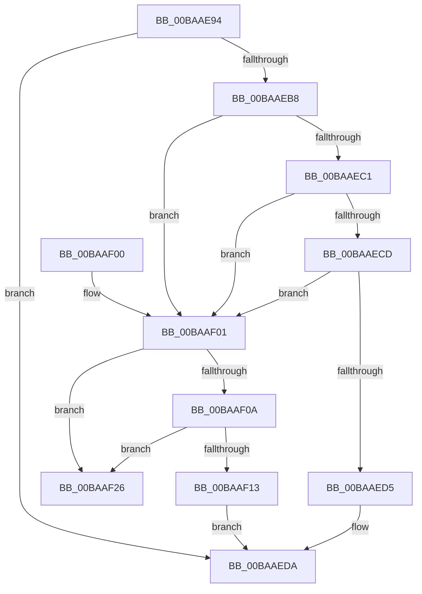

# VfSuspectDriversRemove

- RVA: `0x00BAAE94`–`0x00BAAF2D` (길이 `153` bytes)
- VA: `0x0000000140BAAE94`
- 실행 섹션: `PAGEVRFY`
- PDB 이름 있음: `예`; PDB Function 태그: `아니요`
- unwind 정보 RVA: `0x000B7B78`
- 디코드: `42`개 명령, `153/153` bytes 표시
- 미해석 바이트: `0` (있으면 어셈블리에 `.byte`로 보존)

> 이 문서는 커널 이미지의 기계어와 PDB 기호를 분석해 생성했습니다. 4번과 5번은 함수 원형과 자료형을 바이너리 사용 방식에서 추정한 C 해석이며 원본 소스 복구 결과는 아닙니다.

## 1. Dependencies

- 직접 호출 지점: **4**; 고유 호출 대상: **4**
- 직접 호출자로 확인된 함수: **1**
- RIP 상대 이미지 참조: **4**

### Outgoing calls
- `0x00BAAEA3` → [VfDriverLock](../B9/VfDriverLock_function_00B9A4A4.md) (function, `0x00B9A4A4`)
- `0x00BAAEAB` → [ViSuspectDriversLookupEntry](ViSuspectDriversLookupEntry_function_00BAB194.md) (function, `0x00BAB194`)
- `0x00BAAEEE` → [KeReleaseMutex](../../text/39/KeReleaseMutex_function_00396810.md) (function, `0x00396810`)
- `0x00BAAF1F` → [ExFreePoolWithTag](../../poolcode/B8/ExFreePoolWithTag_function_00B82870.md) (function, `0x00B82870`)

### Direct callers
- [VfRemoveVerifierEntry](VfRemoveVerifierEntry_function_00BAC4C4.md) at `0x00BAC4D9`

### Static image references
- `0x00BAAEB8` → RVA `0x00F048B8` (`.data`; read)
- `0x00BAAEC1` → RVA `0x00F04980` (`.data`; read)
- `0x00BAAEDC` → RVA `0x00F04938` (`.data`; write)
- `0x00BAAEE7` → RVA `0x00F04900` (`.data`; read)

## 2. Other-region calls and transfers

- 다른 실행 섹션으로 향하는 call: **2**
  - `0x00BAAEEE` → [KeReleaseMutex](../../text/39/KeReleaseMutex_function_00396810.md) (`PAGEVRFY` → `.text`)
  - `0x00BAAF1F` → [ExFreePoolWithTag](../../poolcode/B8/ExFreePoolWithTag_function_00B82870.md) (`PAGEVRFY` → `POOLCODE`)
- 별도 외부 분기/꼬리 이동을 확인하지 못했습니다.

## 3. Assembly (complete function range)

```asm
00BAAE94  48 89 5C 24 08                  mov qword ptr [rsp + 8], rbx
00BAAE99  57                              push rdi
00BAAE9A  48 83 EC 20                     sub rsp, 0x20
00BAAE9E  48 8B D9                        mov rbx, rcx
00BAAEA1  33 FF                           xor edi, edi
00BAAEA3  E8 FC F5 FE FF                  call 0x140b9a4a4
00BAAEA8  48 8B CB                        mov rcx, rbx
00BAAEAB  E8 E4 02 00 00                  call 0x140bab194
00BAAEB0  48 8B C8                        mov rcx, rax
00BAAEB3  48 85 C0                        test rax, rax
00BAAEB6  74 22                           je 0x140baaeda
00BAAEB8  40 38 3D F9 99 35 00            cmp byte ptr [rip + 0x3599f9], dil
00BAAEBF  75 40                           jne 0x140baaf01
00BAAEC1  F7 05 B5 9A 35 00 00 08 00 00   test dword ptr [rip + 0x359ab5], 0x800
00BAAECB  75 34                           jne 0x140baaf01
00BAAECD  8B 40 14                        mov eax, dword ptr [rax + 0x14]
00BAAED0  39 41 10                        cmp dword ptr [rcx + 0x10], eax
00BAAED3  74 2C                           je 0x140baaf01
00BAAED5  BF 0E 01 00 C0                  mov edi, 0xc000010e
00BAAEDA  33 D2                           xor edx, edx
00BAAEDC  48 C7 05 51 9A 35 00 00 00 00 00  mov qword ptr [rip + 0x359a51], 0
00BAAEE7  48 8D 0D 12 9A 35 00            lea rcx, [rip + 0x359a12]
00BAAEEE  E8 1D B9 7E FF                  call 0x140396810
00BAAEF3  48 8B 5C 24 30                  mov rbx, qword ptr [rsp + 0x30]
00BAAEF8  8B C7                           mov eax, edi
00BAAEFA  48 83 C4 20                     add rsp, 0x20
00BAAEFE  5F                              pop rdi
00BAAEFF  C3                              ret
00BAAF00  CC                              int3
00BAAF01  48 8B 11                        mov rdx, qword ptr [rcx]
00BAAF04  48 39 4A 08                     cmp qword ptr [rdx + 8], rcx
00BAAF08  75 1C                           jne 0x140baaf26
00BAAF0A  48 8B 41 08                     mov rax, qword ptr [rcx + 8]
00BAAF0E  48 39 08                        cmp qword ptr [rax], rcx
00BAAF11  75 13                           jne 0x140baaf26
00BAAF13  48 89 10                        mov qword ptr [rax], rdx
00BAAF16  48 89 42 08                     mov qword ptr [rdx + 8], rax
00BAAF1A  BA 56 66 53 44                  mov edx, 0x44536656
00BAAF1F  E8 4C 79 FD FF                  call 0x140b82870
00BAAF24  EB B4                           jmp 0x140baaeda
00BAAF26  B9 03 00 00 00                  mov ecx, 3
00BAAF2B  CD 29                           int 0x29
```

## 4. C-style interpretation (structured pseudocode)

```c
__int64 __fastcall VfSuspectDriversRemove(__int64 a1, int a2)
{
    __int64 result;
    __int64 v_rdi;
    __int64 v_rsp;
    unsigned __int64 v_stack_p8;

    v_stack_p8 = v_rbx;
    v_rsp = (v_rsp) - (32);
    v_rdi = 0;
    result = VfDriverLock(a1, a2, a3, a4);
    result = ViSuspectDriversLookupEntry(a1, a2, a3, a4);
    if (result == 0) goto loc_00BAAEDA;
    if ((*(unsigned __int8 *)(v_rip + 3512825)) != 0) goto loc_00BAAF01;
    if (((*(unsigned int *)(v_rip + 3513013)) & (0x800ULL)) != 0) goto loc_00BAAF01;
    if ((*(unsigned int *)(result + 16)) == ((unsigned int)((unsigned int)(*(unsigned int *)(result + 20))))) goto loc_00BAAF01;
loc_00BAAEDA:
    a2 = 0;
    *(unsigned __int64 *)(v_rip + 3512913) = 0;
    result = KeReleaseMutex(v_rip + 3512850, a2, a3, a4);
    v_rsp = (v_rsp) + (32);
    return (unsigned int)((unsigned int)((unsigned int)(0xC000010EULL)));
loc_00BAAF01:
    if ((*(unsigned __int64 *)(*(unsigned __int64 *)(v_rip + 3512850) + 8)) != (v_rip + 3512850)) goto loc_00BAAF26;
    if ((*(unsigned __int64 *)(*(unsigned __int64 *)(v_rip + 3512850 + 8))) != (v_rip + 3512850)) goto loc_00BAAF26;
    *(unsigned __int64 *)(*(unsigned __int64 *)(v_rip + 3512850 + 8)) = *(unsigned __int64 *)(v_rip + 3512850);
    *(unsigned __int64 *)(*(unsigned __int64 *)(v_rip + 3512850) + 8) = *(unsigned __int64 *)(v_rip + 3512850 + 8);
    result = ExFreePoolWithTag(v_rip + 3512850, (unsigned int)(0x44536656ULL), a3, a4);
    goto loc_00BAAEDA;
loc_00BAAF26:
    return result;
}
```

## 5. (Beta) C Style

```c
int64_t VfSuspectDriversRemove(int64_t Arg1, int32_t Arg2)
{
    int64_t result;
    int64_t local_rdi;
    int64_t local_rsp;
    uint64_t v_stack_p8;

    v_stack_p8 = local_rbx;
    local_rsp = (local_rsp) - (32);
    local_rdi = 0;
    result = VfDriverLock(Arg1, Arg2, a3, a4);
    result = ViSuspectDriversLookupEntry(Arg1, Arg2, a3, a4);
    if (result == 0) goto loc_00BAAEDA;
    if ((*(uint8_t *)(v_rip + 0x3599F9)) != 0) goto loc_00BAAF01;
    if (((*(uint32_t *)(v_rip + 0x359AB5)) & (0x800ULL)) != 0) goto loc_00BAAF01;
    if ((*(uint32_t *)(result + 0x10)) == ((uint32_t)((uint32_t)(*(uint32_t *)(result + 0x14))))) goto loc_00BAAF01;
loc_00BAAEDA:
    Arg2 = 0;
    *(uint64_t *)(v_rip + 0x359A51) = 0;
    result = KeReleaseMutex(v_rip + 3512850, Arg2, a3, a4);
    local_rsp = (local_rsp) + (32);
    return (uint32_t)((uint32_t)((uint32_t)(0xC000010EULL)));
loc_00BAAF01:
    if ((*(uint64_t *)(*(uint64_t *)(v_rip + 0x359A12) + 0x8)) != (v_rip + 3512850)) goto loc_00BAAF26;
    if ((*(uint64_t *)(*(uint64_t *)(v_rip + 0x359A12 + 0x8))) != (v_rip + 3512850)) goto loc_00BAAF26;
    *(uint64_t *)(*(uint64_t *)(v_rip + 0x359A12 + 0x8)) = *(uint64_t *)(v_rip + 0x359A12);
    *(uint64_t *)(*(uint64_t *)(v_rip + 0x359A12) + 0x8) = *(uint64_t *)(v_rip + 0x359A12 + 0x8);
    result = ExFreePoolWithTag(v_rip + 3512850, (uint32_t)(0x44536656ULL), a3, a4);
    goto loc_00BAAEDA;
loc_00BAAF26:
    return result;
}
```

## 6. Execution-region graph

[열기: 2D/3D 그래프와 함수 탐색 컨트롤 패널](../../../control-panel.html?section=pagevrfy&rva=0x00BAAE94&view=graph)

- 2D 그래프는 위에서 아래로 흐르고, 3D 그래프는 빈 공간을 드래그해 회전합니다. Shift+드래그는 이동, 휠은 확대·축소, 함수 노드 선택은 대상 보고서 이동입니다.

### Static fallback


