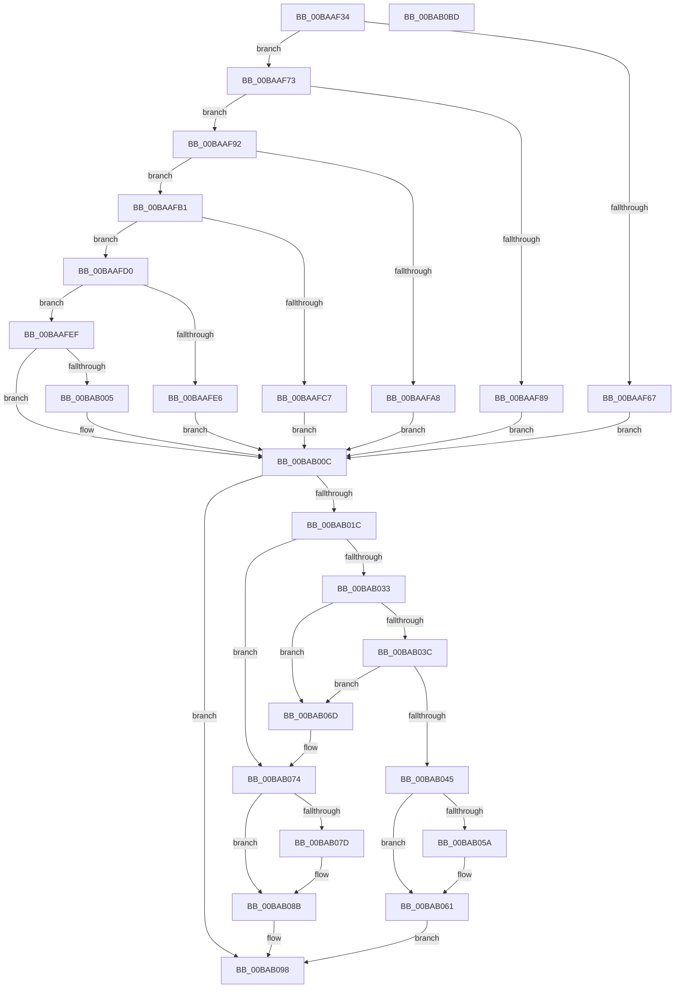

# VfSuspectDriversUnloadCallback

- RVA: `0x00BAAF34`–`0x00BAB0BE` (길이 `394` bytes)
- VA: `0x0000000140BAAF34`
- 실행 섹션: `PAGEVRFY`
- PDB 이름 있음: `예`; PDB Function 태그: `아니요`
- unwind 정보 RVA: `0x00060BC4`
- 디코드: `106`개 명령, `394/394` bytes 표시
- 미해석 바이트: `0` (있으면 어셈블리에 `.byte`로 보존)

> 이 문서는 커널 이미지의 기계어와 PDB 기호를 분석해 생성했습니다. 4번과 5번은 함수 원형과 자료형을 바이너리 사용 방식에서 추정한 C 해석이며 원본 소스 복구 결과는 아닙니다.

## 1. Dependencies

- 직접 호출 지점: **13**; 고유 호출 대상: **6**
- 직접 호출자로 확인된 함수: **1**
- RIP 상대 이미지 참조: **17**

### Outgoing calls
- `0x00BAAF46` → [VfDriverLock](../B9/VfDriverLock_function_00B9A4A4.md) (function, `0x00B9A4A4`)
- `0x00BAAF5C` → [RtlEqualUnicodeString](../../page/93/RtlEqualUnicodeString_function_00932A20.md) (function, `0x00932A20`)
- `0x00BAAF80` → [RtlEqualUnicodeString](../../page/93/RtlEqualUnicodeString_function_00932A20.md) (function, `0x00932A20`)
- `0x00BAAF9F` → [RtlEqualUnicodeString](../../page/93/RtlEqualUnicodeString_function_00932A20.md) (function, `0x00932A20`)
- `0x00BAAFBE` → [RtlEqualUnicodeString](../../page/93/RtlEqualUnicodeString_function_00932A20.md) (function, `0x00932A20`)
- `0x00BAAFDD` → [RtlEqualUnicodeString](../../page/93/RtlEqualUnicodeString_function_00932A20.md) (function, `0x00932A20`)
- `0x00BAAFFC` → [RtlEqualUnicodeString](../../page/93/RtlEqualUnicodeString_function_00932A20.md) (function, `0x00932A20`)
- `0x00BAB00F` → [ViSuspectDriversLookupEntry](ViSuspectDriversLookupEntry_function_00BAB194.md) (function, `0x00BAB194`)
- `0x00BAB05C` → [ExFreePoolWithTag](../../poolcode/B8/ExFreePoolWithTag_function_00B82870.md) (function, `0x00B82870`)
- `0x00BAB066` → [ExFreePoolWithTag](../../poolcode/B8/ExFreePoolWithTag_function_00B82870.md) (function, `0x00B82870`)
- `0x00BAB07F` → [ExFreePoolWithTag](../../poolcode/B8/ExFreePoolWithTag_function_00B82870.md) (function, `0x00B82870`)
- `0x00BAB093` → [VfUtilPrintCheckinString](../B9/VfUtilPrintCheckinString_function_00B934D4.md) (function, `0x00B934D4`)
- `0x00BAB0A8` → [KeReleaseMutex](../../text/39/KeReleaseMutex_function_00396810.md) (function, `0x00396810`)

### Direct callers
- [VfDriverUnloadImage](../B9/VfDriverUnloadImage_function_00B9A5B0.md) at `0x00B9A5FC`

### Static image references
- `0x00BAAF4F` → RVA `0x00B8B098` (`VfTcpIpName`; read)
- `0x00BAAF67` → RVA `0x00FFDB48` (`PAGEVRFD`; write)
- `0x00BAAF76` → RVA `0x00B8B058` (`VfTdxName`; read)
- `0x00BAAF89` → RVA `0x00FFDB40` (`PAGEVRFD`; write)
- `0x00BAAF95` → RVA `0x00B8B068` (`VfMrxsmbName`; read)
- `0x00BAAFA8` → RVA `0x00FFDB30` (`PAGEVRFD`; write)
- `0x00BAAFB4` → RVA `0x00B8B048` (`VfTmName`; read)
- `0x00BAAFC7` → RVA `0x00FFDB28` (`PAGEVRFD`; write)
- `0x00BAAFD3` → RVA `0x00B8B088` (`VfWin32kName`; read)
- `0x00BAAFE6` → RVA `0x00FFDAC0` (`PAGEVRFD`; write)
- `0x00BAAFF2` → RVA `0x00B8B078` (`VfKsName`; read)
- `0x00BAB005` → RVA `0x00FFDB38` (`PAGEVRFD`; write)
- `0x00BAB01C` → RVA `0x00F04A58` (`.data`; read)
- `0x00BAB024` → RVA `0x00F048B8` (`.data`; read)
- `0x00BAB02B` → RVA `0x00F04A58` (`.data`; write)
- `0x00BAB09A` → RVA `0x00F04938` (`.data`; write)
- `0x00BAB0A1` → RVA `0x00F04900` (`.data`; read)

## 2. Other-region calls and transfers

- 다른 실행 섹션으로 향하는 call: **10**
  - `0x00BAAF5C` → [RtlEqualUnicodeString](../../page/93/RtlEqualUnicodeString_function_00932A20.md) (`PAGEVRFY` → `PAGE`)
  - `0x00BAAF80` → [RtlEqualUnicodeString](../../page/93/RtlEqualUnicodeString_function_00932A20.md) (`PAGEVRFY` → `PAGE`)
  - `0x00BAAF9F` → [RtlEqualUnicodeString](../../page/93/RtlEqualUnicodeString_function_00932A20.md) (`PAGEVRFY` → `PAGE`)
  - `0x00BAAFBE` → [RtlEqualUnicodeString](../../page/93/RtlEqualUnicodeString_function_00932A20.md) (`PAGEVRFY` → `PAGE`)
  - `0x00BAAFDD` → [RtlEqualUnicodeString](../../page/93/RtlEqualUnicodeString_function_00932A20.md) (`PAGEVRFY` → `PAGE`)
  - `0x00BAAFFC` → [RtlEqualUnicodeString](../../page/93/RtlEqualUnicodeString_function_00932A20.md) (`PAGEVRFY` → `PAGE`)
  - `0x00BAB05C` → [ExFreePoolWithTag](../../poolcode/B8/ExFreePoolWithTag_function_00B82870.md) (`PAGEVRFY` → `POOLCODE`)
  - `0x00BAB066` → [ExFreePoolWithTag](../../poolcode/B8/ExFreePoolWithTag_function_00B82870.md) (`PAGEVRFY` → `POOLCODE`)
  - `0x00BAB07F` → [ExFreePoolWithTag](../../poolcode/B8/ExFreePoolWithTag_function_00B82870.md) (`PAGEVRFY` → `POOLCODE`)
  - `0x00BAB0A8` → [KeReleaseMutex](../../text/39/KeReleaseMutex_function_00396810.md) (`PAGEVRFY` → `.text`)
- 별도 외부 분기/꼬리 이동을 확인하지 못했습니다.

## 3. Assembly (complete function range)

```asm
00BAAF34  48 89 5C 24 08                  mov qword ptr [rsp + 8], rbx
00BAAF39  48 89 74 24 10                  mov qword ptr [rsp + 0x10], rsi
00BAAF3E  57                              push rdi
00BAAF3F  48 83 EC 20                     sub rsp, 0x20
00BAAF43  48 8B F9                        mov rdi, rcx
00BAAF46  E8 59 F5 FE FF                  call 0x140b9a4a4
00BAAF4B  48 83 C7 58                     add rdi, 0x58
00BAAF4F  48 8D 0D 42 01 FE FF            lea rcx, [rip - 0x1febe]
00BAAF56  48 8B D7                        mov rdx, rdi
00BAAF59  41 B0 01                        mov r8b, 1
00BAAF5C  E8 BF 7A D8 FF                  call 0x140932a20
00BAAF61  33 F6                           xor esi, esi
00BAAF63  3C 01                           cmp al, 1
00BAAF65  75 0C                           jne 0x140baaf73
00BAAF67  48 89 35 DA 2B 45 00            mov qword ptr [rip + 0x452bda], rsi
00BAAF6E  E9 99 00 00 00                  jmp 0x140bab00c
00BAAF73  41 B0 01                        mov r8b, 1
00BAAF76  48 8D 0D DB 00 FE FF            lea rcx, [rip - 0x1ff25]
00BAAF7D  48 8B D7                        mov rdx, rdi
00BAAF80  E8 9B 7A D8 FF                  call 0x140932a20
00BAAF85  3C 01                           cmp al, 1
00BAAF87  75 09                           jne 0x140baaf92
00BAAF89  48 89 35 B0 2B 45 00            mov qword ptr [rip + 0x452bb0], rsi
00BAAF90  EB 7A                           jmp 0x140bab00c
00BAAF92  41 B0 01                        mov r8b, 1
00BAAF95  48 8D 0D CC 00 FE FF            lea rcx, [rip - 0x1ff34]
00BAAF9C  48 8B D7                        mov rdx, rdi
00BAAF9F  E8 7C 7A D8 FF                  call 0x140932a20
00BAAFA4  3C 01                           cmp al, 1
00BAAFA6  75 09                           jne 0x140baafb1
00BAAFA8  48 89 35 81 2B 45 00            mov qword ptr [rip + 0x452b81], rsi
00BAAFAF  EB 5B                           jmp 0x140bab00c
00BAAFB1  41 B0 01                        mov r8b, 1
00BAAFB4  48 8D 0D 8D 00 FE FF            lea rcx, [rip - 0x1ff73]
00BAAFBB  48 8B D7                        mov rdx, rdi
00BAAFBE  E8 5D 7A D8 FF                  call 0x140932a20
00BAAFC3  3C 01                           cmp al, 1
00BAAFC5  75 09                           jne 0x140baafd0
00BAAFC7  48 89 35 5A 2B 45 00            mov qword ptr [rip + 0x452b5a], rsi
00BAAFCE  EB 3C                           jmp 0x140bab00c
00BAAFD0  41 B0 01                        mov r8b, 1
00BAAFD3  48 8D 0D AE 00 FE FF            lea rcx, [rip - 0x1ff52]
00BAAFDA  48 8B D7                        mov rdx, rdi
00BAAFDD  E8 3E 7A D8 FF                  call 0x140932a20
00BAAFE2  3C 01                           cmp al, 1
00BAAFE4  75 09                           jne 0x140baafef
00BAAFE6  48 89 35 D3 2A 45 00            mov qword ptr [rip + 0x452ad3], rsi
00BAAFED  EB 1D                           jmp 0x140bab00c
00BAAFEF  41 B0 01                        mov r8b, 1
00BAAFF2  48 8D 0D 7F 00 FE FF            lea rcx, [rip - 0x1ff81]
00BAAFF9  48 8B D7                        mov rdx, rdi
00BAAFFC  E8 1F 7A D8 FF                  call 0x140932a20
00BAB001  3C 01                           cmp al, 1
00BAB003  75 07                           jne 0x140bab00c
00BAB005  48 89 35 2C 2B 45 00            mov qword ptr [rip + 0x452b2c], rsi
00BAB00C  48 8B CF                        mov rcx, rdi
00BAB00F  E8 80 01 00 00                  call 0x140bab194
00BAB014  48 8B D8                        mov rbx, rax
00BAB017  48 85 C0                        test rax, rax
00BAB01A  74 7C                           je 0x140bab098
00BAB01C  8B 0D 36 9A 35 00               mov ecx, dword ptr [rip + 0x359a36]
00BAB022  FF C1                           inc ecx
00BAB024  40 38 35 8D 98 35 00            cmp byte ptr [rip + 0x35988d], sil
00BAB02B  89 0D 27 9A 35 00               mov dword ptr [rip + 0x359a27], ecx
00BAB031  74 41                           je 0x140bab074
00BAB033  48 8B 08                        mov rcx, qword ptr [rax]
00BAB036  48 39 41 08                     cmp qword ptr [rcx + 8], rax
00BAB03A  75 31                           jne 0x140bab06d
00BAB03C  48 8B 40 08                     mov rax, qword ptr [rax + 8]
00BAB040  48 39 18                        cmp qword ptr [rax], rbx
00BAB043  75 28                           jne 0x140bab06d
00BAB045  48 89 08                        mov qword ptr [rax], rcx
00BAB048  BF 56 66 53 44                  mov edi, 0x44536656
00BAB04D  48 89 41 08                     mov qword ptr [rcx + 8], rax
00BAB051  48 8B 4B 20                     mov rcx, qword ptr [rbx + 0x20]
00BAB055  48 85 C9                        test rcx, rcx
00BAB058  74 07                           je 0x140bab061
00BAB05A  8B D7                           mov edx, edi
00BAB05C  E8 0F 78 FD FF                  call 0x140b82870
00BAB061  8B D7                           mov edx, edi
00BAB063  48 8B CB                        mov rcx, rbx
00BAB066  E8 05 78 FD FF                  call 0x140b82870
00BAB06B  EB 2B                           jmp 0x140bab098
00BAB06D  B9 03 00 00 00                  mov ecx, 3
00BAB072  CD 29                           int 0x29
00BAB074  48 8B 48 20                     mov rcx, qword ptr [rax + 0x20]
00BAB078  48 85 C9                        test rcx, rcx
00BAB07B  74 0E                           je 0x140bab08b
00BAB07D  33 D2                           xor edx, edx
00BAB07F  E8 EC 77 FD FF                  call 0x140b82870
00BAB084  48 89 73 20                     mov qword ptr [rbx + 0x20], rsi
00BAB088  89 73 18                        mov dword ptr [rbx + 0x18], esi
00BAB08B  FF 43 14                        inc dword ptr [rbx + 0x14]
00BAB08E  B2 01                           mov dl, 1
00BAB090  48 8B CF                        mov rcx, rdi
00BAB093  E8 3C 84 FE FF                  call 0x140b934d4
00BAB098  33 D2                           xor edx, edx
00BAB09A  48 89 35 97 98 35 00            mov qword ptr [rip + 0x359897], rsi
00BAB0A1  48 8D 0D 58 98 35 00            lea rcx, [rip + 0x359858]
00BAB0A8  E8 63 B7 7E FF                  call 0x140396810
00BAB0AD  48 8B 5C 24 30                  mov rbx, qword ptr [rsp + 0x30]
00BAB0B2  48 8B 74 24 38                  mov rsi, qword ptr [rsp + 0x38]
00BAB0B7  48 83 C4 20                     add rsp, 0x20
00BAB0BB  5F                              pop rdi
00BAB0BC  C3                              ret
00BAB0BD  CC                              int3
```

## 4. C-style interpretation (structured pseudocode)

```c
__int64 __fastcall VfSuspectDriversUnloadCallback(__int64 a1)
{
    __int64 result;
    __int64 v_rdi;
    __int64 v_rsi;
    __int64 v_rsp;
    unsigned __int64 v_stack_p10;
    unsigned __int64 v_stack_p8;

    v_stack_p8 = v_rbx;
    v_stack_p10 = v_rsi;
    v_rsp = (v_rsp) - (32);
    result = VfDriverLock(a1, a2, a3, a4);
    v_rdi = (a1) + (88);
    result = RtlEqualUnicodeString(v_rip - 130750, v_rdi, 1, a4);
    v_rsi = 0;
    if (((unsigned __int8)(result)) != 1) goto loc_00BAAF73;
    *(unsigned __int64 *)(v_rip + 4533210) = 0;
    goto loc_00BAB00C;
loc_00BAAF73:
    result = RtlEqualUnicodeString(v_rip - 130853, v_rdi, 1, a4);
    if (((unsigned __int8)(result)) != 1) goto loc_00BAAF92;
    *(unsigned __int64 *)(v_rip + 4533168) = 0;
    goto loc_00BAB00C;
loc_00BAAF92:
    result = RtlEqualUnicodeString(v_rip - 130868, v_rdi, 1, a4);
    if (((unsigned __int8)(result)) != 1) goto loc_00BAAFB1;
    *(unsigned __int64 *)(v_rip + 4533121) = 0;
    goto loc_00BAB00C;
loc_00BAAFB1:
    result = RtlEqualUnicodeString(v_rip - 130931, v_rdi, 1, a4);
    if (((unsigned __int8)(result)) != 1) goto loc_00BAAFD0;
    *(unsigned __int64 *)(v_rip + 4533082) = 0;
    goto loc_00BAB00C;
loc_00BAAFD0:
    result = RtlEqualUnicodeString(v_rip - 130898, v_rdi, 1, a4);
    if (((unsigned __int8)(result)) != 1) goto loc_00BAAFEF;
    *(unsigned __int64 *)(v_rip + 4532947) = 0;
    goto loc_00BAB00C;
loc_00BAAFEF:
    result = RtlEqualUnicodeString(v_rip - 130945, v_rdi, 1, a4);
    if (((unsigned __int8)(result)) == 1) {
        *(unsigned __int64 *)(v_rip + 4533036) = 0;
    }
    result = ViSuspectDriversLookupEntry(v_rdi, v_rdi, 1, a4);
    if (result == 0) goto loc_00BAB098;
    a1 = (unsigned int)(((unsigned int)(*(unsigned int *)(v_rip + 3512886))) + 1);
    *(unsigned int *)(v_rip + 3512871) = (unsigned int)(a1);
    if ((*(unsigned __int8 *)(v_rip + 3512461)) == 0) goto loc_00BAB074;
    if ((*(unsigned __int64 *)(*(unsigned __int64 *)(result) + 8)) != result) goto loc_00BAB06D;
    if ((*(unsigned __int64 *)(*(unsigned __int64 *)(result + 8))) != result) goto loc_00BAB06D;
    *(unsigned __int64 *)(*(unsigned __int64 *)(result + 8)) = *(unsigned __int64 *)(result);
    *(unsigned __int64 *)(*(unsigned __int64 *)(result) + 8) = *(unsigned __int64 *)(result + 8);
    result = *(unsigned __int64 *)(result + 8);
    if (*(unsigned __int64 *)(result + 32) != 0) {
        a2 = (unsigned int)((unsigned int)(0x44536656ULL));
        result = ExFreePoolWithTag(*(unsigned __int64 *)(result + 32), a2, 1, a4);
    }
    result = ExFreePoolWithTag(result, (unsigned int)((unsigned int)((unsigned int)(0x44536656ULL))), 1, a4);
    goto loc_00BAB098;
loc_00BAB06D:
loc_00BAB074:
    if (*(unsigned __int64 *)(result + 32) != 0) {
        a2 = 0;
        result = ExFreePoolWithTag(*(unsigned __int64 *)(result + 32), a2, 1, a4);
        *(unsigned __int64 *)(result + 32) = 0;
        *(unsigned int *)(result + 24) = 0;
    }
    result = VfUtilPrintCheckinString((unsigned int)(0x44536656ULL), 1, 1, a4);
loc_00BAB098:
    a2 = 0;
    *(unsigned __int64 *)(v_rip + 3512471) = 0;
    result = KeReleaseMutex(v_rip + 3512408, a2, 1, a4);
    v_rsp = (v_rsp) + (32);
    return result;
}
```

## 5. (Beta) C Style

```c
int64_t VfSuspectDriversUnloadCallback(int64_t Arg1)
{
    int64_t result;
    int64_t local_rdi;
    int64_t local_rsi;
    int64_t local_rsp;
    uint64_t v_stack_p10;
    uint64_t v_stack_p8;

    v_stack_p8 = local_rbx;
    v_stack_p10 = local_rsi;
    local_rsp = (local_rsp) - (32);
    result = VfDriverLock(Arg1, a2, a3, a4);
    local_rdi = (Arg1) + (88);
    result = RtlEqualUnicodeString(v_rip - 130750, local_rdi, 1, a4);
    local_rsi = 0;
    if (((uint8_t)(result)) != 1) goto loc_00BAAF73;
    *(uint64_t *)(v_rip + 0x452BDA) = 0;
    goto loc_00BAB00C;
loc_00BAAF73:
    result = RtlEqualUnicodeString(v_rip - 130853, local_rdi, 1, a4);
    if (((uint8_t)(result)) != 1) goto loc_00BAAF92;
    *(uint64_t *)(v_rip + 0x452BB0) = 0;
    goto loc_00BAB00C;
loc_00BAAF92:
    result = RtlEqualUnicodeString(v_rip - 130868, local_rdi, 1, a4);
    if (((uint8_t)(result)) != 1) goto loc_00BAAFB1;
    *(uint64_t *)(v_rip + 0x452B81) = 0;
    goto loc_00BAB00C;
loc_00BAAFB1:
    result = RtlEqualUnicodeString(v_rip - 130931, local_rdi, 1, a4);
    if (((uint8_t)(result)) != 1) goto loc_00BAAFD0;
    *(uint64_t *)(v_rip + 0x452B5A) = 0;
    goto loc_00BAB00C;
loc_00BAAFD0:
    result = RtlEqualUnicodeString(v_rip - 130898, local_rdi, 1, a4);
    if (((uint8_t)(result)) != 1) goto loc_00BAAFEF;
    *(uint64_t *)(v_rip + 0x452AD3) = 0;
    goto loc_00BAB00C;
loc_00BAAFEF:
    result = RtlEqualUnicodeString(v_rip - 130945, local_rdi, 1, a4);
    if (((uint8_t)(result)) == 1) {
        *(uint64_t *)(v_rip + 0x452B2C) = 0;
    }
    result = ViSuspectDriversLookupEntry(local_rdi, local_rdi, 1, a4);
    if (result == 0) goto loc_00BAB098;
    Arg1 = (uint32_t)(((uint32_t)(*(uint32_t *)(v_rip + 0x359A36))) + 1);
    *(uint32_t *)(v_rip + 0x359A27) = (uint32_t)(Arg1);
    if ((*(uint8_t *)(v_rip + 0x35988D)) == 0) goto loc_00BAB074;
    if ((*(uint64_t *)(*(uint64_t *)(result) + 0x8)) != result) goto loc_00BAB06D;
    if ((*(uint64_t *)(*(uint64_t *)(result + 0x8))) != result) goto loc_00BAB06D;
    *(uint64_t *)(*(uint64_t *)(result + 0x8)) = *(uint64_t *)(result);
    *(uint64_t *)(*(uint64_t *)(result) + 0x8) = *(uint64_t *)(result + 0x8);
    result = *(uint64_t *)(result + 0x8);
    if (*(uint64_t *)(result + 0x20) != 0) {
        a2 = (uint32_t)((uint32_t)(0x44536656ULL));
        result = ExFreePoolWithTag(*(uint64_t *)(result + 0x20), a2, 1, a4);
    }
    result = ExFreePoolWithTag(result, (uint32_t)((uint32_t)((uint32_t)(0x44536656ULL))), 1, a4);
    goto loc_00BAB098;
loc_00BAB06D:
loc_00BAB074:
    if (*(uint64_t *)(result + 0x20) != 0) {
        a2 = 0;
        result = ExFreePoolWithTag(*(uint64_t *)(result + 0x20), a2, 1, a4);
        *(uint64_t *)(result + 0x20) = 0;
        *(uint32_t *)(result + 0x18) = 0;
    }
    result = VfUtilPrintCheckinString((uint32_t)(0x44536656ULL), 1, 1, a4);
loc_00BAB098:
    a2 = 0;
    *(uint64_t *)(v_rip + 0x359897) = 0;
    result = KeReleaseMutex(v_rip + 3512408, a2, 1, a4);
    local_rsp = (local_rsp) + (32);
    return result;
}
```

## 6. Execution-region graph

[열기: 2D/3D 그래프와 함수 탐색 컨트롤 패널](../../../control-panel.html?section=pagevrfy&rva=0x00BAAF34&view=graph)

- 2D 그래프는 위에서 아래로 흐르고, 3D 그래프는 빈 공간을 드래그해 회전합니다. Shift+드래그는 이동, 휠은 확대·축소, 함수 노드 선택은 대상 보고서 이동입니다.

### Static fallback


