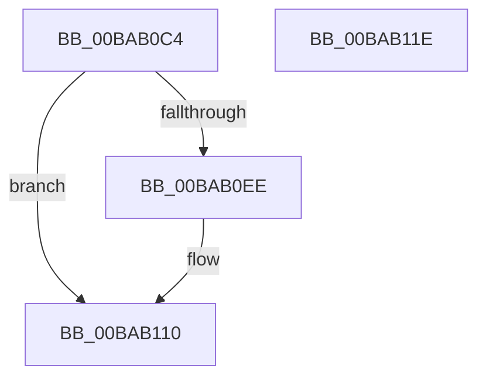

# VfSuspectExcludedDriversAllocateEntry

- RVA: `0x00BAB0C4`–`0x00BAB11F` (길이 `91` bytes)
- VA: `0x0000000140BAB0C4`
- 실행 섹션: `PAGEVRFY`
- PDB 이름 있음: `예`; PDB Function 태그: `아니요`
- unwind 정보 RVA: `0x0005CAAC`
- 디코드: `26`개 명령, `91/91` bytes 표시
- 미해석 바이트: `0` (있으면 어셈블리에 `.byte`로 보존)

> 이 문서는 커널 이미지의 기계어와 PDB 기호를 분석해 생성했습니다. 4번과 5번은 함수 원형과 자료형을 바이너리 사용 방식에서 추정한 C 해석이며 원본 소스 복구 결과는 아닙니다.

## 1. Dependencies

- 직접 호출 지점: **2**; 고유 호출 대상: **2**
- 직접 호출자로 확인된 함수: **2**
- RIP 상대 이미지 참조: **0**

### Outgoing calls
- `0x00BAB0E1` → [ExAllocatePool2](../../poolcode/B8/ExAllocatePool2_function_00B820F0.md) (function, `0x00B820F0`)
- `0x00BAB10B` → [memcpy](../../text/6C/memcpy_function_006C6840.md) (function, `0x006C6840`)

### Direct callers
- [VfSuspectDriversParseRegistryString](../../init/C4/VfSuspectDriversParseRegistryString_function_00C4C820.md) at `0x00C4C95E`
- [VfXdvExcludeParseRegistryString](../../init/C4/VfXdvExcludeParseRegistryString_function_00C4C9CC.md) at `0x00C4CADF`

### Static image references
- 디코드된 RIP-relative 메모리 참조가 없습니다.

## 2. Other-region calls and transfers

- 다른 실행 섹션으로 향하는 call: **2**
  - `0x00BAB0E1` → [ExAllocatePool2](../../poolcode/B8/ExAllocatePool2_function_00B820F0.md) (`PAGEVRFY` → `POOLCODE`)
  - `0x00BAB10B` → [memcpy](../../text/6C/memcpy_function_006C6840.md) (`PAGEVRFY` → `.text`)
- 별도 외부 분기/꼬리 이동을 확인하지 못했습니다.

## 3. Assembly (complete function range)

```asm
00BAB0C4  48 89 5C 24 08                  mov qword ptr [rsp + 8], rbx
00BAB0C9  57                              push rdi
00BAB0CA  48 83 EC 20                     sub rsp, 0x20
00BAB0CE  44 8B C2                        mov r8d, edx
00BAB0D1  48 8B F9                        mov rdi, rcx
00BAB0D4  0F B7 51 02                     movzx edx, word ptr [rcx + 2]
00BAB0D8  B9 40 00 00 00                  mov ecx, 0x40
00BAB0DD  48 83 C2 20                     add rdx, 0x20
00BAB0E1  E8 0A 70 FD FF                  call 0x140b820f0
00BAB0E6  48 8B D8                        mov rbx, rax
00BAB0E9  48 85 C0                        test rax, rax
00BAB0EC  74 22                           je 0x140bab110
00BAB0EE  0F B7 57 02                     movzx edx, word ptr [rdi + 2]
00BAB0F2  48 8D 48 20                     lea rcx, [rax + 0x20]
00BAB0F6  44 0F B7 07                     movzx r8d, word ptr [rdi]
00BAB0FA  66 89 50 12                     mov word ptr [rax + 0x12], dx
00BAB0FE  48 8B 57 08                     mov rdx, qword ptr [rdi + 8]
00BAB102  48 89 48 18                     mov qword ptr [rax + 0x18], rcx
00BAB106  66 44 89 40 10                  mov word ptr [rax + 0x10], r8w
00BAB10B  E8 30 B7 B1 FF                  call 0x1406c6840
00BAB110  48 8B C3                        mov rax, rbx
00BAB113  48 8B 5C 24 30                  mov rbx, qword ptr [rsp + 0x30]
00BAB118  48 83 C4 20                     add rsp, 0x20
00BAB11C  5F                              pop rdi
00BAB11D  C3                              ret
00BAB11E  CC                              int3
```

## 4. C-style interpretation (structured pseudocode)

```c
__int64 __fastcall VfSuspectExcludedDriversAllocateEntry(__int64 a1, int a2)
{
    __int64 result;
    __int64 v_rsp;
    unsigned __int64 v_stack_p8;

    v_stack_p8 = v_rbx;
    v_rsp = (v_rsp) - (32);
    a2 = (*(unsigned __int16 *)(a1 + 2)) + (32);
    result = ExAllocatePool2(64, a2, (unsigned int)(a2), a4);
    if (result != 0) {
        a2 = *(unsigned __int16 *)(a1 + 2);
        a1 = result + 32;
        a3 = *(unsigned __int16 *)(a1);
        *(unsigned __int16 *)(result + 18) = (unsigned __int16)(a2);
        a2 = *(unsigned __int64 *)(a1 + 8);
        *(unsigned __int64 *)(result + 24) = a1;
        *(unsigned __int16 *)(result + 16) = (unsigned __int16)(a3);
        result = memcpy(a1, a2, a3, a4);
    }
    v_rsp = (v_rsp) + (32);
    return result;
}
```

## 5. (Beta) C Style

```c
int64_t VfSuspectExcludedDriversAllocateEntry(void *Arg1, int32_t Arg2)
{
    uint8_t *arg1 = (uint8_t *)Arg1;

    int64_t result;
    int64_t local_rsp;
    uint64_t v_stack_p8;

    v_stack_p8 = local_rbx;
    local_rsp = (local_rsp) - (32);
    Arg2 = (*(uint16_t *)(arg1 + 0x2)) + (32);
    result = ExAllocatePool2(64, Arg2, (uint32_t)(Arg2), a4);
    if (result != 0) {
        Arg2 = *(uint16_t *)(arg1 + 0x2);
        Arg1 = result + 32;
        a3 = *(uint16_t *)(arg1);
        *(uint16_t *)(result + 0x12) = (uint16_t)(Arg2);
        Arg2 = *(uint64_t *)(arg1 + 0x8);
        *(void **)(result + 0x18) = Arg1;
        *(uint16_t *)(result + 0x10) = (uint16_t)(a3);
        result = memcpy(Arg1, Arg2, a3, a4);
    }
    local_rsp = (local_rsp) + (32);
    return result;
}
```

### 관측된 메모리 오프셋

구조체 형식이 확인되지 않은 접근은 인자 기준의 오프셋으로만 기록했습니다.

| 기준 인자 | 오프셋 표현 | 폭 (bit) | 접근 |
|---|---:|---:|---|
| `Arg1` | `+ 0x0` | `16` | `R` |
| `Arg1` | `+ 0x2` | `16` | `R` |
| `Arg1` | `+ 0x8` | `64` | `R` |

## 6. Execution-region graph

[열기: 2D/3D 그래프와 함수 탐색 컨트롤 패널](../../../control-panel.html?section=pagevrfy&rva=0x00BAB0C4&view=graph)

- 2D 그래프는 위에서 아래로 흐르고, 3D 그래프는 빈 공간을 드래그해 회전합니다. Shift+드래그는 이동, 휠은 확대·축소, 함수 노드 선택은 대상 보고서 이동입니다.

### Static fallback


