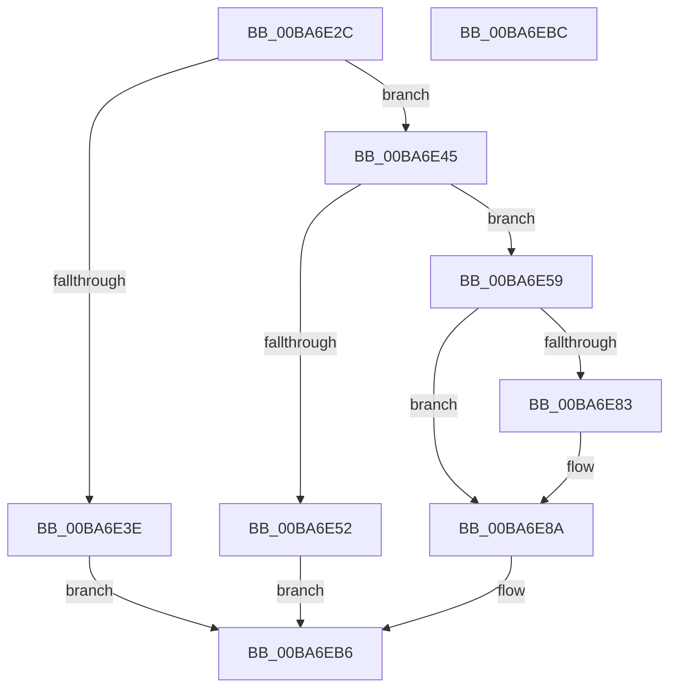

# VfThunkAddDriverThunks

- RVA: `0x00BA6E2C`–`0x00BA6EBD` (길이 `145` bytes)
- VA: `0x0000000140BA6E2C`
- 실행 섹션: `PAGEVRFY`
- PDB 이름 있음: `예`; PDB Function 태그: `아니요`
- unwind 정보 RVA: `0x0005CF00`
- 디코드: `35`개 명령, `145/145` bytes 표시
- 미해석 바이트: `0` (있으면 어셈블리에 `.byte`로 보존)

> 이 문서는 커널 이미지의 기계어와 PDB 기호를 분석해 생성했습니다. 4번과 5번은 함수 원형과 자료형을 바이너리 사용 방식에서 추정한 C 해석이며 원본 소스 복구 결과는 아닙니다.

## 1. Dependencies

- 직접 호출 지점: **3**; 고유 호출 대상: **3**
- 직접 호출자로 확인된 함수: **1**
- RIP 상대 이미지 참조: **8**

### Outgoing calls
- `0x00BA6E45` → [ViThunkCreateThunkTable](ViThunkCreateThunkTable_function_00BA74DC.md) (function, `0x00BA74DC`)
- `0x00BA6E59` → [VfDriverLock](../B9/VfDriverLock_function_00B9A4A4.md) (function, `0x00B9A4A4`)
- `0x00BA6EAF` → [KeReleaseMutex](../../text/39/KeReleaseMutex_function_00396810.md) (function, `0x00396810`)

### Direct callers
- [ViAddVerifierThunks](../../text/61/ViAddVerifierThunks_function_0061245C.md) at `0x00612541`

### Static image references
- `0x00BA6E32` → RVA `0x00E681A0` (`.data`; read)
- `0x00BA6E5E` → RVA `0x00F0488C` (`.data`; write)
- `0x00BA6E6A` → RVA `0x00F04898` (`.data`; read)
- `0x00BA6E71` → RVA `0x00F04890` (`.data`; read)
- `0x00BA6E78` → RVA `0x00F048B0` (`.data`; read/write)
- `0x00BA6E93` → RVA `0x00F04900` (`.data`; read)
- `0x00BA6E9D` → RVA `0x00F04898` (`.data`; write)
- `0x00BA6EA4` → RVA `0x00F04938` (`.data`; write)

## 2. Other-region calls and transfers

- 다른 실행 섹션으로 향하는 call: **1**
  - `0x00BA6EAF` → [KeReleaseMutex](../../text/39/KeReleaseMutex_function_00396810.md) (`PAGEVRFY` → `.text`)
- 별도 외부 분기/꼬리 이동을 확인하지 못했습니다.

## 3. Assembly (complete function range)

```asm
00BA6E2C  40 53                           push rbx
00BA6E2E  48 83 EC 20                     sub rsp, 0x20
00BA6E32  F7 05 64 13 2C 00 00 00 40 00   test dword ptr [rip + 0x2c1364], 0x400000
00BA6E3C  74 07                           je 0x140ba6e45
00BA6E3E  B8 BB 00 00 C0                  mov eax, 0xc00000bb
00BA6E43  EB 71                           jmp 0x140ba6eb6
00BA6E45  E8 92 06 00 00                  call 0x140ba74dc
00BA6E4A  48 8B D8                        mov rbx, rax
00BA6E4D  48 85 C0                        test rax, rax
00BA6E50  75 07                           jne 0x140ba6e59
00BA6E52  B8 9A 00 00 C0                  mov eax, 0xc000009a
00BA6E57  EB 5D                           jmp 0x140ba6eb6
00BA6E59  E8 46 36 FF FF                  call 0x140b9a4a4
00BA6E5E  C6 05 27 DA 35 00 01            mov byte ptr [rip + 0x35da27], 1
00BA6E65  F0 83 0C 24 00                  lock or dword ptr [rsp], 0
00BA6E6A  48 8B 05 27 DA 35 00            mov rax, qword ptr [rip + 0x35da27]
00BA6E71  48 8D 0D 18 DA 35 00            lea rcx, [rip + 0x35da18]
00BA6E78  FF 05 32 DA 35 00               inc dword ptr [rip + 0x35da32]
00BA6E7E  48 39 08                        cmp qword ptr [rax], rcx
00BA6E81  74 07                           je 0x140ba6e8a
00BA6E83  B9 03 00 00 00                  mov ecx, 3
00BA6E88  CD 29                           int 0x29
00BA6E8A  48 89 0B                        mov qword ptr [rbx], rcx
00BA6E8D  33 D2                           xor edx, edx
00BA6E8F  48 89 43 08                     mov qword ptr [rbx + 8], rax
00BA6E93  48 8D 0D 66 DA 35 00            lea rcx, [rip + 0x35da66]
00BA6E9A  48 89 18                        mov qword ptr [rax], rbx
00BA6E9D  48 89 1D F4 D9 35 00            mov qword ptr [rip + 0x35d9f4], rbx
00BA6EA4  48 C7 05 89 DA 35 00 00 00 00 00  mov qword ptr [rip + 0x35da89], 0
00BA6EAF  E8 5C F9 7E FF                  call 0x140396810
00BA6EB4  33 C0                           xor eax, eax
00BA6EB6  48 83 C4 20                     add rsp, 0x20
00BA6EBA  5B                              pop rbx
00BA6EBB  C3                              ret
00BA6EBC  CC                              int3
```

## 4. C-style interpretation (structured pseudocode)

```c
__int64 __fastcall VfThunkAddDriverThunks(__int64 a1, int a2)
{
    __int64 result;
    __int64 v_rsp;
    unsigned int v_stack_m28;

    v_rsp = (v_rsp) - (32);
    if (((*(unsigned int *)(v_rip + 2888548)) & (0x400000ULL)) == 0) goto loc_00BA6E45;
    goto loc_00BA6EB6;
loc_00BA6E45:
    result = ViThunkCreateThunkTable(a1, a2, a3, a4);
    if (result != 0) goto loc_00BA6E59;
    goto loc_00BA6EB6;
loc_00BA6E59:
    result = VfDriverLock(a1, a2, a3, a4);
    *(unsigned __int8 *)(v_rip + 3529255) = 1;
    if ((*(unsigned __int64 *)(*(unsigned __int64 *)(v_rip + 3529255))) != (v_rip + 3529240)) {
        a1 = 3;
    }
    *(unsigned __int64 *)(result) = a1;
    a2 = 0;
    *(unsigned __int64 *)(result + 8) = *(unsigned __int64 *)(v_rip + 3529255);
    *(unsigned __int64 *)(*(unsigned __int64 *)(v_rip + 3529255)) = result;
    *(unsigned __int64 *)(v_rip + 3529204) = result;
    *(unsigned __int64 *)(v_rip + 3529353) = 0;
    result = KeReleaseMutex(v_rip + 3529318, a2, a3, a4);
    result = 0;
loc_00BA6EB6:
    v_rsp = (v_rsp) + (32);
    return result;
}
```

## 5. (Beta) C Style

```c
int64_t VfThunkAddDriverThunks(int64_t Arg1, int32_t Arg2)
{
    int64_t result;
    int64_t local_rsp;
    uint32_t v_stack_m28;

    local_rsp = (local_rsp) - (32);
    if (((*(uint32_t *)(v_rip + 0x2C1364)) & (0x400000ULL)) == 0) goto loc_00BA6E45;
    goto loc_00BA6EB6;
loc_00BA6E45:
    result = ViThunkCreateThunkTable(Arg1, Arg2, a3, a4);
    if (result != 0) goto loc_00BA6E59;
    goto loc_00BA6EB6;
loc_00BA6E59:
    result = VfDriverLock(Arg1, Arg2, a3, a4);
    *(uint8_t *)(v_rip + 0x35DA27) = 1;
    if ((*(uint64_t *)(*(uint64_t *)(v_rip + 0x35DA27))) != (v_rip + 3529240)) {
        Arg1 = 3;
    }
    *(uint64_t *)(result) = Arg1;
    Arg2 = 0;
    *(uint64_t *)(result + 0x8) = *(uint64_t *)(v_rip + 0x35DA27);
    *(uint64_t *)(*(uint64_t *)(v_rip + 0x35DA27)) = result;
    *(uint64_t *)(v_rip + 0x35D9F4) = result;
    *(uint64_t *)(v_rip + 0x35DA89) = 0;
    result = KeReleaseMutex(v_rip + 3529318, Arg2, a3, a4);
    result = 0;
loc_00BA6EB6:
    local_rsp = (local_rsp) + (32);
    return result;
}
```

## 6. Execution-region graph

[열기: 2D/3D 그래프와 함수 탐색 컨트롤 패널](../../../control-panel.html?section=pagevrfy&rva=0x00BA6E2C&view=graph)

- 2D 그래프는 위에서 아래로 흐르고, 3D 그래프는 빈 공간을 드래그해 회전합니다. Shift+드래그는 이동, 휠은 확대·축소, 함수 노드 선택은 대상 보고서 이동입니다.

### Static fallback


