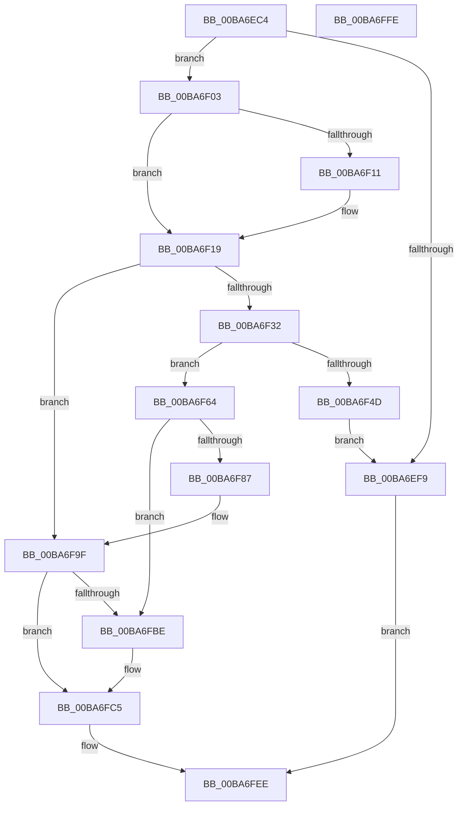

# VfThunkAddSpecialDriverThunks

- RVA: `0x00BA6EC4`–`0x00BA6FFF` (길이 `315` bytes)
- VA: `0x0000000140BA6EC4`
- 실행 섹션: `PAGEVRFY`
- PDB 이름 있음: `예`; PDB Function 태그: `아니요`
- unwind 정보 RVA: `0x000B9DCC`
- 디코드: `79`개 명령, `315/315` bytes 표시
- 미해석 바이트: `0` (있으면 어셈블리에 `.byte`로 보존)

> 이 문서는 커널 이미지의 기계어와 PDB 기호를 분석해 생성했습니다. 4번과 5번은 함수 원형과 자료형을 바이너리 사용 방식에서 추정한 C 해석이며 원본 소스 복구 결과는 아닙니다.

## 1. Dependencies

- 직접 호출 지점: **7**; 고유 호출 대상: **6**
- 직접 호출자로 확인된 함수: **1**
- RIP 상대 이미지 참조: **7**

### Outgoing calls
- `0x00BA6EEC` → [ViThunkCreateThunkTable](ViThunkCreateThunkTable_function_00BA74DC.md) (function, `0x00BA74DC`)
- `0x00BA6F03` → [VfDriverLock](../B9/VfDriverLock_function_00B9A4A4.md) (function, `0x00B9A4A4`)
- `0x00BA6F14` → [ViThunkRecoverPristines](ViThunkRecoverPristines_function_00BA79F0.md) (function, `0x00BA79F0`)
- `0x00BA6F25` → [ViThunkFindNextSpecialTable](ViThunkFindNextSpecialTable_function_00BA7794.md) (function, `0x00BA7794`)
- `0x00BA6F40` → [ExAllocatePool2](../../poolcode/B8/ExAllocatePool2_function_00B820F0.md) (function, `0x00B820F0`)
- `0x00BA6F5D` → [KeReleaseMutex](../../text/39/KeReleaseMutex_function_00396810.md) (function, `0x00396810`)
- `0x00BA6FE7` → [KeReleaseMutex](../../text/39/KeReleaseMutex_function_00396810.md) (function, `0x00396810`)

### Direct callers
- [ViAddVerifierSpecialThunks](../../text/61/ViAddVerifierSpecialThunks_function_0061233C.md) at `0x00612419`

### Static image references
- `0x00BA6F4F` → RVA `0x00F04938` (`.data`; write)
- `0x00BA6F56` → RVA `0x00F04900` (`.data`; read)
- `0x00BA6F68` → RVA `0x00F048A0` (`.data`; read)
- `0x00BA6F87` → RVA `0x00F048B4` (`.data`; read/write)
- `0x00BA6F98` → RVA `0x00F048A0` (`.data`; write)
- `0x00BA6F9F` → RVA `0x00F0488C` (`.data`; write)
- `0x00BA6FB3` → RVA `0x00F048B0` (`.data`; read/write)

## 2. Other-region calls and transfers

- 다른 실행 섹션으로 향하는 call: **3**
  - `0x00BA6F40` → [ExAllocatePool2](../../poolcode/B8/ExAllocatePool2_function_00B820F0.md) (`PAGEVRFY` → `POOLCODE`)
  - `0x00BA6F5D` → [KeReleaseMutex](../../text/39/KeReleaseMutex_function_00396810.md) (`PAGEVRFY` → `.text`)
  - `0x00BA6FE7` → [KeReleaseMutex](../../text/39/KeReleaseMutex_function_00396810.md) (`PAGEVRFY` → `.text`)
- 별도 외부 분기/꼬리 이동을 확인하지 못했습니다.

## 3. Assembly (complete function range)

```asm
00BA6EC4  48 89 5C 24 10                  mov qword ptr [rsp + 0x10], rbx
00BA6EC9  48 89 74 24 18                  mov qword ptr [rsp + 0x18], rsi
00BA6ECE  48 89 4C 24 08                  mov qword ptr [rsp + 8], rcx
00BA6ED3  57                              push rdi
00BA6ED4  48 83 EC 20                     sub rsp, 0x20
00BA6ED8  41 8B C0                        mov eax, r8d
00BA6EDB  4C 8B D2                        mov r10, rdx
00BA6EDE  48 8B F1                        mov rsi, rcx
00BA6EE1  8B D0                           mov edx, eax
00BA6EE3  49 8B CA                        mov rcx, r10
00BA6EE6  4D 8B C1                        mov r8, r9
00BA6EE9  49 8B F9                        mov rdi, r9
00BA6EEC  E8 EB 05 00 00                  call 0x140ba74dc
00BA6EF1  48 8B D8                        mov rbx, rax
00BA6EF4  48 85 C0                        test rax, rax
00BA6EF7  75 0A                           jne 0x140ba6f03
00BA6EF9  B8 9A 00 00 C0                  mov eax, 0xc000009a
00BA6EFE  E9 EB 00 00 00                  jmp 0x140ba6fee
00BA6F03  E8 9C 35 FF FF                  call 0x140b9a4a4
00BA6F08  F7 47 68 00 00 00 02            test dword ptr [rdi + 0x68], 0x2000000
00BA6F0F  74 08                           je 0x140ba6f19
00BA6F11  48 8B CB                        mov rcx, rbx
00BA6F14  E8 D7 0A 00 00                  call 0x140ba79f0
00BA6F19  45 33 C0                        xor r8d, r8d
00BA6F1C  48 8D 4C 24 30                  lea rcx, [rsp + 0x30]
00BA6F21  41 8D 50 01                     lea edx, [r8 + 1]
00BA6F25  E8 6A 08 00 00                  call 0x140ba7794
00BA6F2A  48 8B C8                        mov rcx, rax
00BA6F2D  48 85 C0                        test rax, rax
00BA6F30  75 6D                           jne 0x140ba6f9f
00BA6F32  8D 50 28                        lea edx, [rax + 0x28]
00BA6F35  B9 00 01 00 00                  mov ecx, 0x100
00BA6F3A  41 B8 4D 6D 56 74               mov r8d, 0x74566d4d
00BA6F40  E8 AB B1 FD FF                  call 0x140b820f0
00BA6F45  48 8B C8                        mov rcx, rax
00BA6F48  48 85 C0                        test rax, rax
00BA6F4B  75 17                           jne 0x140ba6f64
00BA6F4D  33 D2                           xor edx, edx
00BA6F4F  48 89 05 E2 D9 35 00            mov qword ptr [rip + 0x35d9e2], rax
00BA6F56  48 8D 0D A3 D9 35 00            lea rcx, [rip + 0x35d9a3]
00BA6F5D  E8 AE F8 7E FF                  call 0x140396810
00BA6F62  EB 95                           jmp 0x140ba6ef9
00BA6F64  48 89 70 10                     mov qword ptr [rax + 0x10], rsi
00BA6F68  48 8D 15 31 D9 35 00            lea rdx, [rip + 0x35d931]
00BA6F6F  48 83 C0 18                     add rax, 0x18
00BA6F73  48 89 40 08                     mov qword ptr [rax + 8], rax
00BA6F77  48 89 00                        mov qword ptr [rax], rax
00BA6F7A  48 8B 05 1F D9 35 00            mov rax, qword ptr [rip + 0x35d91f]
00BA6F81  48 39 50 08                     cmp qword ptr [rax + 8], rdx
00BA6F85  75 37                           jne 0x140ba6fbe
00BA6F87  FF 05 27 D9 35 00               inc dword ptr [rip + 0x35d927]
00BA6F8D  48 89 01                        mov qword ptr [rcx], rax
00BA6F90  48 89 51 08                     mov qword ptr [rcx + 8], rdx
00BA6F94  48 89 48 08                     mov qword ptr [rax + 8], rcx
00BA6F98  48 89 0D 01 D9 35 00            mov qword ptr [rip + 0x35d901], rcx
00BA6F9F  C6 05 E6 D8 35 00 01            mov byte ptr [rip + 0x35d8e6], 1
00BA6FA6  F0 83 0C 24 00                  lock or dword ptr [rsp], 0
00BA6FAB  48 8B 41 20                     mov rax, qword ptr [rcx + 0x20]
00BA6FAF  48 83 C1 18                     add rcx, 0x18
00BA6FB3  FF 05 F7 D8 35 00               inc dword ptr [rip + 0x35d8f7]
00BA6FB9  48 39 08                        cmp qword ptr [rax], rcx
00BA6FBC  74 07                           je 0x140ba6fc5
00BA6FBE  B9 03 00 00 00                  mov ecx, 3
00BA6FC3  CD 29                           int 0x29
00BA6FC5  48 89 0B                        mov qword ptr [rbx], rcx
00BA6FC8  33 D2                           xor edx, edx
00BA6FCA  48 89 43 08                     mov qword ptr [rbx + 8], rax
00BA6FCE  48 89 18                        mov qword ptr [rax], rbx
00BA6FD1  48 89 59 08                     mov qword ptr [rcx + 8], rbx
00BA6FD5  48 8D 0D 24 D9 35 00            lea rcx, [rip + 0x35d924]
00BA6FDC  48 C7 05 51 D9 35 00 00 00 00 00  mov qword ptr [rip + 0x35d951], 0
00BA6FE7  E8 24 F8 7E FF                  call 0x140396810
00BA6FEC  33 C0                           xor eax, eax
00BA6FEE  48 8B 5C 24 38                  mov rbx, qword ptr [rsp + 0x38]
00BA6FF3  48 8B 74 24 40                  mov rsi, qword ptr [rsp + 0x40]
00BA6FF8  48 83 C4 20                     add rsp, 0x20
00BA6FFC  5F                              pop rdi
00BA6FFD  C3                              ret
00BA6FFE  CC                              int3
```

## 4. C-style interpretation (structured pseudocode)

```c
__int64 __fastcall VfThunkAddSpecialDriverThunks(__int64 a1, __int64 a2, int a3, __int64 a4)
{
    __int64 result;
    __int64 v_rsp;
    unsigned int v_stack_m28;
    unsigned __int64 v_stack_p10;
    unsigned __int64 v_stack_p18;
    unsigned __int64 v_stack_p8;

    v_stack_p10 = v_rbx;
    v_stack_p18 = v_rsi;
    v_stack_p8 = a1;
    v_rsp = (v_rsp) - (32);
    result = ViThunkCreateThunkTable(a2, (unsigned int)((unsigned int)((unsigned int)(a3))), a4, a4);
    if (result != 0) goto loc_00BA6F03;
loc_00BA6EF9:
    goto loc_00BA6FEE;
loc_00BA6F03:
    result = VfDriverLock(a2, (unsigned int)((unsigned int)((unsigned int)(a3))), a4, a4);
    if (((*(unsigned int *)(a4 + 104)) & (0x2000000ULL)) != 0) {
        a1 = result;
        result = ViThunkRecoverPristines(a1, (unsigned int)((unsigned int)((unsigned int)(a3))), a4, a4);
    }
    a3 = 0;
    result = ViThunkFindNextSpecialTable(v_stack_p8, a3 + 1, a3, a4);
    if (result != 0) goto loc_00BA6F9F;
    result = ExAllocatePool2(256, result + 40, (unsigned int)(0x74566D4DULL), a4);
    if (result != 0) goto loc_00BA6F64;
    a2 = 0;
    *(unsigned __int64 *)(v_rip + 3529186) = result;
    result = KeReleaseMutex(v_rip + 3529123, a2, (unsigned int)(0x74566D4DULL), a4);
    goto loc_00BA6EF9;
loc_00BA6F64:
    *(unsigned __int64 *)(result + 16) = a1;
    result = (result) + (24);
    *(unsigned __int64 *)(result + 8) = result;
    *(unsigned __int64 *)(result) = result;
    if ((*(unsigned __int64 *)(*(unsigned __int64 *)(v_rip + 3528991) + 8)) != (v_rip + 3529009)) goto loc_00BA6FBE;
    *(unsigned __int64 *)(v_rip + 3529123) = *(unsigned __int64 *)(v_rip + 3528991);
    *(unsigned __int64 *)(v_rip + 3529123 + 8) = v_rip + 3529009;
    *(unsigned __int64 *)(*(unsigned __int64 *)(v_rip + 3528991) + 8) = v_rip + 3529123;
    *(unsigned __int64 *)(v_rip + 3528961) = v_rip + 3529123;
loc_00BA6F9F:
    *(unsigned __int8 *)(v_rip + 3528934) = 1;
    a1 = (v_rip + 3529123) + (24);
    if ((*(unsigned __int64 *)(*(unsigned __int64 *)(v_rip + 3529123 + 32))) != a1) {
        a1 = 3;
    }
    *(unsigned __int64 *)(result) = a1;
    a2 = 0;
    *(unsigned __int64 *)(result + 8) = *(unsigned __int64 *)(v_rip + 3529123 + 32);
    *(unsigned __int64 *)(*(unsigned __int64 *)(v_rip + 3529123 + 32)) = result;
    *(unsigned __int64 *)(a1 + 8) = result;
    *(unsigned __int64 *)(v_rip + 3529041) = 0;
    result = KeReleaseMutex(v_rip + 3528996, a2, (unsigned int)(0x74566D4DULL), a4);
    result = 0;
loc_00BA6FEE:
    v_rsp = (v_rsp) + (32);
    return result;
}
```

## 5. (Beta) C Style

```c
int64_t VfThunkAddSpecialDriverThunks(int64_t Arg1, int64_t Arg2, int32_t Arg3, void *Arg4)
{
    uint8_t *arg4 = (uint8_t *)Arg4;

    int64_t result;
    int64_t local_rsp;
    uint32_t v_stack_m28;
    uint64_t v_stack_p10;
    uint64_t v_stack_p18;
    uint64_t v_stack_p8;

    v_stack_p10 = local_rbx;
    v_stack_p18 = local_rsi;
    v_stack_p8 = Arg1;
    local_rsp = (local_rsp) - (32);
    result = ViThunkCreateThunkTable(Arg2, (uint32_t)((uint32_t)((uint32_t)(Arg3))), Arg4, Arg4);
    if (result != 0) goto loc_00BA6F03;
loc_00BA6EF9:
    goto loc_00BA6FEE;
loc_00BA6F03:
    result = VfDriverLock(Arg2, (uint32_t)((uint32_t)((uint32_t)(Arg3))), Arg4, Arg4);
    if (((*(uint32_t *)(arg4 + 0x68)) & (0x2000000ULL)) != 0) {
        Arg1 = result;
        result = ViThunkRecoverPristines(Arg1, (uint32_t)((uint32_t)((uint32_t)(Arg3))), Arg4, Arg4);
    }
    Arg3 = 0;
    result = ViThunkFindNextSpecialTable(v_stack_p8, Arg3 + 1, Arg3, Arg4);
    if (result != 0) goto loc_00BA6F9F;
    result = ExAllocatePool2(256, result + 40, (uint32_t)(0x74566D4DULL), Arg4);
    if (result != 0) goto loc_00BA6F64;
    Arg2 = 0;
    *(uint64_t *)(v_rip + 0x35D9E2) = result;
    result = KeReleaseMutex(v_rip + 3529123, Arg2, (uint32_t)(0x74566D4DULL), Arg4);
    goto loc_00BA6EF9;
loc_00BA6F64:
    *(uint64_t *)(result + 0x10) = Arg1;
    result = (result) + (24);
    *(uint64_t *)(result + 0x8) = result;
    *(uint64_t *)(result) = result;
    if ((*(uint64_t *)(*(uint64_t *)(v_rip + 0x35D91F) + 0x8)) != (v_rip + 3529009)) goto loc_00BA6FBE;
    *(uint64_t *)(v_rip + 0x35D9A3) = *(uint64_t *)(v_rip + 0x35D91F);
    *(uint64_t *)(v_rip + 0x35D9A3 + 0x8) = v_rip + 3529009;
    *(uint64_t *)(*(uint64_t *)(v_rip + 0x35D91F) + 0x8) = v_rip + 3529123;
    *(uint64_t *)(v_rip + 0x35D901) = v_rip + 3529123;
loc_00BA6F9F:
    *(uint8_t *)(v_rip + 0x35D8E6) = 1;
    Arg1 = (v_rip + 3529123) + (24);
    if ((*(uint64_t *)(*(uint64_t *)(v_rip + 0x35D9A3 + 0x20))) != Arg1) {
        Arg1 = 3;
    }
    *(uint64_t *)(result) = Arg1;
    Arg2 = 0;
    *(uint64_t *)(result + 0x8) = *(uint64_t *)(v_rip + 0x35D9A3 + 0x20);
    *(uint64_t *)(*(uint64_t *)(v_rip + 0x35D9A3 + 0x20)) = result;
    *(uint64_t *)(Arg1 + 0x8) = result;
    *(uint64_t *)(v_rip + 0x35D951) = 0;
    result = KeReleaseMutex(v_rip + 3528996, Arg2, (uint32_t)(0x74566D4DULL), Arg4);
    result = 0;
loc_00BA6FEE:
    local_rsp = (local_rsp) + (32);
    return result;
}
```

### 관측된 메모리 오프셋

구조체 형식이 확인되지 않은 접근은 인자 기준의 오프셋으로만 기록했습니다.

| 기준 인자 | 오프셋 표현 | 폭 (bit) | 접근 |
|---|---:|---:|---|
| `Arg4` | `+ 0x68` | `32` | `R` |

## 6. Execution-region graph

[열기: 2D/3D 그래프와 함수 탐색 컨트롤 패널](../../../control-panel.html?section=pagevrfy&rva=0x00BA6EC4&view=graph)

- 2D 그래프는 위에서 아래로 흐르고, 3D 그래프는 빈 공간을 드래그해 회전합니다. Shift+드래그는 이동, 휠은 확대·축소, 함수 노드 선택은 대상 보고서 이동입니다.

### Static fallback


