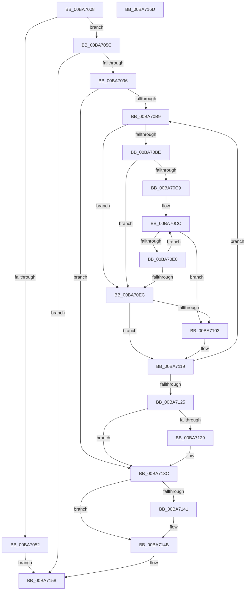

# VfThunkApplyDriverAddedThunks

- RVA: `0x00BA7008`–`0x00BA716E` (길이 `358` bytes)
- VA: `0x0000000140BA7008`
- 실행 섹션: `PAGEVRFY`
- PDB 이름 있음: `예`; PDB Function 태그: `아니요`
- unwind 정보 RVA: `0x00068D9C`
- 디코드: `107`개 명령, `358/358` bytes 표시
- 미해석 바이트: `0` (있으면 어셈블리에 `.byte`로 보존)

> 이 문서는 커널 이미지의 기계어와 PDB 기호를 분석해 생성했습니다. 4번과 5번은 함수 원형과 자료형을 바이너리 사용 방식에서 추정한 C 해석이며 원본 소스 복구 결과는 아닙니다.

## 1. Dependencies

- 직접 호출 지점: **9**; 고유 호출 대상: **7**
- 직접 호출자로 확인된 함수: **1**
- RIP 상대 이미지 참조: **2**

### Outgoing calls
- `0x00BA7045` → [ExAllocatePool2](../../poolcode/B8/ExAllocatePool2_function_00B820F0.md) (function, `0x00B820F0`)
- `0x00BA706F` → [memset](../../text/6C/memset_function_006C6C40.md) (function, `0x006C6C40`)
- `0x00BA7085` → [RtlImageDirectoryEntryToData](../../text/43/RtlImageDirectoryEntryToData_function_004328D0.md) (function, `0x004328D0`)
- `0x00BA70A5` → [ViThunkFindAllSpecialTables](ViThunkFindAllSpecialTables_function_00BA75E8.md) (function, `0x00BA75E8`)
- `0x00BA70D3` → [ViThunkFindDriverImportEntry](ViThunkFindDriverImportEntry_function_00BA7758.md) (function, `0x00BA7758`)
- `0x00BA70F6` → [ViThunkFindDriverImportEntry](ViThunkFindDriverImportEntry_function_00BA7758.md) (function, `0x00BA7758`)
- `0x00BA7134` → [MmApplyVerifierToRunningImage](../BB/MmApplyVerifierToRunningImage_function_00BB4780.md) (function, `0x00BB4780`)
- `0x00BA7146` → [ExFreePoolWithTag](../../poolcode/B8/ExFreePoolWithTag_function_00B82870.md) (function, `0x00B82870`)
- `0x00BA7150` → [ExFreePoolWithTag](../../poolcode/B8/ExFreePoolWithTag_function_00B82870.md) (function, `0x00B82870`)

### Direct callers
- [ViDriverReApplyVerifierForAll](../B9/ViDriverReApplyVerifierForAll_function_00B9A8D4.md) at `0x00B9A94D`

### Static image references
- `0x00BA7021` → RVA `0x00F049F4` (`.data`; read)
- `0x00BA70EF` → RVA `0x00F04890` (`.data`; read)

## 2. Other-region calls and transfers

- 다른 실행 섹션으로 향하는 call: **5**
  - `0x00BA7045` → [ExAllocatePool2](../../poolcode/B8/ExAllocatePool2_function_00B820F0.md) (`PAGEVRFY` → `POOLCODE`)
  - `0x00BA706F` → [memset](../../text/6C/memset_function_006C6C40.md) (`PAGEVRFY` → `.text`)
  - `0x00BA7085` → [RtlImageDirectoryEntryToData](../../text/43/RtlImageDirectoryEntryToData_function_004328D0.md) (`PAGEVRFY` → `.text`)
  - `0x00BA7146` → [ExFreePoolWithTag](../../poolcode/B8/ExFreePoolWithTag_function_00B82870.md) (`PAGEVRFY` → `POOLCODE`)
  - `0x00BA7150` → [ExFreePoolWithTag](../../poolcode/B8/ExFreePoolWithTag_function_00B82870.md) (`PAGEVRFY` → `POOLCODE`)
- 별도 외부 분기/꼬리 이동을 확인하지 못했습니다.

## 3. Assembly (complete function range)

```asm
00BA7008  48 89 5C 24 18                  mov qword ptr [rsp + 0x18], rbx
00BA700D  48 89 4C 24 08                  mov qword ptr [rsp + 8], rcx
00BA7012  55                              push rbp
00BA7013  56                              push rsi
00BA7014  57                              push rdi
00BA7015  41 54                           push r12
00BA7017  41 55                           push r13
00BA7019  41 56                           push r14
00BA701B  41 57                           push r15
00BA701D  48 83 EC 20                     sub rsp, 0x20
00BA7021  8B 05 CD D9 35 00               mov eax, dword ptr [rip + 0x35d9cd]
00BA7027  48 8B D9                        mov rbx, rcx
00BA702A  83 64 24 68 00                  and dword ptr [rsp + 0x68], 0
00BA702F  33 ED                           xor ebp, ebp
00BA7031  41 B8 44 76 4D 6D               mov r8d, 0x6d4d7644
00BA7037  45 33 E4                        xor r12d, r12d
00BA703A  48 8D 14 40                     lea rdx, [rax + rax*2]
00BA703E  48 C1 E2 03                     shl rdx, 3
00BA7042  8D 4D 40                        lea ecx, [rbp + 0x40]
00BA7045  E8 A6 B0 FD FF                  call 0x140b820f0
00BA704A  48 8B F8                        mov rdi, rax
00BA704D  48 85 C0                        test rax, rax
00BA7050  75 0A                           jne 0x140ba705c
00BA7052  B8 17 00 00 C0                  mov eax, 0xc0000017
00BA7057  E9 FC 00 00 00                  jmp 0x140ba7158
00BA705C  8B 05 92 D9 35 00               mov eax, dword ptr [rip + 0x35d992]
00BA7062  33 D2                           xor edx, edx
00BA7064  48 8B CF                        mov rcx, rdi
00BA7067  4C 8D 04 40                     lea r8, [rax + rax*2]
00BA706B  49 C1 E0 03                     shl r8, 3
00BA706F  E8 CC FB B1 FF                  call 0x1406c6c40
00BA7074  48 8B 4B 30                     mov rcx, qword ptr [rbx + 0x30]
00BA7078  4C 8D 4C 24 68                  lea r9, [rsp + 0x68]
00BA707D  41 B8 0C 00 00 00               mov r8d, 0xc
00BA7083  B2 01                           mov dl, 1
00BA7085  E8 46 B8 88 FF                  call 0x1404328d0
00BA708A  48 8B F0                        mov rsi, rax
00BA708D  48 85 C0                        test rax, rax
00BA7090  0F 84 C2 00 00 00               je 0x140ba7158
00BA7096  44 8B 74 24 68                  mov r14d, dword ptr [rsp + 0x68]
00BA709B  48 8B C8                        mov rcx, rax
00BA709E  41 C1 EE 03                     shr r14d, 3
00BA70A2  41 8B D6                        mov edx, r14d
00BA70A5  E8 3E 05 00 00                  call 0x140ba75e8
00BA70AA  45 33 DB                        xor r11d, r11d
00BA70AD  48 8B D8                        mov rbx, rax
00BA70B0  45 85 F6                        test r14d, r14d
00BA70B3  0F 84 83 00 00 00               je 0x140ba713c
00BA70B9  48 85 DB                        test rbx, rbx
00BA70BC  74 2E                           je 0x140ba70ec
00BA70BE  48 8B 03                        mov rax, qword ptr [rbx]
00BA70C1  45 33 FF                        xor r15d, r15d
00BA70C4  48 85 C0                        test rax, rax
00BA70C7  74 23                           je 0x140ba70ec
00BA70C9  4C 8B 2E                        mov r13, qword ptr [rsi]
00BA70CC  48 8D 48 18                     lea rcx, [rax + 0x18]
00BA70D0  49 8B D5                        mov rdx, r13
00BA70D3  E8 80 06 00 00                  call 0x140ba7758
00BA70D8  48 8B D0                        mov rdx, rax
00BA70DB  48 85 C0                        test rax, rax
00BA70DE  75 23                           jne 0x140ba7103
00BA70E0  41 FF C7                        inc r15d
00BA70E3  4A 8B 04 FB                     mov rax, qword ptr [rbx + r15*8]
00BA70E7  48 85 C0                        test rax, rax
00BA70EA  75 E0                           jne 0x140ba70cc
00BA70EC  48 8B 16                        mov rdx, qword ptr [rsi]
00BA70EF  48 8D 0D 9A D7 35 00            lea rcx, [rip + 0x35d79a]
00BA70F6  E8 5D 06 00 00                  call 0x140ba7758
00BA70FB  48 8B D0                        mov rdx, rax
00BA70FE  48 85 C0                        test rax, rax
00BA7101  74 16                           je 0x140ba7119
00BA7103  48 8D 0C 6D 00 00 00 00         lea rcx, [rbp*2]
00BA710B  48 03 CD                        add rcx, rbp
00BA710E  FF C5                           inc ebp
00BA7110  44 89 1C CF                     mov dword ptr [rdi + rcx*8], r11d
00BA7114  48 89 54 CF 08                  mov qword ptr [rdi + rcx*8 + 8], rdx
00BA7119  41 FF C3                        inc r11d
00BA711C  48 83 C6 08                     add rsi, 8
00BA7120  45 3B DE                        cmp r11d, r14d
00BA7123  72 94                           jb 0x140ba70b9
00BA7125  85 ED                           test ebp, ebp
00BA7127  74 13                           je 0x140ba713c
00BA7129  48 8B 4C 24 60                  mov rcx, qword ptr [rsp + 0x60]
00BA712E  44 8B C5                        mov r8d, ebp
00BA7131  48 8B D7                        mov rdx, rdi
00BA7134  E8 47 D6 00 00                  call 0x140bb4780
00BA7139  44 8B E0                        mov r12d, eax
00BA713C  48 85 DB                        test rbx, rbx
00BA713F  74 0A                           je 0x140ba714b
00BA7141  33 D2                           xor edx, edx
00BA7143  48 8B CB                        mov rcx, rbx
00BA7146  E8 25 B7 FD FF                  call 0x140b82870
00BA714B  33 D2                           xor edx, edx
00BA714D  48 8B CF                        mov rcx, rdi
00BA7150  E8 1B B7 FD FF                  call 0x140b82870
00BA7155  41 8B C4                        mov eax, r12d
00BA7158  48 8B 5C 24 70                  mov rbx, qword ptr [rsp + 0x70]
00BA715D  48 83 C4 20                     add rsp, 0x20
00BA7161  41 5F                           pop r15
00BA7163  41 5E                           pop r14
00BA7165  41 5D                           pop r13
00BA7167  41 5C                           pop r12
00BA7169  5F                              pop rdi
00BA716A  5E                              pop rsi
00BA716B  5D                              pop rbp
00BA716C  C3                              ret
00BA716D  CC                              int3
```

## 4. C-style interpretation (structured pseudocode)

```c
__int64 __fastcall VfThunkApplyDriverAddedThunks(__int64 a1)
{
    __int64 result;
    __int64 v_r11;
    __int64 v_r12;
    __int64 v_r14;
    __int64 v_r15;
    __int64 v_rbp;
    __int64 v_rsi;
    __int64 v_rsp;
    unsigned int v_stack_p10;
    unsigned __int64 v_stack_p18;
    unsigned __int64 v_stack_p8;

    v_stack_p18 = v_rbx;
    v_stack_p8 = a1;
    v_rsp = (v_rsp) - (32);
    v_rbp = 0;
    v_r12 = 0;
    a2 = ((unsigned int)(*(unsigned int *)(v_rip + 3529165)) + (unsigned int)(*(unsigned int *)(v_rip + 3529165)) * 2) << (3);
    result = ExAllocatePool2(v_rbp + 64, a2, (unsigned int)(0x6D4D7644ULL), a4);
    if (result != 0) goto loc_00BA705C;
    goto loc_00BA7158;
loc_00BA705C:
    a2 = 0;
    a3 = ((unsigned int)(*(unsigned int *)(v_rip + 3529106)) + (unsigned int)(*(unsigned int *)(v_rip + 3529106)) * 2) << (3);
    result = memset(result, a2, a3, a4);
    result = RtlImageDirectoryEntryToData(*(unsigned __int64 *)(a1 + 48), 1, 12, v_stack_p10);
    if (result == 0) goto loc_00BA7158;
    v_r14 = (unsigned int)(((unsigned int)(v_stack_p10)) >> (3));
    result = ViThunkFindAllSpecialTables(result, (unsigned int)((unsigned int)(v_r14)), 12, v_stack_p10);
    v_r11 = 0;
    if ((unsigned int)(v_r14) == 0) goto loc_00BA713C;
loc_00BA70B9:
    if (result == 0) goto loc_00BA70EC;
    v_r15 = 0;
    if (*(unsigned __int64 *)(result) == 0) goto loc_00BA70EC;
loc_00BA70CC:
    result = ViThunkFindDriverImportEntry(*(unsigned __int64 *)(result) + 24, *(unsigned __int64 *)(result), 12, v_stack_p10);
    if (result != 0) goto loc_00BA7103;
    v_r15 = (unsigned int)((v_r15) + 1);
    if (*(unsigned __int64 *)(result + v_r15 * 8) != 0) goto loc_00BA70CC;
loc_00BA70EC:
    result = ViThunkFindDriverImportEntry(v_rip + 3528602, *(unsigned __int64 *)(result), 12, v_stack_p10);
    if (result != 0) {
        a1 = v_rbp * 2;
        a1 = (a1) + (0);
        v_rbp = (unsigned int)((v_rbp) + 1);
        *(unsigned int *)(result + a1 * 8) = 0;
        *(unsigned __int64 *)(result + a1 * 8 + 8) = result;
    }
    v_r11 = (unsigned int)((v_r11) + 1);
    v_rsi = (result) + (8);
    if (((unsigned int)(v_r11)) < ((unsigned int)(v_r14))) goto loc_00BA70B9;
    if ((unsigned int)(v_rbp) != 0) {
        a1 = v_stack_p8;
        a3 = (unsigned int)(v_rbp);
        a2 = result;
        result = MmApplyVerifierToRunningImage(a1, a2, a3, v_stack_p10);
        v_r12 = (unsigned int)(result);
    }
    if (result != 0) {
        a2 = 0;
        a1 = result;
        result = ExFreePoolWithTag(a1, a2, a3, v_stack_p10);
    }
    a2 = 0;
    result = ExFreePoolWithTag(result, a2, a3, v_stack_p10);
loc_00BA7158:
    v_rsp = (v_rsp) + (32);
    return (unsigned int)((unsigned int)(v_r12));
}
```

## 5. (Beta) C Style

```c
int64_t VfThunkApplyDriverAddedThunks(void *Arg1)
{
    uint8_t *arg1 = (uint8_t *)Arg1;

    int64_t result;
    int64_t local_r11;
    int64_t local_r12;
    int64_t local_r14;
    int64_t local_r15;
    int64_t local_rbp;
    int64_t local_rsi;
    int64_t local_rsp;
    uint32_t v_stack_p10;
    uint64_t v_stack_p18;
    uint64_t v_stack_p8;

    v_stack_p18 = local_rbx;
    v_stack_p8 = Arg1;
    local_rsp = (local_rsp) - (32);
    local_rbp = 0;
    local_r12 = 0;
    a2 = ((uint32_t)(*(uint32_t *)(v_rip + 0x35D9CD)) + (uint32_t)(*(uint32_t *)(v_rip + 0x35D9CD)) * 2) << (3);
    result = ExAllocatePool2(local_rbp + 64, a2, (uint32_t)(0x6D4D7644ULL), a4);
    if (result != 0) goto loc_00BA705C;
    goto loc_00BA7158;
loc_00BA705C:
    a2 = 0;
    a3 = ((uint32_t)(*(uint32_t *)(v_rip + 0x35D992)) + (uint32_t)(*(uint32_t *)(v_rip + 0x35D992)) * 2) << (3);
    result = memset(result, a2, a3, a4);
    result = RtlImageDirectoryEntryToData(*(uint64_t *)(arg1 + 0x30), 1, 12, v_stack_p10);
    if (result == 0) goto loc_00BA7158;
    local_r14 = (uint32_t)(((uint32_t)(v_stack_p10)) >> (3));
    result = ViThunkFindAllSpecialTables(result, (uint32_t)((uint32_t)(local_r14)), 12, v_stack_p10);
    local_r11 = 0;
    if ((uint32_t)(local_r14) == 0) goto loc_00BA713C;
loc_00BA70B9:
    if (result == 0) goto loc_00BA70EC;
    local_r15 = 0;
    if (*(uint64_t *)(result) == 0) goto loc_00BA70EC;
loc_00BA70CC:
    result = ViThunkFindDriverImportEntry(*(uint64_t *)(result) + 24, *(uint64_t *)(result), 12, v_stack_p10);
    if (result != 0) goto loc_00BA7103;
    local_r15 = (uint32_t)((local_r15) + 1);
    if (*(uint64_t *)(result + local_r15 * 8) != 0) goto loc_00BA70CC;
loc_00BA70EC:
    result = ViThunkFindDriverImportEntry(v_rip + 3528602, *(uint64_t *)(result), 12, v_stack_p10);
    if (result != 0) {
        Arg1 = local_rbp * 2;
        Arg1 = (Arg1) + (0);
        local_rbp = (uint32_t)((local_rbp) + 1);
        *(uint32_t *)(result + arg1 * 8) = 0;
        *(uint64_t *)(result + arg1 * 8 + 0x8) = result;
    }
    local_r11 = (uint32_t)((local_r11) + 1);
    local_rsi = (result) + (8);
    if (((uint32_t)(local_r11)) < ((uint32_t)(local_r14))) goto loc_00BA70B9;
    if ((uint32_t)(local_rbp) != 0) {
        Arg1 = v_stack_p8;
        a3 = (uint32_t)(local_rbp);
        a2 = result;
        result = MmApplyVerifierToRunningImage(Arg1, a2, a3, v_stack_p10);
        local_r12 = (uint32_t)(result);
    }
    if (result != 0) {
        a2 = 0;
        Arg1 = result;
        result = ExFreePoolWithTag(Arg1, a2, a3, v_stack_p10);
    }
    a2 = 0;
    result = ExFreePoolWithTag(result, a2, a3, v_stack_p10);
loc_00BA7158:
    local_rsp = (local_rsp) + (32);
    return (uint32_t)((uint32_t)(local_r12));
}
```

### 관측된 메모리 오프셋

구조체 형식이 확인되지 않은 접근은 인자 기준의 오프셋으로만 기록했습니다.

| 기준 인자 | 오프셋 표현 | 폭 (bit) | 접근 |
|---|---:|---:|---|
| `Arg1` | `+ 0x30` | `64` | `R` |

## 6. Execution-region graph

[열기: 2D/3D 그래프와 함수 탐색 컨트롤 패널](../../../control-panel.html?section=pagevrfy&rva=0x00BA7008&view=graph)

- 2D 그래프는 위에서 아래로 흐르고, 3D 그래프는 빈 공간을 드래그해 회전합니다. Shift+드래그는 이동, 휠은 확대·축소, 함수 노드 선택은 대상 보고서 이동입니다.

### Static fallback


