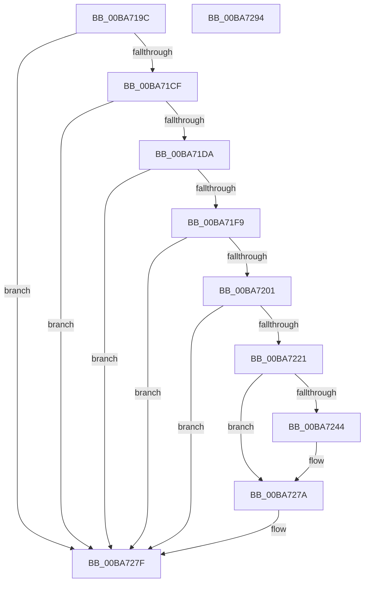

# VfThunkApplyThunksCurrentSession

- RVA: `0x00BA719C`–`0x00BA7295` (길이 `249` bytes)
- VA: `0x0000000140BA719C`
- 실행 섹션: `PAGEVRFY`
- PDB 이름 있음: `예`; PDB Function 태그: `아니요`
- unwind 정보 RVA: `0x000701D4`
- 디코드: `69`개 명령, `249/249` bytes 표시
- 미해석 바이트: `0` (있으면 어셈블리에 `.byte`로 보존)

> 이 문서는 커널 이미지의 기계어와 PDB 기호를 분석해 생성했습니다. 4번과 5번은 함수 원형과 자료형을 바이너리 사용 방식에서 추정한 C 해석이며 원본 소스 복구 결과는 아닙니다.

## 1. Dependencies

- 직접 호출 지점: **10**; 고유 호출 대상: **6**
- 직접 호출자로 확인된 함수: **1**
- RIP 상대 이미지 참조: **4**

### Outgoing calls
- `0x00BA71BE` → [VfTargetDriversGetNode](../../text/3E/VfTargetDriversGetNode_function_003EE174.md) (function, `0x003EE174`)
- `0x00BA71E8` → [RtlImageDirectoryEntryToData](../../text/43/RtlImageDirectoryEntryToData_function_004328D0.md) (function, `0x004328D0`)
- `0x00BA7204` → [ViIsDriverSuspectForVerifier](../B9/ViIsDriverSuspectForVerifier_function_00B9381C.md) (function, `0x00B9381C`)
- `0x00BA7218` → [ViThunkReplaceAllThunkedImports](ViThunkReplaceAllThunkedImports_function_00BA7B38.md) (function, `0x00BA7B38`)
- `0x00BA7228` → [RtlNumberOfClearBits](../../text/43/RtlNumberOfClearBits_function_00433F40.md) (function, `0x00433F40`)
- `0x00BA7237` → [ViThunkReplaceSharedExports](ViThunkReplaceSharedExports_function_00BA7D60.md) (function, `0x00BA7D60`)
- `0x00BA724B` → [RtlNumberOfClearBits](../../text/43/RtlNumberOfClearBits_function_00433F40.md) (function, `0x00433F40`)
- `0x00BA725A` → [ViThunkReplaceSharedExports](ViThunkReplaceSharedExports_function_00BA7D60.md) (function, `0x00BA7D60`)
- `0x00BA7266` → [RtlNumberOfClearBits](../../text/43/RtlNumberOfClearBits_function_00433F40.md) (function, `0x00433F40`)
- `0x00BA7275` → [ViThunkReplaceSharedExports](ViThunkReplaceSharedExports_function_00BA7D60.md) (function, `0x00BA7D60`)

### Direct callers
- [VfSuspectDriversLoadCallback](VfSuspectDriversLoadCallback_function_00BAAB2C.md) at `0x00BAAE05`

### Static image references
- `0x00BA7221` → RVA `0x00FFDC70` (`PAGEVRFD`; read)
- `0x00BA723C` → RVA `0x00F04ABC` (`.data`; read)
- `0x00BA7244` → RVA `0x00FFDC80` (`PAGEVRFD`; read)
- `0x00BA725F` → RVA `0x00FFDC90` (`PAGEVRFD`; read)

## 2. Other-region calls and transfers

- 다른 실행 섹션으로 향하는 call: **5**
  - `0x00BA71BE` → [VfTargetDriversGetNode](../../text/3E/VfTargetDriversGetNode_function_003EE174.md) (`PAGEVRFY` → `.text`)
  - `0x00BA71E8` → [RtlImageDirectoryEntryToData](../../text/43/RtlImageDirectoryEntryToData_function_004328D0.md) (`PAGEVRFY` → `.text`)
  - `0x00BA7228` → [RtlNumberOfClearBits](../../text/43/RtlNumberOfClearBits_function_00433F40.md) (`PAGEVRFY` → `.text`)
  - `0x00BA724B` → [RtlNumberOfClearBits](../../text/43/RtlNumberOfClearBits_function_00433F40.md) (`PAGEVRFY` → `.text`)
  - `0x00BA7266` → [RtlNumberOfClearBits](../../text/43/RtlNumberOfClearBits_function_00433F40.md) (`PAGEVRFY` → `.text`)
- 별도 외부 분기/꼬리 이동을 확인하지 못했습니다.

## 3. Assembly (complete function range)

```asm
00BA719C  48 89 5C 24 10                  mov qword ptr [rsp + 0x10], rbx
00BA71A1  48 89 6C 24 18                  mov qword ptr [rsp + 0x18], rbp
00BA71A6  56                              push rsi
00BA71A7  57                              push rdi
00BA71A8  41 56                           push r14
00BA71AA  48 83 EC 20                     sub rsp, 0x20
00BA71AE  48 8B 69 30                     mov rbp, qword ptr [rcx + 0x30]
00BA71B2  48 8B F1                        mov rsi, rcx
00BA71B5  33 DB                           xor ebx, ebx
00BA71B7  48 8B CD                        mov rcx, rbp
00BA71BA  89 5C 24 40                     mov dword ptr [rsp + 0x40], ebx
00BA71BE  E8 B1 6F 84 FF                  call 0x1403ee174
00BA71C3  48 8B F8                        mov rdi, rax
00BA71C6  48 85 C0                        test rax, rax
00BA71C9  0F 84 B0 00 00 00               je 0x140ba727f
00BA71CF  8B 40 10                        mov eax, dword ptr [rax + 0x10]
00BA71D2  A8 01                           test al, 1
00BA71D4  0F 85 A5 00 00 00               jne 0x140ba727f
00BA71DA  44 8D 43 0C                     lea r8d, [rbx + 0xc]
00BA71DE  B2 01                           mov dl, 1
00BA71E0  4C 8D 4C 24 40                  lea r9, [rsp + 0x40]
00BA71E5  48 8B CD                        mov rcx, rbp
00BA71E8  E8 E3 B6 88 FF                  call 0x1404328d0
00BA71ED  4C 8B F0                        mov r14, rax
00BA71F0  48 85 C0                        test rax, rax
00BA71F3  0F 84 86 00 00 00               je 0x140ba727f
00BA71F9  8B 6C 24 40                     mov ebp, dword ptr [rsp + 0x40]
00BA71FD  85 ED                           test ebp, ebp
00BA71FF  74 7E                           je 0x140ba727f
00BA7201  48 8B CE                        mov rcx, rsi
00BA7204  E8 13 C6 FE FF                  call 0x140b9381c
00BA7209  C1 ED 03                        shr ebp, 3
00BA720C  44 8B C8                        mov r9d, eax
00BA720F  44 8B C5                        mov r8d, ebp
00BA7212  49 8B D6                        mov rdx, r14
00BA7215  48 8B CE                        mov rcx, rsi
00BA7218  E8 1B 09 00 00                  call 0x140ba7b38
00BA721D  85 C0                           test eax, eax
00BA721F  74 5E                           je 0x140ba727f
00BA7221  48 8D 0D 48 6A 45 00            lea rcx, [rip + 0x456a48]
00BA7228  E8 13 CD 88 FF                  call 0x140433f40
00BA722D  48 8B 57 18                     mov rdx, qword ptr [rdi + 0x18]
00BA7231  44 8B C0                        mov r8d, eax
00BA7234  48 8B CE                        mov rcx, rsi
00BA7237  E8 24 0B 00 00                  call 0x140ba7d60
00BA723C  39 1D 7A D8 35 00               cmp dword ptr [rip + 0x35d87a], ebx
00BA7242  75 36                           jne 0x140ba727a
00BA7244  48 8D 0D 35 6A 45 00            lea rcx, [rip + 0x456a35]
00BA724B  E8 F0 CC 88 FF                  call 0x140433f40
00BA7250  48 8B 57 10                     mov rdx, qword ptr [rdi + 0x10]
00BA7254  44 8B C0                        mov r8d, eax
00BA7257  48 8B CE                        mov rcx, rsi
00BA725A  E8 01 0B 00 00                  call 0x140ba7d60
00BA725F  48 8D 0D 2A 6A 45 00            lea rcx, [rip + 0x456a2a]
00BA7266  E8 D5 CC 88 FF                  call 0x140433f40
00BA726B  48 8B 57 20                     mov rdx, qword ptr [rdi + 0x20]
00BA726F  44 8B C0                        mov r8d, eax
00BA7272  48 8B CE                        mov rcx, rsi
00BA7275  E8 E6 0A 00 00                  call 0x140ba7d60
00BA727A  BB 01 00 00 00                  mov ebx, 1
00BA727F  48 8B 6C 24 50                  mov rbp, qword ptr [rsp + 0x50]
00BA7284  8B C3                           mov eax, ebx
00BA7286  48 8B 5C 24 48                  mov rbx, qword ptr [rsp + 0x48]
00BA728B  48 83 C4 20                     add rsp, 0x20
00BA728F  41 5E                           pop r14
00BA7291  5F                              pop rdi
00BA7292  5E                              pop rsi
00BA7293  C3                              ret
00BA7294  CC                              int3
```

## 4. C-style interpretation (structured pseudocode)

```c
__int64 __fastcall VfThunkApplyThunksCurrentSession(__int64 a1)
{
    __int64 result;
    __int64 v_rbp;
    __int64 v_rbx;
    __int64 v_rsp;
    unsigned __int64 v_stack_p10;
    unsigned __int64 v_stack_p18;
    unsigned int v_stack_p8;

    v_stack_p10 = v_rbx;
    v_stack_p18 = v_rbp;
    v_rsp = (v_rsp) - (32);
    v_rbx = 0;
    v_stack_p8 = 0;
    result = VfTargetDriversGetNode(*(unsigned __int64 *)(a1 + 48), a2, a3, a4);
    if (result == 0) goto loc_00BA727F;
    if ((((unsigned __int8)((unsigned int)(*(unsigned int *)(result + 16)))) & (1)) != 0) goto loc_00BA727F;
    result = RtlImageDirectoryEntryToData(*(unsigned __int64 *)(a1 + 48), 1, v_rbx + 12, v_stack_p8);
    if (result == 0) goto loc_00BA727F;
    if ((unsigned int)((unsigned int)(v_stack_p8)) == 0) goto loc_00BA727F;
    result = ViIsDriverSuspectForVerifier(a1, 1, v_rbx + 12, v_stack_p8);
    v_rbp = (unsigned int)(((unsigned int)(v_stack_p8)) >> (3));
    result = ViThunkReplaceAllThunkedImports(a1, result, (unsigned int)((unsigned int)(v_rbp)), (unsigned int)((unsigned int)(result)));
    if ((unsigned int)(result) == 0) goto loc_00BA727F;
    result = RtlNumberOfClearBits(v_rip + 4549192, result, (unsigned int)((unsigned int)(v_rbp)), (unsigned int)((unsigned int)(result)));
    result = ViThunkReplaceSharedExports(a1, *(unsigned __int64 *)(result + 24), (unsigned int)((unsigned int)(result)), (unsigned int)((unsigned int)(result)));
    if ((*(unsigned int *)(v_rip + 3528826)) == 0) {
        a1 = v_rip + 4549173;
        result = RtlNumberOfClearBits(a1, *(unsigned __int64 *)(result + 24), (unsigned int)((unsigned int)(result)), (unsigned int)((unsigned int)(result)));
        a2 = *(unsigned __int64 *)(result + 16);
        a3 = (unsigned int)(result);
        a1 = a1;
        result = ViThunkReplaceSharedExports(a1, a2, a3, (unsigned int)((unsigned int)(result)));
        a1 = v_rip + 4549162;
        result = RtlNumberOfClearBits(a1, a2, a3, (unsigned int)((unsigned int)(result)));
        a2 = *(unsigned __int64 *)(result + 32);
        a3 = (unsigned int)(result);
        a1 = a1;
        result = ViThunkReplaceSharedExports(a1, a2, a3, (unsigned int)((unsigned int)(result)));
    }
loc_00BA727F:
    v_rsp = (v_rsp) + (32);
    return 1;
}
```

## 5. (Beta) C Style

```c
int64_t VfThunkApplyThunksCurrentSession(void *Arg1)
{
    uint8_t *arg1 = (uint8_t *)Arg1;

    int64_t result;
    int64_t local_rbp;
    int64_t local_rbx;
    int64_t local_rsp;
    uint64_t v_stack_p10;
    uint64_t v_stack_p18;
    uint32_t v_stack_p8;

    v_stack_p10 = local_rbx;
    v_stack_p18 = local_rbp;
    local_rsp = (local_rsp) - (32);
    local_rbx = 0;
    v_stack_p8 = 0;
    result = VfTargetDriversGetNode(*(uint64_t *)(arg1 + 0x30), a2, a3, a4);
    if (result == 0) goto loc_00BA727F;
    if ((((uint8_t)((uint32_t)(*(uint32_t *)(result + 0x10)))) & (1)) != 0) goto loc_00BA727F;
    result = RtlImageDirectoryEntryToData(*(uint64_t *)(arg1 + 0x30), 1, local_rbx + 12, v_stack_p8);
    if (result == 0) goto loc_00BA727F;
    if ((uint32_t)((uint32_t)(v_stack_p8)) == 0) goto loc_00BA727F;
    result = ViIsDriverSuspectForVerifier(Arg1, 1, local_rbx + 12, v_stack_p8);
    local_rbp = (uint32_t)(((uint32_t)(v_stack_p8)) >> (3));
    result = ViThunkReplaceAllThunkedImports(Arg1, result, (uint32_t)((uint32_t)(local_rbp)), (uint32_t)((uint32_t)(result)));
    if ((uint32_t)(result) == 0) goto loc_00BA727F;
    result = RtlNumberOfClearBits(v_rip + 4549192, result, (uint32_t)((uint32_t)(local_rbp)), (uint32_t)((uint32_t)(result)));
    result = ViThunkReplaceSharedExports(Arg1, *(uint64_t *)(result + 0x18), (uint32_t)((uint32_t)(result)), (uint32_t)((uint32_t)(result)));
    if ((*(uint32_t *)(v_rip + 0x35D87A)) == 0) {
        Arg1 = v_rip + 4549173;
        result = RtlNumberOfClearBits(Arg1, *(uint64_t *)(result + 0x18), (uint32_t)((uint32_t)(result)), (uint32_t)((uint32_t)(result)));
        a2 = *(uint64_t *)(result + 0x10);
        a3 = (uint32_t)(result);
        Arg1 = Arg1;
        result = ViThunkReplaceSharedExports(Arg1, a2, a3, (uint32_t)((uint32_t)(result)));
        Arg1 = v_rip + 4549162;
        result = RtlNumberOfClearBits(Arg1, a2, a3, (uint32_t)((uint32_t)(result)));
        a2 = *(uint64_t *)(result + 0x20);
        a3 = (uint32_t)(result);
        Arg1 = Arg1;
        result = ViThunkReplaceSharedExports(Arg1, a2, a3, (uint32_t)((uint32_t)(result)));
    }
loc_00BA727F:
    local_rsp = (local_rsp) + (32);
    return 1;
}
```

### 관측된 메모리 오프셋

구조체 형식이 확인되지 않은 접근은 인자 기준의 오프셋으로만 기록했습니다.

| 기준 인자 | 오프셋 표현 | 폭 (bit) | 접근 |
|---|---:|---:|---|
| `Arg1` | `+ 0x30` | `64` | `R` |

## 6. Execution-region graph

[열기: 2D/3D 그래프와 함수 탐색 컨트롤 패널](../../../control-panel.html?section=pagevrfy&rva=0x00BA719C&view=graph)

- 2D 그래프는 위에서 아래로 흐르고, 3D 그래프는 빈 공간을 드래그해 회전합니다. Shift+드래그는 이동, 휠은 확대·축소, 함수 노드 선택은 대상 보고서 이동입니다.

### Static fallback


