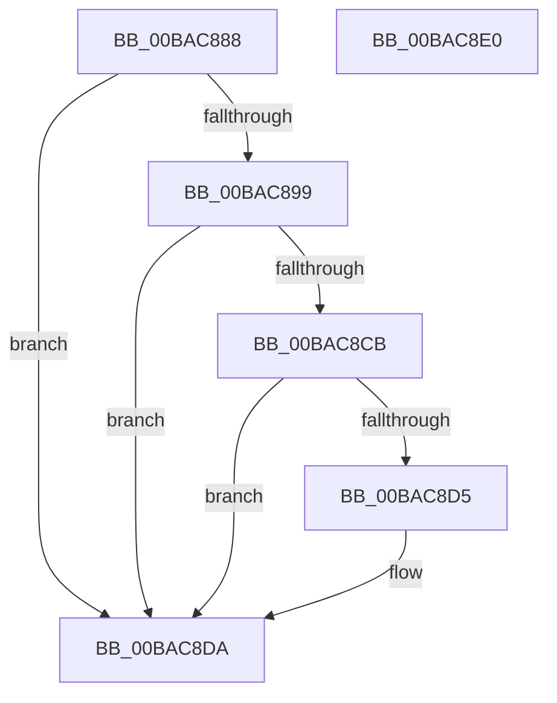

# VfWdCheckForSettingsChange

- RVA: `0x00BAC888`–`0x00BAC8E1` (길이 `89` bytes)
- VA: `0x0000000140BAC888`
- 실행 섹션: `PAGEVRFY`
- PDB 이름 있음: `예`; PDB Function 태그: `아니요`
- unwind 정보 RVA: `0x0005CF00`
- 디코드: `24`개 명령, `89/89` bytes 표시
- 미해석 바이트: `0` (있으면 어셈블리에 `.byte`로 보존)

> 이 문서는 커널 이미지의 기계어와 PDB 기호를 분석해 생성했습니다. 4번과 5번은 함수 원형과 자료형을 바이너리 사용 방식에서 추정한 C 해석이며 원본 소스 복구 결과는 아닙니다.

## 1. Dependencies

- 직접 호출 지점: **3**; 고유 호출 대상: **3**
- 직접 호출자로 확인된 함수: **2**
- RIP 상대 이미지 참조: **5**

### Outgoing calls
- `0x00BAC8AB` → [KeCancelTimer](../../text/23/KeCancelTimer_function_002327E0.md) (function, `0x002327E0`)
- `0x00BAC8B9` → [KeRemoveQueueDpcEx](../../text/46/KeRemoveQueueDpcEx_function_0046CDC0.md) (function, `0x0046CDC0`)
- `0x00BAC8D5` → [ViWdStartTimer](ViWdStartTimer_function_00BACD3C.md) (function, `0x00BACD3C`)

### Direct callers
- [ViSettingsIoCheckForChanges](ViSettingsIoCheckForChanges_function_00BAB3BC.md) at `0x00BAB40B`
- [VfWdSetCancelTimeout](VfWdSetCancelTimeout_function_00BAC9A8.md) at `0x00BAC9EC`

### Static image references
- `0x00BAC88E` → RVA `0x00F044C0` (`.data`; read)
- `0x00BAC89E` → RVA `0x00FFF200` (`PAGEVRFD`; read)
- `0x00BAC8A5` → RVA `0x00FFDAE4` (`PAGEVRFD`; read/write)
- `0x00BAC8B2` → RVA `0x00FFF240` (`PAGEVRFD`; read)
- `0x00BAC8CB` → RVA `0x00F04950` (`.data`; read)

## 2. Other-region calls and transfers

- 다른 실행 섹션으로 향하는 call: **2**
  - `0x00BAC8AB` → [KeCancelTimer](../../text/23/KeCancelTimer_function_002327E0.md) (`PAGEVRFY` → `.text`)
  - `0x00BAC8B9` → [KeRemoveQueueDpcEx](../../text/46/KeRemoveQueueDpcEx_function_0046CDC0.md) (`PAGEVRFY` → `.text`)
- 별도 외부 분기/꼬리 이동을 확인하지 못했습니다.

## 3. Assembly (complete function range)

```asm
00BAC888  40 53                           push rbx
00BAC88A  48 83 EC 20                     sub rsp, 0x20
00BAC88E  83 3D 2B 7C 35 00 00            cmp dword ptr [rip + 0x357c2b], 0
00BAC895  8B D9                           mov ebx, ecx
00BAC897  75 41                           jne 0x140bac8da
00BAC899  B8 01 00 00 00                  mov eax, 1
00BAC89E  48 8D 0D 5B 29 45 00            lea rcx, [rip + 0x45295b]
00BAC8A5  87 05 39 12 45 00               xchg dword ptr [rip + 0x451239], eax
00BAC8AB  E8 30 5F 68 FF                  call 0x1402327e0
00BAC8B0  B2 01                           mov dl, 1
00BAC8B2  48 8D 0D 87 29 45 00            lea rcx, [rip + 0x452987]
00BAC8B9  E8 02 05 8C FF                  call 0x14046cdc0
00BAC8BE  33 C0                           xor eax, eax
00BAC8C0  87 05 1E 12 45 00               xchg dword ptr [rip + 0x45121e], eax
00BAC8C6  F6 C3 10                        test bl, 0x10
00BAC8C9  74 0F                           je 0x140bac8da
00BAC8CB  8B 05 7F 80 35 00               mov eax, dword ptr [rip + 0x35807f]
00BAC8D1  85 C0                           test eax, eax
00BAC8D3  74 05                           je 0x140bac8da
00BAC8D5  E8 62 04 00 00                  call 0x140bacd3c
00BAC8DA  48 83 C4 20                     add rsp, 0x20
00BAC8DE  5B                              pop rbx
00BAC8DF  C3                              ret
00BAC8E0  CC                              int3
```

## 4. C-style interpretation (structured pseudocode)

```c
__int64 __fastcall VfWdCheckForSettingsChange(int a1)
{
    __int64 result;
    __int64 v_rsp;

    v_rsp = (v_rsp) - (32);
    if ((*(unsigned int *)(v_rip + 3505195)) != 0) goto loc_00BAC8DA;
    result = KeCancelTimer(v_rip + 4532571, a2, a3, a4);
    result = KeRemoveQueueDpcEx(v_rip + 4532615, 1, a3, a4);
    result = 0;
    if ((((unsigned __int8)((unsigned int)(a1))) & (16)) == 0) goto loc_00BAC8DA;
    result = (unsigned int)(*(unsigned int *)(v_rip + 3506303));
    if ((unsigned int)((unsigned int)(*(unsigned int *)(v_rip + 3506303))) != 0) {
        result = ViWdStartTimer(v_rip + 4532615, 1, a3, a4);
    }
    v_rsp = (v_rsp) + (32);
    return result;
}
```

## 5. (Beta) C Style

```c
int64_t VfWdCheckForSettingsChange(int32_t Arg1)
{
    int64_t result;
    int64_t local_rsp;

    local_rsp = (local_rsp) - (32);
    if ((*(uint32_t *)(v_rip + 0x357C2B)) != 0) goto loc_00BAC8DA;
    result = KeCancelTimer(v_rip + 4532571, a2, a3, a4);
    result = KeRemoveQueueDpcEx(v_rip + 4532615, 1, a3, a4);
    result = 0;
    if ((((uint8_t)((uint32_t)(Arg1))) & (16)) == 0) goto loc_00BAC8DA;
    result = (uint32_t)(*(uint32_t *)(v_rip + 0x35807F));
    if ((uint32_t)((uint32_t)(*(uint32_t *)(v_rip + 0x35807F))) != 0) {
        result = ViWdStartTimer(v_rip + 4532615, 1, a3, a4);
    }
    local_rsp = (local_rsp) + (32);
    return result;
}
```

## 6. Execution-region graph

[열기: 2D/3D 그래프와 함수 탐색 컨트롤 패널](../../../control-panel.html?section=pagevrfy&rva=0x00BAC888&view=graph)

- 2D 그래프는 위에서 아래로 흐르고, 3D 그래프는 빈 공간을 드래그해 회전합니다. Shift+드래그는 이동, 휠은 확대·축소, 함수 노드 선택은 대상 보고서 이동입니다.

### Static fallback


