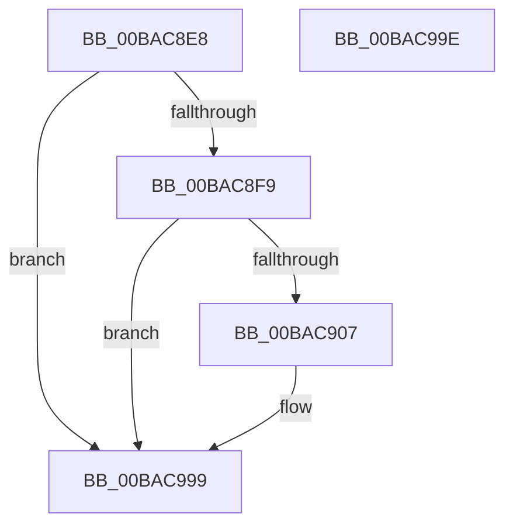

# VfWdInit

- RVA: `0x00BAC8E8`–`0x00BAC99F` (길이 `183` bytes)
- VA: `0x0000000140BAC8E8`
- 실행 섹션: `PAGEVRFY`
- PDB 이름 있음: `예`; PDB Function 태그: `아니요`
- unwind 정보 RVA: `0x00063458`
- 디코드: `33`개 명령, `183/183` bytes 표시
- 미해석 바이트: `0` (있으면 어셈블리에 `.byte`로 보존)

> 이 문서는 커널 이미지의 기계어와 PDB 기호를 분석해 생성했습니다. 4번과 5번은 함수 원형과 자료형을 바이너리 사용 방식에서 추정한 C 해석이며 원본 소스 복구 결과는 아닙니다.

## 1. Dependencies

- 직접 호출 지점: **4**; 고유 호출 대상: **4**
- 직접 호출자로 확인된 함수: **1**
- RIP 상대 이미지 참조: **14**

### Outgoing calls
- `0x00BAC95C` → [ExInitializeNPagedLookasideListInternal](../../text/46/ExInitializeNPagedLookasideListInternal_function_00468720.md) (function, `0x00468720`)
- `0x00BAC968` → [KeInitializeTimer](../../text/45/KeInitializeTimer_function_0045B590.md) (function, `0x0045B590`)
- `0x00BAC97E` → [KeInitializeDpc](../../text/45/KeInitializeDpc_function_0045BBD0.md) (function, `0x0045BBD0`)
- `0x00BAC989` → [VfWdSetCancelTimeout](VfWdSetCancelTimeout_function_00BAC9A8.md) (function, `0x00BAC9A8`)

### Direct callers
- [ViIovInitialization](../BB/ViIovInitialization_function_00BB4EC4.md) at `0x00BB4F40`

### Static image references
- `0x00BAC8EC` → RVA `0x00F044C0` (`.data`; read)
- `0x00BAC8F9` → RVA `0x00FFDAE0` (`PAGEVRFD`; read)
- `0x00BAC907` → RVA `0x00FFDC58` (`PAGEVRFD`; read/write)
- `0x00BAC90F` → RVA `0x00FFDBE0` (`PAGEVRFD`; read)
- `0x00BAC916` → RVA `0x00FFDBE8` (`PAGEVRFD`; write)
- `0x00BAC91D` → RVA `0x00612300` (`VfUtilFreePoolDispatchLevel`; read)
- `0x00BAC924` → RVA `0x00FFDBE0` (`PAGEVRFD`; write)
- `0x00BAC92B` → RVA `0x00FFF480` (`PAGEVRFD`; read)
- `0x00BAC932` → RVA `0x00F04368` (`.data`; read)
- `0x00BAC961` → RVA `0x00FFF200` (`PAGEVRFD`; read)
- `0x00BAC970` → RVA `0x00BACC10` (`ViWdIrpTimerDpcRoutine`; read)
- `0x00BAC977` → RVA `0x00FFF240` (`PAGEVRFD`; read)
- `0x00BAC983` → RVA `0x00FFDB5C` (`PAGEVRFD`; read)
- `0x00BAC993` → RVA `0x00FFDAE0` (`PAGEVRFD`; read/write)

## 2. Other-region calls and transfers

- 다른 실행 섹션으로 향하는 call: **3**
  - `0x00BAC95C` → [ExInitializeNPagedLookasideListInternal](../../text/46/ExInitializeNPagedLookasideListInternal_function_00468720.md) (`PAGEVRFY` → `.text`)
  - `0x00BAC968` → [KeInitializeTimer](../../text/45/KeInitializeTimer_function_0045B590.md) (`PAGEVRFY` → `.text`)
  - `0x00BAC97E` → [KeInitializeDpc](../../text/45/KeInitializeDpc_function_0045BBD0.md) (`PAGEVRFY` → `.text`)
- 별도 외부 분기/꼬리 이동을 확인하지 못했습니다.

## 3. Assembly (complete function range)

```asm
00BAC8E8  48 83 EC 48                     sub rsp, 0x48
00BAC8EC  83 3D CD 7B 35 00 00            cmp dword ptr [rip + 0x357bcd], 0
00BAC8F3  0F 85 A0 00 00 00               jne 0x140bac999
00BAC8F9  8B 05 E1 11 45 00               mov eax, dword ptr [rip + 0x4511e1]
00BAC8FF  85 C0                           test eax, eax
00BAC901  0F 85 92 00 00 00               jne 0x140bac999
00BAC907  48 83 25 49 13 45 00 00         and qword ptr [rip + 0x451349], 0
00BAC90F  48 8D 05 CA 12 45 00            lea rax, [rip + 0x4512ca]
00BAC916  48 89 05 CB 12 45 00            mov qword ptr [rip + 0x4512cb], rax
00BAC91D  4C 8D 05 DC 59 A6 FF            lea r8, [rip - 0x59a624]
00BAC924  48 89 05 B5 12 45 00            mov qword ptr [rip + 0x4512b5], rax
00BAC92B  48 8D 0D 4E 2B 45 00            lea rcx, [rip + 0x452b4e]
00BAC932  8B 05 30 7A 35 00               mov eax, dword ptr [rip + 0x357a30]
00BAC938  41 B9 00 02 00 00               mov r9d, 0x200
00BAC93E  89 44 24 38                     mov dword ptr [rsp + 0x38], eax
00BAC942  33 D2                           xor edx, edx
00BAC944  66 C7 44 24 30 10 00            mov word ptr [rsp + 0x30], 0x10
00BAC94B  C7 44 24 28 56 66 57 64         mov dword ptr [rsp + 0x28], 0x64576656
00BAC953  48 C7 44 24 20 20 00 00 00      mov qword ptr [rsp + 0x20], 0x20
00BAC95C  E8 BF BD 8B FF                  call 0x140468720
00BAC961  48 8D 0D 98 28 45 00            lea rcx, [rip + 0x452898]
00BAC968  E8 23 EC 8A FF                  call 0x14045b590
00BAC96D  45 33 C0                        xor r8d, r8d
00BAC970  48 8D 15 99 02 00 00            lea rdx, [rip + 0x299]
00BAC977  48 8D 0D C2 28 45 00            lea rcx, [rip + 0x4528c2]
00BAC97E  E8 4D F2 8A FF                  call 0x14045bbd0
00BAC983  8B 0D D3 11 45 00               mov ecx, dword ptr [rip + 0x4511d3]
00BAC989  E8 1A 00 00 00                  call 0x140bac9a8
00BAC98E  B8 01 00 00 00                  mov eax, 1
00BAC993  87 05 47 11 45 00               xchg dword ptr [rip + 0x451147], eax
00BAC999  48 83 C4 48                     add rsp, 0x48
00BAC99D  C3                              ret
00BAC99E  CC                              int3
```

## 4. C-style interpretation (structured pseudocode)

```c
__int64 __fastcall VfWdInit(__int64 a1, int a2)
{
    __int64 result;
    __int64 v_rsp;
    unsigned int v_stack_m10;
    unsigned __int16 v_stack_m18;
    unsigned int v_stack_m20;
    unsigned __int64 v_stack_m28;

    v_rsp = (v_rsp) - (72);
    if ((*(unsigned int *)(v_rip + 3505101)) != 0) goto loc_00BAC999;
    result = (unsigned int)(*(unsigned int *)(v_rip + 4526561));
    if ((unsigned int)((unsigned int)(*(unsigned int *)(v_rip + 4526561))) == 0) {
        result = v_rip + 4526794;
        *(unsigned __int64 *)(v_rip + 4526795) = result;
        a3 = v_rip - 5875236;
        *(unsigned __int64 *)(v_rip + 4526773) = result;
        a1 = v_rip + 4533070;
        result = *(unsigned int *)(v_rip + 3504688);
        a4 = 512;
        v_stack_m10 = (unsigned int)(result);
        a2 = 0;
        v_stack_m18 = 16;
        v_stack_m20 = 0x64576656ULL;
        v_stack_m28 = 32;
        result = ExInitializeNPagedLookasideListInternal(a1, a2, a3, a4);
        a1 = v_rip + 4532376;
        result = KeInitializeTimer(a1, a2, a3, a4);
        a3 = 0;
        a2 = v_rip + 665;
        a1 = v_rip + 4532418;
        result = KeInitializeDpc(a1, a2, a3, a4);
        a1 = *(unsigned int *)(v_rip + 4526547);
        result = VfWdSetCancelTimeout(a1, a2, a3, a4);
        result = 1;
    }
    v_rsp = (v_rsp) + (72);
    return result;
}
```

## 5. (Beta) C Style

```c
int64_t VfWdInit(int64_t Arg1, int32_t Arg2)
{
    int64_t result;
    int64_t local_rsp;
    uint32_t v_stack_m10;
    uint16_t v_stack_m18;
    uint32_t v_stack_m20;
    uint64_t v_stack_m28;

    local_rsp = (local_rsp) - (72);
    if ((*(uint32_t *)(v_rip + 0x357BCD)) != 0) goto loc_00BAC999;
    result = (uint32_t)(*(uint32_t *)(v_rip + 0x4511E1));
    if ((uint32_t)((uint32_t)(*(uint32_t *)(v_rip + 0x4511E1))) == 0) {
        result = v_rip + 4526794;
        *(uint64_t *)(v_rip + 0x4512CB) = result;
        a3 = v_rip - 5875236;
        *(uint64_t *)(v_rip + 0x4512B5) = result;
        Arg1 = v_rip + 4533070;
        result = *(uint32_t *)(v_rip + 0x357A30);
        a4 = 512;
        v_stack_m10 = (uint32_t)(result);
        Arg2 = 0;
        v_stack_m18 = 16;
        v_stack_m20 = 0x64576656ULL;
        v_stack_m28 = 32;
        result = ExInitializeNPagedLookasideListInternal(Arg1, Arg2, a3, a4);
        Arg1 = v_rip + 4532376;
        result = KeInitializeTimer(Arg1, Arg2, a3, a4);
        a3 = 0;
        Arg2 = v_rip + 665;
        Arg1 = v_rip + 4532418;
        result = KeInitializeDpc(Arg1, Arg2, a3, a4);
        Arg1 = *(uint32_t *)(v_rip + 0x4511D3);
        result = VfWdSetCancelTimeout(Arg1, Arg2, a3, a4);
        result = 1;
    }
    local_rsp = (local_rsp) + (72);
    return result;
}
```

## 6. Execution-region graph

[열기: 2D/3D 그래프와 함수 탐색 컨트롤 패널](../../../control-panel.html?section=pagevrfy&rva=0x00BAC8E8&view=graph)

- 2D 그래프는 위에서 아래로 흐르고, 3D 그래프는 빈 공간을 드래그해 회전합니다. Shift+드래그는 이동, 휠은 확대·축소, 함수 노드 선택은 대상 보고서 이동입니다.

### Static fallback


