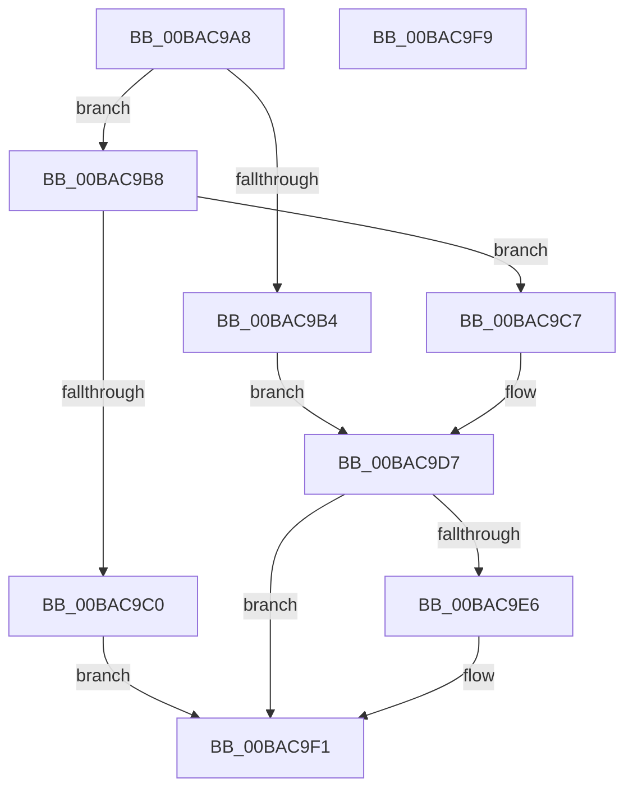

# VfWdSetCancelTimeout

- RVA: `0x00BAC9A8`–`0x00BAC9FA` (길이 `82` bytes)
- VA: `0x0000000140BAC9A8`
- 실행 섹션: `PAGEVRFY`
- PDB 이름 있음: `예`; PDB Function 태그: `아니요`
- unwind 정보 RVA: `0x0005CF00`
- 디코드: `25`개 명령, `82/82` bytes 표시
- 미해석 바이트: `0` (있으면 어셈블리에 `.byte`로 보존)

> 이 문서는 커널 이미지의 기계어와 PDB 기호를 분석해 생성했습니다. 4번과 5번은 함수 원형과 자료형을 바이너리 사용 방식에서 추정한 C 해석이며 원본 소스 복구 결과는 아닙니다.

## 1. Dependencies

- 직접 호출 지점: **1**; 고유 호출 대상: **1**
- 직접 호출자로 확인된 함수: **2**
- RIP 상대 이미지 참조: **3**

### Outgoing calls
- `0x00BAC9EC` → [VfWdCheckForSettingsChange](VfWdCheckForSettingsChange_function_00BAC888.md) (function, `0x00BAC888`)

### Direct callers
- [VfSetVerifierInformationEx](VfSetVerifierInformationEx_function_00BAC624.md) at `0x00BAC66E`
- [VfWdInit](VfWdInit_function_00BAC8E8.md) at `0x00BAC989`

### Static image references
- `0x00BAC9D7` → RVA `0x00F04890` (`.data`; read)
- `0x00BAC9DE` → RVA `0x00F04950` (`.data`; write)
- `0x00BAC9E6` → RVA `0x00F04A20` (`.data`; read)

## 2. Other-region calls and transfers

- 다른 실행 섹션으로 향하는 call: **0**
- 별도 외부 분기/꼬리 이동을 확인하지 못했습니다.

## 3. Assembly (complete function range)

```asm
00BAC9A8  40 53                           push rbx
00BAC9AA  48 83 EC 20                     sub rsp, 0x20
00BAC9AE  33 DB                           xor ebx, ebx
00BAC9B0  85 C9                           test ecx, ecx
00BAC9B2  75 04                           jne 0x140bac9b8
00BAC9B4  8B D3                           mov edx, ebx
00BAC9B6  EB 1F                           jmp 0x140bac9d7
00BAC9B8  81 F9 60 EA 00 00               cmp ecx, 0xea60
00BAC9BE  76 07                           jbe 0x140bac9c7
00BAC9C0  BB 0D 00 00 C0                  mov ebx, 0xc000000d
00BAC9C5  EB 2A                           jmp 0x140bac9f1
00BAC9C7  81 C1 E7 03 00 00               add ecx, 0x3e7
00BAC9CD  B8 D3 4D 62 10                  mov eax, 0x10624dd3
00BAC9D2  F7 E1                           mul ecx
00BAC9D4  C1 EA 06                        shr edx, 6
00BAC9D7  48 39 1D B2 7E 35 00            cmp qword ptr [rip + 0x357eb2], rbx
00BAC9DE  89 15 6C 7F 35 00               mov dword ptr [rip + 0x357f6c], edx
00BAC9E4  74 0B                           je 0x140bac9f1
00BAC9E6  8B 0D 34 80 35 00               mov ecx, dword ptr [rip + 0x358034]
00BAC9EC  E8 97 FE FF FF                  call 0x140bac888
00BAC9F1  8B C3                           mov eax, ebx
00BAC9F3  48 83 C4 20                     add rsp, 0x20
00BAC9F7  5B                              pop rbx
00BAC9F8  C3                              ret
00BAC9F9  CC                              int3
```

## 4. C-style interpretation (structured pseudocode)

```c
__int64 __fastcall VfWdSetCancelTimeout(int a1)
{
    __int64 result;
    __int64 v_rbx;
    __int64 v_rsp;

    v_rsp = (v_rsp) - (32);
    v_rbx = 0;
    if (a1 != 0) goto loc_00BAC9B8;
    goto loc_00BAC9D7;
loc_00BAC9B8:
    if (a1 <= 0xEA60ULL) goto loc_00BAC9C7;
    goto loc_00BAC9F1;
loc_00BAC9C7:
    a1 = (unsigned int)((a1) + (999));
    a2 = (unsigned int)((0) >> (6));
loc_00BAC9D7:
    *(unsigned int *)(v_rip + 3506028) = (unsigned int)(a2);
    result = (unsigned int)(0x10624DD3ULL);
    if ((*(unsigned __int64 *)(v_rip + 3505842)) != ((unsigned int)(0xC000000DULL))) {
        a1 = *(unsigned int *)(v_rip + 3506228);
        result = VfWdCheckForSettingsChange(a1, a2, a3, a4);
    }
    v_rsp = (v_rsp) + (32);
    return (unsigned int)((unsigned int)((unsigned int)(0xC000000DULL)));
}
```

## 5. (Beta) C Style

```c
int64_t VfWdSetCancelTimeout(int32_t Arg1)
{
    int64_t result;
    int64_t local_rbx;
    int64_t local_rsp;

    local_rsp = (local_rsp) - (32);
    local_rbx = 0;
    if (Arg1 != 0) goto loc_00BAC9B8;
    goto loc_00BAC9D7;
loc_00BAC9B8:
    if (Arg1 <= 0xEA60ULL) goto loc_00BAC9C7;
    goto loc_00BAC9F1;
loc_00BAC9C7:
    Arg1 = (uint32_t)((Arg1) + (999));
    a2 = (uint32_t)((0) >> (6));
loc_00BAC9D7:
    *(uint32_t *)(v_rip + 0x357F6C) = (uint32_t)(a2);
    result = (uint32_t)(0x10624DD3ULL);
    if ((*(uint64_t *)(v_rip + 0x357EB2)) != ((uint32_t)(0xC000000DULL))) {
        Arg1 = *(uint32_t *)(v_rip + 0x358034);
        result = VfWdCheckForSettingsChange(Arg1, a2, a3, a4);
    }
    local_rsp = (local_rsp) + (32);
    return (uint32_t)((uint32_t)((uint32_t)(0xC000000DULL)));
}
```

## 6. Execution-region graph

[열기: 2D/3D 그래프와 함수 탐색 컨트롤 패널](../../../control-panel.html?section=pagevrfy&rva=0x00BAC9A8&view=graph)

- 2D 그래프는 위에서 아래로 흐르고, 3D 그래프는 빈 공간을 드래그해 회전합니다. Shift+드래그는 이동, 휠은 확대·축소, 함수 노드 선택은 대상 보고서 이동입니다.

### Static fallback


