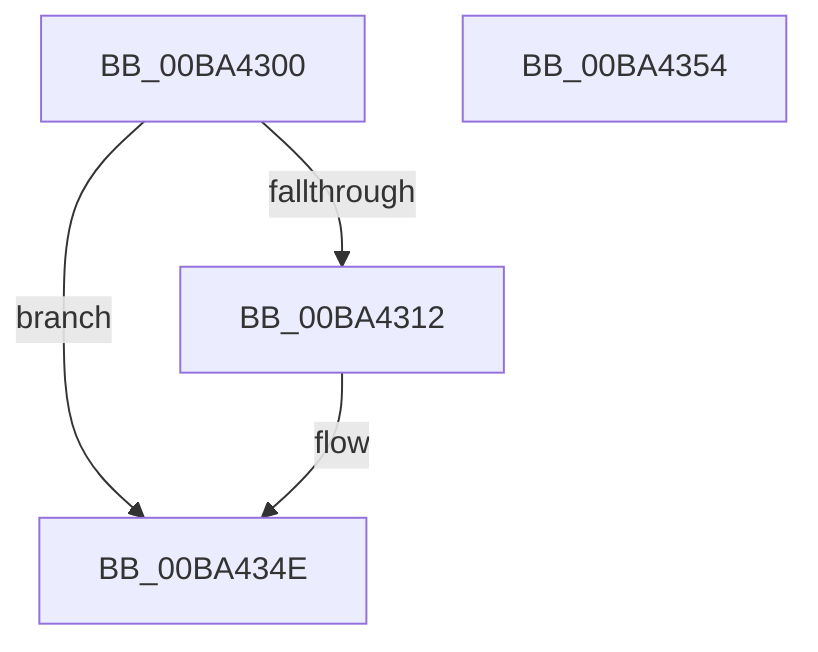

# VfZwCreateTransaction_Entry

- RVA: `0x00BA4300`–`0x00BA4355` (길이 `85` bytes)
- VA: `0x0000000140BA4300`
- 실행 섹션: `PAGEVRFY`
- PDB 이름 있음: `예`; PDB Function 태그: `아니요`
- unwind 정보 RVA: `0x0005CF00`
- 디코드: `25`개 명령, `85/85` bytes 표시
- 미해석 바이트: `0` (있으면 어셈블리에 `.byte`로 보존)

> 이 문서는 커널 이미지의 기계어와 PDB 기호를 분석해 생성했습니다. 4번과 5번은 함수 원형과 자료형을 바이너리 사용 방식에서 추정한 C 해석이며 원본 소스 복구 결과는 아닙니다.

## 1. Dependencies

- 직접 호출 지점: **6**; 고유 호출 대상: **4**
- 직접 호출자로 확인된 함수: **0**
- RIP 상대 이미지 참조: **0**

### Outgoing calls
- `0x00BA4309` → [ViZwShouldCheck](ViZwShouldCheck_function_00BA4DB4.md) (function, `0x00BA4DB4`)
- `0x00BA4319` → [ViZwCheckVirtualAddress](ViZwCheckVirtualAddress_function_00BA4D68.md) (function, `0x00BA4D68`)
- `0x00BA4325` → [ViZwCheckVirtualAddress](ViZwCheckVirtualAddress_function_00BA4D68.md) (function, `0x00BA4D68`)
- `0x00BA4331` → [ViZwCheckVirtualAddress](ViZwCheckVirtualAddress_function_00BA4D68.md) (function, `0x00BA4D68`)
- `0x00BA433D` → [ViZwCheckObjectAttributes](ViZwCheckObjectAttributes_function_00BA4C80.md) (function, `0x00BA4C80`)
- `0x00BA4349` → [ViZwCheckUnicodeString](ViZwCheckUnicodeString_function_00BA4CD0.md) (function, `0x00BA4CD0`)

### Direct callers
- 이 함수 시작 RVA로 연결되는 직접 call은 확인되지 않았습니다. 간접 호출은 완전히 역산할 수 없습니다.

### Static image references
- 디코드된 RIP-relative 메모리 참조가 없습니다.

## 2. Other-region calls and transfers

- 다른 실행 섹션으로 향하는 call: **0**
- 별도 외부 분기/꼬리 이동을 확인하지 못했습니다.

## 3. Assembly (complete function range)

```asm
00BA4300  40 53                           push rbx
00BA4302  48 83 EC 20                     sub rsp, 0x20
00BA4306  48 8B D9                        mov rbx, rcx
00BA4309  E8 A6 0A 00 00                  call 0x140ba4db4
00BA430E  85 C0                           test eax, eax
00BA4310  74 3C                           je 0x140ba434e
00BA4312  48 8B 13                        mov rdx, qword ptr [rbx]
00BA4315  48 8B 4B 48                     mov rcx, qword ptr [rbx + 0x48]
00BA4319  E8 4A 0A 00 00                  call 0x140ba4d68
00BA431E  48 8B 13                        mov rdx, qword ptr [rbx]
00BA4321  48 8B 4B 30                     mov rcx, qword ptr [rbx + 0x30]
00BA4325  E8 3E 0A 00 00                  call 0x140ba4d68
00BA432A  48 8B 13                        mov rdx, qword ptr [rbx]
00BA432D  48 8B 4B 10                     mov rcx, qword ptr [rbx + 0x10]
00BA4331  E8 32 0A 00 00                  call 0x140ba4d68
00BA4336  48 8B 13                        mov rdx, qword ptr [rbx]
00BA4339  48 8B 4B 38                     mov rcx, qword ptr [rbx + 0x38]
00BA433D  E8 3E 09 00 00                  call 0x140ba4c80
00BA4342  48 8B 13                        mov rdx, qword ptr [rbx]
00BA4345  48 8B 4B 08                     mov rcx, qword ptr [rbx + 8]
00BA4349  E8 82 09 00 00                  call 0x140ba4cd0
00BA434E  48 83 C4 20                     add rsp, 0x20
00BA4352  5B                              pop rbx
00BA4353  C3                              ret
00BA4354  CC                              int3
```

## 4. C-style interpretation (structured pseudocode)

```c
__int64 __fastcall VfZwCreateTransaction_Entry(__int64 a1)
{
    __int64 result;
    __int64 v_rsp;

    v_rsp = (v_rsp) - (32);
    result = ViZwShouldCheck(a1, a2, a3, a4);
    if ((unsigned int)(result) != 0) {
        a2 = *(unsigned __int64 *)(a1);
        a1 = *(unsigned __int64 *)(a1 + 72);
        result = ViZwCheckVirtualAddress(a1, a2, a3, a4);
        a2 = *(unsigned __int64 *)(a1);
        a1 = *(unsigned __int64 *)(a1 + 48);
        result = ViZwCheckVirtualAddress(a1, a2, a3, a4);
        a2 = *(unsigned __int64 *)(a1);
        a1 = *(unsigned __int64 *)(a1 + 16);
        result = ViZwCheckVirtualAddress(a1, a2, a3, a4);
        a2 = *(unsigned __int64 *)(a1);
        a1 = *(unsigned __int64 *)(a1 + 56);
        result = ViZwCheckObjectAttributes(a1, a2, a3, a4);
        a2 = *(unsigned __int64 *)(a1);
        a1 = *(unsigned __int64 *)(a1 + 8);
        result = ViZwCheckUnicodeString(a1, a2, a3, a4);
    }
    v_rsp = (v_rsp) + (32);
    return result;
}
```

## 5. (Beta) C Style

```c
int64_t VfZwCreateTransaction_Entry(void *Arg1)
{
    uint8_t *arg1 = (uint8_t *)Arg1;

    int64_t result;
    int64_t local_rsp;

    local_rsp = (local_rsp) - (32);
    result = ViZwShouldCheck(Arg1, a2, a3, a4);
    if ((uint32_t)(result) != 0) {
        a2 = *(uint64_t *)(arg1);
        Arg1 = *(uint64_t *)(arg1 + 0x48);
        result = ViZwCheckVirtualAddress(Arg1, a2, a3, a4);
        a2 = *(uint64_t *)(arg1);
        Arg1 = *(uint64_t *)(arg1 + 0x30);
        result = ViZwCheckVirtualAddress(Arg1, a2, a3, a4);
        a2 = *(uint64_t *)(arg1);
        Arg1 = *(uint64_t *)(arg1 + 0x10);
        result = ViZwCheckVirtualAddress(Arg1, a2, a3, a4);
        a2 = *(uint64_t *)(arg1);
        Arg1 = *(uint64_t *)(arg1 + 0x38);
        result = ViZwCheckObjectAttributes(Arg1, a2, a3, a4);
        a2 = *(uint64_t *)(arg1);
        Arg1 = *(uint64_t *)(arg1 + 0x8);
        result = ViZwCheckUnicodeString(Arg1, a2, a3, a4);
    }
    local_rsp = (local_rsp) + (32);
    return result;
}
```

### 관측된 메모리 오프셋

구조체 형식이 확인되지 않은 접근은 인자 기준의 오프셋으로만 기록했습니다.

| 기준 인자 | 오프셋 표현 | 폭 (bit) | 접근 |
|---|---:|---:|---|
| `Arg1` | `+ 0x0` | `64` | `R` |
| `Arg1` | `+ 0x8` | `64` | `R` |
| `Arg1` | `+ 0x10` | `64` | `R` |
| `Arg1` | `+ 0x30` | `64` | `R` |
| `Arg1` | `+ 0x38` | `64` | `R` |
| `Arg1` | `+ 0x48` | `64` | `R` |

## 6. Execution-region graph

[열기: 2D/3D 그래프와 함수 탐색 컨트롤 패널](../../../control-panel.html?section=pagevrfy&rva=0x00BA4300&view=graph)

- 2D 그래프는 위에서 아래로 흐르고, 3D 그래프는 빈 공간을 드래그해 회전합니다. Shift+드래그는 이동, 휠은 확대·축소, 함수 노드 선택은 대상 보고서 이동입니다.

### Static fallback


