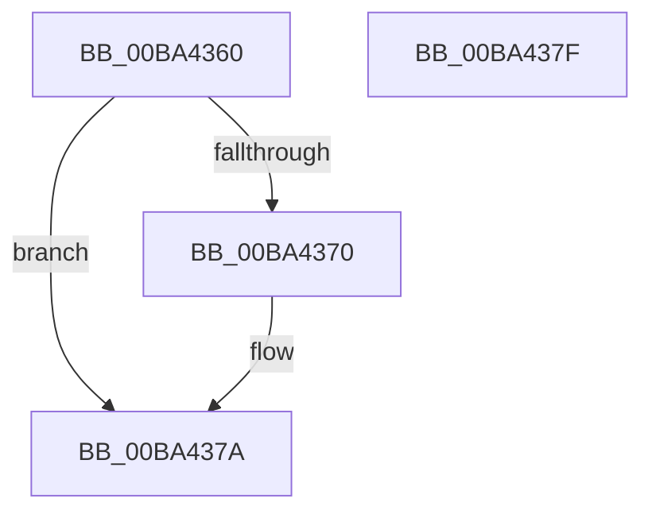

# VfZwDeleteBootEntry_Entry

- RVA: `0x00BA4360`–`0x00BA4380` (길이 `32` bytes)
- VA: `0x0000000140BA4360`
- 실행 섹션: `PAGEVRFY`
- PDB 이름 있음: `예`; PDB Function 태그: `아니요`
- unwind 정보 RVA: `0x0005C788`
- 디코드: `11`개 명령, `32/32` bytes 표시
- 미해석 바이트: `0` (있으면 어셈블리에 `.byte`로 보존)

> 이 문서는 커널 이미지의 기계어와 PDB 기호를 분석해 생성했습니다. 4번과 5번은 함수 원형과 자료형을 바이너리 사용 방식에서 추정한 C 해석이며 원본 소스 복구 결과는 아닙니다.

## 1. Dependencies

- 직접 호출 지점: **2**; 고유 호출 대상: **2**
- 직접 호출자로 확인된 함수: **0**
- RIP 상대 이미지 참조: **0**

### Outgoing calls
- `0x00BA4367` → [ViZwShouldCheck](ViZwShouldCheck_function_00BA4DB4.md) (function, `0x00BA4DB4`)
- `0x00BA4375` → [ViZwCheckVirtualAddress](ViZwCheckVirtualAddress_function_00BA4D68.md) (function, `0x00BA4D68`)

### Direct callers
- 이 함수 시작 RVA로 연결되는 직접 call은 확인되지 않았습니다. 간접 호출은 완전히 역산할 수 없습니다.

### Static image references
- 디코드된 RIP-relative 메모리 참조가 없습니다.

## 2. Other-region calls and transfers

- 다른 실행 섹션으로 향하는 call: **0**
- 별도 외부 분기/꼬리 이동을 확인하지 못했습니다.

## 3. Assembly (complete function range)

```asm
00BA4360  48 83 EC 28                     sub rsp, 0x28
00BA4364  4C 8B C1                        mov r8, rcx
00BA4367  E8 48 0A 00 00                  call 0x140ba4db4
00BA436C  85 C0                           test eax, eax
00BA436E  74 0A                           je 0x140ba437a
00BA4370  49 8B 10                        mov rdx, qword ptr [r8]
00BA4373  33 C9                           xor ecx, ecx
00BA4375  E8 EE 09 00 00                  call 0x140ba4d68
00BA437A  48 83 C4 28                     add rsp, 0x28
00BA437E  C3                              ret
00BA437F  CC                              int3
```

## 4. C-style interpretation (structured pseudocode)

```c
__int64 __fastcall VfZwDeleteBootEntry_Entry(__int64 a1)
{
    __int64 result;
    __int64 v_rsp;

    v_rsp = (v_rsp) - (40);
    result = ViZwShouldCheck(a1, a2, a1, a4);
    if ((unsigned int)(result) != 0) {
        a2 = *(unsigned __int64 *)(a1);
        a1 = 0;
        result = ViZwCheckVirtualAddress(a1, a2, a1, a4);
    }
    v_rsp = (v_rsp) + (40);
    return result;
}
```

## 5. (Beta) C Style

```c
int64_t VfZwDeleteBootEntry_Entry(int64_t Arg1)
{
    int64_t result;
    int64_t local_rsp;

    local_rsp = (local_rsp) - (40);
    result = ViZwShouldCheck(Arg1, a2, Arg1, a4);
    if ((uint32_t)(result) != 0) {
        a2 = *(uint64_t *)(Arg1);
        Arg1 = 0;
        result = ViZwCheckVirtualAddress(Arg1, a2, Arg1, a4);
    }
    local_rsp = (local_rsp) + (40);
    return result;
}
```

## 6. Execution-region graph

[열기: 2D/3D 그래프와 함수 탐색 컨트롤 패널](../../../control-panel.html?section=pagevrfy&rva=0x00BA4360&view=graph)

- 2D 그래프는 위에서 아래로 흐르고, 3D 그래프는 빈 공간을 드래그해 회전합니다. Shift+드래그는 이동, 휠은 확대·축소, 함수 노드 선택은 대상 보고서 이동입니다.

### Static fallback


