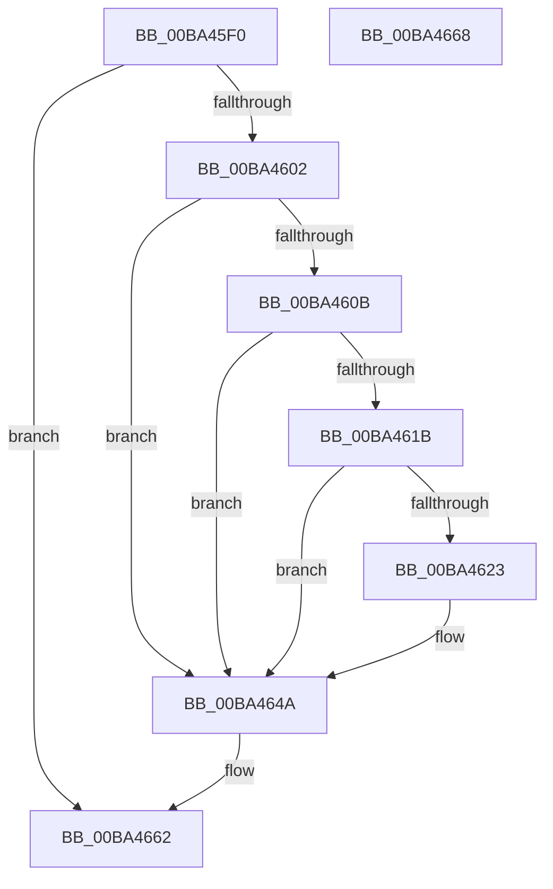

# VfZwNotifyChangeKey_Entry

- RVA: `0x00BA45F0`–`0x00BA4669` (길이 `121` bytes)
- VA: `0x0000000140BA45F0`
- 실행 섹션: `PAGEVRFY`
- PDB 이름 있음: `예`; PDB Function 태그: `아니요`
- unwind 정보 RVA: `0x000697A4`
- 디코드: `35`개 명령, `121/121` bytes 표시
- 미해석 바이트: `0` (있으면 어셈블리에 `.byte`로 보존)

> 이 문서는 커널 이미지의 기계어와 PDB 기호를 분석해 생성했습니다. 4번과 5번은 함수 원형과 자료형을 바이너리 사용 방식에서 추정한 C 해석이며 원본 소스 복구 결과는 아닙니다.

## 1. Dependencies

- 직접 호출 지점: **5**; 고유 호출 대상: **3**
- 직접 호출자로 확인된 함수: **0**
- RIP 상대 이미지 참조: **0**

### Outgoing calls
- `0x00BA45F9` → [ViZwShouldCheck](ViZwShouldCheck_function_00BA4DB4.md) (function, `0x00BA4DB4`)
- `0x00BA460E` → [ViZwCheckVirtualAddress](ViZwCheckVirtualAddress_function_00BA4D68.md) (function, `0x00BA4D68`)
- `0x00BA4645` → [CarReportRuleViolationFromNt](../B9/CarReportRuleViolationFromNt_function_00B9D904.md) (function, `0x00B9D904`)
- `0x00BA4651` → [ViZwCheckVirtualAddress](ViZwCheckVirtualAddress_function_00BA4D68.md) (function, `0x00BA4D68`)
- `0x00BA465D` → [ViZwCheckVirtualAddress](ViZwCheckVirtualAddress_function_00BA4D68.md) (function, `0x00BA4D68`)

### Direct callers
- 이 함수 시작 RVA로 연결되는 직접 call은 확인되지 않았습니다. 간접 호출은 완전히 역산할 수 없습니다.

### Static image references
- 디코드된 RIP-relative 메모리 참조가 없습니다.

## 2. Other-region calls and transfers

- 다른 실행 섹션으로 향하는 call: **0**
- 별도 외부 분기/꼬리 이동을 확인하지 못했습니다.

## 3. Assembly (complete function range)

```asm
00BA45F0  40 53                           push rbx
00BA45F2  48 83 EC 40                     sub rsp, 0x40
00BA45F6  48 8B D9                        mov rbx, rcx
00BA45F9  E8 B6 07 00 00                  call 0x140ba4db4
00BA45FE  85 C0                           test eax, eax
00BA4600  74 60                           je 0x140ba4662
00BA4602  48 8B 4B 30                     mov rcx, qword ptr [rbx + 0x30]
00BA4606  48 85 C9                        test rcx, rcx
00BA4609  74 3F                           je 0x140ba464a
00BA460B  48 8B 13                        mov rdx, qword ptr [rbx]
00BA460E  E8 55 07 00 00                  call 0x140ba4d68
00BA4613  8B 43 28                        mov eax, dword ptr [rbx + 0x28]
00BA4616  83 F8 06                        cmp eax, 6
00BA4619  76 2F                           jbe 0x140ba464a
00BA461B  83 C0 E0                        add eax, -0x20
00BA461E  83 F8 1F                        cmp eax, 0x1f
00BA4621  76 27                           jbe 0x140ba464a
00BA4623  4C 8B 03                        mov r8, qword ptr [rbx]
00BA4626  BA FC 00 00 00                  mov edx, 0xfc
00BA462B  4C 8B 4B 28                     mov r9, qword ptr [rbx + 0x28]
00BA462F  4C 89 44 24 30                  mov qword ptr [rsp + 0x30], r8
00BA4634  C7 44 24 28 08 00 00 00         mov dword ptr [rsp + 0x28], 8
00BA463C  48 83 64 24 20 00               and qword ptr [rsp + 0x20], 0
00BA4642  8D 4A C8                        lea ecx, [rdx - 0x38]
00BA4645  E8 BA 92 FF FF                  call 0x140b9d904
00BA464A  48 8B 13                        mov rdx, qword ptr [rbx]
00BA464D  48 8B 4B 20                     mov rcx, qword ptr [rbx + 0x20]
00BA4651  E8 12 07 00 00                  call 0x140ba4d68
00BA4656  48 8B 13                        mov rdx, qword ptr [rbx]
00BA4659  48 8B 4B 10                     mov rcx, qword ptr [rbx + 0x10]
00BA465D  E8 06 07 00 00                  call 0x140ba4d68
00BA4662  48 83 C4 40                     add rsp, 0x40
00BA4666  5B                              pop rbx
00BA4667  C3                              ret
00BA4668  CC                              int3
```

## 4. C-style interpretation (structured pseudocode)

```c
__int64 __fastcall VfZwNotifyChangeKey_Entry(__int64 a1)
{
    __int64 result;
    __int64 v_rsp;
    unsigned __int64 v_stack_m18;
    unsigned int v_stack_m20;
    unsigned __int64 v_stack_m28;

    v_rsp = (v_rsp) - (64);
    result = ViZwShouldCheck(a1, a2, a3, a4);
    if ((unsigned int)(result) == 0) goto loc_00BA4662;
    if (*(unsigned __int64 *)(a1 + 48) == 0) goto loc_00BA464A;
    result = ViZwCheckVirtualAddress(*(unsigned __int64 *)(a1 + 48), *(unsigned __int64 *)(a1), a3, a4);
    if (((unsigned int)((unsigned int)(*(unsigned int *)(a1 + 40)))) <= 6) goto loc_00BA464A;
    result = (unsigned int)(((unsigned int)(*(unsigned int *)(a1 + 40))) + (-32));
    if (((unsigned int)(result)) >= = 31) {
        a3 = *(unsigned __int64 *)(a1);
        a2 = 252;
        a4 = *(unsigned __int64 *)(a1 + 40);
        v_stack_m18 = a3;
        v_stack_m20 = 8;
        a1 = a2 - 56;
        result = CarReportRuleViolationFromNt(a1, a2, a3, a4);
    }
    result = ViZwCheckVirtualAddress(*(unsigned __int64 *)(a1 + 32), *(unsigned __int64 *)(a1), a3, a4);
    result = ViZwCheckVirtualAddress(*(unsigned __int64 *)(a1 + 16), *(unsigned __int64 *)(a1), a3, a4);
loc_00BA4662:
    v_rsp = (v_rsp) + (64);
    return result;
}
```

## 5. (Beta) C Style

```c
int64_t VfZwNotifyChangeKey_Entry(void *Arg1)
{
    uint8_t *arg1 = (uint8_t *)Arg1;

    int64_t result;
    int64_t local_rsp;
    uint64_t v_stack_m18;
    uint32_t v_stack_m20;
    uint64_t v_stack_m28;

    local_rsp = (local_rsp) - (64);
    result = ViZwShouldCheck(Arg1, a2, a3, a4);
    if ((uint32_t)(result) == 0) goto loc_00BA4662;
    if (*(uint64_t *)(arg1 + 0x30) == 0) goto loc_00BA464A;
    result = ViZwCheckVirtualAddress(*(uint64_t *)(arg1 + 0x30), *(uint64_t *)(arg1), a3, a4);
    if (((uint32_t)((uint32_t)(*(uint32_t *)(arg1 + 0x28)))) <= 6) goto loc_00BA464A;
    result = (uint32_t)(((uint32_t)(*(uint32_t *)(arg1 + 0x28))) + (-32));
    if (((uint32_t)(result)) >= = 31) {
        a3 = *(uint64_t *)(arg1);
        a2 = 252;
        a4 = *(uint64_t *)(arg1 + 0x28);
        v_stack_m18 = a3;
        v_stack_m20 = 8;
        Arg1 = a2 - 56;
        result = CarReportRuleViolationFromNt(Arg1, a2, a3, a4);
    }
    result = ViZwCheckVirtualAddress(*(uint64_t *)(arg1 + 0x20), *(uint64_t *)(arg1), a3, a4);
    result = ViZwCheckVirtualAddress(*(uint64_t *)(arg1 + 0x10), *(uint64_t *)(arg1), a3, a4);
loc_00BA4662:
    local_rsp = (local_rsp) + (64);
    return result;
}
```

### 관측된 메모리 오프셋

구조체 형식이 확인되지 않은 접근은 인자 기준의 오프셋으로만 기록했습니다.

| 기준 인자 | 오프셋 표현 | 폭 (bit) | 접근 |
|---|---:|---:|---|
| `Arg1` | `+ 0x0` | `64` | `R` |
| `Arg1` | `+ 0x10` | `64` | `R` |
| `Arg1` | `+ 0x20` | `64` | `R` |
| `Arg1` | `+ 0x28` | `32` | `R` |
| `Arg1` | `+ 0x28` | `64` | `R` |
| `Arg1` | `+ 0x30` | `64` | `R` |

## 6. Execution-region graph

[열기: 2D/3D 그래프와 함수 탐색 컨트롤 패널](../../../control-panel.html?section=pagevrfy&rva=0x00BA45F0&view=graph)

- 2D 그래프는 위에서 아래로 흐르고, 3D 그래프는 빈 공간을 드래그해 회전합니다. Shift+드래그는 이동, 휠은 확대·축소, 함수 노드 선택은 대상 보고서 이동입니다.

### Static fallback


