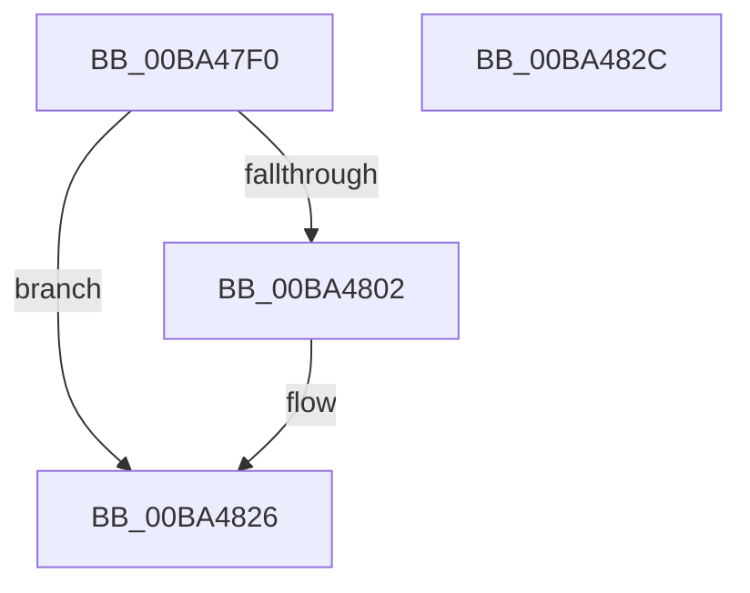

# VfZwProtectVirtualMemory_Entry

- RVA: `0x00BA47F0`–`0x00BA482D` (길이 `61` bytes)
- VA: `0x0000000140BA47F0`
- 실행 섹션: `PAGEVRFY`
- PDB 이름 있음: `예`; PDB Function 태그: `아니요`
- unwind 정보 RVA: `0x0005CF00`
- 디코드: `19`개 명령, `61/61` bytes 표시
- 미해석 바이트: `0` (있으면 어셈블리에 `.byte`로 보존)

> 이 문서는 커널 이미지의 기계어와 PDB 기호를 분석해 생성했습니다. 4번과 5번은 함수 원형과 자료형을 바이너리 사용 방식에서 추정한 C 해석이며 원본 소스 복구 결과는 아닙니다.

## 1. Dependencies

- 직접 호출 지점: **4**; 고유 호출 대상: **2**
- 직접 호출자로 확인된 함수: **0**
- RIP 상대 이미지 참조: **0**

### Outgoing calls
- `0x00BA47F9` → [ViZwShouldCheck](ViZwShouldCheck_function_00BA4DB4.md) (function, `0x00BA4DB4`)
- `0x00BA4809` → [ViZwCheckVirtualAddress](ViZwCheckVirtualAddress_function_00BA4D68.md) (function, `0x00BA4D68`)
- `0x00BA4815` → [ViZwCheckVirtualAddress](ViZwCheckVirtualAddress_function_00BA4D68.md) (function, `0x00BA4D68`)
- `0x00BA4821` → [ViZwCheckVirtualAddress](ViZwCheckVirtualAddress_function_00BA4D68.md) (function, `0x00BA4D68`)

### Direct callers
- 이 함수 시작 RVA로 연결되는 직접 call은 확인되지 않았습니다. 간접 호출은 완전히 역산할 수 없습니다.

### Static image references
- 디코드된 RIP-relative 메모리 참조가 없습니다.

## 2. Other-region calls and transfers

- 다른 실행 섹션으로 향하는 call: **0**
- 별도 외부 분기/꼬리 이동을 확인하지 못했습니다.

## 3. Assembly (complete function range)

```asm
00BA47F0  40 53                           push rbx
00BA47F2  48 83 EC 20                     sub rsp, 0x20
00BA47F6  48 8B D9                        mov rbx, rcx
00BA47F9  E8 B6 05 00 00                  call 0x140ba4db4
00BA47FE  85 C0                           test eax, eax
00BA4800  74 24                           je 0x140ba4826
00BA4802  48 8B 13                        mov rdx, qword ptr [rbx]
00BA4805  48 8B 4B 20                     mov rcx, qword ptr [rbx + 0x20]
00BA4809  E8 5A 05 00 00                  call 0x140ba4d68
00BA480E  48 8B 13                        mov rdx, qword ptr [rbx]
00BA4811  48 8B 4B 18                     mov rcx, qword ptr [rbx + 0x18]
00BA4815  E8 4E 05 00 00                  call 0x140ba4d68
00BA481A  48 8B 13                        mov rdx, qword ptr [rbx]
00BA481D  48 8B 4B 08                     mov rcx, qword ptr [rbx + 8]
00BA4821  E8 42 05 00 00                  call 0x140ba4d68
00BA4826  48 83 C4 20                     add rsp, 0x20
00BA482A  5B                              pop rbx
00BA482B  C3                              ret
00BA482C  CC                              int3
```

## 4. C-style interpretation (structured pseudocode)

```c
__int64 __fastcall VfZwProtectVirtualMemory_Entry(__int64 a1)
{
    __int64 result;
    __int64 v_rsp;

    v_rsp = (v_rsp) - (32);
    result = ViZwShouldCheck(a1, a2, a3, a4);
    if ((unsigned int)(result) != 0) {
        a2 = *(unsigned __int64 *)(a1);
        a1 = *(unsigned __int64 *)(a1 + 32);
        result = ViZwCheckVirtualAddress(a1, a2, a3, a4);
        a2 = *(unsigned __int64 *)(a1);
        a1 = *(unsigned __int64 *)(a1 + 24);
        result = ViZwCheckVirtualAddress(a1, a2, a3, a4);
        a2 = *(unsigned __int64 *)(a1);
        a1 = *(unsigned __int64 *)(a1 + 8);
        result = ViZwCheckVirtualAddress(a1, a2, a3, a4);
    }
    v_rsp = (v_rsp) + (32);
    return result;
}
```

## 5. (Beta) C Style

```c
int64_t VfZwProtectVirtualMemory_Entry(void *Arg1)
{
    uint8_t *arg1 = (uint8_t *)Arg1;

    int64_t result;
    int64_t local_rsp;

    local_rsp = (local_rsp) - (32);
    result = ViZwShouldCheck(Arg1, a2, a3, a4);
    if ((uint32_t)(result) != 0) {
        a2 = *(uint64_t *)(arg1);
        Arg1 = *(uint64_t *)(arg1 + 0x20);
        result = ViZwCheckVirtualAddress(Arg1, a2, a3, a4);
        a2 = *(uint64_t *)(arg1);
        Arg1 = *(uint64_t *)(arg1 + 0x18);
        result = ViZwCheckVirtualAddress(Arg1, a2, a3, a4);
        a2 = *(uint64_t *)(arg1);
        Arg1 = *(uint64_t *)(arg1 + 0x8);
        result = ViZwCheckVirtualAddress(Arg1, a2, a3, a4);
    }
    local_rsp = (local_rsp) + (32);
    return result;
}
```

### 관측된 메모리 오프셋

구조체 형식이 확인되지 않은 접근은 인자 기준의 오프셋으로만 기록했습니다.

| 기준 인자 | 오프셋 표현 | 폭 (bit) | 접근 |
|---|---:|---:|---|
| `Arg1` | `+ 0x0` | `64` | `R` |
| `Arg1` | `+ 0x8` | `64` | `R` |
| `Arg1` | `+ 0x18` | `64` | `R` |
| `Arg1` | `+ 0x20` | `64` | `R` |

## 6. Execution-region graph

[열기: 2D/3D 그래프와 함수 탐색 컨트롤 패널](../../../control-panel.html?section=pagevrfy&rva=0x00BA47F0&view=graph)

- 2D 그래프는 위에서 아래로 흐르고, 3D 그래프는 빈 공간을 드래그해 회전합니다. Shift+드래그는 이동, 휠은 확대·축소, 함수 노드 선택은 대상 보고서 이동입니다.

### Static fallback


