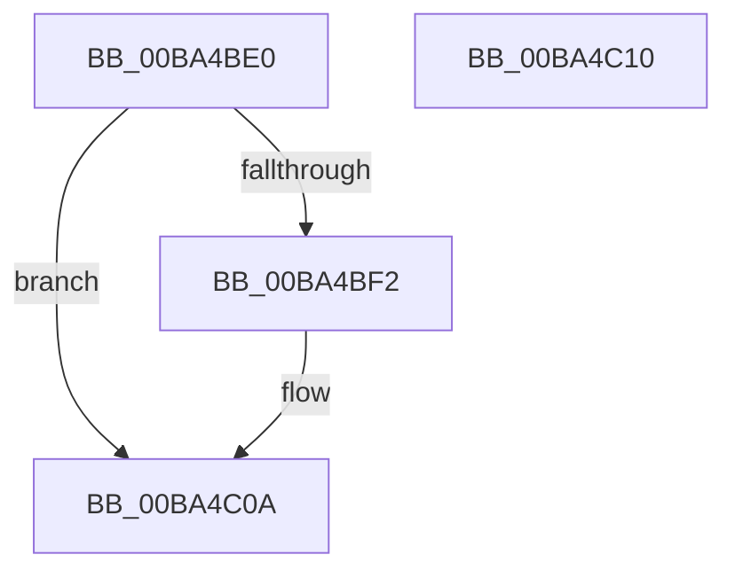

# VfZwSetValueKey_Entry

- RVA: `0x00BA4BE0`–`0x00BA4C11` (길이 `49` bytes)
- VA: `0x0000000140BA4BE0`
- 실행 섹션: `PAGEVRFY`
- PDB 이름 있음: `예`; PDB Function 태그: `아니요`
- unwind 정보 RVA: `0x0005CF00`
- 디코드: `16`개 명령, `49/49` bytes 표시
- 미해석 바이트: `0` (있으면 어셈블리에 `.byte`로 보존)

> 이 문서는 커널 이미지의 기계어와 PDB 기호를 분석해 생성했습니다. 4번과 5번은 함수 원형과 자료형을 바이너리 사용 방식에서 추정한 C 해석이며 원본 소스 복구 결과는 아닙니다.

## 1. Dependencies

- 직접 호출 지점: **3**; 고유 호출 대상: **3**
- 직접 호출자로 확인된 함수: **0**
- RIP 상대 이미지 참조: **0**

### Outgoing calls
- `0x00BA4BE9` → [ViZwShouldCheck](ViZwShouldCheck_function_00BA4DB4.md) (function, `0x00BA4DB4`)
- `0x00BA4BF9` → [ViZwCheckUnicodeString](ViZwCheckUnicodeString_function_00BA4CD0.md) (function, `0x00BA4CD0`)
- `0x00BA4C05` → [ViZwCheckVirtualAddress](ViZwCheckVirtualAddress_function_00BA4D68.md) (function, `0x00BA4D68`)

### Direct callers
- 이 함수 시작 RVA로 연결되는 직접 call은 확인되지 않았습니다. 간접 호출은 완전히 역산할 수 없습니다.

### Static image references
- 디코드된 RIP-relative 메모리 참조가 없습니다.

## 2. Other-region calls and transfers

- 다른 실행 섹션으로 향하는 call: **0**
- 별도 외부 분기/꼬리 이동을 확인하지 못했습니다.

## 3. Assembly (complete function range)

```asm
00BA4BE0  40 53                           push rbx
00BA4BE2  48 83 EC 20                     sub rsp, 0x20
00BA4BE6  48 8B D9                        mov rbx, rcx
00BA4BE9  E8 C6 01 00 00                  call 0x140ba4db4
00BA4BEE  85 C0                           test eax, eax
00BA4BF0  74 18                           je 0x140ba4c0a
00BA4BF2  48 8B 13                        mov rdx, qword ptr [rbx]
00BA4BF5  48 8B 4B 20                     mov rcx, qword ptr [rbx + 0x20]
00BA4BF9  E8 D2 00 00 00                  call 0x140ba4cd0
00BA4BFE  48 8B 13                        mov rdx, qword ptr [rbx]
00BA4C01  48 8B 4B 10                     mov rcx, qword ptr [rbx + 0x10]
00BA4C05  E8 5E 01 00 00                  call 0x140ba4d68
00BA4C0A  48 83 C4 20                     add rsp, 0x20
00BA4C0E  5B                              pop rbx
00BA4C0F  C3                              ret
00BA4C10  CC                              int3
```

## 4. C-style interpretation (structured pseudocode)

```c
__int64 __fastcall VfZwSetValueKey_Entry(__int64 a1)
{
    __int64 result;
    __int64 v_rsp;

    v_rsp = (v_rsp) - (32);
    result = ViZwShouldCheck(a1, a2, a3, a4);
    if ((unsigned int)(result) != 0) {
        a2 = *(unsigned __int64 *)(a1);
        a1 = *(unsigned __int64 *)(a1 + 32);
        result = ViZwCheckUnicodeString(a1, a2, a3, a4);
        a2 = *(unsigned __int64 *)(a1);
        a1 = *(unsigned __int64 *)(a1 + 16);
        result = ViZwCheckVirtualAddress(a1, a2, a3, a4);
    }
    v_rsp = (v_rsp) + (32);
    return result;
}
```

## 5. (Beta) C Style

```c
int64_t VfZwSetValueKey_Entry(void *Arg1)
{
    uint8_t *arg1 = (uint8_t *)Arg1;

    int64_t result;
    int64_t local_rsp;

    local_rsp = (local_rsp) - (32);
    result = ViZwShouldCheck(Arg1, a2, a3, a4);
    if ((uint32_t)(result) != 0) {
        a2 = *(uint64_t *)(arg1);
        Arg1 = *(uint64_t *)(arg1 + 0x20);
        result = ViZwCheckUnicodeString(Arg1, a2, a3, a4);
        a2 = *(uint64_t *)(arg1);
        Arg1 = *(uint64_t *)(arg1 + 0x10);
        result = ViZwCheckVirtualAddress(Arg1, a2, a3, a4);
    }
    local_rsp = (local_rsp) + (32);
    return result;
}
```

### 관측된 메모리 오프셋

구조체 형식이 확인되지 않은 접근은 인자 기준의 오프셋으로만 기록했습니다.

| 기준 인자 | 오프셋 표현 | 폭 (bit) | 접근 |
|---|---:|---:|---|
| `Arg1` | `+ 0x0` | `64` | `R` |
| `Arg1` | `+ 0x10` | `64` | `R` |
| `Arg1` | `+ 0x20` | `64` | `R` |

## 6. Execution-region graph

[열기: 2D/3D 그래프와 함수 탐색 컨트롤 패널](../../../control-panel.html?section=pagevrfy&rva=0x00BA4BE0&view=graph)

- 2D 그래프는 위에서 아래로 흐르고, 3D 그래프는 빈 공간을 드래그해 회전합니다. Shift+드래그는 이동, 휠은 확대·축소, 함수 노드 선택은 대상 보고서 이동입니다.

### Static fallback


