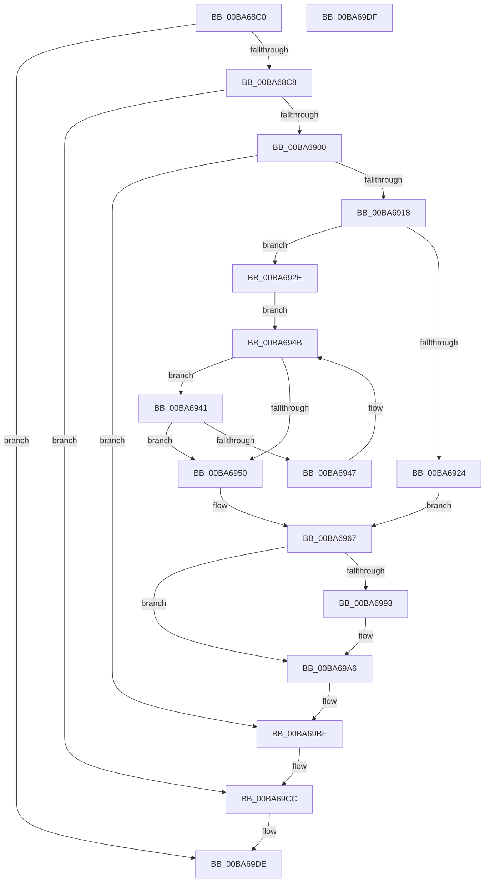

# ViCreateProcessCallbackInternal

- RVA: `0x00BA68C0`–`0x00BA69E0` (길이 `288` bytes)
- VA: `0x0000000140BA68C0`
- 실행 섹션: `PAGEVRFY`
- PDB 이름 있음: `예`; PDB Function 태그: `아니요`
- unwind 정보 RVA: `0x000D25B4`
- 디코드: `79`개 명령, `288/288` bytes 표시
- 미해석 바이트: `0` (있으면 어셈블리에 `.byte`로 보존)

> 이 문서는 커널 이미지의 기계어와 PDB 기호를 분석해 생성했습니다. 4번과 5번은 함수 원형과 자료형을 바이너리 사용 방식에서 추정한 C 해석이며 원본 소스 복구 결과는 아닙니다.

## 1. Dependencies

- 직접 호출 지점: **8**; 고유 호출 대상: **8**
- 직접 호출자로 확인된 함수: **1**
- RIP 상대 이미지 참조: **1**

### Outgoing calls
- `0x00BA68F3` → [PsLookupProcessByProcessId](../../page/8A/PsLookupProcessByProcessId_function_008A2AA0.md) (function, `0x008A2AA0`)
- `0x00BA690B` → [PsGetAllocatedFullProcessImageName](../../page/96/PsGetAllocatedFullProcessImageName_function_00960530.md) (function, `0x00960530`)
- `0x00BA6972` → [RtlUpcaseUnicodeString](../../page/96/RtlUpcaseUnicodeString_function_00960780.md) (function, `0x00960780`)
- `0x00BA697E` → [KeAcquireSpinLockRaiseToDpc](../../text/20/KeAcquireSpinLockRaiseToDpc_function_00208470.md) (function, `0x00208470`)
- `0x00BA698A` → [ViFaultsIsAppTarget](ViFaultsIsAppTarget_function_00BA6CE0.md) (function, `0x00BA6CE0`)
- `0x00BA69B0` → [KeReleaseSpinLock](../../text/39/KeReleaseSpinLock_function_00392BA0.md) (function, `0x00392BA0`)
- `0x00BA69BA` → [ExFreePoolWithTag](../../poolcode/B8/ExFreePoolWithTag_function_00B82870.md) (function, `0x00B82870`)
- `0x00BA69C7` → [ObfDereferenceObjectWithTag](../../text/2F/ObfDereferenceObjectWithTag_function_002F78E0.md) (function, `0x002F78E0`)

### Direct callers
- [VfCreateProcessCallback](../../text/61/VfCreateProcessCallback_function_00615F40.md) at `0x00615F56`

### Static image references
- `0x00BA6977` → RVA `0x00F044C8` (`.data`; read)

## 2. Other-region calls and transfers

- 다른 실행 섹션으로 향하는 call: **7**
  - `0x00BA68F3` → [PsLookupProcessByProcessId](../../page/8A/PsLookupProcessByProcessId_function_008A2AA0.md) (`PAGEVRFY` → `PAGE`)
  - `0x00BA690B` → [PsGetAllocatedFullProcessImageName](../../page/96/PsGetAllocatedFullProcessImageName_function_00960530.md) (`PAGEVRFY` → `PAGE`)
  - `0x00BA6972` → [RtlUpcaseUnicodeString](../../page/96/RtlUpcaseUnicodeString_function_00960780.md) (`PAGEVRFY` → `PAGE`)
  - `0x00BA697E` → [KeAcquireSpinLockRaiseToDpc](../../text/20/KeAcquireSpinLockRaiseToDpc_function_00208470.md) (`PAGEVRFY` → `.text`)
  - `0x00BA69B0` → [KeReleaseSpinLock](../../text/39/KeReleaseSpinLock_function_00392BA0.md) (`PAGEVRFY` → `.text`)
  - `0x00BA69BA` → [ExFreePoolWithTag](../../poolcode/B8/ExFreePoolWithTag_function_00B82870.md) (`PAGEVRFY` → `POOLCODE`)
  - `0x00BA69C7` → [ObfDereferenceObjectWithTag](../../text/2F/ObfDereferenceObjectWithTag_function_002F78E0.md) (`PAGEVRFY` → `.text`)
- 별도 외부 분기/꼬리 이동을 확인하지 못했습니다.

## 3. Assembly (complete function range)

```asm
00BA68C0  84 D2                           test dl, dl
00BA68C2  0F 84 16 01 00 00               je 0x140ba69de
00BA68C8  48 89 5C 24 08                  mov qword ptr [rsp + 8], rbx
00BA68CD  48 89 74 24 10                  mov qword ptr [rsp + 0x10], rsi
00BA68D2  55                              push rbp
00BA68D3  57                              push rdi
00BA68D4  41 56                           push r14
00BA68D6  48 8B EC                        mov rbp, rsp
00BA68D9  48 83 EC 30                     sub rsp, 0x30
00BA68DD  45 33 F6                        xor r14d, r14d
00BA68E0  48 8D 55 30                     lea rdx, [rbp + 0x30]
00BA68E4  0F 57 C0                        xorps xmm0, xmm0
00BA68E7  4C 89 75 30                     mov qword ptr [rbp + 0x30], r14
00BA68EB  4C 89 75 38                     mov qword ptr [rbp + 0x38], r14
00BA68EF  0F 11 45 F0                     movups xmmword ptr [rbp - 0x10], xmm0
00BA68F3  E8 A8 C1 CF FF                  call 0x1408a2aa0
00BA68F8  85 C0                           test eax, eax
00BA68FA  0F 88 CC 00 00 00               js 0x140ba69cc
00BA6900  48 8B 5D 30                     mov rbx, qword ptr [rbp + 0x30]
00BA6904  48 8D 55 38                     lea rdx, [rbp + 0x38]
00BA6908  48 8B CB                        mov rcx, rbx
00BA690B  E8 20 9C DB FF                  call 0x140960530
00BA6910  85 C0                           test eax, eax
00BA6912  0F 88 A7 00 00 00               js 0x140ba69bf
00BA6918  48 8B 7D 38                     mov rdi, qword ptr [rbp + 0x38]
00BA691C  0F B7 17                        movzx edx, word ptr [rdi]
00BA691F  66 85 D2                        test dx, dx
00BA6922  75 0A                           jne 0x140ba692e
00BA6924  0F 10 07                        movups xmm0, xmmword ptr [rdi]
00BA6927  F3 0F 7F 45 F0                  movdqu xmmword ptr [rbp - 0x10], xmm0
00BA692C  EB 39                           jmp 0x140ba6967
00BA692E  4C 8B 47 08                     mov r8, qword ptr [rdi + 8]
00BA6932  48 8B CA                        mov rcx, rdx
00BA6935  48 D1 E9                        shr rcx, 1
00BA6938  48 FF C9                        dec rcx
00BA693B  49 8D 0C 48                     lea rcx, [r8 + rcx*2]
00BA693F  EB 0A                           jmp 0x140ba694b
00BA6941  66 83 39 5C                     cmp word ptr [rcx], 0x5c
00BA6945  74 09                           je 0x140ba6950
00BA6947  48 83 E9 02                     sub rcx, 2
00BA694B  49 3B C8                        cmp rcx, r8
00BA694E  73 F1                           jae 0x140ba6941
00BA6950  48 83 C1 02                     add rcx, 2
00BA6954  66 2B D1                        sub dx, cx
00BA6957  48 89 4D F8                     mov qword ptr [rbp - 8], rcx
00BA695B  66 41 03 D0                     add dx, r8w
00BA695F  66 89 55 F0                     mov word ptr [rbp - 0x10], dx
00BA6963  66 89 55 F2                     mov word ptr [rbp - 0xe], dx
00BA6967  45 33 C0                        xor r8d, r8d
00BA696A  48 8D 55 F0                     lea rdx, [rbp - 0x10]
00BA696E  48 8D 4D F0                     lea rcx, [rbp - 0x10]
00BA6972  E8 09 9E DB FF                  call 0x140960780
00BA6977  48 8D 0D 4A DB 35 00            lea rcx, [rip + 0x35db4a]
00BA697E  E8 ED 1A 66 FF                  call 0x140208470
00BA6983  48 8D 4D F0                     lea rcx, [rbp - 0x10]
00BA6987  40 8A F0                        mov sil, al
00BA698A  E8 51 03 00 00                  call 0x140ba6ce0
00BA698F  85 C0                           test eax, eax
00BA6991  74 13                           je 0x140ba69a6
00BA6993  F0 81 8B F0 01 00 00 00 00 01 00  lock or dword ptr [rbx + 0x1f0], 0x10000
00BA699E  48 8B 5D 30                     mov rbx, qword ptr [rbp + 0x30]
00BA69A2  48 8B 7D 38                     mov rdi, qword ptr [rbp + 0x38]
00BA69A6  40 8A D6                        mov dl, sil
00BA69A9  48 8D 0D 18 DB 35 00            lea rcx, [rip + 0x35db18]
00BA69B0  E8 EB C1 7E FF                  call 0x140392ba0
00BA69B5  33 D2                           xor edx, edx
00BA69B7  48 8B CF                        mov rcx, rdi
00BA69BA  E8 B1 BE FD FF                  call 0x140b82870
00BA69BF  BA 44 66 6C 74                  mov edx, 0x746c6644
00BA69C4  48 8B CB                        mov rcx, rbx
00BA69C7  E8 14 0F 75 FF                  call 0x1402f78e0
00BA69CC  48 8B 5C 24 50                  mov rbx, qword ptr [rsp + 0x50]
00BA69D1  48 8B 74 24 58                  mov rsi, qword ptr [rsp + 0x58]
00BA69D6  48 83 C4 30                     add rsp, 0x30
00BA69DA  41 5E                           pop r14
00BA69DC  5F                              pop rdi
00BA69DD  5D                              pop rbp
00BA69DE  C3                              ret
00BA69DF  CC                              int3
```

## 4. C-style interpretation (structured pseudocode)

```c
__int64 __fastcall ViCreateProcessCallbackInternal(__int64 a1, unsigned __int8 a2)
{
    __int64 result;
    __int64 v_r14;
    __int64 v_rbx;
    __int64 v_rdi;
    __int64 v_rsp;
    unsigned __int64 v_stack_m20;
    unsigned __int16 v_stack_m26;
    unsigned __int64 v_stack_m28;
    unsigned __int64 v_stack_p10;
    unsigned __int64 v_stack_p18;
    unsigned __int64 v_stack_p20;
    unsigned __int64 v_stack_p8;

    if (a2 == 0) goto loc_00BA69DE;
    v_stack_p8 = v_rbx;
    v_stack_p10 = v_rsi;
    v_rsp = (v_rsp) - (48);
    v_r14 = 0;
    v_stack_p18 = 0;
    v_stack_p20 = 0;
    v_stack_m28 = v_xmm0;
    result = PsLookupProcessByProcessId(a1, v_stack_p18, a3, a4);
    if (sign_flag) goto loc_00BA69CC;
    result = PsGetAllocatedFullProcessImageName(v_stack_p18, v_stack_p20, a3, a4);
    if (sign_flag) goto loc_00BA69BF;
    if ((unsigned __int16)(*(unsigned __int16 *)(v_stack_p20)) != 0) goto loc_00BA692E;
    v_stack_m28 = v_xmm0;
    goto loc_00BA6967;
loc_00BA692E:
    a1 = (*(unsigned __int16 *)(v_stack_p20)) >> (1);
    a1 = (a1) - 1;
    goto loc_00BA694B;
loc_00BA6941:
    if ((*(unsigned __int16 *)(*(unsigned __int64 *)(v_stack_p20 + 8) + a1 * 2)) == 92) goto loc_00BA6950;
    a1 = (*(unsigned __int64 *)(v_stack_p20 + 8) + a1 * 2) - (2);
loc_00BA694B:
    if (a1 >= (*(unsigned __int64 *)(v_stack_p20 + 8))) goto loc_00BA6941;
loc_00BA6950:
    a1 = (a1) + (2);
    a2 = (unsigned __int16)((*(unsigned __int16 *)(v_stack_p20)) - ((unsigned __int16)(a1)));
    v_stack_m20 = a1;
    a2 = (unsigned __int16)((a2) + ((unsigned __int16)(*(unsigned __int64 *)(v_stack_p20 + 8))));
    v_stack_m28 = a2;
    v_stack_m26 = a2;
loc_00BA6967:
    a3 = 0;
    result = RtlUpcaseUnicodeString(v_stack_m28, v_stack_m28, a3, a4);
    result = KeAcquireSpinLockRaiseToDpc(v_rip + 3529546, v_stack_m28, a3, a4);
    result = ViFaultsIsAppTarget(v_stack_m28, v_stack_m28, a3, a4);
    v_rbx = v_stack_p18;
    v_rdi = v_stack_p20;
    if ((unsigned int)(result) != 0) {
        v_rbx = v_stack_p18;
        v_rdi = v_stack_p20;
    }
    result = KeReleaseSpinLock(v_rip + 3529496, (unsigned __int8)((unsigned __int8)(result)), a3, a4);
    a2 = 0;
    result = ExFreePoolWithTag(v_rdi, a2, a3, a4);
loc_00BA69BF:
    result = ObfDereferenceObjectWithTag(v_rbx, (unsigned int)(0x746C6644ULL), a3, a4);
loc_00BA69CC:
    v_rsp = (v_rsp) + (48);
loc_00BA69DE:
    return result;
}
```

## 5. (Beta) C Style

```c
int64_t ViCreateProcessCallbackInternal(int64_t Arg1, uint8_t Arg2)
{
    int64_t result;
    int64_t local_r14;
    int64_t local_rbx;
    int64_t local_rdi;
    int64_t local_rsp;
    uint64_t v_stack_m20;
    uint16_t v_stack_m26;
    uint64_t v_stack_m28;
    uint64_t v_stack_p10;
    uint64_t v_stack_p18;
    uint64_t v_stack_p20;
    uint64_t v_stack_p8;

    if (Arg2 == 0) goto loc_00BA69DE;
    v_stack_p8 = local_rbx;
    v_stack_p10 = local_rsi;
    local_rsp = (local_rsp) - (48);
    local_r14 = 0;
    v_stack_p18 = 0;
    v_stack_p20 = 0;
    v_stack_m28 = v_xmm0;
    result = PsLookupProcessByProcessId(Arg1, v_stack_p18, a3, a4);
    if (sign_flag) goto loc_00BA69CC;
    result = PsGetAllocatedFullProcessImageName(v_stack_p18, v_stack_p20, a3, a4);
    if (sign_flag) goto loc_00BA69BF;
    if ((uint16_t)(*(uint16_t *)(v_stack_p20)) != 0) goto loc_00BA692E;
    v_stack_m28 = v_xmm0;
    goto loc_00BA6967;
loc_00BA692E:
    Arg1 = (*(uint16_t *)(v_stack_p20)) >> (1);
    Arg1 = (Arg1) - 1;
    goto loc_00BA694B;
loc_00BA6941:
    if ((*(uint16_t *)(*(uint64_t *)(v_stack_p20 + 0x8) + Arg1 * 2)) == 92) goto loc_00BA6950;
    Arg1 = (*(uint64_t *)(v_stack_p20 + 0x8) + Arg1 * 2) - (2);
loc_00BA694B:
    if (Arg1 >= (*(uint64_t *)(v_stack_p20 + 0x8))) goto loc_00BA6941;
loc_00BA6950:
    Arg1 = (Arg1) + (2);
    Arg2 = (uint16_t)((*(uint16_t *)(v_stack_p20)) - ((uint16_t)(Arg1)));
    v_stack_m20 = Arg1;
    Arg2 = (uint16_t)((Arg2) + ((uint16_t)(*(uint64_t *)(v_stack_p20 + 0x8))));
    v_stack_m28 = Arg2;
    v_stack_m26 = Arg2;
loc_00BA6967:
    a3 = 0;
    result = RtlUpcaseUnicodeString(v_stack_m28, v_stack_m28, a3, a4);
    result = KeAcquireSpinLockRaiseToDpc(v_rip + 3529546, v_stack_m28, a3, a4);
    result = ViFaultsIsAppTarget(v_stack_m28, v_stack_m28, a3, a4);
    local_rbx = v_stack_p18;
    local_rdi = v_stack_p20;
    if ((uint32_t)(result) != 0) {
        local_rbx = v_stack_p18;
        local_rdi = v_stack_p20;
    }
    result = KeReleaseSpinLock(v_rip + 3529496, (uint8_t)((uint8_t)(result)), a3, a4);
    Arg2 = 0;
    result = ExFreePoolWithTag(local_rdi, Arg2, a3, a4);
loc_00BA69BF:
    result = ObfDereferenceObjectWithTag(local_rbx, (uint32_t)(0x746C6644ULL), a3, a4);
loc_00BA69CC:
    local_rsp = (local_rsp) + (48);
loc_00BA69DE:
    return result;
}
```

## 6. Execution-region graph

[열기: 2D/3D 그래프와 함수 탐색 컨트롤 패널](../../../control-panel.html?section=pagevrfy&rva=0x00BA68C0&view=graph)

- 2D 그래프는 위에서 아래로 흐르고, 3D 그래프는 빈 공간을 드래그해 회전합니다. Shift+드래그는 이동, 휠은 확대·축소, 함수 노드 선택은 대상 보고서 이동입니다.

### Static fallback


