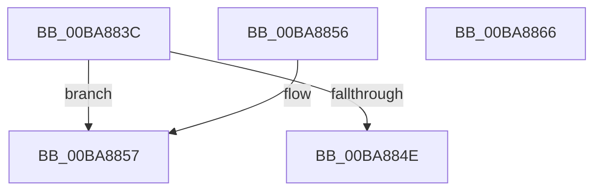

# ViDeadlockAddParticipant

- RVA: `0x00BA883C`–`0x00BA8867` (길이 `43` bytes)
- VA: `0x0000000140BA883C`
- 실행 섹션: `PAGEVRFY`
- PDB 이름 있음: `예`; PDB Function 태그: `아니요`
- unwind 정보 RVA: `0x000DB714`
- 디코드: `11`개 명령, `43/43` bytes 표시
- 미해석 바이트: `0` (있으면 어셈블리에 `.byte`로 보존)

> 이 문서는 커널 이미지의 기계어와 PDB 기호를 분석해 생성했습니다. 4번과 5번은 함수 원형과 자료형을 바이너리 사용 방식에서 추정한 C 해석이며 원본 소스 복구 결과는 아닙니다.

## 1. Dependencies

- 직접 호출 지점: **0**; 고유 호출 대상: **0**
- 직접 호출자로 확인된 함수: **1**
- RIP 상대 이미지 참조: **2**

### Outgoing calls
- 직접 디코드된 call 명령이 없습니다.

### Direct callers
- [ViDeadlockAnalyze](ViDeadlockAnalyze_function_00BA8BD4.md) at `0x00BA8CF7`
- [ViDeadlockAnalyze](ViDeadlockAnalyze_function_00BA8BD4.md) at `0x00BA8D6E`

### Static image references
- `0x00BA883C` → RVA `0x00FFDA00` (`PAGEVRFD`; read)
- `0x00BA884E` → RVA `0x00FFDA20` (`PAGEVRFD`; read/write)

## 2. Other-region calls and transfers

- 다른 실행 섹션으로 향하는 call: **0**
- 별도 외부 분기/꼬리 이동을 확인하지 못했습니다.

## 3. Assembly (complete function range)

```asm
00BA883C  48 8B 15 BD 51 45 00            mov rdx, qword ptr [rip + 0x4551bd]
00BA8843  8B 82 60 80 00 00               mov eax, dword ptr [rdx + 0x8060]
00BA8849  83 F8 20                        cmp eax, 0x20
00BA884C  72 09                           jb 0x140ba8857
00BA884E  83 0D CB 51 45 00 10            or dword ptr [rip + 0x4551cb], 0x10
00BA8855  C3                              ret
00BA8856  CC                              int3
00BA8857  48 89 8C C2 68 80 00 00         mov qword ptr [rdx + rax*8 + 0x8068], rcx
00BA885F  FF 82 60 80 00 00               inc dword ptr [rdx + 0x8060]
00BA8865  C3                              ret
00BA8866  CC                              int3
```

## 4. C-style interpretation (structured pseudocode)

```c
__int64 __fastcall ViDeadlockAddParticipant(__int64 a1)
{
    if (((unsigned int)((unsigned int)(*(unsigned int *)(*(unsigned __int64 *)(v_rip + 4542909) + 32864)))) < 32) goto loc_00BA8857;
    return (unsigned int)(*(unsigned int *)(*(unsigned __int64 *)(v_rip + 4542909) + 32864));
loc_00BA8857:
    *(unsigned __int64 *)(*(unsigned __int64 *)(v_rip + 4542909) + (unsigned int)(*(unsigned int *)(*(unsigned __int64 *)(v_rip + 4542909) + 32864)) * 8 + 32872) = a1;
    return (unsigned int)(*(unsigned int *)(*(unsigned __int64 *)(v_rip + 4542909) + 32864));
}
```

## 5. (Beta) C Style

```c
int64_t ViDeadlockAddParticipant(int64_t Arg1)
{
    if (((uint32_t)((uint32_t)(*(uint32_t *)(*(uint64_t *)(v_rip + 0x4551BD) + 0x8060)))) < 32) goto loc_00BA8857;
    return (uint32_t)(*(uint32_t *)(*(uint64_t *)(v_rip + 0x4551BD) + 0x8060));
loc_00BA8857:
    *(uint64_t *)(*(uint64_t *)(v_rip + 0x4551BD) + (uint32_t)(*(uint32_t *)(*(uint64_t *)(v_rip + 0x4551BD) + 0x8060)) * 8 + 0x8068) = Arg1;
    return (uint32_t)(*(uint32_t *)(*(uint64_t *)(v_rip + 0x4551BD) + 0x8060));
}
```

## 6. Execution-region graph

[열기: 2D/3D 그래프와 함수 탐색 컨트롤 패널](../../../control-panel.html?section=pagevrfy&rva=0x00BA883C&view=graph)

- 2D 그래프는 위에서 아래로 흐르고, 3D 그래프는 빈 공간을 드래그해 회전합니다. Shift+드래그는 이동, 휠은 확대·축소, 함수 노드 선택은 대상 보고서 이동입니다.

### Static fallback


