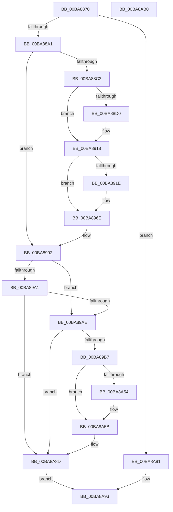

# ViDeadlockAddResource

- RVA: `0x00BA8870`–`0x00BA8AB1` (길이 `577` bytes)
- VA: `0x0000000140BA8870`
- 실행 섹션: `PAGEVRFY`
- PDB 이름 있음: `예`; PDB Function 태그: `아니요`
- unwind 정보 RVA: `0x0008C20C`
- 디코드: `136`개 명령, `577/577` bytes 표시
- 미해석 바이트: `0` (있으면 어셈블리에 `.byte`로 보존)

> 이 문서는 커널 이미지의 기계어와 PDB 기호를 분석해 생성했습니다. 4번과 5번은 함수 원형과 자료형을 바이너리 사용 방식에서 추정한 C 해석이며 원본 소스 복구 결과는 아닙니다.

## 1. Dependencies

- 직접 호출 지점: **7**; 고유 호출 대상: **5**
- 직접 호출자로 확인된 함수: **2**
- RIP 상대 이미지 참조: **5**

### Outgoing calls
- `0x00BA88A9` → [ViDeadlockSearchResource](ViDeadlockSearchResource_function_00BAA0D0.md) (function, `0x00BAA0D0`)
- `0x00BA88F4` → [ViDeadlockPreprocessOptions](ViDeadlockPreprocessOptions_function_00BA9BB4.md) (function, `0x00BA9BB4`)
- `0x00BA8913` → [VfReportIssueWithOptions](../../text/61/VfReportIssueWithOptions_function_00614444.md) (function, `0x00614444`)
- `0x00BA8946` → [ViDeadlockPreprocessOptions](ViDeadlockPreprocessOptions_function_00BA9BB4.md) (function, `0x00BA9BB4`)
- `0x00BA8969` → [VfReportIssueWithOptions](../../text/61/VfReportIssueWithOptions_function_00614444.md) (function, `0x00614444`)
- `0x00BA897B` → [ViDeadlockRemoveResource](ViDeadlockRemoveResource_function_00BA9DEC.md) (function, `0x00BA9DEC`)
- `0x00BA8A7F` → [VfUtilAddressRangeAdd](../B9/VfUtilAddressRangeAdd_function_00B93108.md) (function, `0x00B93108`)

### Direct callers
- [VfDeadlockInitializeResource](VfDeadlockInitializeResource_function_00BA80A0.md) at `0x00BA819F`
- [VfDeadlockAcquireResource](../BB/VfDeadlockAcquireResource_function_00BB83B4.md) at `0x00BB85DF`

### Static image references
- `0x00BA88B0` → RVA `0x00000000` (`image boundary/outside`; read)
- `0x00BA88D0` → RVA `0x00E0EA18` (`.data`; read)
- `0x00BA88E7` → RVA `0x00BBB1A0` (` ?? ::JKADOLAD::`string'`; read)
- `0x00BA891E` → RVA `0x00E0EA28` (`.data`; read)
- `0x00BA89B7` → RVA `0x00FFDA00` (`PAGEVRFD`; read)

## 2. Other-region calls and transfers

- 다른 실행 섹션으로 향하는 call: **2**
  - `0x00BA8913` → [VfReportIssueWithOptions](../../text/61/VfReportIssueWithOptions_function_00614444.md) (`PAGEVRFY` → `.text`)
  - `0x00BA8969` → [VfReportIssueWithOptions](../../text/61/VfReportIssueWithOptions_function_00614444.md) (`PAGEVRFY` → `.text`)
- 별도 외부 분기/꼬리 이동을 확인하지 못했습니다.

## 3. Assembly (complete function range)

```asm
00BA8870  48 89 5C 24 08                  mov qword ptr [rsp + 8], rbx
00BA8875  48 89 6C 24 10                  mov qword ptr [rsp + 0x10], rbp
00BA887A  48 89 74 24 18                  mov qword ptr [rsp + 0x18], rsi
00BA887F  57                              push rdi
00BA8880  41 54                           push r12
00BA8882  41 55                           push r13
00BA8884  41 56                           push r14
00BA8886  41 57                           push r15
00BA8888  48 83 EC 30                     sub rsp, 0x30
00BA888C  48 63 EA                        movsxd rbp, edx
00BA888F  4D 8B E1                        mov r12, r9
00BA8892  4D 8B F0                        mov r14, r8
00BA8895  48 8B F9                        mov rdi, rcx
00BA8898  83 FD 08                        cmp ebp, 8
00BA889B  0F 87 F0 01 00 00               ja 0x140ba8a91
00BA88A1  48 8B 94 24 88 00 00 00         mov rdx, qword ptr [rsp + 0x88]
00BA88A9  E8 22 18 00 00                  call 0x140baa0d0
00BA88AE  33 DB                           xor ebx, ebx
00BA88B0  4C 8D 05 49 77 45 FF            lea r8, [rip - 0xba88b7]
00BA88B7  48 8B F0                        mov rsi, rax
00BA88BA  48 85 C0                        test rax, rax
00BA88BD  0F 84 CF 00 00 00               je 0x140ba8992
00BA88C3  41 8B 8C A8 A8 B0 B8 00         mov ecx, dword ptr [r8 + rbp*4 + 0xb8b0a8]
00BA88CB  F6 C1 08                        test cl, 8
00BA88CE  75 48                           jne 0x140ba8918
00BA88D0  4C 8D 2D 41 61 26 00            lea r13, [rip + 0x266141]
00BA88D7  48 89 5C 24 28                  mov qword ptr [rsp + 0x28], rbx
00BA88DC  49 8B CD                        mov rcx, r13
00BA88DF  48 89 44 24 20                  mov qword ptr [rsp + 0x20], rax
00BA88E4  4C 8B CF                        mov r9, rdi
00BA88E7  48 8D 15 B2 28 01 00            lea rdx, [rip + 0x128b2]
00BA88EE  41 B8 05 10 00 00               mov r8d, 0x1005
00BA88F4  E8 BB 12 00 00                  call 0x140ba9bb4
00BA88F9  4C 8B CE                        mov r9, rsi
00BA88FC  4C 89 6C 24 28                  mov qword ptr [rsp + 0x28], r13
00BA8901  4C 8B C7                        mov r8, rdi
00BA8904  48 89 5C 24 20                  mov qword ptr [rsp + 0x20], rbx
00BA8909  BA 05 10 00 00                  mov edx, 0x1005
00BA890E  B9 C4 00 00 00                  mov ecx, 0xc4
00BA8913  E8 2C BB A6 FF                  call 0x140614444
00BA8918  48 39 5E 10                     cmp qword ptr [rsi + 0x10], rbx
00BA891C  74 50                           je 0x140ba896e
00BA891E  4C 8D 2D 03 61 26 00            lea r13, [rip + 0x266103]
00BA8925  48 C7 44 24 28 01 00 00 00      mov qword ptr [rsp + 0x28], 1
00BA892E  49 8B CD                        mov rcx, r13
00BA8931  48 89 74 24 20                  mov qword ptr [rsp + 0x20], rsi
00BA8936  4C 8B CF                        mov r9, rdi
00BA8939  48 8D 15 60 28 01 00            lea rdx, [rip + 0x12860]
00BA8940  41 B8 05 10 00 00               mov r8d, 0x1005
00BA8946  E8 69 12 00 00                  call 0x140ba9bb4
00BA894B  4C 8B CE                        mov r9, rsi
00BA894E  4C 89 6C 24 28                  mov qword ptr [rsp + 0x28], r13
00BA8953  4C 8B C7                        mov r8, rdi
00BA8956  48 C7 44 24 20 01 00 00 00      mov qword ptr [rsp + 0x20], 1
00BA895F  BA 05 10 00 00                  mov edx, 0x1005
00BA8964  B9 C4 00 00 00                  mov ecx, 0xc4
00BA8969  E8 D6 BA A6 FF                  call 0x140614444
00BA896E  4C 8B 84 24 88 00 00 00         mov r8, qword ptr [rsp + 0x88]
00BA8976  33 D2                           xor edx, edx
00BA8978  48 8B CE                        mov rcx, rsi
00BA897B  E8 6C 14 00 00                  call 0x140ba9dec
00BA8980  48 8B 84 24 80 00 00 00         mov rax, qword ptr [rsp + 0x80]
00BA8988  4C 8D 05 71 76 45 FF            lea r8, [rip - 0xba898f]
00BA898F  48 89 30                        mov qword ptr [rax], rsi
00BA8992  65 48 8B 04 25 88 01 00 00      mov rax, qword ptr gs:[0x188]
00BA899B  48 3B 78 28                     cmp rdi, qword ptr [rax + 0x28]
00BA899F  73 0D                           jae 0x140ba89ae
00BA89A1  48 8B 40 30                     mov rax, qword ptr [rax + 0x30]
00BA89A5  48 3B F8                        cmp rdi, rax
00BA89A8  0F 87 DF 00 00 00               ja 0x140ba8a8d
00BA89AE  4D 85 F6                        test r14, r14
00BA89B1  0F 84 D6 00 00 00               je 0x140ba8a8d
00BA89B7  4C 8B 0D 42 50 45 00            mov r9, qword ptr [rip + 0x455042]
00BA89BE  49 8D 46 18                     lea rax, [r14 + 0x18]
00BA89C2  49 89 5E 78                     mov qword ptr [r14 + 0x78], rbx
00BA89C6  48 8B CF                        mov rcx, rdi
00BA89C9  49 89 9E B8 00 00 00            mov qword ptr [r14 + 0xb8], rbx
00BA89D0  41 89 5E 04                     mov dword ptr [r14 + 4], ebx
00BA89D4  49 89 5E 10                     mov qword ptr [r14 + 0x10], rbx
00BA89D8  41 89 2E                        mov dword ptr [r14], ebp
00BA89DB  49 89 7E 08                     mov qword ptr [r14 + 8], rdi
00BA89DF  48 89 40 08                     mov qword ptr [rax + 8], rax
00BA89E3  48 89 00                        mov qword ptr [rax], rax
00BA89E6  48 B8 11 40 00 01 04 10 40 00   movabs rax, 0x40100401004011
00BA89F0  41 0F 28 04 24                  movaps xmm0, xmmword ptr [r12]
00BA89F5  41 0F 11 46 38                  movups xmmword ptr [r14 + 0x38], xmm0
00BA89FA  48 C1 E9 0C                     shr rcx, 0xc
00BA89FE  41 0F 28 4C 24 10               movaps xmm1, xmmword ptr [r12 + 0x10]
00BA8A04  48 F7 E1                        mul rcx
00BA8A07  41 0F 11 4E 48                  movups xmmword ptr [r14 + 0x48], xmm1
00BA8A0C  41 0F 28 44 24 20               movaps xmm0, xmmword ptr [r12 + 0x20]
00BA8A12  41 0F 11 46 58                  movups xmmword ptr [r14 + 0x58], xmm0
00BA8A17  48 8B C1                        mov rax, rcx
00BA8A1A  41 0F 28 4C 24 30               movaps xmm1, xmmword ptr [r12 + 0x30]
00BA8A20  48 2B C2                        sub rax, rdx
00BA8A23  48 D1 E8                        shr rax, 1
00BA8A26  48 03 C2                        add rax, rdx
00BA8A29  48 C1 E8 09                     shr rax, 9
00BA8A2D  48 69 C0 FF 03 00 00            imul rax, rax, 0x3ff
00BA8A34  41 0F 11 4E 68                  movups xmmword ptr [r14 + 0x68], xmm1
00BA8A39  49 83 C6 28                     add r14, 0x28
00BA8A3D  48 2B C8                        sub rcx, rax
00BA8A40  48 8B C1                        mov rax, rcx
00BA8A43  48 C1 E0 04                     shl rax, 4
00BA8A47  49 03 41 10                     add rax, qword ptr [r9 + 0x10]
00BA8A4B  48 8B 10                        mov rdx, qword ptr [rax]
00BA8A4E  48 39 42 08                     cmp qword ptr [rdx + 8], rax
00BA8A52  74 07                           je 0x140ba8a5b
00BA8A54  B9 03 00 00 00                  mov ecx, 3
00BA8A59  CD 29                           int 0x29
00BA8A5B  45 8B 84 A8 60 B1 B8 00         mov r8d, dword ptr [r8 + rbp*4 + 0xb8b160]
00BA8A63  48 83 C1 02                     add rcx, 2
00BA8A67  49 89 16                        mov qword ptr [r14], rdx
00BA8A6A  49 89 46 08                     mov qword ptr [r14 + 8], rax
00BA8A6E  4C 89 72 08                     mov qword ptr [rdx + 8], r14
00BA8A72  48 8B D7                        mov rdx, rdi
00BA8A75  48 C1 E1 04                     shl rcx, 4
00BA8A79  49 03 C9                        add rcx, r9
00BA8A7C  4C 89 30                        mov qword ptr [rax], r14
00BA8A7F  E8 84 A6 FE FF                  call 0x140b93108
00BA8A84  49 FF 41 18                     inc qword ptr [r9 + 0x18]
00BA8A88  BB 01 00 00 00                  mov ebx, 1
00BA8A8D  8B C3                           mov eax, ebx
00BA8A8F  EB 02                           jmp 0x140ba8a93
00BA8A91  33 C0                           xor eax, eax
00BA8A93  48 8B 5C 24 60                  mov rbx, qword ptr [rsp + 0x60]
00BA8A98  48 8B 6C 24 68                  mov rbp, qword ptr [rsp + 0x68]
00BA8A9D  48 8B 74 24 70                  mov rsi, qword ptr [rsp + 0x70]
00BA8AA2  48 83 C4 30                     add rsp, 0x30
00BA8AA6  41 5F                           pop r15
00BA8AA8  41 5E                           pop r14
00BA8AAA  41 5D                           pop r13
00BA8AAC  41 5C                           pop r12
00BA8AAE  5F                              pop rdi
00BA8AAF  C3                              ret
00BA8AB0  CC                              int3
```

## 4. C-style interpretation (structured pseudocode)

```c
__int64 __fastcall ViDeadlockAddResource(__int64 a1, int a2, __int64 a3, __int64 a4, __int64 a5, __int64 a6)
{
    __int64 result;
    __int64 v_r13;
    __int64 v_r14;
    __int64 v_rbx;
    __int64 v_rsp;
    unsigned __int64 v_stack_m30;
    unsigned __int64 v_stack_m38;
    unsigned __int64 v_stack_p10;
    unsigned __int64 v_stack_p18;
    unsigned __int64 v_stack_p8;

    v_stack_p8 = v_rbx;
    v_stack_p10 = v_rbp;
    v_stack_p18 = v_rsi;
    v_rsp = (v_rsp) - (48);
    if (((unsigned int)((int)(a2))) > 8) goto loc_00BA8A91;
    result = ViDeadlockSearchResource(a1, a6, a3, a4);
    v_rbx = 0;
    if (result == 0) goto loc_00BA8992;
    if ((((unsigned __int8)((unsigned int)(*(unsigned int *)(v_rip - 12224695 + (int)(a2) * 4 + 12103848)))) & (8)) == 0) {
        v_r13 = v_rip + 2515265;
        v_stack_m30 = 0;
        a1 = v_r13;
        v_stack_m38 = result;
        a4 = a1;
        a2 = v_rip + 75954;
        a3 = 0x1005ULL;
        result = ViDeadlockPreprocessOptions(a1, a2, a3, a4);
        a4 = result;
        v_stack_m30 = v_r13;
        a3 = a1;
        v_stack_m38 = 0;
        a2 = 0x1005ULL;
        a1 = 196;
        result = VfReportIssueWithOptions(a1, a2, a3, a4);
    }
    if ((*(unsigned __int64 *)(result + 16)) != 0) {
        v_r13 = v_rip + 2515203;
        v_stack_m30 = 1;
        a1 = v_r13;
        v_stack_m38 = result;
        a4 = a1;
        a2 = v_rip + 75872;
        a3 = 0x1005ULL;
        result = ViDeadlockPreprocessOptions(a1, a2, a3, a4);
        a4 = result;
        v_stack_m30 = v_r13;
        a3 = a1;
        v_stack_m38 = 1;
        a2 = 0x1005ULL;
        a1 = 196;
        result = VfReportIssueWithOptions(a1, a2, a3, a4);
    }
    a2 = 0;
    result = ViDeadlockRemoveResource(result, a2, a6, a4);
    *(unsigned __int64 *)(a5) = result;
loc_00BA8992:
    if (a1 >= (*(unsigned __int64 *)(*(unsigned __int64 *)(gs_base + (0 + 392)) + 40))) goto loc_00BA89AE;
    if (a1 > (*(unsigned __int64 *)(*(unsigned __int64 *)(gs_base + (0 + 392)) + 48))) goto loc_00BA8A8D;
loc_00BA89AE:
    if (a3 == 0) goto loc_00BA8A8D;
    *(unsigned __int64 *)(a3 + 120) = 0;
    *(unsigned __int64 *)(a3 + 184) = 0;
    *(unsigned int *)(a3 + 4) = 0;
    *(unsigned __int64 *)(a3 + 16) = 0;
    *(unsigned int *)(a3) = (unsigned int)((int)(a2));
    *(unsigned __int64 *)(a3 + 8) = a1;
    *(unsigned __int64 *)(a3 + 24 + 8) = a3 + 24;
    *(unsigned __int64 *)(a3 + 24) = a3 + 24;
    *(unsigned __int64 *)(a3 + 56) = v_xmm0;
    a1 = (a1) >> (12);
    *(unsigned __int64 *)(a3 + 72) = v_xmm1;
    *(unsigned __int64 *)(a3 + 88) = v_xmm0;
    result = (a1) - (0);
    result = (result) >> (1);
    result = (result) + (0);
    result = (result) >> (9);
    result = (result) * (result);
    *(unsigned __int64 *)(a3 + 104) = v_xmm1;
    v_r14 = (a3) + (40);
    a1 = (a1) - (result);
    result = (a1) << (4);
    result = (result) + (*(unsigned __int64 *)(*(unsigned __int64 *)(v_rip + 4542530) + 16));
    if ((*(unsigned __int64 *)(*(unsigned __int64 *)(result) + 8)) != result) {
        a1 = 3;
    }
    a1 = (a1) + (2);
    *(unsigned __int64 *)(v_r14) = *(unsigned __int64 *)(result);
    *(unsigned __int64 *)(v_r14 + 8) = result;
    *(unsigned __int64 *)(*(unsigned __int64 *)(result) + 8) = v_r14;
    a1 = (a1) << (4);
    a1 = (a1) + (*(unsigned __int64 *)(v_rip + 4542530));
    *(unsigned __int64 *)(result) = v_r14;
    result = VfUtilAddressRangeAdd(a1, a1, (unsigned int)(*(unsigned int *)(v_rip - 12224911 + (int)(a2) * 4 + 12104032)), *(unsigned __int64 *)(v_rip + 4542530));
loc_00BA8A8D:
    goto loc_00BA8A93;
loc_00BA8A91:
    result = 0;
loc_00BA8A93:
    v_rsp = (v_rsp) + (48);
    return result;
}
```

## 5. (Beta) C Style

```c
int64_t ViDeadlockAddResource(int64_t Arg1, int32_t Arg2, int64_t Arg3, void *Arg4, void *Arg5, int64_t Arg6)
{
    uint8_t *arg4 = (uint8_t *)Arg4;
    uint8_t *arg5 = (uint8_t *)Arg5;

    int64_t result;
    int64_t local_r13;
    int64_t local_r14;
    int64_t local_rbx;
    int64_t local_rsp;
    uint64_t v_stack_m30;
    uint64_t v_stack_m38;
    uint64_t v_stack_p10;
    uint64_t v_stack_p18;
    uint64_t v_stack_p8;

    v_stack_p8 = local_rbx;
    v_stack_p10 = local_rbp;
    v_stack_p18 = local_rsi;
    local_rsp = (local_rsp) - (48);
    if (((uint32_t)((int32_t)(Arg2))) > 8) goto loc_00BA8A91;
    result = ViDeadlockSearchResource(Arg1, Arg6, Arg3, Arg4);
    local_rbx = 0;
    if (result == 0) goto loc_00BA8992;
    if ((((uint8_t)((uint32_t)(*(uint32_t *)(v_rip - 0xBA88B7 + (int32_t)(Arg2) * 4 + 0xB8B0A8)))) & (8)) == 0) {
        local_r13 = v_rip + 2515265;
        v_stack_m30 = 0;
        Arg1 = local_r13;
        v_stack_m38 = result;
        Arg4 = Arg1;
        Arg2 = v_rip + 75954;
        Arg3 = 0x1005ULL;
        result = ViDeadlockPreprocessOptions(Arg1, Arg2, Arg3, Arg4);
        Arg4 = result;
        v_stack_m30 = local_r13;
        Arg3 = Arg1;
        v_stack_m38 = 0;
        Arg2 = 0x1005ULL;
        Arg1 = 196;
        result = VfReportIssueWithOptions(Arg1, Arg2, Arg3, Arg4);
    }
    if ((*(uint64_t *)(result + 0x10)) != 0) {
        local_r13 = v_rip + 2515203;
        v_stack_m30 = 1;
        Arg1 = local_r13;
        v_stack_m38 = result;
        Arg4 = Arg1;
        Arg2 = v_rip + 75872;
        Arg3 = 0x1005ULL;
        result = ViDeadlockPreprocessOptions(Arg1, Arg2, Arg3, Arg4);
        Arg4 = result;
        v_stack_m30 = local_r13;
        Arg3 = Arg1;
        v_stack_m38 = 1;
        Arg2 = 0x1005ULL;
        Arg1 = 196;
        result = VfReportIssueWithOptions(Arg1, Arg2, Arg3, Arg4);
    }
    Arg2 = 0;
    result = ViDeadlockRemoveResource(result, Arg2, Arg6, Arg4);
    *(uint64_t *)(arg5) = result;
loc_00BA8992:
    if (Arg1 >= (*(uint64_t *)(*(uint64_t *)(gs_base + (0 + 0x188)) + 0x28))) goto loc_00BA89AE;
    if (Arg1 > (*(uint64_t *)(*(uint64_t *)(gs_base + (0 + 0x188)) + 0x30))) goto loc_00BA8A8D;
loc_00BA89AE:
    if (Arg3 == 0) goto loc_00BA8A8D;
    *(uint64_t *)(Arg3 + 0x78) = 0;
    *(uint64_t *)(Arg3 + 0xB8) = 0;
    *(uint32_t *)(Arg3 + 0x4) = 0;
    *(uint64_t *)(Arg3 + 0x10) = 0;
    *(uint32_t *)(Arg3) = (uint32_t)((int32_t)(Arg2));
    *(uint64_t *)(Arg3 + 0x8) = Arg1;
    *(uint64_t *)(Arg3 + 0x18 + 0x8) = Arg3 + 24;
    *(uint64_t *)(Arg3 + 0x18) = Arg3 + 24;
    *(uint64_t *)(Arg3 + 0x38) = v_xmm0;
    Arg1 = (Arg1) >> (12);
    *(uint64_t *)(Arg3 + 0x48) = v_xmm1;
    *(uint64_t *)(Arg3 + 0x58) = v_xmm0;
    result = (Arg1) - (0);
    result = (result) >> (1);
    result = (result) + (0);
    result = (result) >> (9);
    result = (result) * (result);
    *(uint64_t *)(Arg3 + 0x68) = v_xmm1;
    local_r14 = (Arg3) + (40);
    Arg1 = (Arg1) - (result);
    result = (Arg1) << (4);
    result = (result) + (*(uint64_t *)(*(uint64_t *)(v_rip + 0x455042) + 0x10));
    if ((*(uint64_t *)(*(uint64_t *)(result) + 0x8)) != result) {
        Arg1 = 3;
    }
    Arg1 = (Arg1) + (2);
    *(uint64_t *)(local_r14) = *(uint64_t *)(result);
    *(uint64_t *)(local_r14 + 0x8) = result;
    *(uint64_t *)(*(uint64_t *)(result) + 0x8) = local_r14;
    Arg1 = (Arg1) << (4);
    Arg1 = (Arg1) + (*(uint64_t *)(v_rip + 0x455042));
    *(uint64_t *)(result) = local_r14;
    result = VfUtilAddressRangeAdd(Arg1, Arg1, (uint32_t)(*(uint32_t *)(v_rip - 0xBA898F + (int32_t)(Arg2) * 4 + 0xB8B160)), *(uint64_t *)(v_rip + 0x455042));
loc_00BA8A8D:
    goto loc_00BA8A93;
loc_00BA8A91:
    result = 0;
loc_00BA8A93:
    local_rsp = (local_rsp) + (48);
    return result;
}
```

### 관측된 메모리 오프셋

구조체 형식이 확인되지 않은 접근은 인자 기준의 오프셋으로만 기록했습니다.

| 기준 인자 | 오프셋 표현 | 폭 (bit) | 접근 |
|---|---:|---:|---|
| `Arg4` | `+ 0x0` | `128` | `R` |
| `Arg4` | `+ 0x10` | `128` | `R` |
| `Arg4` | `+ 0x20` | `128` | `R` |
| `Arg4` | `+ 0x30` | `128` | `R` |
| `Arg5` | `+ 0x0` | `64` | `W` |

## 6. Execution-region graph

[열기: 2D/3D 그래프와 함수 탐색 컨트롤 패널](../../../control-panel.html?section=pagevrfy&rva=0x00BA8870&view=graph)

- 2D 그래프는 위에서 아래로 흐르고, 3D 그래프는 빈 공간을 드래그해 회전합니다. Shift+드래그는 이동, 휠은 확대·축소, 함수 노드 선택은 대상 보고서 이동입니다.

### Static fallback


