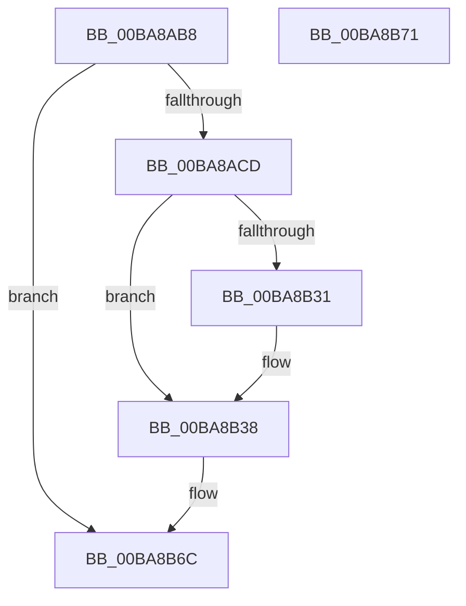

# ViDeadlockAddThread

- RVA: `0x00BA8AB8`–`0x00BA8B72` (길이 `186` bytes)
- VA: `0x0000000140BA8AB8`
- 실행 섹션: `PAGEVRFY`
- PDB 이름 있음: `예`; PDB Function 태그: `아니요`
- unwind 정보 RVA: `0x0005C788`
- 디코드: `48`개 명령, `186/186` bytes 표시
- 미해석 바이트: `0` (있으면 어셈블리에 `.byte`로 보존)

> 이 문서는 커널 이미지의 기계어와 PDB 기호를 분석해 생성했습니다. 4번과 5번은 함수 원형과 자료형을 바이너리 사용 방식에서 추정한 C 해석이며 원본 소스 복구 결과는 아닙니다.

## 1. Dependencies

- 직접 호출 지점: **1**; 고유 호출 대상: **1**
- 직접 호출자로 확인된 함수: **1**
- RIP 상대 이미지 참조: **1**

### Outgoing calls
- `0x00BA8B5D` → [VfUtilAddressRangeAdd](../B9/VfUtilAddressRangeAdd_function_00B93108.md) (function, `0x00B93108`)

### Direct callers
- [VfDeadlockAcquireResource](../BB/VfDeadlockAcquireResource_function_00BB83B4.md) at `0x00BB8567`

### Static image references
- `0x00BA8ACD` → RVA `0x00FFDA00` (`PAGEVRFD`; read)

## 2. Other-region calls and transfers

- 다른 실행 섹션으로 향하는 call: **0**
- 별도 외부 분기/꼬리 이동을 확인하지 못했습니다.

## 3. Assembly (complete function range)

```asm
00BA8AB8  48 83 EC 28                     sub rsp, 0x28
00BA8ABC  33 C0                           xor eax, eax
00BA8ABE  4C 8B CA                        mov r9, rdx
00BA8AC1  4C 8B D9                        mov r11, rcx
00BA8AC4  48 85 D2                        test rdx, rdx
00BA8AC7  0F 84 9F 00 00 00               je 0x140ba8b6c
00BA8ACD  4C 8B 15 2C 4F 45 00            mov r10, qword ptr [rip + 0x454f2c]
00BA8AD4  4C 8B C1                        mov r8, rcx
00BA8AD7  48 89 42 08                     mov qword ptr [rdx + 8], rax
00BA8ADB  48 89 42 10                     mov qword ptr [rdx + 0x10], rax
00BA8ADF  89 42 28                        mov dword ptr [rdx + 0x28], eax
00BA8AE2  89 42 2C                        mov dword ptr [rdx + 0x2c], eax
00BA8AE5  88 42 30                        mov byte ptr [rdx + 0x30], al
00BA8AE8  48 B8 11 40 00 01 04 10 40 00   movabs rax, 0x40100401004011
00BA8AF2  48 89 0A                        mov qword ptr [rdx], rcx
00BA8AF5  49 C1 E8 0C                     shr r8, 0xc
00BA8AF9  49 F7 E0                        mul r8
00BA8AFC  49 8B C0                        mov rax, r8
00BA8AFF  48 2B C2                        sub rax, rdx
00BA8B02  48 D1 E8                        shr rax, 1
00BA8B05  48 03 C2                        add rax, rdx
00BA8B08  48 C1 E8 09                     shr rax, 9
00BA8B0C  48 69 C0 FF 03 00 00            imul rax, rax, 0x3ff
00BA8B13  4C 2B C0                        sub r8, rax
00BA8B16  49 8D 41 18                     lea rax, [r9 + 0x18]
00BA8B1A  49 8B C8                        mov rcx, r8
00BA8B1D  48 C1 E1 04                     shl rcx, 4
00BA8B21  49 03 8A 10 40 00 00            add rcx, qword ptr [r10 + 0x4010]
00BA8B28  48 8B 11                        mov rdx, qword ptr [rcx]
00BA8B2B  48 39 4A 08                     cmp qword ptr [rdx + 8], rcx
00BA8B2F  74 07                           je 0x140ba8b38
00BA8B31  B9 03 00 00 00                  mov ecx, 3
00BA8B36  CD 29                           int 0x29
00BA8B38  48 89 48 08                     mov qword ptr [rax + 8], rcx
00BA8B3C  48 89 10                        mov qword ptr [rax], rdx
00BA8B3F  48 89 42 08                     mov qword ptr [rdx + 8], rax
00BA8B43  49 8B D3                        mov rdx, r11
00BA8B46  48 89 01                        mov qword ptr [rcx], rax
00BA8B49  49 8D 88 02 04 00 00            lea rcx, [r8 + 0x402]
00BA8B50  48 C1 E1 04                     shl rcx, 4
00BA8B54  41 B8 98 07 00 00               mov r8d, 0x798
00BA8B5A  49 03 CA                        add rcx, r10
00BA8B5D  E8 A6 A5 FE FF                  call 0x140b93108
00BA8B62  49 FF 82 18 40 00 00            inc qword ptr [r10 + 0x4018]
00BA8B69  49 8B C1                        mov rax, r9
00BA8B6C  48 83 C4 28                     add rsp, 0x28
00BA8B70  C3                              ret
00BA8B71  CC                              int3
```

## 4. C-style interpretation (structured pseudocode)

```c
__int64 __fastcall ViDeadlockAddThread(__int64 a1, __int64 a2)
{
    __int64 result;
    __int64 v_rsp;

    v_rsp = (v_rsp) - (40);
    result = 0;
    if (a2 == 0) goto loc_00BA8B6C;
    *(unsigned __int64 *)(a2 + 8) = 0;
    *(unsigned __int64 *)(a2 + 16) = 0;
    *(unsigned int *)(a2 + 40) = 0;
    *(unsigned int *)(a2 + 44) = 0;
    *(unsigned __int8 *)(a2 + 48) = 0;
    *(unsigned __int64 *)(a2) = a1;
    a3 = (a1) >> (12);
    result = (a3) - (a2);
    result = (result) >> (1);
    result = (result) + (a2);
    result = (result) >> (9);
    result = (result) * (result);
    a3 = (a3) - (result);
    a1 = (a3) << (4);
    a1 = (a1) + (*(unsigned __int64 *)(*(unsigned __int64 *)(v_rip + 4542252) + 16400));
    if ((*(unsigned __int64 *)(*(unsigned __int64 *)(a1) + 8)) != a1) {
        a1 = 3;
    }
    *(unsigned __int64 *)(a2 + 24 + 8) = a1;
    *(unsigned __int64 *)(a2 + 24) = *(unsigned __int64 *)(a1);
    *(unsigned __int64 *)(*(unsigned __int64 *)(a1) + 8) = a2 + 24;
    *(unsigned __int64 *)(a1) = a2 + 24;
    a1 = (a3 + 1026) << (4);
    a1 = (a1) + (*(unsigned __int64 *)(v_rip + 4542252));
    result = VfUtilAddressRangeAdd(a1, a1, (unsigned int)(0x798ULL), a2);
loc_00BA8B6C:
    v_rsp = (v_rsp) + (40);
    return a2;
}
```

## 5. (Beta) C Style

```c
void *ViDeadlockAddThread(int64_t Arg1, void *Arg2)
{
    uint8_t *arg2 = (uint8_t *)Arg2;

    int64_t result;
    int64_t local_rsp;

    local_rsp = (local_rsp) - (40);
    result = 0;
    if (Arg2 == NULL) goto loc_00BA8B6C;
    *(uint64_t *)(arg2 + 0x8) = 0;
    *(uint64_t *)(arg2 + 0x10) = 0;
    *(uint32_t *)(arg2 + 0x28) = 0;
    *(uint32_t *)(arg2 + 0x2C) = 0;
    *(uint8_t *)(arg2 + 0x30) = 0;
    *(uint64_t *)(arg2) = Arg1;
    a3 = (Arg1) >> (12);
    result = (a3) - (Arg2);
    result = (result) >> (1);
    result = (result) + (Arg2);
    result = (result) >> (9);
    result = (result) * (result);
    a3 = (a3) - (result);
    Arg1 = (a3) << (4);
    Arg1 = (Arg1) + (*(uint64_t *)(*(uint64_t *)(v_rip + 0x454F2C) + 0x4010));
    if ((*(uint64_t *)(*(uint64_t *)(Arg1) + 0x8)) != Arg1) {
        Arg1 = 3;
    }
    *(uint64_t *)(arg2 + 0x18 + 0x8) = Arg1;
    *(uint64_t *)(arg2 + 0x18) = *(uint64_t *)(Arg1);
    *(void **)(*(uint64_t *)(Arg1) + 0x8) = Arg2 + 24;
    *(void **)(Arg1) = Arg2 + 24;
    Arg1 = (a3 + 1026) << (4);
    Arg1 = (Arg1) + (*(uint64_t *)(v_rip + 0x454F2C));
    result = VfUtilAddressRangeAdd(Arg1, Arg1, (uint32_t)(0x798ULL), Arg2);
loc_00BA8B6C:
    local_rsp = (local_rsp) + (40);
    return Arg2;
}
```

### 관측된 메모리 오프셋

구조체 형식이 확인되지 않은 접근은 인자 기준의 오프셋으로만 기록했습니다.

| 기준 인자 | 오프셋 표현 | 폭 (bit) | 접근 |
|---|---:|---:|---|
| `Arg2` | `+ 0x0` | `64` | `W` |
| `Arg2` | `+ 0x8` | `64` | `W` |
| `Arg2` | `+ 0x18` | `64` | `R` |

## 6. Execution-region graph

[열기: 2D/3D 그래프와 함수 탐색 컨트롤 패널](../../../control-panel.html?section=pagevrfy&rva=0x00BA8AB8&view=graph)

- 2D 그래프는 위에서 아래로 흐르고, 3D 그래프는 빈 공간을 드래그해 회전합니다. Shift+드래그는 이동, 휠은 확대·축소, 함수 노드 선택은 대상 보고서 이동입니다.

### Static fallback


