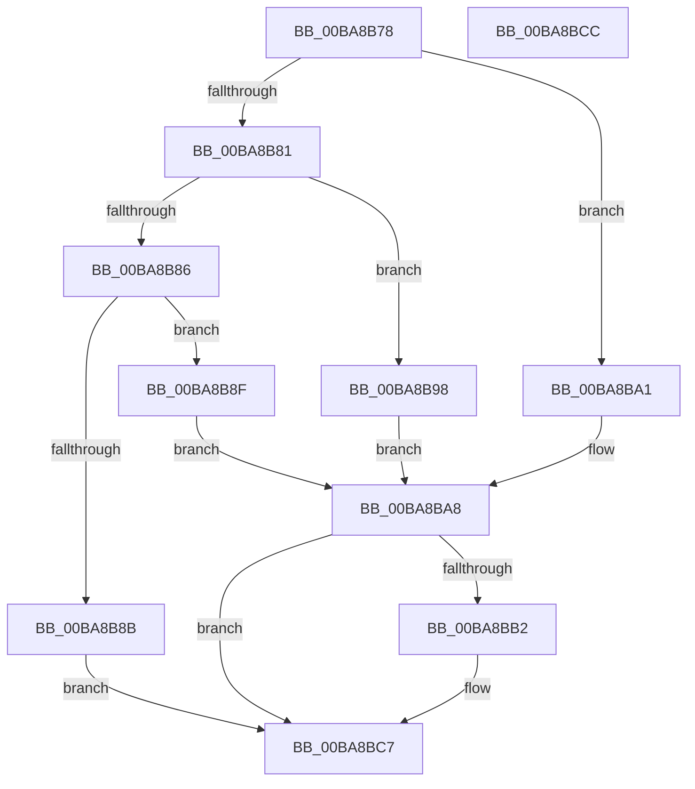

# ViDeadlockAllocate

- RVA: `0x00BA8B78`–`0x00BA8BCD` (길이 `85` bytes)
- VA: `0x0000000140BA8B78`
- 실행 섹션: `PAGEVRFY`
- PDB 이름 있음: `예`; PDB Function 태그: `아니요`
- unwind 정보 RVA: `0x0005C788`
- 디코드: `23`개 명령, `85/85` bytes 표시
- 미해석 바이트: `0` (있으면 어셈블리에 `.byte`로 보존)

> 이 문서는 커널 이미지의 기계어와 PDB 기호를 분석해 생성했습니다. 4번과 5번은 함수 원형과 자료형을 바이너리 사용 방식에서 추정한 C 해석이며 원본 소스 복구 결과는 아닙니다.

## 1. Dependencies

- 직접 호출 지점: **1**; 고유 호출 대상: **1**
- 직접 호출자로 확인된 함수: **2**
- RIP 상대 이미지 참조: **5**

### Outgoing calls
- `0x00BA8BA8` → [ExAllocateFromNPagedLookasideList](../../text/38/ExAllocateFromNPagedLookasideList_function_0038E6C0.md) (function, `0x0038E6C0`)

### Direct callers
- [VfDeadlockInitializeResource](VfDeadlockInitializeResource_function_00BA80A0.md) at `0x00BA812A`
- [VfDeadlockAcquireResource](../BB/VfDeadlockAcquireResource_function_00BB83B4.md) at `0x00BB84B1`
- [VfDeadlockAcquireResource](../BB/VfDeadlockAcquireResource_function_00BB83B4.md) at `0x00BB84C0`
- [VfDeadlockAcquireResource](../BB/VfDeadlockAcquireResource_function_00BB83B4.md) at `0x00BB84CE`

### Static image references
- `0x00BA8B8F` → RVA `0x00FFF300` (`PAGEVRFD`; read)
- `0x00BA8B98` → RVA `0x00FFF400` (`PAGEVRFD`; read)
- `0x00BA8BA1` → RVA `0x00FFF380` (`PAGEVRFD`; read)
- `0x00BA8BB2` → RVA `0x00FFDA20` (`PAGEVRFD`; read/write)
- `0x00BA8BB9` → RVA `0x00FFDA00` (`PAGEVRFD`; read)

## 2. Other-region calls and transfers

- 다른 실행 섹션으로 향하는 call: **1**
  - `0x00BA8BA8` → [ExAllocateFromNPagedLookasideList](../../text/38/ExAllocateFromNPagedLookasideList_function_0038E6C0.md) (`PAGEVRFY` → `.text`)
- 별도 외부 분기/꼬리 이동을 확인하지 못했습니다.

## 3. Assembly (complete function range)

```asm
00BA8B78  48 83 EC 28                     sub rsp, 0x28
00BA8B7C  83 E9 01                        sub ecx, 1
00BA8B7F  74 20                           je 0x140ba8ba1
00BA8B81  83 E9 01                        sub ecx, 1
00BA8B84  74 12                           je 0x140ba8b98
00BA8B86  83 F9 01                        cmp ecx, 1
00BA8B89  74 04                           je 0x140ba8b8f
00BA8B8B  33 C0                           xor eax, eax
00BA8B8D  EB 38                           jmp 0x140ba8bc7
00BA8B8F  48 8D 0D 6A 67 45 00            lea rcx, [rip + 0x45676a]
00BA8B96  EB 10                           jmp 0x140ba8ba8
00BA8B98  48 8D 0D 61 68 45 00            lea rcx, [rip + 0x456861]
00BA8B9F  EB 07                           jmp 0x140ba8ba8
00BA8BA1  48 8D 0D D8 67 45 00            lea rcx, [rip + 0x4567d8]
00BA8BA8  E8 13 5B 7E FF                  call 0x14038e6c0
00BA8BAD  48 85 C0                        test rax, rax
00BA8BB0  75 15                           jne 0x140ba8bc7
00BA8BB2  83 0D 67 4E 45 00 01            or dword ptr [rip + 0x454e67], 1
00BA8BB9  48 8B 0D 40 4E 45 00            mov rcx, qword ptr [rip + 0x454e40]
00BA8BC0  F0 FF 81 10 80 00 00            lock inc dword ptr [rcx + 0x8010]
00BA8BC7  48 83 C4 28                     add rsp, 0x28
00BA8BCB  C3                              ret
00BA8BCC  CC                              int3
```

## 4. C-style interpretation (structured pseudocode)

```c
__int64 __fastcall ViDeadlockAllocate(int a1)
{
    __int64 result;
    __int64 v_rsp;

    v_rsp = (v_rsp) - (40);
    a1 = (unsigned int)((a1) - (1));
    if (condition_is_equal) goto loc_00BA8BA1;
    a1 = (unsigned int)((a1) - (1));
    if (condition_is_equal) goto loc_00BA8B98;
    if (a1 == 1) goto loc_00BA8B8F;
    result = 0;
    goto loc_00BA8BC7;
loc_00BA8B8F:
    goto loc_00BA8BA8;
loc_00BA8B98:
    goto loc_00BA8BA8;
loc_00BA8BA1:
loc_00BA8BA8:
    result = ExAllocateFromNPagedLookasideList(v_rip + 4548568, a2, a3, a4);
    if (result == 0) {
        a1 = *(unsigned __int64 *)(v_rip + 4542016);
    }
    v_rsp = (v_rsp) + (40);
    return result;
}
```

## 5. (Beta) C Style

```c
int64_t ViDeadlockAllocate(int32_t Arg1)
{
    int64_t result;
    int64_t local_rsp;

    local_rsp = (local_rsp) - (40);
    Arg1 = (uint32_t)((Arg1) - (1));
    if (condition_is_equal) goto loc_00BA8BA1;
    Arg1 = (uint32_t)((Arg1) - (1));
    if (condition_is_equal) goto loc_00BA8B98;
    if (Arg1 == 1) goto loc_00BA8B8F;
    result = 0;
    goto loc_00BA8BC7;
loc_00BA8B8F:
    goto loc_00BA8BA8;
loc_00BA8B98:
    goto loc_00BA8BA8;
loc_00BA8BA1:
loc_00BA8BA8:
    result = ExAllocateFromNPagedLookasideList(v_rip + 4548568, a2, a3, a4);
    if (result == 0) {
        Arg1 = *(uint64_t *)(v_rip + 0x454E40);
    }
    local_rsp = (local_rsp) + (40);
    return result;
}
```

## 6. Execution-region graph

[열기: 2D/3D 그래프와 함수 탐색 컨트롤 패널](../../../control-panel.html?section=pagevrfy&rva=0x00BA8B78&view=graph)

- 2D 그래프는 위에서 아래로 흐르고, 3D 그래프는 빈 공간을 드래그해 회전합니다. Shift+드래그는 이동, 휠은 확대·축소, 함수 노드 선택은 대상 보고서 이동입니다.

### Static fallback


