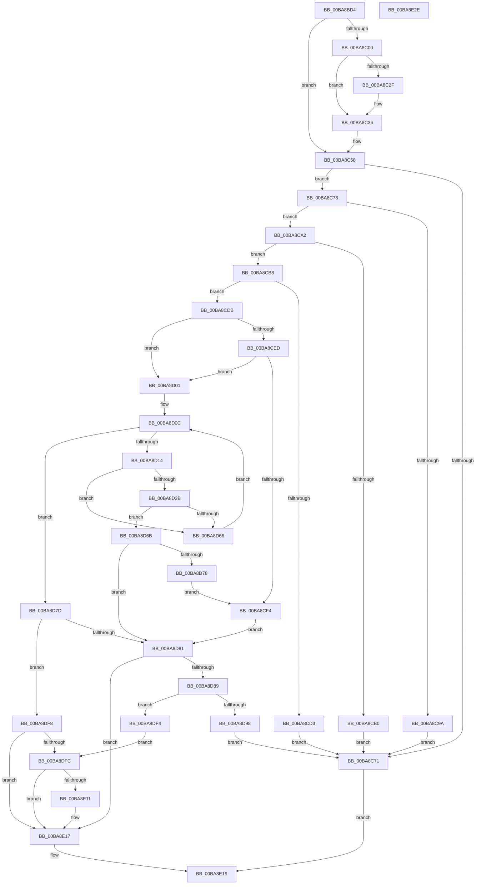

# ViDeadlockAnalyze

- RVA: `0x00BA8BD4`–`0x00BA8E2F` (길이 `603` bytes)
- VA: `0x0000000140BA8BD4`
- 실행 섹션: `PAGEVRFY`
- PDB 이름 있음: `예`; PDB Function 태그: `아니요`
- unwind 정보 RVA: `0x00097FE8`
- 디코드: `154`개 명령, `603/603` bytes 표시
- 미해석 바이트: `0` (있으면 어셈블리에 `.byte`로 보존)

> 이 문서는 커널 이미지의 기계어와 PDB 기호를 분석해 생성했습니다. 4번과 5번은 함수 원형과 자료형을 바이너리 사용 방식에서 추정한 C 해석이며 원본 소스 복구 결과는 아닙니다.

## 1. Dependencies

- 직접 호출 지점: **8**; 고유 호출 대상: **7**
- 직접 호출자로 확인된 함수: **2**
- RIP 상대 이미지 참조: **4**

### Outgoing calls
- `0x00BA8C4B` → [KeQueryCurrentStackInformation](../../text/2F/KeQueryCurrentStackInformation_function_002F7C80.md) (function, `0x002F7C80`)
- `0x00BA8CB8` → [KeGetCurrentStackPointer](../../text/6B/KeGetCurrentStackPointer_function_006B1070.md) (function, `0x006B1070`)
- `0x00BA8CF7` → [ViDeadlockAddParticipant](ViDeadlockAddParticipant_function_00BA883C.md) (function, `0x00BA883C`)
- `0x00BA8D58` → [ViDeadlockAnalyze](ViDeadlockAnalyze_function_00BA8BD4.md) (function, `0x00BA8BD4`)
- `0x00BA8D6E` → [ViDeadlockAddParticipant](ViDeadlockAddParticipant_function_00BA883C.md) (function, `0x00BA883C`)
- `0x00BA8D8F` → [ViDeadlockCertify](ViDeadlockCertify_function_00BA8E38.md) (function, `0x00BA8E38`)
- `0x00BA8DCD` → [ViDeadlockPreprocessOptions](ViDeadlockPreprocessOptions_function_00BA9BB4.md) (function, `0x00BA9BB4`)
- `0x00BA8DEA` → [VfReportIssueWithOptions](../../text/61/VfReportIssueWithOptions_function_00614444.md) (function, `0x00614444`)

### Direct callers
- [ViDeadlockAnalyze](ViDeadlockAnalyze_function_00BA8BD4.md) at `0x00BA8D58`
- [VfDeadlockAcquireResource](../BB/VfDeadlockAcquireResource_function_00BB83B4.md) at `0x00BB878A`

### Static image references
- `0x00BA8C00` → RVA `0x00FFDA00` (`PAGEVRFD`; read)
- `0x00BA8C2F` → RVA `0x00FFDA20` (`PAGEVRFD`; read/write)
- `0x00BA8D9F` → RVA `0x00E0EA14` (`.data`; read)
- `0x00BA8DAC` → RVA `0x00BBB1D0` (` ?? ::JKADOLAD::`string'`; read)

## 2. Other-region calls and transfers

- 다른 실행 섹션으로 향하는 call: **3**
  - `0x00BA8C4B` → [KeQueryCurrentStackInformation](../../text/2F/KeQueryCurrentStackInformation_function_002F7C80.md) (`PAGEVRFY` → `.text`)
  - `0x00BA8CB8` → [KeGetCurrentStackPointer](../../text/6B/KeGetCurrentStackPointer_function_006B1070.md) (`PAGEVRFY` → `.text`)
  - `0x00BA8DEA` → [VfReportIssueWithOptions](../../text/61/VfReportIssueWithOptions_function_00614444.md) (`PAGEVRFY` → `.text`)
- 별도 외부 분기/꼬리 이동을 확인하지 못했습니다.

## 3. Assembly (complete function range)

```asm
00BA8BD4  48 89 5C 24 08                  mov qword ptr [rsp + 8], rbx
00BA8BD9  44 89 4C 24 20                  mov dword ptr [rsp + 0x20], r9d
00BA8BDE  55                              push rbp
00BA8BDF  56                              push rsi
00BA8BE0  57                              push rdi
00BA8BE1  41 54                           push r12
00BA8BE3  41 55                           push r13
00BA8BE5  41 56                           push r14
00BA8BE7  41 57                           push r15
00BA8BE9  48 83 EC 30                     sub rsp, 0x30
00BA8BED  41 8B E8                        mov ebp, r8d
00BA8BF0  48 8B FA                        mov rdi, rdx
00BA8BF3  4C 8B F9                        mov r15, rcx
00BA8BF6  BB 01 00 00 00                  mov ebx, 1
00BA8BFB  45 85 C0                        test r8d, r8d
00BA8BFE  74 58                           je 0x140ba8c58
00BA8C00  48 8B 0D F9 4D 45 00            mov rcx, qword ptr [rip + 0x454df9]
00BA8C07  83 A1 1C 80 00 00 00            and dword ptr [rcx + 0x801c], 0
00BA8C0E  01 99 24 80 00 00               add dword ptr [rcx + 0x8024], ebx
00BA8C14  83 A1 60 80 00 00 00            and dword ptr [rcx + 0x8060], 0
00BA8C1B  48 83 A1 58 80 00 00 00         and qword ptr [rcx + 0x8058], 0
00BA8C23  81 B9 24 80 00 00 FE FF FF 3F   cmp dword ptr [rcx + 0x8024], 0x3ffffffe
00BA8C2D  75 07                           jne 0x140ba8c36
00BA8C2F  83 0D EA 4D 45 00 08            or dword ptr [rip + 0x454dea], 8
00BA8C36  4C 8D 81 78 81 00 00            lea r8, [rcx + 0x8178]
00BA8C3D  48 8D 91 70 81 00 00            lea rdx, [rcx + 0x8170]
00BA8C44  48 81 C1 6C 81 00 00            add rcx, 0x816c
00BA8C4B  E8 30 F0 74 FF                  call 0x1402f7c80
00BA8C50  44 8B 8C 24 88 00 00 00         mov r9d, dword ptr [rsp + 0x88]
00BA8C58  48 8B 15 A1 4D 45 00            mov rdx, qword ptr [rip + 0x454da1]
00BA8C5F  8B 47 48                        mov eax, dword ptr [rdi + 0x48]
00BA8C62  C1 E8 03                        shr eax, 3
00BA8C65  44 8B 82 24 80 00 00            mov r8d, dword ptr [rdx + 0x8024]
00BA8C6C  41 3B C0                        cmp eax, r8d
00BA8C6F  75 07                           jne 0x140ba8c78
00BA8C71  33 C0                           xor eax, eax
00BA8C73  E9 A1 01 00 00                  jmp 0x140ba8e19
00BA8C78  01 9A 1C 80 00 00               add dword ptr [rdx + 0x801c], ebx
00BA8C7E  42 8D 04 C5 00 00 00 00         lea eax, [r8*8]
00BA8C86  8B 4F 48                        mov ecx, dword ptr [rdi + 0x48]
00BA8C89  83 E1 07                        and ecx, 7
00BA8C8C  0B C8                           or ecx, eax
00BA8C8E  89 4F 48                        mov dword ptr [rdi + 0x48], ecx
00BA8C91  44 3B 8A 28 80 00 00            cmp r9d, dword ptr [rdx + 0x8028]
00BA8C98  76 08                           jbe 0x140ba8ca2
00BA8C9A  01 9A 30 80 00 00               add dword ptr [rdx + 0x8030], ebx
00BA8CA0  EB CF                           jmp 0x140ba8c71
00BA8CA2  8B 82 2C 80 00 00               mov eax, dword ptr [rdx + 0x802c]
00BA8CA8  39 82 1C 80 00 00               cmp dword ptr [rdx + 0x801c], eax
00BA8CAE  72 08                           jb 0x140ba8cb8
00BA8CB0  01 9A 34 80 00 00               add dword ptr [rdx + 0x8034], ebx
00BA8CB6  EB B9                           jmp 0x140ba8c71
00BA8CB8  E8 B3 83 B0 FF                  call 0x1406b1070
00BA8CBD  48 8B 0D 3C 4D 45 00            mov rcx, qword ptr [rip + 0x454d3c]
00BA8CC4  48 2B 81 70 81 00 00            sub rax, qword ptr [rcx + 0x8170]
00BA8CCB  48 3D 30 16 00 00               cmp rax, 0x1630
00BA8CD1  77 08                           ja 0x140ba8cdb
00BA8CD3  01 99 38 80 00 00               add dword ptr [rcx + 0x8038], ebx
00BA8CD9  EB 96                           jmp 0x140ba8c71
00BA8CDB  48 8B 4F 38                     mov rcx, qword ptr [rdi + 0x38]
00BA8CDF  4C 8B AC 24 90 00 00 00         mov r13, qword ptr [rsp + 0x90]
00BA8CE7  4C 3B 79 08                     cmp r15, qword ptr [rcx + 8]
00BA8CEB  75 14                           jne 0x140ba8d01
00BA8CED  8B 47 48                        mov eax, dword ptr [rdi + 0x48]
00BA8CF0  A8 04                           test al, 4
00BA8CF2  75 0D                           jne 0x140ba8d01
00BA8CF4  48 8B CF                        mov rcx, rdi
00BA8CF7  E8 40 FB FF FF                  call 0x140ba883c
00BA8CFC  E9 80 00 00 00                  jmp 0x140ba8d81
00BA8D01  4C 8D 61 18                     lea r12, [rcx + 0x18]
00BA8D05  45 33 C0                        xor r8d, r8d
00BA8D08  4D 8B 34 24                     mov r14, qword ptr [r12]
00BA8D0C  41 8B D8                        mov ebx, r8d
00BA8D0F  4D 3B F4                        cmp r14, r12
00BA8D12  74 69                           je 0x140ba8d7d
00BA8D14  48 8B 05 E5 4C 45 00            mov rax, qword ptr [rip + 0x454ce5]
00BA8D1B  49 8D 76 D8                     lea rsi, [r14 - 0x28]
00BA8D1F  48 8B 16                        mov rdx, qword ptr [rsi]
00BA8D22  8B 88 24 80 00 00               mov ecx, dword ptr [rax + 0x8024]
00BA8D28  8B 46 48                        mov eax, dword ptr [rsi + 0x48]
00BA8D2B  83 E0 07                        and eax, 7
00BA8D2E  C1 E1 03                        shl ecx, 3
00BA8D31  0B C8                           or ecx, eax
00BA8D33  89 4E 48                        mov dword ptr [rsi + 0x48], ecx
00BA8D36  48 85 D2                        test rdx, rdx
00BA8D39  74 2B                           je 0x140ba8d66
00BA8D3B  8B 84 24 88 00 00 00            mov eax, dword ptr [rsp + 0x88]
00BA8D42  48 3B F7                        cmp rsi, rdi
00BA8D45  49 8B CF                        mov rcx, r15
00BA8D48  4C 89 6C 24 20                  mov qword ptr [rsp + 0x20], r13
00BA8D4D  44 8D 48 01                     lea r9d, [rax + 1]
00BA8D51  44 0F 44 C8                     cmove r9d, eax
00BA8D55  45 33 C0                        xor r8d, r8d
00BA8D58  E8 77 FE FF FF                  call 0x140ba8bd4
00BA8D5D  8B D8                           mov ebx, eax
00BA8D5F  44 8B C0                        mov r8d, eax
00BA8D62  85 C0                           test eax, eax
00BA8D64  75 05                           jne 0x140ba8d6b
00BA8D66  4D 8B 36                        mov r14, qword ptr [r14]
00BA8D69  EB A1                           jmp 0x140ba8d0c
00BA8D6B  48 8B CE                        mov rcx, rsi
00BA8D6E  E8 C9 FA FF FF                  call 0x140ba883c
00BA8D73  48 3B F7                        cmp rsi, rdi
00BA8D76  74 09                           je 0x140ba8d81
00BA8D78  E9 77 FF FF FF                  jmp 0x140ba8cf4
00BA8D7D  85 DB                           test ebx, ebx
00BA8D7F  74 77                           je 0x140ba8df8
00BA8D81  85 ED                           test ebp, ebp
00BA8D83  0F 84 8E 00 00 00               je 0x140ba8e17
00BA8D89  48 8B D7                        mov rdx, rdi
00BA8D8C  49 8B CD                        mov rcx, r13
00BA8D8F  E8 A4 00 00 00                  call 0x140ba8e38
00BA8D94  85 C0                           test eax, eax
00BA8D96  74 5C                           je 0x140ba8df4
00BA8D98  48 8B 05 61 4C 45 00            mov rax, qword ptr [rip + 0x454c61]
00BA8D9F  48 8D 1D 6E 5C 26 00            lea rbx, [rip + 0x265c6e]
00BA8DA6  48 83 64 24 28 00               and qword ptr [rsp + 0x28], 0
00BA8DAC  48 8D 15 1D 24 01 00            lea rdx, [rip + 0x1241d]
00BA8DB3  BE 01 10 00 00                  mov esi, 0x1001
00BA8DB8  48 89 7C 24 20                  mov qword ptr [rsp + 0x20], rdi
00BA8DBD  4D 8B CF                        mov r9, r15
00BA8DC0  44 8B C6                        mov r8d, esi
00BA8DC3  48 8B CB                        mov rcx, rbx
00BA8DC6  4C 89 B8 58 80 00 00            mov qword ptr [rax + 0x8058], r15
00BA8DCD  E8 E2 0D 00 00                  call 0x140ba9bb4
00BA8DD2  48 89 5C 24 28                  mov qword ptr [rsp + 0x28], rbx
00BA8DD7  4C 8B CF                        mov r9, rdi
00BA8DDA  48 83 64 24 20 00               and qword ptr [rsp + 0x20], 0
00BA8DE0  4D 8B C7                        mov r8, r15
00BA8DE3  8B D6                           mov edx, esi
00BA8DE5  B9 C4 00 00 00                  mov ecx, 0xc4
00BA8DEA  E8 55 B6 A6 FF                  call 0x140614444
00BA8DEF  E9 7D FE FF FF                  jmp 0x140ba8c71
00BA8DF4  33 DB                           xor ebx, ebx
00BA8DF6  EB 04                           jmp 0x140ba8dfc
00BA8DF8  85 ED                           test ebp, ebp
00BA8DFA  74 1B                           je 0x140ba8e17
00BA8DFC  48 8B 05 FD 4B 45 00            mov rax, qword ptr [rip + 0x454bfd]
00BA8E03  8B 88 1C 80 00 00               mov ecx, dword ptr [rax + 0x801c]
00BA8E09  3B 88 20 80 00 00               cmp ecx, dword ptr [rax + 0x8020]
00BA8E0F  76 06                           jbe 0x140ba8e17
00BA8E11  89 88 20 80 00 00               mov dword ptr [rax + 0x8020], ecx
00BA8E17  8B C3                           mov eax, ebx
00BA8E19  48 8B 5C 24 70                  mov rbx, qword ptr [rsp + 0x70]
00BA8E1E  48 83 C4 30                     add rsp, 0x30
00BA8E22  41 5F                           pop r15
00BA8E24  41 5E                           pop r14
00BA8E26  41 5D                           pop r13
00BA8E28  41 5C                           pop r12
00BA8E2A  5F                              pop rdi
00BA8E2B  5E                              pop rsi
00BA8E2C  5D                              pop rbp
00BA8E2D  C3                              ret
00BA8E2E  CC                              int3
```

## 4. C-style interpretation (structured pseudocode)

```c
__int64 __fastcall ViDeadlockAnalyze(__int64 a1, __int64 a2, int a3, int a4, __int64 a5)
{
    __int64 result;
    __int64 v_rbx;
    __int64 v_rsp;
    unsigned __int64 v_stack_m40;
    unsigned __int64 v_stack_m48;
    unsigned int v_stack_p20;
    unsigned __int64 v_stack_p8;

    v_stack_p8 = v_rbx;
    v_stack_p20 = a4;
    v_rsp = (v_rsp) - (48);
    if (a3 == 0) goto loc_00BA8C58;
    if ((*(unsigned int *)(*(unsigned __int64 *)(v_rip + 4541945) + 32804)) == 0x3FFFFFFEULL) {
    }
    a1 = (*(unsigned __int64 *)(v_rip + 4541945)) + (0x816CULL);
    result = KeQueryCurrentStackInformation(a1, *(unsigned __int64 *)(v_rip + 4541945) + 33136, *(unsigned __int64 *)(v_rip + 4541945) + 33144, a4);
loc_00BA8C58:
    result = (unsigned int)(((unsigned int)(*(unsigned int *)(a2 + 72))) >> (3));
    if (((unsigned int)(result)) != ((unsigned int)((unsigned int)(*(unsigned int *)(*(unsigned __int64 *)(v_rip + 4541857) + 32804))))) goto loc_00BA8C78;
loc_00BA8C71:
    result = 0;
    goto loc_00BA8E19;
loc_00BA8C78:
    a1 = (unsigned int)(((unsigned int)(*(unsigned int *)(a2 + 72))) & (7));
    a1 = (unsigned int)((a1) | ((unsigned int)((unsigned int)(*(unsigned int *)(*(unsigned __int64 *)(v_rip + 4541857) + 32804)) * 8)));
    *(unsigned int *)(a2 + 72) = (unsigned int)(a1);
    if (((unsigned int)((unsigned int)(v_stack_p20))) <= (*(unsigned int *)(*(unsigned __int64 *)(v_rip + 4541857) + 32808))) goto loc_00BA8CA2;
    goto loc_00BA8C71;
loc_00BA8CA2:
    if ((*(unsigned int *)(*(unsigned __int64 *)(v_rip + 4541857) + 32796)) < ((unsigned int)((unsigned int)(*(unsigned int *)(*(unsigned __int64 *)(v_rip + 4541857) + 32812))))) goto loc_00BA8CB8;
    goto loc_00BA8C71;
loc_00BA8CB8:
    result = KeGetCurrentStackPointer(a1, *(unsigned __int64 *)(v_rip + 4541857), (unsigned int)(*(unsigned int *)(*(unsigned __int64 *)(v_rip + 4541857) + 32804)), (unsigned int)(v_stack_p20));
    result = (result) - (*(unsigned __int64 *)(*(unsigned __int64 *)(v_rip + 4541756) + 33136));
    if (result > 0x1630ULL) goto loc_00BA8CDB;
    goto loc_00BA8C71;
loc_00BA8CDB:
    if (a1 != (*(unsigned __int64 *)(*(unsigned __int64 *)(a2 + 56) + 8))) goto loc_00BA8D01;
    if ((((unsigned __int8)((unsigned int)(*(unsigned int *)(a2 + 72)))) & (4)) != 0) goto loc_00BA8D01;
loc_00BA8CF4:
    result = ViDeadlockAddParticipant(a2, *(unsigned __int64 *)(v_rip + 4541857), (unsigned int)(*(unsigned int *)(*(unsigned __int64 *)(v_rip + 4541857) + 32804)), (unsigned int)(v_stack_p20));
    goto loc_00BA8D81;
loc_00BA8D01:
    a3 = 0;
loc_00BA8D0C:
    if ((*(unsigned __int64 *)(a2 + 24)) == (a2 + 24)) goto loc_00BA8D7D;
    result = (unsigned int)(((unsigned int)(*(unsigned int *)(*(unsigned __int64 *)(a2 + 24) - 40 + 72))) & (7));
    a1 = (unsigned int)(((unsigned int)(*(unsigned int *)(*(unsigned __int64 *)(v_rip + 4541669) + 32804))) << (3));
    a1 = (unsigned int)((a1) | ((unsigned int)(result)));
    *(unsigned int *)(*(unsigned __int64 *)(a2 + 24) - 40 + 72) = (unsigned int)(a1);
    if (*(unsigned __int64 *)(*(unsigned __int64 *)(a2 + 24) - 40) == 0) goto loc_00BA8D66;
    v_stack_m48 = a5;
    a4 = (unsigned int)(v_stack_p20) + 1;
    if ((*(unsigned __int64 *)(a2 + 24) - 40) == a2) { a4 = (unsigned int)((unsigned int)(v_stack_p20)); }
    a3 = 0;
    result = ViDeadlockAnalyze(a1, *(unsigned __int64 *)(*(unsigned __int64 *)(a2 + 24) - 40), a3, a4);
    if ((unsigned int)(result) != 0) goto loc_00BA8D6B;
loc_00BA8D66:
    goto loc_00BA8D0C;
loc_00BA8D6B:
    result = ViDeadlockAddParticipant(*(unsigned __int64 *)(a2 + 24) - 40, *(unsigned __int64 *)(*(unsigned __int64 *)(a2 + 24) - 40), (unsigned int)((unsigned int)(result)), a4);
    if ((*(unsigned __int64 *)(a2 + 24) - 40) == a2) goto loc_00BA8D81;
    goto loc_00BA8CF4;
loc_00BA8D7D:
    if ((unsigned int)((unsigned int)((unsigned int)(result))) == 0) goto loc_00BA8DF8;
loc_00BA8D81:
    if ((unsigned int)((unsigned int)(a3)) == 0) goto loc_00BA8E17;
    result = ViDeadlockCertify(a5, a2, (unsigned int)((unsigned int)(result)), a4);
    if ((unsigned int)(result) == 0) goto loc_00BA8DF4;
    v_stack_m48 = a2;
    *(unsigned __int64 *)(*(unsigned __int64 *)(v_rip + 4541537) + 32856) = a1;
    result = ViDeadlockPreprocessOptions(v_rip + 2514030, v_rip + 74781, (unsigned int)((unsigned int)((unsigned int)(0x1001ULL))), a1);
    v_stack_m40 = v_rip + 2514030;
    result = VfReportIssueWithOptions(196, (unsigned int)((unsigned int)((unsigned int)(0x1001ULL))), a1, a2);
    goto loc_00BA8C71;
loc_00BA8DF4:
    v_rbx = 0;
    goto loc_00BA8DFC;
loc_00BA8DF8:
    if ((unsigned int)((unsigned int)(a3)) == 0) goto loc_00BA8E17;
loc_00BA8DFC:
    if (((unsigned int)((unsigned int)(*(unsigned int *)(*(unsigned __int64 *)(v_rip + 4541437) + 32796)))) >= = (*(unsigned int *)(*(unsigned __int64 *)(v_rip + 4541437) + 32800))) {
        *(unsigned int *)(*(unsigned __int64 *)(v_rip + 4541437) + 32800) = (unsigned int)((unsigned int)(*(unsigned int *)(*(unsigned __int64 *)(v_rip + 4541437) + 32796)));
    }
loc_00BA8E19:
    v_rsp = (v_rsp) + (48);
    return 0;
}
```

## 5. (Beta) C Style

```c
int64_t ViDeadlockAnalyze(int64_t Arg1, void *Arg2, int32_t Arg3, int32_t Arg4, int64_t Arg5)
{
    uint8_t *arg2 = (uint8_t *)Arg2;

    int64_t result;
    int64_t local_rbx;
    int64_t local_rsp;
    uint64_t v_stack_m40;
    uint64_t v_stack_m48;
    uint32_t v_stack_p20;
    uint64_t v_stack_p8;

    v_stack_p8 = local_rbx;
    v_stack_p20 = Arg4;
    local_rsp = (local_rsp) - (48);
    if (Arg3 == 0) goto loc_00BA8C58;
    if ((*(uint32_t *)(*(uint64_t *)(v_rip + 0x454DF9) + 0x8024)) == 0x3FFFFFFEULL) {
    }
    Arg1 = (*(uint64_t *)(v_rip + 0x454DF9)) + (0x816CULL);
    result = KeQueryCurrentStackInformation(Arg1, *(uint64_t *)(v_rip + 0x454DF9) + 33136, *(uint64_t *)(v_rip + 0x454DF9) + 33144, Arg4);
loc_00BA8C58:
    result = (uint32_t)(((uint32_t)(*(uint32_t *)(arg2 + 0x48))) >> (3));
    if (((uint32_t)(result)) != ((uint32_t)((uint32_t)(*(uint32_t *)(*(uint64_t *)(v_rip + 0x454DA1) + 0x8024))))) goto loc_00BA8C78;
loc_00BA8C71:
    result = 0;
    goto loc_00BA8E19;
loc_00BA8C78:
    Arg1 = (uint32_t)(((uint32_t)(*(uint32_t *)(arg2 + 0x48))) & (7));
    Arg1 = (uint32_t)((Arg1) | ((uint32_t)((uint32_t)(*(uint32_t *)(*(uint64_t *)(v_rip + 0x454DA1) + 0x8024)) * 8)));
    *(uint32_t *)(arg2 + 0x48) = (uint32_t)(Arg1);
    if (((uint32_t)((uint32_t)(v_stack_p20))) <= (*(uint32_t *)(*(uint64_t *)(v_rip + 0x454DA1) + 0x8028))) goto loc_00BA8CA2;
    goto loc_00BA8C71;
loc_00BA8CA2:
    if ((*(uint32_t *)(*(uint64_t *)(v_rip + 0x454DA1) + 0x801C)) < ((uint32_t)((uint32_t)(*(uint32_t *)(*(uint64_t *)(v_rip + 0x454DA1) + 0x802C))))) goto loc_00BA8CB8;
    goto loc_00BA8C71;
loc_00BA8CB8:
    result = KeGetCurrentStackPointer(Arg1, *(uint64_t *)(v_rip + 0x454DA1), (uint32_t)(*(uint32_t *)(*(uint64_t *)(v_rip + 0x454DA1) + 0x8024)), (uint32_t)(v_stack_p20));
    result = (result) - (*(uint64_t *)(*(uint64_t *)(v_rip + 0x454D3C) + 0x8170));
    if (result > 0x1630ULL) goto loc_00BA8CDB;
    goto loc_00BA8C71;
loc_00BA8CDB:
    if (Arg1 != (*(uint64_t *)(*(uint64_t *)(arg2 + 0x38) + 0x8))) goto loc_00BA8D01;
    if ((((uint8_t)((uint32_t)(*(uint32_t *)(arg2 + 0x48)))) & (4)) != 0) goto loc_00BA8D01;
loc_00BA8CF4:
    result = ViDeadlockAddParticipant(Arg2, *(uint64_t *)(v_rip + 0x454DA1), (uint32_t)(*(uint32_t *)(*(uint64_t *)(v_rip + 0x454DA1) + 0x8024)), (uint32_t)(v_stack_p20));
    goto loc_00BA8D81;
loc_00BA8D01:
    Arg3 = 0;
loc_00BA8D0C:
    if ((*(uint64_t *)(arg2 + 0x18)) == (Arg2 + 24)) goto loc_00BA8D7D;
    result = (uint32_t)(((uint32_t)(*(uint32_t *)(*(uint64_t *)(arg2 + 0x18) - 0x28 + 0x48))) & (7));
    Arg1 = (uint32_t)(((uint32_t)(*(uint32_t *)(*(uint64_t *)(v_rip + 0x454CE5) + 0x8024))) << (3));
    Arg1 = (uint32_t)((Arg1) | ((uint32_t)(result)));
    *(uint32_t *)(*(uint64_t *)(arg2 + 0x18) - 0x28 + 0x48) = (uint32_t)(Arg1);
    if (*(uint64_t *)(*(uint64_t *)(arg2 + 0x18) - 0x28) == 0) goto loc_00BA8D66;
    v_stack_m48 = Arg5;
    Arg4 = (uint32_t)(v_stack_p20) + 1;
    if ((*(uint64_t *)(arg2 + 0x18) - 40) == Arg2) { Arg4 = (uint32_t)((uint32_t)(v_stack_p20)); }
    Arg3 = 0;
    result = ViDeadlockAnalyze(Arg1, *(uint64_t *)(*(uint64_t *)(arg2 + 0x18) - 0x28), Arg3, Arg4);
    if ((uint32_t)(result) != 0) goto loc_00BA8D6B;
loc_00BA8D66:
    goto loc_00BA8D0C;
loc_00BA8D6B:
    result = ViDeadlockAddParticipant(*(uint64_t *)(arg2 + 0x18) - 40, *(uint64_t *)(*(uint64_t *)(arg2 + 0x18) - 0x28), (uint32_t)((uint32_t)(result)), Arg4);
    if ((*(uint64_t *)(arg2 + 0x18) - 40) == Arg2) goto loc_00BA8D81;
    goto loc_00BA8CF4;
loc_00BA8D7D:
    if ((uint32_t)((uint32_t)((uint32_t)(result))) == 0) goto loc_00BA8DF8;
loc_00BA8D81:
    if ((uint32_t)((uint32_t)(Arg3)) == 0) goto loc_00BA8E17;
    result = ViDeadlockCertify(Arg5, Arg2, (uint32_t)((uint32_t)(result)), Arg4);
    if ((uint32_t)(result) == 0) goto loc_00BA8DF4;
    v_stack_m48 = Arg2;
    *(uint64_t *)(*(uint64_t *)(v_rip + 0x454C61) + 0x8058) = Arg1;
    result = ViDeadlockPreprocessOptions(v_rip + 2514030, v_rip + 74781, (uint32_t)((uint32_t)((uint32_t)(0x1001ULL))), Arg1);
    v_stack_m40 = v_rip + 2514030;
    result = VfReportIssueWithOptions(196, (uint32_t)((uint32_t)((uint32_t)(0x1001ULL))), Arg1, Arg2);
    goto loc_00BA8C71;
loc_00BA8DF4:
    local_rbx = 0;
    goto loc_00BA8DFC;
loc_00BA8DF8:
    if ((uint32_t)((uint32_t)(Arg3)) == 0) goto loc_00BA8E17;
loc_00BA8DFC:
    if (((uint32_t)((uint32_t)(*(uint32_t *)(*(uint64_t *)(v_rip + 0x454BFD) + 0x801C)))) >= = (*(uint32_t *)(*(uint64_t *)(v_rip + 0x454BFD) + 0x8020))) {
        *(uint32_t *)(*(uint64_t *)(v_rip + 0x454BFD) + 0x8020) = (uint32_t)((uint32_t)(*(uint32_t *)(*(uint64_t *)(v_rip + 0x454BFD) + 0x801C)));
    }
loc_00BA8E19:
    local_rsp = (local_rsp) + (48);
    return 0;
}
```

### 관측된 메모리 오프셋

구조체 형식이 확인되지 않은 접근은 인자 기준의 오프셋으로만 기록했습니다.

| 기준 인자 | 오프셋 표현 | 폭 (bit) | 접근 |
|---|---:|---:|---|
| `Arg2` | `+ 0x38` | `64` | `R` |
| `Arg2` | `+ 0x48` | `32` | `R` |
| `Arg2` | `+ 0x48` | `32` | `W` |

## 6. Execution-region graph

[열기: 2D/3D 그래프와 함수 탐색 컨트롤 패널](../../../control-panel.html?section=pagevrfy&rva=0x00BA8BD4&view=graph)

- 2D 그래프는 위에서 아래로 흐르고, 3D 그래프는 빈 공간을 드래그해 회전합니다. Shift+드래그는 이동, 휠은 확대·축소, 함수 노드 선택은 대상 보고서 이동입니다.

### Static fallback


