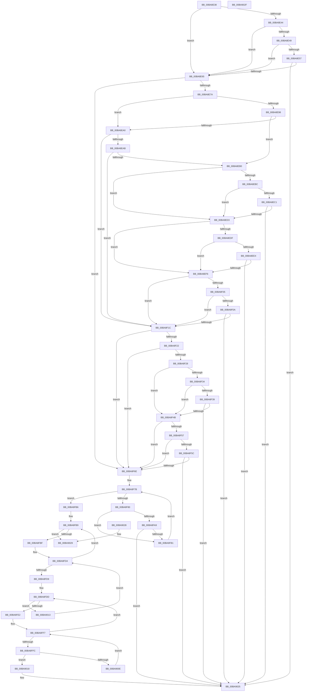

# ViDeadlockCertify

- RVA: `0x00BA8E38`–`0x00BA9030` (길이 `504` bytes)
- VA: `0x0000000140BA8E38`
- 실행 섹션: `PAGEVRFY`
- PDB 이름 있음: `예`; PDB Function 태그: `아니요`
- unwind 정보 RVA: `0x000DB714`
- 디코드: `134`개 명령, `504/504` bytes 표시
- 미해석 바이트: `0` (있으면 어셈블리에 `.byte`로 보존)

> 이 문서는 커널 이미지의 기계어와 PDB 기호를 분석해 생성했습니다. 4번과 5번은 함수 원형과 자료형을 바이너리 사용 방식에서 추정한 C 해석이며 원본 소스 복구 결과는 아닙니다.

## 1. Dependencies

- 직접 호출 지점: **0**; 고유 호출 대상: **0**
- 직접 호출자로 확인된 함수: **1**
- RIP 상대 이미지 참조: **13**

### Outgoing calls
- 직접 디코드된 call 명령이 없습니다.

### Direct callers
- [ViDeadlockAnalyze](ViDeadlockAnalyze_function_00BA8BD4.md) at `0x00BA8D8F`

### Static image references
- `0x00BA8E38` → RVA `0x00FFDAC0` (`PAGEVRFD`; read)
- `0x00BA8E49` → RVA `0x00FFDAEC` (`PAGEVRFD`; read)
- `0x00BA8E65` → RVA `0x00FFDA00` (`PAGEVRFD`; read)
- `0x00BA8EB0` → RVA `0x00FFDB48` (`PAGEVRFD`; read)
- `0x00BA8EC1` → RVA `0x00FFDB6C` (`PAGEVRFD`; read)
- `0x00BA8ED3` → RVA `0x00FFDB40` (`PAGEVRFD`; read)
- `0x00BA8EE4` → RVA `0x00FFDB70` (`PAGEVRFD`; read)
- `0x00BA8EF6` → RVA `0x00FFDB30` (`PAGEVRFD`; read)
- `0x00BA8F0A` → RVA `0x00FFDB64` (`PAGEVRFD`; read)
- `0x00BA8F28` → RVA `0x00FFDB28` (`PAGEVRFD`; read)
- `0x00BA8F39` → RVA `0x00FFDB60` (`PAGEVRFD`; read)
- `0x00BA8F4B` → RVA `0x00FFDB38` (`PAGEVRFD`; read)
- `0x00BA8F5C` → RVA `0x00FFDB68` (`PAGEVRFD`; read)

## 2. Other-region calls and transfers

- 다른 실행 섹션으로 향하는 call: **0**
- 별도 외부 분기/꼬리 이동을 확인하지 못했습니다.

## 3. Assembly (complete function range)

```asm
00BA8E38  4C 8B 05 81 4C 45 00            mov r8, qword ptr [rip + 0x454c81]
00BA8E3F  4D 85 C0                        test r8, r8
00BA8E42  74 21                           je 0x140ba8e65
00BA8E44  4C 3B C1                        cmp r8, rcx
00BA8E47  77 1C                           ja 0x140ba8e65
00BA8E49  8B 05 9D 4C 45 00               mov eax, dword ptr [rip + 0x454c9d]
00BA8E4F  49 03 C0                        add rax, r8
00BA8E52  48 3B C1                        cmp rax, rcx
00BA8E55  76 0E                           jbe 0x140ba8e65
00BA8E57  48 8B 42 40                     mov rax, qword ptr [rdx + 0x40]
00BA8E5B  80 78 30 00                     cmp byte ptr [rax + 0x30], 0
00BA8E5F  0F 85 C0 01 00 00               jne 0x140ba9025
00BA8E65  4C 8B 0D 94 4B 45 00            mov r9, qword ptr [rip + 0x454b94]
00BA8E6C  41 83 B9 60 80 00 00 03         cmp dword ptr [r9 + 0x8060], 3
00BA8E74  0F 82 F4 00 00 00               jb 0x140ba8f6e
00BA8E7A  49 8B 81 68 80 00 00            mov rax, qword ptr [r9 + 0x8068]
00BA8E81  4C 8B 58 38                     mov r11, qword ptr [rax + 0x38]
00BA8E85  49 8B 81 70 80 00 00            mov rax, qword ptr [r9 + 0x8070]
00BA8E8C  4C 8B 40 38                     mov r8, qword ptr [rax + 0x38]
00BA8E90  41 8B 03                        mov eax, dword ptr [r11]
00BA8E93  83 F8 05                        cmp eax, 5
00BA8E96  75 08                           jne 0x140ba8ea0
00BA8E98  41 8B 10                        mov edx, dword ptr [r8]
00BA8E9B  83 FA 06                        cmp edx, 6
00BA8E9E  74 10                           je 0x140ba8eb0
00BA8EA0  41 8B 10                        mov edx, dword ptr [r8]
00BA8EA3  44 8B C2                        mov r8d, edx
00BA8EA6  83 FA 05                        cmp edx, 5
00BA8EA9  75 71                           jne 0x140ba8f1c
00BA8EAB  83 F8 06                        cmp eax, 6
00BA8EAE  75 6C                           jne 0x140ba8f1c
00BA8EB0  4C 8B 05 91 4C 45 00            mov r8, qword ptr [rip + 0x454c91]
00BA8EB7  4D 85 C0                        test r8, r8
00BA8EBA  74 17                           je 0x140ba8ed3
00BA8EBC  4C 3B C1                        cmp r8, rcx
00BA8EBF  77 12                           ja 0x140ba8ed3
00BA8EC1  8B 05 A5 4C 45 00               mov eax, dword ptr [rip + 0x454ca5]
00BA8EC7  49 03 C0                        add rax, r8
00BA8ECA  48 3B C1                        cmp rax, rcx
00BA8ECD  0F 87 52 01 00 00               ja 0x140ba9025
00BA8ED3  4C 8B 05 66 4C 45 00            mov r8, qword ptr [rip + 0x454c66]
00BA8EDA  4D 85 C0                        test r8, r8
00BA8EDD  74 17                           je 0x140ba8ef6
00BA8EDF  4C 3B C1                        cmp r8, rcx
00BA8EE2  77 12                           ja 0x140ba8ef6
00BA8EE4  8B 05 86 4C 45 00               mov eax, dword ptr [rip + 0x454c86]
00BA8EEA  49 03 C0                        add rax, r8
00BA8EED  48 3B C1                        cmp rax, rcx
00BA8EF0  0F 87 2F 01 00 00               ja 0x140ba9025
00BA8EF6  4C 8B 15 33 4C 45 00            mov r10, qword ptr [rip + 0x454c33]
00BA8EFD  44 8B C2                        mov r8d, edx
00BA8F00  4D 85 D2                        test r10, r10
00BA8F03  74 17                           je 0x140ba8f1c
00BA8F05  4C 3B D1                        cmp r10, rcx
00BA8F08  77 12                           ja 0x140ba8f1c
00BA8F0A  8B 05 54 4C 45 00               mov eax, dword ptr [rip + 0x454c54]
00BA8F10  49 03 C2                        add rax, r10
00BA8F13  48 3B C1                        cmp rax, rcx
00BA8F16  0F 87 09 01 00 00               ja 0x140ba9025
00BA8F1C  41 83 3B 01                     cmp dword ptr [r11], 1
00BA8F20  75 4C                           jne 0x140ba8f6e
00BA8F22  41 83 F8 01                     cmp r8d, 1
00BA8F26  75 46                           jne 0x140ba8f6e
00BA8F28  48 8B 15 F9 4B 45 00            mov rdx, qword ptr [rip + 0x454bf9]
00BA8F2F  48 85 D2                        test rdx, rdx
00BA8F32  74 17                           je 0x140ba8f4b
00BA8F34  48 3B D1                        cmp rdx, rcx
00BA8F37  77 12                           ja 0x140ba8f4b
00BA8F39  8B 05 21 4C 45 00               mov eax, dword ptr [rip + 0x454c21]
00BA8F3F  48 03 C2                        add rax, rdx
00BA8F42  48 3B C1                        cmp rax, rcx
00BA8F45  0F 87 DA 00 00 00               ja 0x140ba9025
00BA8F4B  48 8B 15 E6 4B 45 00            mov rdx, qword ptr [rip + 0x454be6]
00BA8F52  48 85 D2                        test rdx, rdx
00BA8F55  74 17                           je 0x140ba8f6e
00BA8F57  48 3B D1                        cmp rdx, rcx
00BA8F5A  77 12                           ja 0x140ba8f6e
00BA8F5C  8B 05 06 4C 45 00               mov eax, dword ptr [rip + 0x454c06]
00BA8F62  48 03 C2                        add rax, rdx
00BA8F65  48 3B C1                        cmp rax, rcx
00BA8F68  0F 87 B7 00 00 00               ja 0x140ba9025
00BA8F6E  45 8B 91 60 80 00 00            mov r10d, dword ptr [r9 + 0x8060]
00BA8F75  41 B8 01 00 00 00               mov r8d, 1
00BA8F7B  45 3B C2                        cmp r8d, r10d
00BA8F7E  73 36                           jae 0x140ba8fb6
00BA8F80  41 8D 40 FF                     lea eax, [r8 - 1]
00BA8F84  4D 8B 9C C1 68 80 00 00         mov r11, qword ptr [r9 + rax*8 + 0x8068]
00BA8F8C  41 8B C0                        mov eax, r8d
00BA8F8F  49 8B 8C C1 68 80 00 00         mov rcx, qword ptr [r9 + rax*8 + 0x8068]
00BA8F97  49 8B 43 38                     mov rax, qword ptr [r11 + 0x38]
00BA8F9B  48 8B 51 38                     mov rdx, qword ptr [rcx + 0x38]
00BA8F9F  48 8B 48 08                     mov rcx, qword ptr [rax + 8]
00BA8FA3  48 39 4A 08                     cmp qword ptr [rdx + 8], rcx
00BA8FA7  75 08                           jne 0x140ba8fb1
00BA8FA9  41 8B 43 48                     mov eax, dword ptr [r11 + 0x48]
00BA8FAD  A8 02                           test al, 2
00BA8FAF  75 74                           jne 0x140ba9025
00BA8FB1  41 FF C0                        inc r8d
00BA8FB4  EB C5                           jmp 0x140ba8f7b
00BA8FB6  45 8B C2                        mov r8d, r10d
00BA8FB9  41 83 F8 01                     cmp r8d, 1
00BA8FBD  76 6A                           jbe 0x140ba9029
00BA8FBF  48 8B 05 3A 4A 45 00            mov rax, qword ptr [rip + 0x454a3a]
00BA8FC6  41 FF C8                        dec r8d
00BA8FC9  4A 8B 8C C0 68 80 00 00         mov rcx, qword ptr [rax + r8*8 + 0x8068]
00BA8FD1  4C 8B 09                        mov r9, qword ptr [rcx]
00BA8FD4  4D 85 C9                        test r9, r9
00BA8FD7  74 E0                           je 0x140ba8fb9
00BA8FD9  45 8D 58 FF                     lea r11d, [r8 - 1]
00BA8FDD  45 85 DB                        test r11d, r11d
00BA8FE0  74 31                           je 0x140ba9013
00BA8FE2  48 8B 05 17 4A 45 00            mov rax, qword ptr [rip + 0x454a17]
00BA8FE9  41 FF CB                        dec r11d
00BA8FEC  4A 8B 8C D8 68 80 00 00         mov rcx, qword ptr [rax + r11*8 + 0x8068]
00BA8FF4  4C 8B 11                        mov r10, qword ptr [rcx]
00BA8FF7  4D 85 D2                        test r10, r10
00BA8FFA  74 E1                           je 0x140ba8fdd
00BA8FFC  49 8B 41 38                     mov rax, qword ptr [r9 + 0x38]
00BA9000  49 8B 52 38                     mov rdx, qword ptr [r10 + 0x38]
00BA9004  48 8B 48 08                     mov rcx, qword ptr [rax + 8]
00BA9008  48 39 4A 08                     cmp qword ptr [rdx + 8], rcx
00BA900C  74 0A                           je 0x140ba9018
00BA900E  4D 8B 12                        mov r10, qword ptr [r10]
00BA9011  EB E4                           jmp 0x140ba8ff7
00BA9013  4D 8B 09                        mov r9, qword ptr [r9]
00BA9016  EB BC                           jmp 0x140ba8fd4
00BA9018  48 8B 05 E1 49 45 00            mov rax, qword ptr [rip + 0x4549e1]
00BA901F  FF 80 3C 80 00 00               inc dword ptr [rax + 0x803c]
00BA9025  33 C0                           xor eax, eax
00BA9027  C3                              ret
00BA9028  CC                              int3
00BA9029  B8 01 00 00 00                  mov eax, 1
00BA902E  C3                              ret
00BA902F  CC                              int3
```

## 4. C-style interpretation (structured pseudocode)

```c
__int64 __fastcall ViDeadlockCertify(__int64 a1, __int64 a2)
{
    __int64 result;
    __int64 v_r11;

    if (*(unsigned __int64 *)(v_rip + 4541569) == 0) goto loc_00BA8E65;
    if ((*(unsigned __int64 *)(v_rip + 4541569)) > a1) goto loc_00BA8E65;
    result = ((unsigned int)(*(unsigned int *)(v_rip + 4541597))) + (*(unsigned __int64 *)(v_rip + 4541569));
    if (result <= a1) goto loc_00BA8E65;
    if ((*(unsigned __int8 *)(*(unsigned __int64 *)(a2 + 64) + 48)) != 0) goto loc_00BA9025;
loc_00BA8E65:
    if ((*(unsigned int *)(*(unsigned __int64 *)(v_rip + 4541332) + 32864)) < 3) goto loc_00BA8F6E;
    if (((unsigned int)((unsigned int)(*(unsigned int *)(*(unsigned __int64 *)(*(unsigned __int64 *)(*(unsigned __int64 *)(v_rip + 4541332) + 32872) + 56))))) != 5) goto loc_00BA8EA0;
    if (((unsigned int)((unsigned int)(*(unsigned int *)(*(unsigned __int64 *)(*(unsigned __int64 *)(*(unsigned __int64 *)(v_rip + 4541332) + 32880) + 56))))) == 6) goto loc_00BA8EB0;
loc_00BA8EA0:
    if (((unsigned int)((unsigned int)(*(unsigned int *)(*(unsigned __int64 *)(*(unsigned __int64 *)(*(unsigned __int64 *)(v_rip + 4541332) + 32880) + 56))))) != 5) goto loc_00BA8F1C;
    if (((unsigned int)((unsigned int)(*(unsigned int *)(*(unsigned __int64 *)(*(unsigned __int64 *)(*(unsigned __int64 *)(v_rip + 4541332) + 32872) + 56))))) != 6) goto loc_00BA8F1C;
loc_00BA8EB0:
    if (*(unsigned __int64 *)(v_rip + 4541585) == 0) goto loc_00BA8ED3;
    if ((*(unsigned __int64 *)(v_rip + 4541585)) > a1) goto loc_00BA8ED3;
    result = ((unsigned int)(*(unsigned int *)(v_rip + 4541605))) + (*(unsigned __int64 *)(v_rip + 4541585));
    if (result > a1) goto loc_00BA9025;
loc_00BA8ED3:
    if (*(unsigned __int64 *)(v_rip + 4541542) == 0) goto loc_00BA8EF6;
    if ((*(unsigned __int64 *)(v_rip + 4541542)) > a1) goto loc_00BA8EF6;
    result = ((unsigned int)(*(unsigned int *)(v_rip + 4541574))) + (*(unsigned __int64 *)(v_rip + 4541542));
    if (result > a1) goto loc_00BA9025;
loc_00BA8EF6:
    if (*(unsigned __int64 *)(v_rip + 4541491) == 0) goto loc_00BA8F1C;
    if ((*(unsigned __int64 *)(v_rip + 4541491)) > a1) goto loc_00BA8F1C;
    result = ((unsigned int)(*(unsigned int *)(v_rip + 4541524))) + (*(unsigned __int64 *)(v_rip + 4541491));
    if (result > a1) goto loc_00BA9025;
loc_00BA8F1C:
    if ((*(unsigned int *)(*(unsigned __int64 *)(*(unsigned __int64 *)(*(unsigned __int64 *)(v_rip + 4541332) + 32872) + 56))) != 1) goto loc_00BA8F6E;
    if (((unsigned int)((unsigned int)((unsigned int)((unsigned int)(*(unsigned int *)(*(unsigned __int64 *)(*(unsigned __int64 *)(*(unsigned __int64 *)(v_rip + 4541332) + 32880) + 56))))))) != 1) goto loc_00BA8F6E;
    if (*(unsigned __int64 *)(v_rip + 4541433) == 0) goto loc_00BA8F4B;
    if ((*(unsigned __int64 *)(v_rip + 4541433)) > a1) goto loc_00BA8F4B;
    result = ((unsigned int)(*(unsigned int *)(v_rip + 4541473))) + (*(unsigned __int64 *)(v_rip + 4541433));
    if (result > a1) goto loc_00BA9025;
loc_00BA8F4B:
    if (*(unsigned __int64 *)(v_rip + 4541414) == 0) goto loc_00BA8F6E;
    if ((*(unsigned __int64 *)(v_rip + 4541414)) > a1) goto loc_00BA8F6E;
    result = ((unsigned int)(*(unsigned int *)(v_rip + 4541446))) + (*(unsigned __int64 *)(v_rip + 4541414));
    if (result > a1) goto loc_00BA9025;
loc_00BA8F6E:
loc_00BA8F7B:
    if (1 >= ((unsigned int)((unsigned int)(*(unsigned int *)(*(unsigned __int64 *)(v_rip + 4541332) + 32864))))) goto loc_00BA8FB6;
    if ((*(unsigned __int64 *)(*(unsigned __int64 *)(*(unsigned __int64 *)(*(unsigned __int64 *)(v_rip + 4541332) + 1 * 8 + 32872) + 56) + 8)) != (*(unsigned __int64 *)(*(unsigned __int64 *)(*(unsigned __int64 *)(*(unsigned __int64 *)(v_rip + 4541332) + 1 - 1 * 8 + 32872) + 56) + 8))) goto loc_00BA8FB1;
    if ((((unsigned __int8)((unsigned int)(*(unsigned int *)(*(unsigned __int64 *)(*(unsigned __int64 *)(v_rip + 4541332) + 1 - 1 * 8 + 32872) + 72)))) & (2)) != 0) goto loc_00BA9025;
loc_00BA8FB1:
    a3 = (unsigned int)((1) + 1);
    goto loc_00BA8F7B;
loc_00BA8FB6:
loc_00BA8FB9:
    if (((unsigned int)((unsigned int)((unsigned int)((unsigned int)(*(unsigned int *)(*(unsigned __int64 *)(v_rip + 4541332) + 32864)))))) <= 1) goto loc_00BA9029;
    a3 = (unsigned int)(((unsigned int)((unsigned int)((unsigned int)(*(unsigned int *)(*(unsigned __int64 *)(v_rip + 4541332) + 32864))))) - 1);
loc_00BA8FD4:
    if (*(unsigned __int64 *)(*(unsigned __int64 *)(*(unsigned __int64 *)(v_rip + 4540986) + a3 * 8 + 32872)) == 0) goto loc_00BA8FB9;
loc_00BA8FDD:
    if ((unsigned int)(a3 - 1) == 0) goto loc_00BA9013;
    v_r11 = (unsigned int)((a3 - 1) - 1);
loc_00BA8FF7:
    if (*(unsigned __int64 *)(*(unsigned __int64 *)(*(unsigned __int64 *)(v_rip + 4540951) + v_r11 * 8 + 32872)) == 0) goto loc_00BA8FDD;
    if ((*(unsigned __int64 *)(*(unsigned __int64 *)(*(unsigned __int64 *)(*(unsigned __int64 *)(*(unsigned __int64 *)(v_rip + 4540951) + v_r11 * 8 + 32872)) + 56) + 8)) == (*(unsigned __int64 *)(*(unsigned __int64 *)(*(unsigned __int64 *)(*(unsigned __int64 *)(*(unsigned __int64 *)(v_rip + 4540986) + a3 * 8 + 32872)) + 56) + 8))) goto loc_00BA9018;
    goto loc_00BA8FF7;
loc_00BA9013:
    goto loc_00BA8FD4;
loc_00BA9018:
loc_00BA9025:
    result = 0;
    return result;
loc_00BA9029:
    return 1;
}
```

## 5. (Beta) C Style

```c
int64_t ViDeadlockCertify(int64_t Arg1, void *Arg2)
{
    uint8_t *arg2 = (uint8_t *)Arg2;

    int64_t result;
    int64_t local_r11;

    if (*(uint64_t *)(v_rip + 0x454C81) == 0) goto loc_00BA8E65;
    if ((*(uint64_t *)(v_rip + 0x454C81)) > Arg1) goto loc_00BA8E65;
    result = ((uint32_t)(*(uint32_t *)(v_rip + 0x454C9D))) + (*(uint64_t *)(v_rip + 0x454C81));
    if (result <= Arg1) goto loc_00BA8E65;
    if ((*(uint8_t *)(*(uint64_t *)(arg2 + 0x40) + 0x30)) != 0) goto loc_00BA9025;
loc_00BA8E65:
    if ((*(uint32_t *)(*(uint64_t *)(v_rip + 0x454B94) + 0x8060)) < 3) goto loc_00BA8F6E;
    if (((uint32_t)((uint32_t)(*(uint32_t *)(*(uint64_t *)(*(uint64_t *)(*(uint64_t *)(v_rip + 0x454B94) + 0x8068) + 0x38))))) != 5) goto loc_00BA8EA0;
    if (((uint32_t)((uint32_t)(*(uint32_t *)(*(uint64_t *)(*(uint64_t *)(*(uint64_t *)(v_rip + 0x454B94) + 0x8070) + 0x38))))) == 6) goto loc_00BA8EB0;
loc_00BA8EA0:
    if (((uint32_t)((uint32_t)(*(uint32_t *)(*(uint64_t *)(*(uint64_t *)(*(uint64_t *)(v_rip + 0x454B94) + 0x8070) + 0x38))))) != 5) goto loc_00BA8F1C;
    if (((uint32_t)((uint32_t)(*(uint32_t *)(*(uint64_t *)(*(uint64_t *)(*(uint64_t *)(v_rip + 0x454B94) + 0x8068) + 0x38))))) != 6) goto loc_00BA8F1C;
loc_00BA8EB0:
    if (*(uint64_t *)(v_rip + 0x454C91) == 0) goto loc_00BA8ED3;
    if ((*(uint64_t *)(v_rip + 0x454C91)) > Arg1) goto loc_00BA8ED3;
    result = ((uint32_t)(*(uint32_t *)(v_rip + 0x454CA5))) + (*(uint64_t *)(v_rip + 0x454C91));
    if (result > Arg1) goto loc_00BA9025;
loc_00BA8ED3:
    if (*(uint64_t *)(v_rip + 0x454C66) == 0) goto loc_00BA8EF6;
    if ((*(uint64_t *)(v_rip + 0x454C66)) > Arg1) goto loc_00BA8EF6;
    result = ((uint32_t)(*(uint32_t *)(v_rip + 0x454C86))) + (*(uint64_t *)(v_rip + 0x454C66));
    if (result > Arg1) goto loc_00BA9025;
loc_00BA8EF6:
    if (*(uint64_t *)(v_rip + 0x454C33) == 0) goto loc_00BA8F1C;
    if ((*(uint64_t *)(v_rip + 0x454C33)) > Arg1) goto loc_00BA8F1C;
    result = ((uint32_t)(*(uint32_t *)(v_rip + 0x454C54))) + (*(uint64_t *)(v_rip + 0x454C33));
    if (result > Arg1) goto loc_00BA9025;
loc_00BA8F1C:
    if ((*(uint32_t *)(*(uint64_t *)(*(uint64_t *)(*(uint64_t *)(v_rip + 0x454B94) + 0x8068) + 0x38))) != 1) goto loc_00BA8F6E;
    if (((uint32_t)((uint32_t)((uint32_t)((uint32_t)(*(uint32_t *)(*(uint64_t *)(*(uint64_t *)(*(uint64_t *)(v_rip + 0x454B94) + 0x8070) + 0x38))))))) != 1) goto loc_00BA8F6E;
    if (*(uint64_t *)(v_rip + 0x454BF9) == 0) goto loc_00BA8F4B;
    if ((*(uint64_t *)(v_rip + 0x454BF9)) > Arg1) goto loc_00BA8F4B;
    result = ((uint32_t)(*(uint32_t *)(v_rip + 0x454C21))) + (*(uint64_t *)(v_rip + 0x454BF9));
    if (result > Arg1) goto loc_00BA9025;
loc_00BA8F4B:
    if (*(uint64_t *)(v_rip + 0x454BE6) == 0) goto loc_00BA8F6E;
    if ((*(uint64_t *)(v_rip + 0x454BE6)) > Arg1) goto loc_00BA8F6E;
    result = ((uint32_t)(*(uint32_t *)(v_rip + 0x454C06))) + (*(uint64_t *)(v_rip + 0x454BE6));
    if (result > Arg1) goto loc_00BA9025;
loc_00BA8F6E:
loc_00BA8F7B:
    if (1 >= ((uint32_t)((uint32_t)(*(uint32_t *)(*(uint64_t *)(v_rip + 0x454B94) + 0x8060))))) goto loc_00BA8FB6;
    if ((*(uint64_t *)(*(uint64_t *)(*(uint64_t *)(*(uint64_t *)(v_rip + 0x454B94) + 0x1 * 8 + 0x8068) + 0x38) + 0x8)) != (*(uint64_t *)(*(uint64_t *)(*(uint64_t *)(*(uint64_t *)(v_rip + 0x454B94) + 0x1 - 0x1 * 8 + 0x8068) + 0x38) + 0x8))) goto loc_00BA8FB1;
    if ((((uint8_t)((uint32_t)(*(uint32_t *)(*(uint64_t *)(*(uint64_t *)(v_rip + 0x454B94) + 0x1 - 0x1 * 8 + 0x8068) + 0x48)))) & (2)) != 0) goto loc_00BA9025;
loc_00BA8FB1:
    a3 = (uint32_t)((1) + 1);
    goto loc_00BA8F7B;
loc_00BA8FB6:
loc_00BA8FB9:
    if (((uint32_t)((uint32_t)((uint32_t)((uint32_t)(*(uint32_t *)(*(uint64_t *)(v_rip + 0x454B94) + 0x8060)))))) <= 1) goto loc_00BA9029;
    a3 = (uint32_t)(((uint32_t)((uint32_t)((uint32_t)(*(uint32_t *)(*(uint64_t *)(v_rip + 0x454B94) + 0x8060))))) - 1);
loc_00BA8FD4:
    if (*(uint64_t *)(*(uint64_t *)(*(uint64_t *)(v_rip + 0x454A3A) + a3 * 8 + 0x8068)) == 0) goto loc_00BA8FB9;
loc_00BA8FDD:
    if ((uint32_t)(a3 - 1) == 0) goto loc_00BA9013;
    local_r11 = (uint32_t)((a3 - 1) - 1);
loc_00BA8FF7:
    if (*(uint64_t *)(*(uint64_t *)(*(uint64_t *)(v_rip + 0x454A17) + local_r11 * 8 + 0x8068)) == 0) goto loc_00BA8FDD;
    if ((*(uint64_t *)(*(uint64_t *)(*(uint64_t *)(*(uint64_t *)(*(uint64_t *)(v_rip + 0x454A17) + local_r11 * 8 + 0x8068)) + 0x38) + 0x8)) == (*(uint64_t *)(*(uint64_t *)(*(uint64_t *)(*(uint64_t *)(*(uint64_t *)(v_rip + 0x454A3A) + a3 * 8 + 0x8068)) + 0x38) + 0x8))) goto loc_00BA9018;
    goto loc_00BA8FF7;
loc_00BA9013:
    goto loc_00BA8FD4;
loc_00BA9018:
loc_00BA9025:
    result = 0;
    return result;
loc_00BA9029:
    return 1;
}
```

### 관측된 메모리 오프셋

구조체 형식이 확인되지 않은 접근은 인자 기준의 오프셋으로만 기록했습니다.

| 기준 인자 | 오프셋 표현 | 폭 (bit) | 접근 |
|---|---:|---:|---|
| `Arg2` | `+ 0x40` | `64` | `R` |

## 6. Execution-region graph

[열기: 2D/3D 그래프와 함수 탐색 컨트롤 패널](../../../control-panel.html?section=pagevrfy&rva=0x00BA8E38&view=graph)

- 2D 그래프는 위에서 아래로 흐르고, 3D 그래프는 빈 공간을 드래그해 회전합니다. Shift+드래그는 이동, 휠은 확대·축소, 함수 노드 선택은 대상 보고서 이동입니다.

### Static fallback


