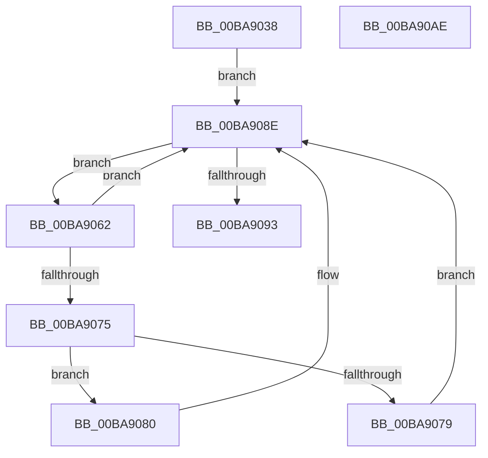

# ViDeadlockCheckDuplicatesAmongChildren

- RVA: `0x00BA9038`–`0x00BA90AF` (길이 `119` bytes)
- VA: `0x0000000140BA9038`
- 실행 섹션: `PAGEVRFY`
- PDB 이름 있음: `예`; PDB Function 태그: `아니요`
- unwind 정보 RVA: `0x0005E6B4`
- 디코드: `37`개 명령, `119/119` bytes 표시
- 미해석 바이트: `0` (있으면 어셈블리에 `.byte`로 보존)

> 이 문서는 커널 이미지의 기계어와 PDB 기호를 분석해 생성했습니다. 4번과 5번은 함수 원형과 자료형을 바이너리 사용 방식에서 추정한 C 해석이며 원본 소스 복구 결과는 아닙니다.

## 1. Dependencies

- 직접 호출 지점: **2**; 고유 호출 대상: **2**
- 직접 호출자로 확인된 함수: **1**
- RIP 상대 이미지 참조: **0**

### Outgoing calls
- `0x00BA906C` → [ViDeadlockSimilarNodes](ViDeadlockSimilarNodes_function_00BAA270.md) (function, `0x00BAA270`)
- `0x00BA9089` → [ViDeadlockMergeNodes](ViDeadlockMergeNodes_function_00BA9934.md) (function, `0x00BA9934`)

### Direct callers
- [VfDeadlockAcquireResource](../BB/VfDeadlockAcquireResource_function_00BB83B4.md) at `0x00BB8763`

### Static image references
- 디코드된 RIP-relative 메모리 참조가 없습니다.

## 2. Other-region calls and transfers

- 다른 실행 섹션으로 향하는 call: **0**
- 별도 외부 분기/꼬리 이동을 확인하지 못했습니다.

## 3. Assembly (complete function range)

```asm
00BA9038  48 8B C4                        mov rax, rsp
00BA903B  48 89 58 08                     mov qword ptr [rax + 8], rbx
00BA903F  48 89 68 10                     mov qword ptr [rax + 0x10], rbp
00BA9043  48 89 70 18                     mov qword ptr [rax + 0x18], rsi
00BA9047  48 89 78 20                     mov qword ptr [rax + 0x20], rdi
00BA904B  41 56                           push r14
00BA904D  48 83 EC 20                     sub rsp, 0x20
00BA9051  48 8D 79 08                     lea rdi, [rcx + 8]
00BA9055  4D 8B F0                        mov r14, r8
00BA9058  48 8B 1F                        mov rbx, qword ptr [rdi]
00BA905B  48 8B EA                        mov rbp, rdx
00BA905E  33 F6                           xor esi, esi
00BA9060  EB 2C                           jmp 0x140ba908e
00BA9062  48 8D 4B E8                     lea rcx, [rbx - 0x18]
00BA9066  48 8B D5                        mov rdx, rbp
00BA9069  48 8B 1B                        mov rbx, qword ptr [rbx]
00BA906C  E8 FF 11 00 00                  call 0x140baa270
00BA9071  85 C0                           test eax, eax
00BA9073  74 19                           je 0x140ba908e
00BA9075  85 F6                           test esi, esi
00BA9077  75 07                           jne 0x140ba9080
00BA9079  BE 01 00 00 00                  mov esi, 1
00BA907E  EB 0E                           jmp 0x140ba908e
00BA9080  48 8B D1                        mov rdx, rcx
00BA9083  4D 8B C6                        mov r8, r14
00BA9086  48 8B CD                        mov rcx, rbp
00BA9089  E8 A6 08 00 00                  call 0x140ba9934
00BA908E  48 3B DF                        cmp rbx, rdi
00BA9091  75 CF                           jne 0x140ba9062
00BA9093  48 8B 5C 24 30                  mov rbx, qword ptr [rsp + 0x30]
00BA9098  48 8B 6C 24 38                  mov rbp, qword ptr [rsp + 0x38]
00BA909D  48 8B 74 24 40                  mov rsi, qword ptr [rsp + 0x40]
00BA90A2  48 8B 7C 24 48                  mov rdi, qword ptr [rsp + 0x48]
00BA90A7  48 83 C4 20                     add rsp, 0x20
00BA90AB  41 5E                           pop r14
00BA90AD  C3                              ret
00BA90AE  CC                              int3
```

## 4. C-style interpretation (structured pseudocode)

```c
__int64 __fastcall ViDeadlockCheckDuplicatesAmongChildren(__int64 a1, __int64 a2, __int64 a3)
{
    __int64 result;
    __int64 v_rsi;
    __int64 v_rsp;
    unsigned __int64 v_stack_p10;
    unsigned __int64 v_stack_p18;
    unsigned __int64 v_stack_p20;
    unsigned __int64 v_stack_p8;

    *(unsigned __int64 *)(v_rsp + 8) = v_rbx;
    *(unsigned __int64 *)(v_rsp + 16) = v_rbp;
    *(unsigned __int64 *)(v_rsp + 24) = v_rsi;
    *(unsigned __int64 *)(v_rsp + 32) = v_rdi;
    v_rsp = (v_rsp) - (32);
    v_rsi = 0;
    goto loc_00BA908E;
loc_00BA9062:
    result = ViDeadlockSimilarNodes(*(unsigned __int64 *)(a1 + 8) - 24, a2, a3, a4);
    if ((unsigned int)(result) == 0) goto loc_00BA908E;
    if (0 != 0) goto loc_00BA9080;
    goto loc_00BA908E;
loc_00BA9080:
    result = ViDeadlockMergeNodes(a2, *(unsigned __int64 *)(a1 + 8) - 24, a3, a4);
loc_00BA908E:
    if ((*(unsigned __int64 *)(*(unsigned __int64 *)(a1 + 8))) != (a1 + 8)) goto loc_00BA9062;
    v_rsp = (v_rsp) + (32);
    return result;
}
```

## 5. (Beta) C Style

```c
int64_t ViDeadlockCheckDuplicatesAmongChildren(void *Arg1, int64_t Arg2, int64_t Arg3)
{
    uint8_t *arg1 = (uint8_t *)Arg1;

    int64_t result;
    int64_t local_rsi;
    int64_t local_rsp;
    uint64_t v_stack_p10;
    uint64_t v_stack_p18;
    uint64_t v_stack_p20;
    uint64_t v_stack_p8;

    *(uint64_t *)(local_rsp + 0x8) = local_rbx;
    *(uint64_t *)(local_rsp + 0x10) = local_rbp;
    *(uint64_t *)(local_rsp + 0x18) = local_rsi;
    *(uint64_t *)(local_rsp + 0x20) = local_rdi;
    local_rsp = (local_rsp) - (32);
    local_rsi = 0;
    goto loc_00BA908E;
loc_00BA9062:
    result = ViDeadlockSimilarNodes(*(uint64_t *)(arg1 + 0x8) - 24, Arg2, Arg3, a4);
    if ((uint32_t)(result) == 0) goto loc_00BA908E;
    if (0 != 0) goto loc_00BA9080;
    goto loc_00BA908E;
loc_00BA9080:
    result = ViDeadlockMergeNodes(Arg2, *(uint64_t *)(arg1 + 0x8) - 24, Arg3, a4);
loc_00BA908E:
    if ((*(uint64_t *)(*(uint64_t *)(arg1 + 0x8))) != (Arg1 + 8)) goto loc_00BA9062;
    local_rsp = (local_rsp) + (32);
    return result;
}
```

### 관측된 메모리 오프셋

구조체 형식이 확인되지 않은 접근은 인자 기준의 오프셋으로만 기록했습니다.

| 기준 인자 | 오프셋 표현 | 폭 (bit) | 접근 |
|---|---:|---:|---|
| `Arg1` | `+ 0x0` | `64` | `R` |
| `Arg1` | `+ 0x8` | `64` | `R` |

## 6. Execution-region graph

[열기: 2D/3D 그래프와 함수 탐색 컨트롤 패널](../../../control-panel.html?section=pagevrfy&rva=0x00BA9038&view=graph)

- 2D 그래프는 위에서 아래로 흐르고, 3D 그래프는 빈 공간을 드래그해 회전합니다. Shift+드래그는 이동, 휠은 확대·축소, 함수 노드 선택은 대상 보고서 이동입니다.

### Static fallback


