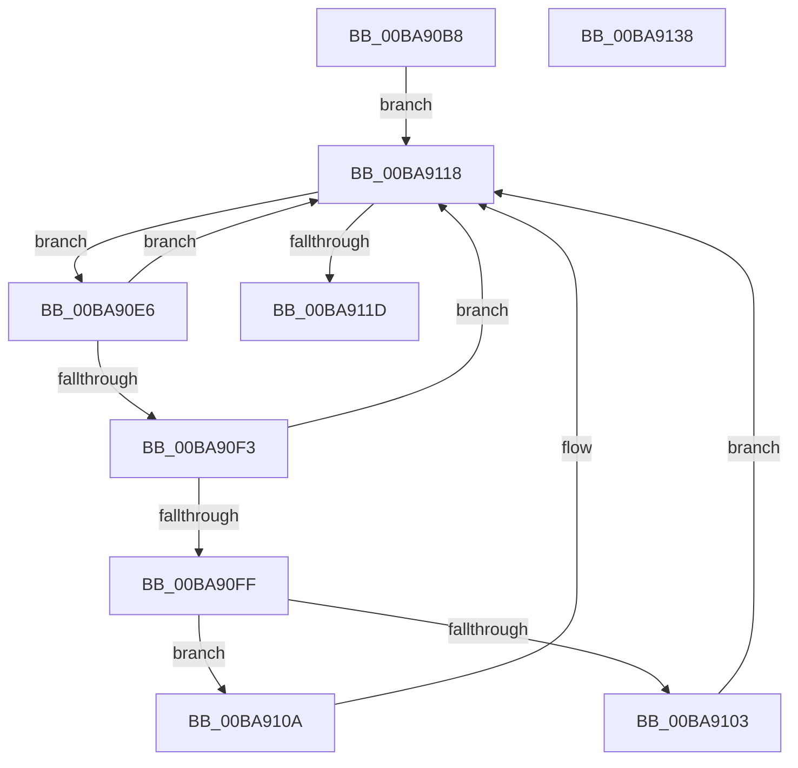

# ViDeadlockCheckDuplicatesAmongRoots

- RVA: `0x00BA90B8`–`0x00BA9139` (길이 `129` bytes)
- VA: `0x0000000140BA90B8`
- 실행 섹션: `PAGEVRFY`
- PDB 이름 있음: `예`; PDB Function 태그: `아니요`
- unwind 정보 RVA: `0x0005E6B4`
- 디코드: `40`개 명령, `129/129` bytes 표시
- 미해석 바이트: `0` (있으면 어셈블리에 `.byte`로 보존)

> 이 문서는 커널 이미지의 기계어와 PDB 기호를 분석해 생성했습니다. 4번과 5번은 함수 원형과 자료형을 바이너리 사용 방식에서 추정한 C 해석이며 원본 소스 복구 결과는 아닙니다.

## 1. Dependencies

- 직접 호출 지점: **2**; 고유 호출 대상: **2**
- 직접 호출자로 확인된 함수: **1**
- RIP 상대 이미지 참조: **0**

### Outgoing calls
- `0x00BA90F6` → [ViDeadlockSimilarNodes](ViDeadlockSimilarNodes_function_00BAA270.md) (function, `0x00BAA270`)
- `0x00BA9113` → [ViDeadlockMergeNodes](ViDeadlockMergeNodes_function_00BA9934.md) (function, `0x00BA9934`)

### Direct callers
- [VfDeadlockAcquireResource](../BB/VfDeadlockAcquireResource_function_00BB83B4.md) at `0x00BB87DC`

### Static image references
- 디코드된 RIP-relative 메모리 참조가 없습니다.

## 2. Other-region calls and transfers

- 다른 실행 섹션으로 향하는 call: **0**
- 별도 외부 분기/꼬리 이동을 확인하지 못했습니다.

## 3. Assembly (complete function range)

```asm
00BA90B8  48 8B C4                        mov rax, rsp
00BA90BB  48 89 58 08                     mov qword ptr [rax + 8], rbx
00BA90BF  48 89 68 10                     mov qword ptr [rax + 0x10], rbp
00BA90C3  48 89 70 18                     mov qword ptr [rax + 0x18], rsi
00BA90C7  48 89 78 20                     mov qword ptr [rax + 0x20], rdi
00BA90CB  41 56                           push r14
00BA90CD  48 83 EC 20                     sub rsp, 0x20
00BA90D1  48 8B 79 38                     mov rdi, qword ptr [rcx + 0x38]
00BA90D5  33 F6                           xor esi, esi
00BA90D7  48 83 C7 18                     add rdi, 0x18
00BA90DB  4C 8B F2                        mov r14, rdx
00BA90DE  48 8B E9                        mov rbp, rcx
00BA90E1  48 8B 1F                        mov rbx, qword ptr [rdi]
00BA90E4  EB 32                           jmp 0x140ba9118
00BA90E6  48 8D 4B D8                     lea rcx, [rbx - 0x28]
00BA90EA  48 8B 1B                        mov rbx, qword ptr [rbx]
00BA90ED  48 83 39 00                     cmp qword ptr [rcx], 0
00BA90F1  75 25                           jne 0x140ba9118
00BA90F3  48 8B D5                        mov rdx, rbp
00BA90F6  E8 75 11 00 00                  call 0x140baa270
00BA90FB  85 C0                           test eax, eax
00BA90FD  74 19                           je 0x140ba9118
00BA90FF  85 F6                           test esi, esi
00BA9101  75 07                           jne 0x140ba910a
00BA9103  BE 01 00 00 00                  mov esi, 1
00BA9108  EB 0E                           jmp 0x140ba9118
00BA910A  48 8B D1                        mov rdx, rcx
00BA910D  4D 8B C6                        mov r8, r14
00BA9110  48 8B CD                        mov rcx, rbp
00BA9113  E8 1C 08 00 00                  call 0x140ba9934
00BA9118  48 3B DF                        cmp rbx, rdi
00BA911B  75 C9                           jne 0x140ba90e6
00BA911D  48 8B 5C 24 30                  mov rbx, qword ptr [rsp + 0x30]
00BA9122  48 8B 6C 24 38                  mov rbp, qword ptr [rsp + 0x38]
00BA9127  48 8B 74 24 40                  mov rsi, qword ptr [rsp + 0x40]
00BA912C  48 8B 7C 24 48                  mov rdi, qword ptr [rsp + 0x48]
00BA9131  48 83 C4 20                     add rsp, 0x20
00BA9135  41 5E                           pop r14
00BA9137  C3                              ret
00BA9138  CC                              int3
```

## 4. C-style interpretation (structured pseudocode)

```c
__int64 __fastcall ViDeadlockCheckDuplicatesAmongRoots(__int64 a1, __int64 a2)
{
    __int64 result;
    __int64 v_rdi;
    __int64 v_rsi;
    __int64 v_rsp;
    unsigned __int64 v_stack_p10;
    unsigned __int64 v_stack_p18;
    unsigned __int64 v_stack_p20;
    unsigned __int64 v_stack_p8;

    *(unsigned __int64 *)(v_rsp + 8) = v_rbx;
    *(unsigned __int64 *)(v_rsp + 16) = v_rbp;
    *(unsigned __int64 *)(v_rsp + 24) = v_rsi;
    *(unsigned __int64 *)(v_rsp + 32) = v_rdi;
    v_rsp = (v_rsp) - (32);
    v_rsi = 0;
    v_rdi = (*(unsigned __int64 *)(a1 + 56)) + (24);
    goto loc_00BA9118;
loc_00BA90E6:
    if ((*(unsigned __int64 *)(*(unsigned __int64 *)(v_rdi) - 40)) != 0) goto loc_00BA9118;
    result = ViDeadlockSimilarNodes(*(unsigned __int64 *)(v_rdi) - 40, a1, a3, a4);
    if ((unsigned int)(result) == 0) goto loc_00BA9118;
    if (0 != 0) goto loc_00BA910A;
    goto loc_00BA9118;
loc_00BA910A:
    result = ViDeadlockMergeNodes(a1, *(unsigned __int64 *)(v_rdi) - 40, a2, a4);
loc_00BA9118:
    if ((*(unsigned __int64 *)(*(unsigned __int64 *)(v_rdi))) != v_rdi) goto loc_00BA90E6;
    v_rsp = (v_rsp) + (32);
    return result;
}
```

## 5. (Beta) C Style

```c
int64_t ViDeadlockCheckDuplicatesAmongRoots(void *Arg1, int64_t Arg2)
{
    uint8_t *arg1 = (uint8_t *)Arg1;

    int64_t result;
    int64_t local_rdi;
    int64_t local_rsi;
    int64_t local_rsp;
    uint64_t v_stack_p10;
    uint64_t v_stack_p18;
    uint64_t v_stack_p20;
    uint64_t v_stack_p8;

    *(uint64_t *)(local_rsp + 0x8) = local_rbx;
    *(uint64_t *)(local_rsp + 0x10) = local_rbp;
    *(uint64_t *)(local_rsp + 0x18) = local_rsi;
    *(uint64_t *)(local_rsp + 0x20) = local_rdi;
    local_rsp = (local_rsp) - (32);
    local_rsi = 0;
    local_rdi = (*(uint64_t *)(arg1 + 0x38)) + (24);
    goto loc_00BA9118;
loc_00BA90E6:
    if ((*(uint64_t *)(*(uint64_t *)(local_rdi) - 0x28)) != 0) goto loc_00BA9118;
    result = ViDeadlockSimilarNodes(*(uint64_t *)(local_rdi) - 40, Arg1, a3, a4);
    if ((uint32_t)(result) == 0) goto loc_00BA9118;
    if (0 != 0) goto loc_00BA910A;
    goto loc_00BA9118;
loc_00BA910A:
    result = ViDeadlockMergeNodes(Arg1, *(uint64_t *)(local_rdi) - 40, Arg2, a4);
loc_00BA9118:
    if ((*(uint64_t *)(*(uint64_t *)(local_rdi))) != local_rdi) goto loc_00BA90E6;
    local_rsp = (local_rsp) + (32);
    return result;
}
```

### 관측된 메모리 오프셋

구조체 형식이 확인되지 않은 접근은 인자 기준의 오프셋으로만 기록했습니다.

| 기준 인자 | 오프셋 표현 | 폭 (bit) | 접근 |
|---|---:|---:|---|
| `Arg1` | `+ 0x38` | `64` | `R` |

## 6. Execution-region graph

[열기: 2D/3D 그래프와 함수 탐색 컨트롤 패널](../../../control-panel.html?section=pagevrfy&rva=0x00BA90B8&view=graph)

- 2D 그래프는 위에서 아래로 흐르고, 3D 그래프는 빈 공간을 드래그해 회전합니다. Shift+드래그는 이동, 휠은 확대·축소, 함수 노드 선택은 대상 보고서 이동입니다.

### Static fallback


