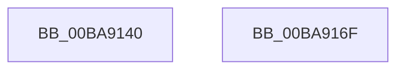

# ViDeadlockDatabaseHashIndex

- RVA: `0x00BA9140`–`0x00BA9170` (길이 `48` bytes)
- VA: `0x0000000140BA9140`
- 실행 섹션: `PAGEVRFY`
- PDB 이름 있음: `예`; PDB Function 태그: `아니요`
- unwind 정보 RVA: `0x000DB714`
- 디코드: `13`개 명령, `48/48` bytes 표시
- 미해석 바이트: `0` (있으면 어셈블리에 `.byte`로 보존)

> 이 문서는 커널 이미지의 기계어와 PDB 기호를 분석해 생성했습니다. 4번과 5번은 함수 원형과 자료형을 바이너리 사용 방식에서 추정한 C 해석이며 원본 소스 복구 결과는 아닙니다.

## 1. Dependencies

- 직접 호출 지점: **0**; 고유 호출 대상: **0**
- 직접 호출자로 확인된 함수: **2**
- RIP 상대 이미지 참조: **0**

### Outgoing calls
- 직접 디코드된 call 명령이 없습니다.

### Direct callers
- [ViDeadlockRemoveMemoryRangeResources](../../text/61/ViDeadlockRemoveMemoryRangeResources_function_00615FE8.md) at `0x00616017`
- [ViDeadlockRemoveMemoryRangeThreads](../../text/61/ViDeadlockRemoveMemoryRangeThreads_function_00616148.md) at `0x00616172`

### Static image references
- 디코드된 RIP-relative 메모리 참조가 없습니다.

## 2. Other-region calls and transfers

- 다른 실행 섹션으로 향하는 call: **0**
- 별도 외부 분기/꼬리 이동을 확인하지 못했습니다.

## 3. Assembly (complete function range)

```asm
00BA9140  48 C1 E9 0C                     shr rcx, 0xc
00BA9144  48 B8 11 40 00 01 04 10 40 00   movabs rax, 0x40100401004011
00BA914E  48 F7 E1                        mul rcx
00BA9151  48 8B C1                        mov rax, rcx
00BA9154  48 2B C2                        sub rax, rdx
00BA9157  48 D1 E8                        shr rax, 1
00BA915A  48 03 C2                        add rax, rdx
00BA915D  48 C1 E8 09                     shr rax, 9
00BA9161  48 69 C0 FF 03 00 00            imul rax, rax, 0x3ff
00BA9168  48 2B C8                        sub rcx, rax
00BA916B  48 8B C1                        mov rax, rcx
00BA916E  C3                              ret
00BA916F  CC                              int3
```

## 4. C-style interpretation (structured pseudocode)

```c
__int64 __fastcall ViDeadlockDatabaseHashIndex(__int64 a1, __int64 a2)
{
    __int64 result;

    a1 = (a1) >> (12);
    result = (a1) - (a2);
    result = (result) >> (1);
    result = (result) + (a2);
    result = (result) >> (9);
    result = (result) * (result);
    a1 = (a1) - (result);
    return a1;
}
```

## 5. (Beta) C Style

```c
int64_t ViDeadlockDatabaseHashIndex(int64_t Arg1, int64_t Arg2)
{
    int64_t result;

    Arg1 = (Arg1) >> (12);
    result = (Arg1) - (Arg2);
    result = (result) >> (1);
    result = (result) + (Arg2);
    result = (result) >> (9);
    result = (result) * (result);
    Arg1 = (Arg1) - (result);
    return Arg1;
}
```

## 6. Execution-region graph

[열기: 2D/3D 그래프와 함수 탐색 컨트롤 패널](../../../control-panel.html?section=pagevrfy&rva=0x00BA9140&view=graph)

- 2D 그래프는 위에서 아래로 흐르고, 3D 그래프는 빈 공간을 드래그해 회전합니다. Shift+드래그는 이동, 휠은 확대·축소, 함수 노드 선택은 대상 보고서 이동입니다.

### Static fallback


