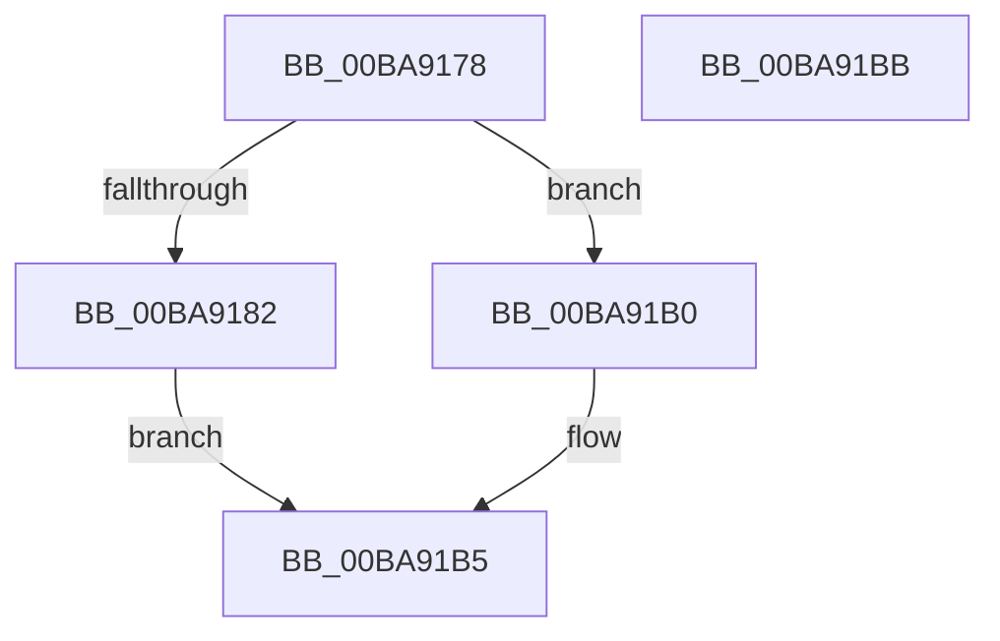

# ViDeadlockDetectionApplySettings

- RVA: `0x00BA9178`–`0x00BA91BC` (길이 `68` bytes)
- VA: `0x0000000140BA9178`
- 실행 섹션: `PAGEVRFY`
- PDB 이름 있음: `예`; PDB Function 태그: `아니요`
- unwind 정보 RVA: `0x0005CF00`
- 디코드: `19`개 명령, `68/68` bytes 표시
- 미해석 바이트: `0` (있으면 어셈블리에 `.byte`로 보존)

> 이 문서는 커널 이미지의 기계어와 PDB 기호를 분석해 생성했습니다. 4번과 5번은 함수 원형과 자료형을 바이너리 사용 방식에서 추정한 C 해석이며 원본 소스 복구 결과는 아닙니다.

## 1. Dependencies

- 직접 호출 지점: **5**; 고유 호출 대상: **5**
- 직접 호출자로 확인된 함수: **4**
- RIP 상대 이미지 참조: **1**

### Outgoing calls
- `0x00BA9182` → [ViRaiseIrqlToDpcLevel](../../text/61/ViRaiseIrqlToDpcLevel_function_006162B0.md) (function, `0x006162B0`)
- `0x00BA918E` → [ViDeadlockDetectionLock](ViDeadlockDetectionLock_function_00BA91C4.md) (function, `0x00BA91C4`)
- `0x00BA91A2` → [ViDeadlockDetectionUnlock](ViDeadlockDetectionUnlock_function_00BA91FC.md) (function, `0x00BA91FC`)
- `0x00BA91A9` → [ViLowerIrql](../../text/61/ViLowerIrql_function_00616278.md) (function, `0x00616278`)
- `0x00BA91B0` → [ViDeadlockEmptyDatabase](ViDeadlockEmptyDatabase_function_00BA922C.md) (function, `0x00BA922C`)

### Direct callers
- [ViDeadlockPluginUnload](../../text/61/ViDeadlockPluginUnload_function_00615FD0.md) at `0x00615FD6`
- [VfDeadlockInitialize](VfDeadlockInitialize_function_00BA7DDC.md) at `0x00BA8032`
- [VfDeadlockPluginEntry](VfDeadlockPluginEntry_function_00BA8230.md) at `0x00BA8809`
- [VfSettingsCheckForChanges](VfSettingsCheckForChanges_function_00BAB250.md) at `0x00BAB2D6`

### Static image references
- `0x00BA9198` → RVA `0x00FFDA78` (`PAGEVRFD`; write)

## 2. Other-region calls and transfers

- 다른 실행 섹션으로 향하는 call: **2**
  - `0x00BA9182` → [ViRaiseIrqlToDpcLevel](../../text/61/ViRaiseIrqlToDpcLevel_function_006162B0.md) (`PAGEVRFY` → `.text`)
  - `0x00BA91A9` → [ViLowerIrql](../../text/61/ViLowerIrql_function_00616278.md) (`PAGEVRFY` → `.text`)
- 별도 외부 분기/꼬리 이동을 확인하지 못했습니다.

## 3. Assembly (complete function range)

```asm
00BA9178  40 53                           push rbx
00BA917A  48 83 EC 20                     sub rsp, 0x20
00BA917E  85 C9                           test ecx, ecx
00BA9180  74 2E                           je 0x140ba91b0
00BA9182  E8 29 D1 A6 FF                  call 0x1406162b0
00BA9187  B9 01 00 00 00                  mov ecx, 1
00BA918C  8A D8                           mov bl, al
00BA918E  E8 31 00 00 00                  call 0x140ba91c4
00BA9193  B9 01 00 00 00                  mov ecx, 1
00BA9198  C7 05 D6 48 45 00 01 00 00 00   mov dword ptr [rip + 0x4548d6], 1
00BA91A2  E8 55 00 00 00                  call 0x140ba91fc
00BA91A7  8A CB                           mov cl, bl
00BA91A9  E8 CA D0 A6 FF                  call 0x140616278
00BA91AE  EB 05                           jmp 0x140ba91b5
00BA91B0  E8 77 00 00 00                  call 0x140ba922c
00BA91B5  48 83 C4 20                     add rsp, 0x20
00BA91B9  5B                              pop rbx
00BA91BA  C3                              ret
00BA91BB  CC                              int3
```

## 4. C-style interpretation (structured pseudocode)

```c
__int64 __fastcall ViDeadlockDetectionApplySettings(int a1)
{
    __int64 result;
    __int64 v_rsp;

    v_rsp = (v_rsp) - (32);
    if (a1 == 0) goto loc_00BA91B0;
    result = ViRaiseIrqlToDpcLevel(a1, a2, a3, a4);
    result = ViDeadlockDetectionLock(1, a2, a3, a4);
    *(unsigned int *)(v_rip + 4540630) = 1;
    result = ViDeadlockDetectionUnlock(1, a2, a3, a4);
    result = ViLowerIrql((unsigned __int8)((unsigned __int8)(result)), a2, a3, a4);
    goto loc_00BA91B5;
loc_00BA91B0:
    result = ViDeadlockEmptyDatabase((unsigned __int8)((unsigned __int8)(result)), a2, a3, a4);
loc_00BA91B5:
    v_rsp = (v_rsp) + (32);
    return result;
}
```

## 5. (Beta) C Style

```c
int64_t ViDeadlockDetectionApplySettings(int32_t Arg1)
{
    int64_t result;
    int64_t local_rsp;

    local_rsp = (local_rsp) - (32);
    if (Arg1 == 0) goto loc_00BA91B0;
    result = ViRaiseIrqlToDpcLevel(Arg1, a2, a3, a4);
    result = ViDeadlockDetectionLock(1, a2, a3, a4);
    *(uint32_t *)(v_rip + 0x4548D6) = 1;
    result = ViDeadlockDetectionUnlock(1, a2, a3, a4);
    result = ViLowerIrql((uint8_t)((uint8_t)(result)), a2, a3, a4);
    goto loc_00BA91B5;
loc_00BA91B0:
    result = ViDeadlockEmptyDatabase((uint8_t)((uint8_t)(result)), a2, a3, a4);
loc_00BA91B5:
    local_rsp = (local_rsp) + (32);
    return result;
}
```

## 6. Execution-region graph

[열기: 2D/3D 그래프와 함수 탐색 컨트롤 패널](../../../control-panel.html?section=pagevrfy&rva=0x00BA9178&view=graph)

- 2D 그래프는 위에서 아래로 흐르고, 3D 그래프는 빈 공간을 드래그해 회전합니다. Shift+드래그는 이동, 휠은 확대·축소, 함수 노드 선택은 대상 보고서 이동입니다.

### Static fallback


