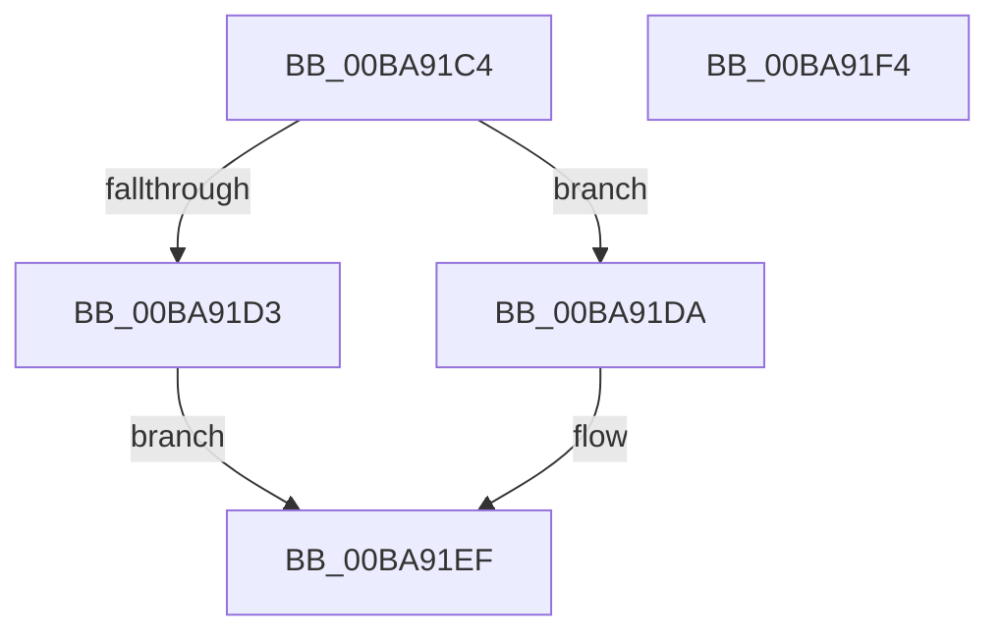

# ViDeadlockDetectionLock

- RVA: `0x00BA91C4`–`0x00BA91F5` (길이 `49` bytes)
- VA: `0x0000000140BA91C4`
- 실행 섹션: `PAGEVRFY`
- PDB 이름 있음: `예`; PDB Function 태그: `아니요`
- unwind 정보 RVA: `0x0005C788`
- 디코드: `12`개 명령, `49/49` bytes 표시
- 미해석 바이트: `0` (있으면 어셈블리에 `.byte`로 보존)

> 이 문서는 커널 이미지의 기계어와 PDB 기호를 분석해 생성했습니다. 4번과 5번은 함수 원형과 자료형을 바이너리 사용 방식에서 추정한 C 해석이며 원본 소스 복구 결과는 아닙니다.

## 1. Dependencies

- 직접 호출 지점: **2**; 고유 호출 대상: **2**
- 직접 호출자로 확인된 함수: **8**
- RIP 상대 이미지 참조: **2**

### Outgoing calls
- `0x00BA91D3` → [ExAcquireSpinLockSharedAtDpcLevel](../../text/24/ExAcquireSpinLockSharedAtDpcLevel_function_00248E30.md) (function, `0x00248E30`)
- `0x00BA91DA` → [ExAcquireSpinLockExclusiveAtDpcLevel](../../text/24/ExAcquireSpinLockExclusiveAtDpcLevel_function_00248E80.md) (function, `0x00248E80`)

### Direct callers
- [ViDeadlockRemoveMemoryRangeResources](../../text/61/ViDeadlockRemoveMemoryRangeResources_function_00615FE8.md) at `0x0061603A`
- [ViDeadlockRemoveMemoryRangeThreads](../../text/61/ViDeadlockRemoveMemoryRangeThreads_function_00616148.md) at `0x00616195`
- [VfDeadlockInitializeResource](VfDeadlockInitializeResource_function_00BA80A0.md) at `0x00BA8178`
- [ViDeadlockDetectionApplySettings](ViDeadlockDetectionApplySettings_function_00BA9178.md) at `0x00BA918E`
- [ViDeadlockEmptyDatabase](ViDeadlockEmptyDatabase_function_00BA922C.md) at `0x00BA9258`
- [ViIsThreadInsidePagingCodePaths](ViIsThreadInsidePagingCodePaths_function_00BAA2D4.md) at `0x00BAA2F8`
- [VfDeadlockReleaseResource](../BB/VfDeadlockReleaseResource_function_00BB759C.md) at `0x00BB7681`
- [VfDeadlockAcquireResource](../BB/VfDeadlockAcquireResource_function_00BB83B4.md) at `0x00BB8517`

### Static image references
- `0x00BA91CA` → RVA `0x00F04060` (`.data`; read)
- `0x00BA91E8` → RVA `0x00F04020` (`.data`; write)

## 2. Other-region calls and transfers

- 다른 실행 섹션으로 향하는 call: **2**
  - `0x00BA91D3` → [ExAcquireSpinLockSharedAtDpcLevel](../../text/24/ExAcquireSpinLockSharedAtDpcLevel_function_00248E30.md) (`PAGEVRFY` → `.text`)
  - `0x00BA91DA` → [ExAcquireSpinLockExclusiveAtDpcLevel](../../text/24/ExAcquireSpinLockExclusiveAtDpcLevel_function_00248E80.md) (`PAGEVRFY` → `.text`)
- 별도 외부 분기/꼬리 이동을 확인하지 못했습니다.

## 3. Assembly (complete function range)

```asm
00BA91C4  48 83 EC 28                     sub rsp, 0x28
00BA91C8  85 C9                           test ecx, ecx
00BA91CA  48 8D 0D 8F AE 35 00            lea rcx, [rip + 0x35ae8f]
00BA91D1  75 07                           jne 0x140ba91da
00BA91D3  E8 58 FC 69 FF                  call 0x140248e30
00BA91D8  EB 15                           jmp 0x140ba91ef
00BA91DA  E8 A1 FC 69 FF                  call 0x140248e80
00BA91DF  65 48 8B 04 25 88 01 00 00      mov rax, qword ptr gs:[0x188]
00BA91E8  48 89 05 31 AE 35 00            mov qword ptr [rip + 0x35ae31], rax
00BA91EF  48 83 C4 28                     add rsp, 0x28
00BA91F3  C3                              ret
00BA91F4  CC                              int3
```

## 4. C-style interpretation (structured pseudocode)

```c
__int64 __fastcall ViDeadlockDetectionLock(int a1)
{
    __int64 result;
    __int64 v_rsp;

    v_rsp = (v_rsp) - (40);
    if (a1 != 0) goto loc_00BA91DA;
    result = ExAcquireSpinLockSharedAtDpcLevel(v_rip + 3518095, a2, a3, a4);
    goto loc_00BA91EF;
loc_00BA91DA:
    result = ExAcquireSpinLockExclusiveAtDpcLevel(v_rip + 3518095, a2, a3, a4);
    *(unsigned __int64 *)(v_rip + 3518001) = *(unsigned __int64 *)(gs_base + (0 + 392));
loc_00BA91EF:
    v_rsp = (v_rsp) + (40);
    return *(unsigned __int64 *)(gs_base + (0 + 392));
}
```

## 5. (Beta) C Style

```c
int64_t ViDeadlockDetectionLock(int32_t Arg1)
{
    int64_t result;
    int64_t local_rsp;

    local_rsp = (local_rsp) - (40);
    if (Arg1 != 0) goto loc_00BA91DA;
    result = ExAcquireSpinLockSharedAtDpcLevel(v_rip + 3518095, a2, a3, a4);
    goto loc_00BA91EF;
loc_00BA91DA:
    result = ExAcquireSpinLockExclusiveAtDpcLevel(v_rip + 3518095, a2, a3, a4);
    *(uint64_t *)(v_rip + 0x35AE31) = *(uint64_t *)(gs_base + (0 + 0x188));
loc_00BA91EF:
    local_rsp = (local_rsp) + (40);
    return *(uint64_t *)(gs_base + (0 + 0x188));
}
```

## 6. Execution-region graph

[열기: 2D/3D 그래프와 함수 탐색 컨트롤 패널](../../../control-panel.html?section=pagevrfy&rva=0x00BA91C4&view=graph)

- 2D 그래프는 위에서 아래로 흐르고, 3D 그래프는 빈 공간을 드래그해 회전합니다. Shift+드래그는 이동, 휠은 확대·축소, 함수 노드 선택은 대상 보고서 이동입니다.

### Static fallback


