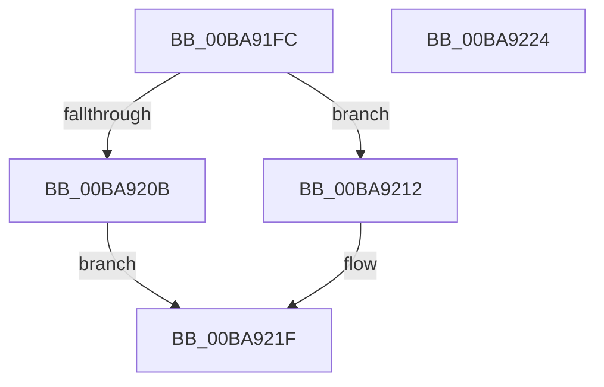

# ViDeadlockDetectionUnlock

- RVA: `0x00BA91FC`–`0x00BA9225` (길이 `41` bytes)
- VA: `0x0000000140BA91FC`
- 실행 섹션: `PAGEVRFY`
- PDB 이름 있음: `예`; PDB Function 태그: `아니요`
- unwind 정보 RVA: `0x0005C788`
- 디코드: `11`개 명령, `41/41` bytes 표시
- 미해석 바이트: `0` (있으면 어셈블리에 `.byte`로 보존)

> 이 문서는 커널 이미지의 기계어와 PDB 기호를 분석해 생성했습니다. 4번과 5번은 함수 원형과 자료형을 바이너리 사용 방식에서 추정한 C 해석이며 원본 소스 복구 결과는 아닙니다.

## 1. Dependencies

- 직접 호출 지점: **2**; 고유 호출 대상: **2**
- 직접 호출자로 확인된 함수: **8**
- RIP 상대 이미지 참조: **2**

### Outgoing calls
- `0x00BA920B` → [ExReleaseSpinLockSharedFromDpcLevel](../../text/24/ExReleaseSpinLockSharedFromDpcLevel_function_0024A590.md) (function, `0x0024A590`)
- `0x00BA921A` → [ExReleaseSpinLockExclusiveFromDpcLevel](../../text/24/ExReleaseSpinLockExclusiveFromDpcLevel_function_002497E0.md) (function, `0x002497E0`)

### Direct callers
- [ViDeadlockRemoveMemoryRangeResources](../../text/61/ViDeadlockRemoveMemoryRangeResources_function_00615FE8.md) at `0x006160C8`
- [ViDeadlockRemoveMemoryRangeResources](../../text/61/ViDeadlockRemoveMemoryRangeResources_function_00615FE8.md) at `0x006160DC`
- [ViDeadlockRemoveMemoryRangeThreads](../../text/61/ViDeadlockRemoveMemoryRangeThreads_function_00616148.md) at `0x00616220`
- [ViDeadlockRemoveMemoryRangeThreads](../../text/61/ViDeadlockRemoveMemoryRangeThreads_function_00616148.md) at `0x00616231`
- [VfDeadlockInitializeResource](VfDeadlockInitializeResource_function_00BA80A0.md) at `0x00BA81A9`
- [ViDeadlockDetectionApplySettings](ViDeadlockDetectionApplySettings_function_00BA9178.md) at `0x00BA91A2`
- [ViDeadlockEmptyDatabase](ViDeadlockEmptyDatabase_function_00BA922C.md) at `0x00BA9332`
- [ViIsThreadInsidePagingCodePaths](ViIsThreadInsidePagingCodePaths_function_00BAA2D4.md) at `0x00BAA317`
- [VfDeadlockReleaseResource](../BB/VfDeadlockReleaseResource_function_00BB759C.md) at `0x00BB79FC`
- [VfDeadlockAcquireResource](../BB/VfDeadlockAcquireResource_function_00BB83B4.md) at `0x00BB89BA`

### Static image references
- `0x00BA9202` → RVA `0x00F04060` (`.data`; read)
- `0x00BA9212` → RVA `0x00F04020` (`.data`; read/write)

## 2. Other-region calls and transfers

- 다른 실행 섹션으로 향하는 call: **2**
  - `0x00BA920B` → [ExReleaseSpinLockSharedFromDpcLevel](../../text/24/ExReleaseSpinLockSharedFromDpcLevel_function_0024A590.md) (`PAGEVRFY` → `.text`)
  - `0x00BA921A` → [ExReleaseSpinLockExclusiveFromDpcLevel](../../text/24/ExReleaseSpinLockExclusiveFromDpcLevel_function_002497E0.md) (`PAGEVRFY` → `.text`)
- 별도 외부 분기/꼬리 이동을 확인하지 못했습니다.

## 3. Assembly (complete function range)

```asm
00BA91FC  48 83 EC 28                     sub rsp, 0x28
00BA9200  85 C9                           test ecx, ecx
00BA9202  48 8D 0D 57 AE 35 00            lea rcx, [rip + 0x35ae57]
00BA9209  75 07                           jne 0x140ba9212
00BA920B  E8 80 13 6A FF                  call 0x14024a590
00BA9210  EB 0D                           jmp 0x140ba921f
00BA9212  48 83 25 06 AE 35 00 00         and qword ptr [rip + 0x35ae06], 0
00BA921A  E8 C1 05 6A FF                  call 0x1402497e0
00BA921F  48 83 C4 28                     add rsp, 0x28
00BA9223  C3                              ret
00BA9224  CC                              int3
```

## 4. C-style interpretation (structured pseudocode)

```c
__int64 __fastcall ViDeadlockDetectionUnlock(int a1)
{
    __int64 result;
    __int64 v_rsp;

    v_rsp = (v_rsp) - (40);
    if (a1 != 0) goto loc_00BA9212;
    result = ExReleaseSpinLockSharedFromDpcLevel(v_rip + 3518039, a2, a3, a4);
    goto loc_00BA921F;
loc_00BA9212:
    result = ExReleaseSpinLockExclusiveFromDpcLevel(v_rip + 3518039, a2, a3, a4);
loc_00BA921F:
    v_rsp = (v_rsp) + (40);
    return result;
}
```

## 5. (Beta) C Style

```c
int64_t ViDeadlockDetectionUnlock(int32_t Arg1)
{
    int64_t result;
    int64_t local_rsp;

    local_rsp = (local_rsp) - (40);
    if (Arg1 != 0) goto loc_00BA9212;
    result = ExReleaseSpinLockSharedFromDpcLevel(v_rip + 3518039, a2, a3, a4);
    goto loc_00BA921F;
loc_00BA9212:
    result = ExReleaseSpinLockExclusiveFromDpcLevel(v_rip + 3518039, a2, a3, a4);
loc_00BA921F:
    local_rsp = (local_rsp) + (40);
    return result;
}
```

## 6. Execution-region graph

[열기: 2D/3D 그래프와 함수 탐색 컨트롤 패널](../../../control-panel.html?section=pagevrfy&rva=0x00BA91FC&view=graph)

- 2D 그래프는 위에서 아래로 흐르고, 3D 그래프는 빈 공간을 드래그해 회전합니다. Shift+드래그는 이동, 휠은 확대·축소, 함수 노드 선택은 대상 보고서 이동입니다.

### Static fallback


