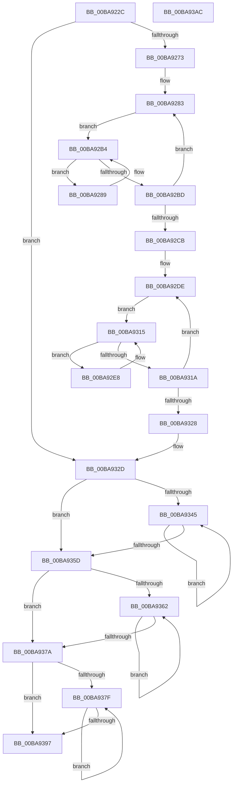

# ViDeadlockEmptyDatabase

- RVA: `0x00BA922C`–`0x00BA93AD` (길이 `385` bytes)
- VA: `0x0000000140BA922C`
- 실행 섹션: `PAGEVRFY`
- PDB 이름 있음: `예`; PDB Function 태그: `아니요`
- unwind 정보 RVA: `0x000BE6C8`
- 디코드: `110`개 명령, `385/385` bytes 표시
- 미해석 바이트: `0` (있으면 어셈블리에 `.byte`로 보존)

> 이 문서는 커널 이미지의 기계어와 PDB 기호를 분석해 생성했습니다. 4번과 5번은 함수 원형과 자료형을 바이너리 사용 방식에서 추정한 C 해석이며 원본 소스 복구 결과는 아닙니다.

## 1. Dependencies

- 직접 호출 지점: **9**; 고유 호출 대상: **7**
- 직접 호출자로 확인된 함수: **1**
- RIP 상대 이미지 참조: **2**

### Outgoing calls
- `0x00BA924C` → [ViRaiseIrqlToDpcLevel](../../text/61/ViRaiseIrqlToDpcLevel_function_006162B0.md) (function, `0x006162B0`)
- `0x00BA9258` → [ViDeadlockDetectionLock](ViDeadlockDetectionLock_function_00BA91C4.md) (function, `0x00BA91C4`)
- `0x00BA929E` → [ViDeadlockRemoveResource](ViDeadlockRemoveResource_function_00BA9DEC.md) (function, `0x00BA9DEC`)
- `0x00BA92F8` → [ViDeadlockRemoveThread](ViDeadlockRemoveThread_function_00BA9F8C.md) (function, `0x00BA9F8C`)
- `0x00BA9332` → [ViDeadlockDetectionUnlock](ViDeadlockDetectionUnlock_function_00BA91FC.md) (function, `0x00BA91FC`)
- `0x00BA933B` → [ViLowerIrql](../../text/61/ViLowerIrql_function_00616278.md) (function, `0x00616278`)
- `0x00BA9350` → [ViDeadlockFree](ViDeadlockFree_function_00BA9670.md) (function, `0x00BA9670`)
- `0x00BA936D` → [ViDeadlockFree](ViDeadlockFree_function_00BA9670.md) (function, `0x00BA9670`)
- `0x00BA938A` → [ViDeadlockFree](ViDeadlockFree_function_00BA9670.md) (function, `0x00BA9670`)

### Direct callers
- [ViDeadlockDetectionApplySettings](ViDeadlockDetectionApplySettings_function_00BA9178.md) at `0x00BA91B0`

### Static image references
- `0x00BA925D` → RVA `0x00FFDA00` (`PAGEVRFD`; read)
- `0x00BA9264` → RVA `0x00FFDA78` (`PAGEVRFD`; write)

## 2. Other-region calls and transfers

- 다른 실행 섹션으로 향하는 call: **2**
  - `0x00BA924C` → [ViRaiseIrqlToDpcLevel](../../text/61/ViRaiseIrqlToDpcLevel_function_006162B0.md) (`PAGEVRFY` → `.text`)
  - `0x00BA933B` → [ViLowerIrql](../../text/61/ViLowerIrql_function_00616278.md) (`PAGEVRFY` → `.text`)
- 별도 외부 분기/꼬리 이동을 확인하지 못했습니다.

## 3. Assembly (complete function range)

```asm
00BA922C  48 89 5C 24 18                  mov qword ptr [rsp + 0x18], rbx
00BA9231  55                              push rbp
00BA9232  56                              push rsi
00BA9233  57                              push rdi
00BA9234  41 54                           push r12
00BA9236  41 55                           push r13
00BA9238  41 56                           push r14
00BA923A  41 57                           push r15
00BA923C  48 83 EC 20                     sub rsp, 0x20
00BA9240  33 FF                           xor edi, edi
00BA9242  45 33 F6                        xor r14d, r14d
00BA9245  48 89 7C 24 68                  mov qword ptr [rsp + 0x68], rdi
00BA924A  33 F6                           xor esi, esi
00BA924C  E8 5F D0 A6 FF                  call 0x1406162b0
00BA9251  8D 4F 01                        lea ecx, [rdi + 1]
00BA9254  88 44 24 60                     mov byte ptr [rsp + 0x60], al
00BA9258  E8 67 FF FF FF                  call 0x140ba91c4
00BA925D  48 8B 0D 9C 47 45 00            mov rcx, qword ptr [rip + 0x45479c]
00BA9264  89 35 0E 48 45 00               mov dword ptr [rip + 0x45480e], esi
00BA926A  48 85 C9                        test rcx, rcx
00BA926D  0F 84 BA 00 00 00               je 0x140ba932d
00BA9273  48 8B 51 10                     mov rdx, qword ptr [rcx + 0x10]
00BA9277  41 BC FF 03 00 00               mov r12d, 0x3ff
00BA927D  45 8B EC                        mov r13d, r12d
00BA9280  45 33 FF                        xor r15d, r15d
00BA9283  49 8B 2C 17                     mov rbp, qword ptr [r15 + rdx]
00BA9287  EB 2B                           jmp 0x140ba92b4
00BA9289  48 8D 5D D8                     lea rbx, [rbp - 0x28]
00BA928D  BA 01 00 00 00                  mov edx, 1
00BA9292  48 8B 6D 00                     mov rbp, qword ptr [rbp]
00BA9296  4C 8D 44 24 68                  lea r8, [rsp + 0x68]
00BA929B  48 8B CB                        mov rcx, rbx
00BA929E  E8 49 0B 00 00                  call 0x140ba9dec
00BA92A3  48 8B 05 56 47 45 00            mov rax, qword ptr [rip + 0x454756]
00BA92AA  48 89 33                        mov qword ptr [rbx], rsi
00BA92AD  48 8B F3                        mov rsi, rbx
00BA92B0  48 8B 50 10                     mov rdx, qword ptr [rax + 0x10]
00BA92B4  48 8D 04 17                     lea rax, [rdi + rdx]
00BA92B8  48 3B E8                        cmp rbp, rax
00BA92BB  75 CC                           jne 0x140ba9289
00BA92BD  48 83 C7 10                     add rdi, 0x10
00BA92C1  49 83 C7 10                     add r15, 0x10
00BA92C5  49 83 ED 01                     sub r13, 1
00BA92C9  75 B8                           jne 0x140ba9283
00BA92CB  48 8B 05 2E 47 45 00            mov rax, qword ptr [rip + 0x45472e]
00BA92D2  45 33 FF                        xor r15d, r15d
00BA92D5  33 FF                           xor edi, edi
00BA92D7  48 8B 88 10 40 00 00            mov rcx, qword ptr [rax + 0x4010]
00BA92DE  49 8B 2C 0F                     mov rbp, qword ptr [r15 + rcx]
00BA92E2  48 8D 04 0F                     lea rax, [rdi + rcx]
00BA92E6  EB 2D                           jmp 0x140ba9315
00BA92E8  48 8D 5D E8                     lea rbx, [rbp - 0x18]
00BA92EC  BA 01 00 00 00                  mov edx, 1
00BA92F1  48 8B 6D 00                     mov rbp, qword ptr [rbp]
00BA92F5  48 8B CB                        mov rcx, rbx
00BA92F8  E8 8F 0C 00 00                  call 0x140ba9f8c
00BA92FD  48 8B 05 FC 46 45 00            mov rax, qword ptr [rip + 0x4546fc]
00BA9304  4C 89 33                        mov qword ptr [rbx], r14
00BA9307  4C 8B F3                        mov r14, rbx
00BA930A  48 8B 88 10 40 00 00            mov rcx, qword ptr [rax + 0x4010]
00BA9311  48 8D 04 39                     lea rax, [rcx + rdi]
00BA9315  48 3B E8                        cmp rbp, rax
00BA9318  75 CE                           jne 0x140ba92e8
00BA931A  48 83 C7 10                     add rdi, 0x10
00BA931E  49 83 C7 10                     add r15, 0x10
00BA9322  49 83 EC 01                     sub r12, 1
00BA9326  75 B6                           jne 0x140ba92de
00BA9328  48 8B 7C 24 68                  mov rdi, qword ptr [rsp + 0x68]
00BA932D  B9 01 00 00 00                  mov ecx, 1
00BA9332  E8 C5 FE FF FF                  call 0x140ba91fc
00BA9337  8A 4C 24 60                     mov cl, byte ptr [rsp + 0x60]
00BA933B  E8 38 CF A6 FF                  call 0x140616278
00BA9340  4D 85 F6                        test r14, r14
00BA9343  74 18                           je 0x140ba935d
00BA9345  49 8B 1E                        mov rbx, qword ptr [r14]
00BA9348  BA 03 00 00 00                  mov edx, 3
00BA934D  49 8B CE                        mov rcx, r14
00BA9350  E8 1B 03 00 00                  call 0x140ba9670
00BA9355  4C 8B F3                        mov r14, rbx
00BA9358  48 85 DB                        test rbx, rbx
00BA935B  75 E8                           jne 0x140ba9345
00BA935D  48 85 FF                        test rdi, rdi
00BA9360  74 18                           je 0x140ba937a
00BA9362  48 8B 1F                        mov rbx, qword ptr [rdi]
00BA9365  BA 02 00 00 00                  mov edx, 2
00BA936A  48 8B CF                        mov rcx, rdi
00BA936D  E8 FE 02 00 00                  call 0x140ba9670
00BA9372  48 8B FB                        mov rdi, rbx
00BA9375  48 85 DB                        test rbx, rbx
00BA9378  75 E8                           jne 0x140ba9362
00BA937A  48 85 F6                        test rsi, rsi
00BA937D  74 18                           je 0x140ba9397
00BA937F  48 8B 1E                        mov rbx, qword ptr [rsi]
00BA9382  BA 01 00 00 00                  mov edx, 1
00BA9387  48 8B CE                        mov rcx, rsi
00BA938A  E8 E1 02 00 00                  call 0x140ba9670
00BA938F  48 8B F3                        mov rsi, rbx
00BA9392  48 85 DB                        test rbx, rbx
00BA9395  75 E8                           jne 0x140ba937f
00BA9397  48 8B 5C 24 70                  mov rbx, qword ptr [rsp + 0x70]
00BA939C  48 83 C4 20                     add rsp, 0x20
00BA93A0  41 5F                           pop r15
00BA93A2  41 5E                           pop r14
00BA93A4  41 5D                           pop r13
00BA93A6  41 5C                           pop r12
00BA93A8  5F                              pop rdi
00BA93A9  5E                              pop rsi
00BA93AA  5D                              pop rbp
00BA93AB  C3                              ret
00BA93AC  CC                              int3
```

## 4. C-style interpretation (structured pseudocode)

```c
__int64 __fastcall ViDeadlockEmptyDatabase(void)
{
    __int64 result;
    __int64 v_r12;
    __int64 v_r13;
    __int64 v_r14;
    __int64 v_r15;
    __int64 v_rdi;
    __int64 v_rsi;
    __int64 v_rsp;
    unsigned __int64 v_stack_p10;
    unsigned __int64 v_stack_p18;
    unsigned __int8 v_stack_p8;

    v_stack_p18 = v_rbx;
    v_rsp = (v_rsp) - (32);
    v_rdi = 0;
    v_r14 = 0;
    v_stack_p10 = 0;
    v_rsi = 0;
    result = ViRaiseIrqlToDpcLevel(a1, a2, a3, a4);
    v_stack_p8 = (unsigned __int8)(result);
    result = ViDeadlockDetectionLock(v_rdi + 1, a2, a3, a4);
    *(unsigned int *)(v_rip + 4540430) = 0;
    if (*(unsigned __int64 *)(v_rip + 4540316) == 0) goto loc_00BA932D;
    v_r15 = 0;
loc_00BA9283:
    goto loc_00BA92B4;
loc_00BA9289:
    result = ViDeadlockRemoveResource(*(unsigned __int64 *)(v_r15 + *(unsigned __int64 *)(*(unsigned __int64 *)(v_rip + 4540316) + 16) * 1) - 40, 1, v_stack_p10, a4);
    *(unsigned __int64 *)(*(unsigned __int64 *)(v_r15 + *(unsigned __int64 *)(*(unsigned __int64 *)(v_rip + 4540316) + 16) * 1) - 40) = 0;
loc_00BA92B4:
    if ((*(unsigned __int64 *)(*(unsigned __int64 *)(v_r15 + *(unsigned __int64 *)(*(unsigned __int64 *)(v_rip + 4540316) + 16) * 1))) != (v_rdi + *(unsigned __int64 *)(*(unsigned __int64 *)(v_rip + 4540246) + 16) * 1)) goto loc_00BA9289;
    v_rdi = (v_rdi) + (16);
    v_r15 = (v_r15) + (16);
    v_r13 = ((unsigned int)((unsigned int)((unsigned int)(0x3FFULL)))) - (1);
    if (condition_is_not_equal) goto loc_00BA9283;
    v_r15 = 0;
    v_rdi = 0;
loc_00BA92DE:
    goto loc_00BA9315;
loc_00BA92E8:
    result = ViDeadlockRemoveThread(*(unsigned __int64 *)(v_r15 + *(unsigned __int64 *)(*(unsigned __int64 *)(v_rip + 4540206) + 16400) * 1) - 24, 1, v_stack_p10, a4);
    *(unsigned __int64 *)(*(unsigned __int64 *)(v_r15 + *(unsigned __int64 *)(*(unsigned __int64 *)(v_rip + 4540206) + 16400) * 1) - 24) = 0;
loc_00BA9315:
    if ((*(unsigned __int64 *)(*(unsigned __int64 *)(v_r15 + *(unsigned __int64 *)(*(unsigned __int64 *)(v_rip + 4540206) + 16400) * 1))) != (*(unsigned __int64 *)(*(unsigned __int64 *)(v_rip + 4540156) + 16400) + v_rdi * 1)) goto loc_00BA92E8;
    v_rdi = (v_rdi) + (16);
    v_r15 = (v_r15) + (16);
    v_r12 = ((unsigned int)(0x3FFULL)) - (1);
    if (condition_is_not_equal) goto loc_00BA92DE;
loc_00BA932D:
    result = ViDeadlockDetectionUnlock(1, 1, v_stack_p10, a4);
    result = ViLowerIrql(v_stack_p8, 1, v_stack_p10, a4);
    if (*(unsigned __int64 *)(v_r15 + *(unsigned __int64 *)(*(unsigned __int64 *)(v_rip + 4540206) + 16400) * 1) - 24 == 0) goto loc_00BA935D;
loc_00BA9345:
    result = ViDeadlockFree(*(unsigned __int64 *)(v_r15 + *(unsigned __int64 *)(*(unsigned __int64 *)(v_rip + 4540206) + 16400) * 1) - 24, 3, v_stack_p10, a4);
    if (*(unsigned __int64 *)(*(unsigned __int64 *)(v_r15 + *(unsigned __int64 *)(*(unsigned __int64 *)(v_rip + 4540206) + 16400) * 1) - 24) != 0) goto loc_00BA9345;
loc_00BA935D:
    if (v_stack_p10 == 0) goto loc_00BA937A;
loc_00BA9362:
    result = ViDeadlockFree(v_stack_p10, 2, v_stack_p10, a4);
    if (*(unsigned __int64 *)(v_stack_p10) != 0) goto loc_00BA9362;
loc_00BA937A:
    if (*(unsigned __int64 *)(v_r15 + *(unsigned __int64 *)(*(unsigned __int64 *)(v_rip + 4540316) + 16) * 1) - 40 == 0) goto loc_00BA9397;
loc_00BA937F:
    result = ViDeadlockFree(*(unsigned __int64 *)(v_r15 + *(unsigned __int64 *)(*(unsigned __int64 *)(v_rip + 4540316) + 16) * 1) - 40, 1, v_stack_p10, a4);
    if (*(unsigned __int64 *)(*(unsigned __int64 *)(v_r15 + *(unsigned __int64 *)(*(unsigned __int64 *)(v_rip + 4540316) + 16) * 1) - 40) != 0) goto loc_00BA937F;
loc_00BA9397:
    v_rsp = (v_rsp) + (32);
    return result;
}
```

## 5. (Beta) C Style

```c
void ViDeadlockEmptyDatabase(void)
{
    int64_t result;
    int64_t local_r12;
    int64_t local_r13;
    int64_t local_r14;
    int64_t local_r15;
    int64_t local_rdi;
    int64_t local_rsi;
    int64_t local_rsp;
    uint64_t v_stack_p10;
    uint64_t v_stack_p18;
    uint8_t v_stack_p8;

    v_stack_p18 = local_rbx;
    local_rsp = (local_rsp) - (32);
    local_rdi = 0;
    local_r14 = 0;
    v_stack_p10 = 0;
    local_rsi = 0;
    result = ViRaiseIrqlToDpcLevel(a1, a2, a3, a4);
    v_stack_p8 = (uint8_t)(result);
    result = ViDeadlockDetectionLock(local_rdi + 1, a2, a3, a4);
    *(uint32_t *)(v_rip + 0x45480E) = 0;
    if (*(uint64_t *)(v_rip + 0x45479C) == 0) goto loc_00BA932D;
    local_r15 = 0;
loc_00BA9283:
    goto loc_00BA92B4;
loc_00BA9289:
    result = ViDeadlockRemoveResource(*(uint64_t *)(local_r15 + *(uint64_t *)(*(uint64_t *)(v_rip + 0x45479C) + 0x10) * 1) - 40, 1, v_stack_p10, a4);
    *(uint64_t *)(*(uint64_t *)(local_r15 + *(uint64_t *)(*(uint64_t *)(v_rip + 0x45479C) + 0x10) * 1) - 0x28) = 0;
loc_00BA92B4:
    if ((*(uint64_t *)(*(uint64_t *)(local_r15 + *(uint64_t *)(*(uint64_t *)(v_rip + 0x45479C) + 0x10) * 1))) != (local_rdi + *(uint64_t *)(*(uint64_t *)(v_rip + 0x454756) + 0x10) * 1)) goto loc_00BA9289;
    local_rdi = (local_rdi) + (16);
    local_r15 = (local_r15) + (16);
    local_r13 = ((uint32_t)((uint32_t)((uint32_t)(0x3FFULL)))) - (1);
    if (condition_is_not_equal) goto loc_00BA9283;
    local_r15 = 0;
    local_rdi = 0;
loc_00BA92DE:
    goto loc_00BA9315;
loc_00BA92E8:
    result = ViDeadlockRemoveThread(*(uint64_t *)(local_r15 + *(uint64_t *)(*(uint64_t *)(v_rip + 0x45472E) + 0x4010) * 1) - 24, 1, v_stack_p10, a4);
    *(uint64_t *)(*(uint64_t *)(local_r15 + *(uint64_t *)(*(uint64_t *)(v_rip + 0x45472E) + 0x4010) * 1) - 0x18) = 0;
loc_00BA9315:
    if ((*(uint64_t *)(*(uint64_t *)(local_r15 + *(uint64_t *)(*(uint64_t *)(v_rip + 0x45472E) + 0x4010) * 1))) != (*(uint64_t *)(*(uint64_t *)(v_rip + 0x4546FC) + 0x4010) + local_rdi * 1)) goto loc_00BA92E8;
    local_rdi = (local_rdi) + (16);
    local_r15 = (local_r15) + (16);
    local_r12 = ((uint32_t)(0x3FFULL)) - (1);
    if (condition_is_not_equal) goto loc_00BA92DE;
loc_00BA932D:
    result = ViDeadlockDetectionUnlock(1, 1, v_stack_p10, a4);
    result = ViLowerIrql(v_stack_p8, 1, v_stack_p10, a4);
    if (*(uint64_t *)(local_r15 + *(uint64_t *)(*(uint64_t *)(v_rip + 0x45472E) + 0x4010) * 1) - 24 == 0) goto loc_00BA935D;
loc_00BA9345:
    result = ViDeadlockFree(*(uint64_t *)(local_r15 + *(uint64_t *)(*(uint64_t *)(v_rip + 0x45472E) + 0x4010) * 1) - 24, 3, v_stack_p10, a4);
    if (*(uint64_t *)(*(uint64_t *)(local_r15 + *(uint64_t *)(*(uint64_t *)(v_rip + 0x45472E) + 0x4010) * 1) - 0x18) != 0) goto loc_00BA9345;
loc_00BA935D:
    if (v_stack_p10 == 0) goto loc_00BA937A;
loc_00BA9362:
    result = ViDeadlockFree(v_stack_p10, 2, v_stack_p10, a4);
    if (*(uint64_t *)(v_stack_p10) != 0) goto loc_00BA9362;
loc_00BA937A:
    if (*(uint64_t *)(local_r15 + *(uint64_t *)(*(uint64_t *)(v_rip + 0x45479C) + 0x10) * 1) - 40 == 0) goto loc_00BA9397;
loc_00BA937F:
    result = ViDeadlockFree(*(uint64_t *)(local_r15 + *(uint64_t *)(*(uint64_t *)(v_rip + 0x45479C) + 0x10) * 1) - 40, 1, v_stack_p10, a4);
    if (*(uint64_t *)(*(uint64_t *)(local_r15 + *(uint64_t *)(*(uint64_t *)(v_rip + 0x45479C) + 0x10) * 1) - 0x28) != 0) goto loc_00BA937F;
loc_00BA9397:
    local_rsp = (local_rsp) + (32);
    return result;
}
```

## 6. Execution-region graph

[열기: 2D/3D 그래프와 함수 탐색 컨트롤 패널](../../../control-panel.html?section=pagevrfy&rva=0x00BA922C&view=graph)

- 2D 그래프는 위에서 아래로 흐르고, 3D 그래프는 빈 공간을 드래그해 회전합니다. Shift+드래그는 이동, 휠은 확대·축소, 함수 노드 선택은 대상 보고서 이동입니다.

### Static fallback


