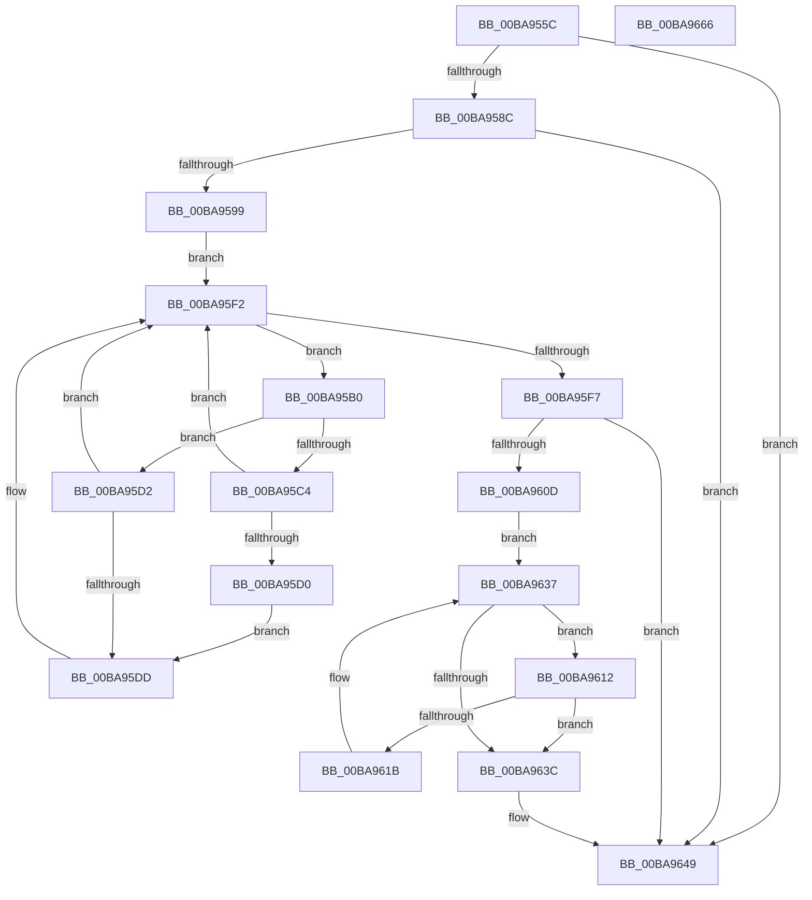

# ViDeadlockForgetResourceHistory

- RVA: `0x00BA955C`–`0x00BA9667` (길이 `267` bytes)
- VA: `0x0000000140BA955C`
- 실행 섹션: `PAGEVRFY`
- PDB 이름 있음: `예`; PDB Function 태그: `아니요`
- unwind 정보 RVA: `0x00075C18`
- 디코드: `80`개 명령, `267/267` bytes 표시
- 미해석 바이트: `0` (있으면 어셈블리에 `.byte`로 보존)

> 이 문서는 커널 이미지의 기계어와 PDB 기호를 분석해 생성했습니다. 4번과 5번은 함수 원형과 자료형을 바이너리 사용 방식에서 추정한 C 해석이며 원본 소스 복구 결과는 아닙니다.

## 1. Dependencies

- 직접 호출 지점: **2**; 고유 호출 대상: **1**
- 직접 호출자로 확인된 함수: **1**
- RIP 상대 이미지 참조: **1**

### Outgoing calls
- `0x00BA95E2` → [ViDeadlockRemoveNode](ViDeadlockRemoveNode_function_00BA9CB8.md) (function, `0x00BA9CB8`)
- `0x00BA9627` → [ViDeadlockRemoveNode](ViDeadlockRemoveNode_function_00BA9CB8.md) (function, `0x00BA9CB8`)

### Direct callers
- [ViDeadlockSearchResource](ViDeadlockSearchResource_function_00BAA0D0.md) at `0x00BAA168`

### Static image references
- `0x00BA9599` → RVA `0x00FFDA00` (`PAGEVRFD`; read)

## 2. Other-region calls and transfers

- 다른 실행 섹션으로 향하는 call: **0**
- 별도 외부 분기/꼬리 이동을 확인하지 못했습니다.

## 3. Assembly (complete function range)

```asm
00BA955C  48 89 5C 24 08                  mov qword ptr [rsp + 8], rbx
00BA9561  48 89 6C 24 10                  mov qword ptr [rsp + 0x10], rbp
00BA9566  48 89 74 24 18                  mov qword ptr [rsp + 0x18], rsi
00BA956B  57                              push rdi
00BA956C  41 54                           push r12
00BA956E  41 55                           push r13
00BA9570  41 56                           push r14
00BA9572  41 57                           push r15
00BA9574  48 83 EC 20                     sub rsp, 0x20
00BA9578  33 F6                           xor esi, esi
00BA957A  4D 8B F9                        mov r15, r9
00BA957D  48 8B E9                        mov rbp, rcx
00BA9580  8B FE                           mov edi, esi
00BA9582  48 39 71 10                     cmp qword ptr [rcx + 0x10], rsi
00BA9586  0F 85 BD 00 00 00               jne 0x140ba9649
00BA958C  8B 41 04                        mov eax, dword ptr [rcx + 4]
00BA958F  66 3D 00 01                     cmp ax, 0x100
00BA9593  0F 82 B0 00 00 00               jb 0x140ba9649
00BA9599  48 8B 05 60 44 45 00            mov rax, qword ptr [rip + 0x454460]
00BA95A0  4C 8D 71 18                     lea r14, [rcx + 0x18]
00BA95A4  4D 8B 26                        mov r12, qword ptr [r14]
00BA95A7  44 8B A8 24 80 00 00            mov r13d, dword ptr [rax + 0x8024]
00BA95AE  EB 42                           jmp 0x140ba95f2
00BA95B0  49 8D 5C 24 D8                  lea rbx, [r12 - 0x28]
00BA95B5  4D 8B 24 24                     mov r12, qword ptr [r12]
00BA95B9  8B 4B 48                        mov ecx, dword ptr [rbx + 0x48]
00BA95BC  C1 E9 03                        shr ecx, 3
00BA95BF  44 3B E9                        cmp r13d, ecx
00BA95C2  76 0E                           jbe 0x140ba95d2
00BA95C4  41 8B C5                        mov eax, r13d
00BA95C7  2B C1                           sub eax, ecx
00BA95C9  3D 00 20 00 00                  cmp eax, 0x2000
00BA95CE  76 22                           jbe 0x140ba95f2
00BA95D0  EB 0B                           jmp 0x140ba95dd
00BA95D2  41 2B CD                        sub ecx, r13d
00BA95D5  81 F9 00 20 00 00               cmp ecx, 0x2000
00BA95DB  73 15                           jae 0x140ba95f2
00BA95DD  33 D2                           xor edx, edx
00BA95DF  48 8B CB                        mov rcx, rbx
00BA95E2  E8 D1 06 00 00                  call 0x140ba9cb8
00BA95E7  49 8B 07                        mov rax, qword ptr [r15]
00BA95EA  FF C7                           inc edi
00BA95EC  48 89 03                        mov qword ptr [rbx], rax
00BA95EF  49 89 1F                        mov qword ptr [r15], rbx
00BA95F2  4D 3B E6                        cmp r12, r14
00BA95F5  75 B9                           jne 0x140ba95b0
00BA95F7  48 8B 05 02 44 45 00            mov rax, qword ptr [rip + 0x454402]
00BA95FE  01 B8 14 80 00 00               add dword ptr [rax + 0x8014], edi
00BA9604  8B 45 04                        mov eax, dword ptr [rbp + 4]
00BA9607  66 3D 00 01                     cmp ax, 0x100
00BA960B  72 3C                           jb 0x140ba9649
00BA960D  49 8B 3E                        mov rdi, qword ptr [r14]
00BA9610  EB 25                           jmp 0x140ba9637
00BA9612  8B 45 04                        mov eax, dword ptr [rbp + 4]
00BA9615  66 3D 00 01                     cmp ax, 0x100
00BA9619  72 21                           jb 0x140ba963c
00BA961B  48 8D 5F D8                     lea rbx, [rdi - 0x28]
00BA961F  33 D2                           xor edx, edx
00BA9621  48 8B 3F                        mov rdi, qword ptr [rdi]
00BA9624  48 8B CB                        mov rcx, rbx
00BA9627  E8 8C 06 00 00                  call 0x140ba9cb8
00BA962C  49 8B 07                        mov rax, qword ptr [r15]
00BA962F  FF C6                           inc esi
00BA9631  48 89 03                        mov qword ptr [rbx], rax
00BA9634  49 89 1F                        mov qword ptr [r15], rbx
00BA9637  49 3B FE                        cmp rdi, r14
00BA963A  75 D6                           jne 0x140ba9612
00BA963C  48 8B 05 BD 43 45 00            mov rax, qword ptr [rip + 0x4543bd]
00BA9643  01 B0 18 80 00 00               add dword ptr [rax + 0x8018], esi
00BA9649  48 8B 5C 24 50                  mov rbx, qword ptr [rsp + 0x50]
00BA964E  48 8B 6C 24 58                  mov rbp, qword ptr [rsp + 0x58]
00BA9653  48 8B 74 24 60                  mov rsi, qword ptr [rsp + 0x60]
00BA9658  48 83 C4 20                     add rsp, 0x20
00BA965C  41 5F                           pop r15
00BA965E  41 5E                           pop r14
00BA9660  41 5D                           pop r13
00BA9662  41 5C                           pop r12
00BA9664  5F                              pop rdi
00BA9665  C3                              ret
00BA9666  CC                              int3
```

## 4. C-style interpretation (structured pseudocode)

```c
__int64 __fastcall ViDeadlockForgetResourceHistory(__int64 a1, int a2, __int64 a3, __int64 a4)
{
    __int64 result;
    __int64 v_rdi;
    __int64 v_rsi;
    __int64 v_rsp;
    unsigned __int64 v_stack_p10;
    unsigned __int64 v_stack_p18;
    unsigned __int64 v_stack_p8;

    v_stack_p8 = v_rbx;
    v_stack_p10 = v_rbp;
    v_stack_p18 = v_rsi;
    v_rsp = (v_rsp) - (32);
    v_rsi = 0;
    if ((*(unsigned __int64 *)(a1 + 16)) != 0) goto loc_00BA9649;
    if (((unsigned __int16)((unsigned int)(*(unsigned int *)(a1 + 4)))) < 256) goto loc_00BA9649;
    goto loc_00BA95F2;
loc_00BA95B0:
    a1 = (unsigned int)(((unsigned int)(*(unsigned int *)(*(unsigned __int64 *)(a1 + 24) - 40 + 72))) >> (3));
    if (((unsigned int)((unsigned int)(*(unsigned int *)(*(unsigned __int64 *)(v_rip + 4539488) + 32804)))) <= ((unsigned int)(a1))) goto loc_00BA95D2;
    result = (unsigned int)(((unsigned int)((unsigned int)((unsigned int)(*(unsigned int *)(*(unsigned __int64 *)(v_rip + 4539488) + 32804))))) - ((unsigned int)(a1)));
    if (((unsigned int)(result)) <= 0x2000ULL) goto loc_00BA95F2;
    goto loc_00BA95DD;
loc_00BA95D2:
    a1 = (unsigned int)((a1) - ((unsigned int)((unsigned int)(*(unsigned int *)(*(unsigned __int64 *)(v_rip + 4539488) + 32804)))));
    v_rdi = 0;
    if (((unsigned int)(a1)) < 0x2000ULL) {
        a2 = 0;
        a1 = *(unsigned __int64 *)(a1 + 24) - 40;
        result = ViDeadlockRemoveNode(a1, a2, a3, a4);
        result = *(unsigned __int64 *)(a4);
        v_rdi = (unsigned int)((0) + 1);
        *(unsigned __int64 *)(*(unsigned __int64 *)(a1 + 24) - 40) = result;
        *(unsigned __int64 *)(a4) = *(unsigned __int64 *)(a1 + 24) - 40;
    }
    if ((*(unsigned __int64 *)(*(unsigned __int64 *)(a1 + 24))) != (a1 + 24)) goto loc_00BA95B0;
    if (((unsigned __int16)((unsigned int)(*(unsigned int *)(a1 + 4)))) < 256) goto loc_00BA9649;
    goto loc_00BA9637;
loc_00BA9612:
    if (((unsigned __int16)((unsigned int)(*(unsigned int *)(a1 + 4)))) < 256) goto loc_00BA963C;
    a2 = 0;
    result = ViDeadlockRemoveNode(*(unsigned __int64 *)(a1 + 24) - 40, a2, a3, a4);
    v_rsi = (unsigned int)((v_rsi) + 1);
    *(unsigned __int64 *)(*(unsigned __int64 *)(a1 + 24) - 40) = *(unsigned __int64 *)(a4);
    *(unsigned __int64 *)(a4) = *(unsigned __int64 *)(a1 + 24) - 40;
loc_00BA9637:
    if ((*(unsigned __int64 *)(*(unsigned __int64 *)(a1 + 24))) != (a1 + 24)) goto loc_00BA9612;
loc_00BA963C:
loc_00BA9649:
    v_rsp = (v_rsp) + (32);
    return *(unsigned __int64 *)(v_rip + 4539325);
}
```

## 5. (Beta) C Style

```c
int64_t ViDeadlockForgetResourceHistory(void *Arg1, int32_t Arg2, int64_t Arg3, void *Arg4)
{
    uint8_t *arg1 = (uint8_t *)Arg1;
    uint8_t *arg4 = (uint8_t *)Arg4;

    int64_t result;
    int64_t local_rdi;
    int64_t local_rsi;
    int64_t local_rsp;
    uint64_t v_stack_p10;
    uint64_t v_stack_p18;
    uint64_t v_stack_p8;

    v_stack_p8 = local_rbx;
    v_stack_p10 = local_rbp;
    v_stack_p18 = local_rsi;
    local_rsp = (local_rsp) - (32);
    local_rsi = 0;
    if ((*(uint64_t *)(arg1 + 0x10)) != 0) goto loc_00BA9649;
    if (((uint16_t)((uint32_t)(*(uint32_t *)(arg1 + 0x4)))) < 256) goto loc_00BA9649;
    goto loc_00BA95F2;
loc_00BA95B0:
    Arg1 = (uint32_t)(((uint32_t)(*(uint32_t *)(*(uint64_t *)(arg1 + 0x18) - 0x28 + 0x48))) >> (3));
    if (((uint32_t)((uint32_t)(*(uint32_t *)(*(uint64_t *)(v_rip + 0x454460) + 0x8024)))) <= ((uint32_t)(Arg1))) goto loc_00BA95D2;
    result = (uint32_t)(((uint32_t)((uint32_t)((uint32_t)(*(uint32_t *)(*(uint64_t *)(v_rip + 0x454460) + 0x8024))))) - ((uint32_t)(Arg1)));
    if (((uint32_t)(result)) <= 0x2000ULL) goto loc_00BA95F2;
    goto loc_00BA95DD;
loc_00BA95D2:
    Arg1 = (uint32_t)((Arg1) - ((uint32_t)((uint32_t)(*(uint32_t *)(*(uint64_t *)(v_rip + 0x454460) + 0x8024)))));
    local_rdi = 0;
    if (((uint32_t)(Arg1)) < 0x2000ULL) {
        Arg2 = 0;
        Arg1 = *(uint64_t *)(arg1 + 0x18) - 40;
        result = ViDeadlockRemoveNode(Arg1, Arg2, Arg3, Arg4);
        result = *(uint64_t *)(arg4);
        local_rdi = (uint32_t)((0) + 1);
        *(uint64_t *)(*(uint64_t *)(arg1 + 0x18) - 0x28) = result;
        *(uint64_t *)(arg4) = *(uint64_t *)(arg1 + 0x18) - 40;
    }
    if ((*(uint64_t *)(*(uint64_t *)(arg1 + 0x18))) != (Arg1 + 24)) goto loc_00BA95B0;
    if (((uint16_t)((uint32_t)(*(uint32_t *)(arg1 + 0x4)))) < 256) goto loc_00BA9649;
    goto loc_00BA9637;
loc_00BA9612:
    if (((uint16_t)((uint32_t)(*(uint32_t *)(arg1 + 0x4)))) < 256) goto loc_00BA963C;
    Arg2 = 0;
    result = ViDeadlockRemoveNode(*(uint64_t *)(arg1 + 0x18) - 40, Arg2, Arg3, Arg4);
    local_rsi = (uint32_t)((local_rsi) + 1);
    *(uint64_t *)(*(uint64_t *)(arg1 + 0x18) - 0x28) = *(uint64_t *)(arg4);
    *(uint64_t *)(arg4) = *(uint64_t *)(arg1 + 0x18) - 40;
loc_00BA9637:
    if ((*(uint64_t *)(*(uint64_t *)(arg1 + 0x18))) != (Arg1 + 24)) goto loc_00BA9612;
loc_00BA963C:
loc_00BA9649:
    local_rsp = (local_rsp) + (32);
    return *(uint64_t *)(v_rip + 0x4543BD);
}
```

### 관측된 메모리 오프셋

구조체 형식이 확인되지 않은 접근은 인자 기준의 오프셋으로만 기록했습니다.

| 기준 인자 | 오프셋 표현 | 폭 (bit) | 접근 |
|---|---:|---:|---|
| `Arg1` | `+ 0x0` | `64` | `R` |
| `Arg1` | `+ 0x4` | `32` | `R` |
| `Arg1` | `+ 0x10` | `64` | `R` |
| `Arg1` | `+ 0x18` | `64` | `R` |
| `Arg4` | `+ 0x0` | `64` | `R` |
| `Arg4` | `+ 0x0` | `64` | `W` |

## 6. Execution-region graph

[열기: 2D/3D 그래프와 함수 탐색 컨트롤 패널](../../../control-panel.html?section=pagevrfy&rva=0x00BA955C&view=graph)

- 2D 그래프는 위에서 아래로 흐르고, 3D 그래프는 빈 공간을 드래그해 회전합니다. Shift+드래그는 이동, 휠은 확대·축소, 함수 노드 선택은 대상 보고서 이동입니다.

### Static fallback


