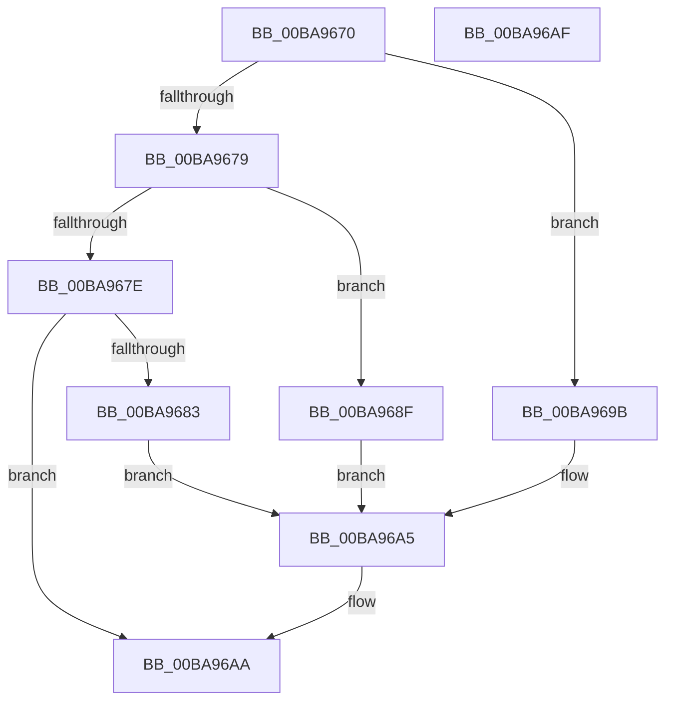

# ViDeadlockFree

- RVA: `0x00BA9670`–`0x00BA96B0` (길이 `64` bytes)
- VA: `0x0000000140BA9670`
- 실행 섹션: `PAGEVRFY`
- PDB 이름 있음: `예`; PDB Function 태그: `아니요`
- unwind 정보 RVA: `0x0005C788`
- 디코드: `19`개 명령, `64/64` bytes 표시
- 미해석 바이트: `0` (있으면 어셈블리에 `.byte`로 보존)

> 이 문서는 커널 이미지의 기계어와 PDB 기호를 분석해 생성했습니다. 4번과 5번은 함수 원형과 자료형을 바이너리 사용 방식에서 추정한 C 해석이며 원본 소스 복구 결과는 아닙니다.

## 1. Dependencies

- 직접 호출 지점: **1**; 고유 호출 대상: **1**
- 직접 호출자로 확인된 함수: **6**
- RIP 상대 이미지 참조: **3**

### Outgoing calls
- `0x00BA96A5` → [ExFreeToNPagedLookasideList](../../text/38/ExFreeToNPagedLookasideList_function_0038D9D0.md) (function, `0x0038D9D0`)

### Direct callers
- [ViDeadlockRemoveMemoryRangeResources](../../text/61/ViDeadlockRemoveMemoryRangeResources_function_00615FE8.md) at `0x006160FC`
- [ViDeadlockRemoveMemoryRangeResources](../../text/61/ViDeadlockRemoveMemoryRangeResources_function_00615FE8.md) at `0x00616119`
- [ViDeadlockRemoveMemoryRangeThreads](../../text/61/ViDeadlockRemoveMemoryRangeThreads_function_00616148.md) at `0x0061624F`
- [VfDeadlockInitializeResource](VfDeadlockInitializeResource_function_00BA80A0.md) at `0x00BA81BF`
- [VfDeadlockInitializeResource](VfDeadlockInitializeResource_function_00BA80A0.md) at `0x00BA81D1`
- [VfDeadlockInitializeResource](VfDeadlockInitializeResource_function_00BA80A0.md) at `0x00BA81E8`
- [ViDeadlockEmptyDatabase](ViDeadlockEmptyDatabase_function_00BA922C.md) at `0x00BA9350`
- [ViDeadlockEmptyDatabase](ViDeadlockEmptyDatabase_function_00BA922C.md) at `0x00BA936D`
- [ViDeadlockEmptyDatabase](ViDeadlockEmptyDatabase_function_00BA922C.md) at `0x00BA938A`
- [VfDeadlockReleaseResource](../BB/VfDeadlockReleaseResource_function_00BB759C.md) at `0x00BB7A1B`
- [VfDeadlockReleaseResource](../BB/VfDeadlockReleaseResource_function_00BB759C.md) at `0x00BB7A35`
- [VfDeadlockAcquireResource](../BB/VfDeadlockAcquireResource_function_00BB83B4.md) at `0x00BB89D9`
- [VfDeadlockAcquireResource](../BB/VfDeadlockAcquireResource_function_00BB83B4.md) at `0x00BB89F6`
- [VfDeadlockAcquireResource](../BB/VfDeadlockAcquireResource_function_00BB83B4.md) at `0x00BB8A07`
- [VfDeadlockAcquireResource](../BB/VfDeadlockAcquireResource_function_00BB83B4.md) at `0x00BB8A1D`
- [VfDeadlockAcquireResource](../BB/VfDeadlockAcquireResource_function_00BB83B4.md) at `0x00BB8A2C`
- [VfDeadlockAcquireResource](../BB/VfDeadlockAcquireResource_function_00BB83B4.md) at `0x00BB8A42`
- [VfDeadlockAcquireResource](../BB/VfDeadlockAcquireResource_function_00BB83B4.md) at `0x00BB8A54`

### Static image references
- `0x00BA9686` → RVA `0x00FFF300` (`PAGEVRFD`; read)
- `0x00BA9692` → RVA `0x00FFF400` (`PAGEVRFD`; read)
- `0x00BA969E` → RVA `0x00FFF380` (`PAGEVRFD`; read)

## 2. Other-region calls and transfers

- 다른 실행 섹션으로 향하는 call: **1**
  - `0x00BA96A5` → [ExFreeToNPagedLookasideList](../../text/38/ExFreeToNPagedLookasideList_function_0038D9D0.md) (`PAGEVRFY` → `.text`)
- 별도 외부 분기/꼬리 이동을 확인하지 못했습니다.

## 3. Assembly (complete function range)

```asm
00BA9670  48 83 EC 28                     sub rsp, 0x28
00BA9674  83 EA 01                        sub edx, 1
00BA9677  74 22                           je 0x140ba969b
00BA9679  83 EA 01                        sub edx, 1
00BA967C  74 11                           je 0x140ba968f
00BA967E  83 FA 01                        cmp edx, 1
00BA9681  75 27                           jne 0x140ba96aa
00BA9683  48 8B D1                        mov rdx, rcx
00BA9686  48 8D 0D 73 5C 45 00            lea rcx, [rip + 0x455c73]
00BA968D  EB 16                           jmp 0x140ba96a5
00BA968F  48 8B D1                        mov rdx, rcx
00BA9692  48 8D 0D 67 5D 45 00            lea rcx, [rip + 0x455d67]
00BA9699  EB 0A                           jmp 0x140ba96a5
00BA969B  48 8B D1                        mov rdx, rcx
00BA969E  48 8D 0D DB 5C 45 00            lea rcx, [rip + 0x455cdb]
00BA96A5  E8 26 43 7E FF                  call 0x14038d9d0
00BA96AA  48 83 C4 28                     add rsp, 0x28
00BA96AE  C3                              ret
00BA96AF  CC                              int3
```

## 4. C-style interpretation (structured pseudocode)

```c
__int64 __fastcall ViDeadlockFree(__int64 a1, int a2)
{
    __int64 result;
    __int64 v_rsp;

    v_rsp = (v_rsp) - (40);
    a2 = (unsigned int)((a2) - (1));
    if (condition_is_equal) goto loc_00BA969B;
    a2 = (unsigned int)((a2) - (1));
    if (condition_is_equal) goto loc_00BA968F;
    if (a2 != 1) goto loc_00BA96AA;
    goto loc_00BA96A5;
loc_00BA968F:
    goto loc_00BA96A5;
loc_00BA969B:
loc_00BA96A5:
    result = ExFreeToNPagedLookasideList(v_rip + 4545755, v_rip + 4545895, a3, a4);
loc_00BA96AA:
    v_rsp = (v_rsp) + (40);
    return result;
}
```

## 5. (Beta) C Style

```c
int64_t ViDeadlockFree(int64_t Arg1, int32_t Arg2)
{
    int64_t result;
    int64_t local_rsp;

    local_rsp = (local_rsp) - (40);
    Arg2 = (uint32_t)((Arg2) - (1));
    if (condition_is_equal) goto loc_00BA969B;
    Arg2 = (uint32_t)((Arg2) - (1));
    if (condition_is_equal) goto loc_00BA968F;
    if (Arg2 != 1) goto loc_00BA96AA;
    goto loc_00BA96A5;
loc_00BA968F:
    goto loc_00BA96A5;
loc_00BA969B:
loc_00BA96A5:
    result = ExFreeToNPagedLookasideList(v_rip + 4545755, v_rip + 4545895, a3, a4);
loc_00BA96AA:
    local_rsp = (local_rsp) + (40);
    return result;
}
```

## 6. Execution-region graph

[열기: 2D/3D 그래프와 함수 탐색 컨트롤 패널](../../../control-panel.html?section=pagevrfy&rva=0x00BA9670&view=graph)

- 2D 그래프는 위에서 아래로 흐르고, 3D 그래프는 빈 공간을 드래그해 회전합니다. Shift+드래그는 이동, 휠은 확대·축소, 함수 노드 선택은 대상 보고서 이동입니다.

### Static fallback


