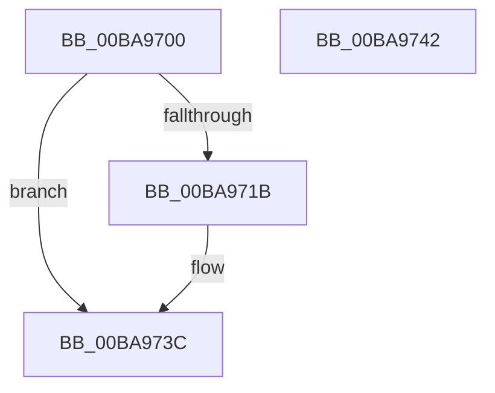

# ViDeadlockKeInitializeMutant_Exit

- RVA: `0x00BA9700`–`0x00BA9743` (길이 `67` bytes)
- VA: `0x0000000140BA9700`
- 실행 섹션: `PAGEVRFY`
- PDB 이름 있음: `예`; PDB Function 태그: `아니요`
- unwind 정보 RVA: `0x00064C80`
- 디코드: `19`개 명령, `67/67` bytes 표시
- 미해석 바이트: `0` (있으면 어셈블리에 `.byte`로 보존)

> 이 문서는 커널 이미지의 기계어와 PDB 기호를 분석해 생성했습니다. 4번과 5번은 함수 원형과 자료형을 바이너리 사용 방식에서 추정한 C 해석이며 원본 소스 복구 결과는 아닙니다.

## 1. Dependencies

- 직접 호출 지점: **2**; 고유 호출 대상: **2**
- 직접 호출자로 확인된 함수: **0**
- RIP 상대 이미지 참조: **0**

### Outgoing calls
- `0x00BA9710` → [VfDeadlockInitializeResource](VfDeadlockInitializeResource_function_00BA80A0.md) (function, `0x00BA80A0`)
- `0x00BA9737` → [VfDeadlockAcquireResource](../BB/VfDeadlockAcquireResource_function_00BB83B4.md) (function, `0x00BB83B4`)

### Direct callers
- 이 함수 시작 RVA로 연결되는 직접 call은 확인되지 않았습니다. 간접 호출은 완전히 역산할 수 없습니다.

### Static image references
- 디코드된 RIP-relative 메모리 참조가 없습니다.

## 2. Other-region calls and transfers

- 다른 실행 섹션으로 향하는 call: **0**
- 별도 외부 분기/꼬리 이동을 확인하지 못했습니다.

## 3. Assembly (complete function range)

```asm
00BA9700  40 53                           push rbx
00BA9702  48 83 EC 30                     sub rsp, 0x30
00BA9706  4C 8B 01                        mov r8, qword ptr [rcx]
00BA9709  48 8B D9                        mov rbx, rcx
00BA970C  48 8B 49 10                     mov rcx, qword ptr [rcx + 0x10]
00BA9710  E8 8B E9 FF FF                  call 0x140ba80a0
00BA9715  80 7B 08 00                     cmp byte ptr [rbx + 8], 0
00BA9719  74 21                           je 0x140ba973c
00BA971B  65 4C 8B 04 25 88 01 00 00      mov r8, qword ptr gs:[0x188]
00BA9724  45 33 C9                        xor r9d, r9d
00BA9727  48 8B 03                        mov rax, qword ptr [rbx]
00BA972A  48 8B 4B 10                     mov rcx, qword ptr [rbx + 0x10]
00BA972E  48 89 44 24 20                  mov qword ptr [rsp + 0x20], rax
00BA9733  41 8D 51 01                     lea edx, [r9 + 1]
00BA9737  E8 78 EC 00 00                  call 0x140bb83b4
00BA973C  48 83 C4 30                     add rsp, 0x30
00BA9740  5B                              pop rbx
00BA9741  C3                              ret
00BA9742  CC                              int3
```

## 4. C-style interpretation (structured pseudocode)

```c
__int64 __fastcall ViDeadlockKeInitializeMutant_Exit(__int64 a1, __int64 a2, __int64 a3, int a4)
{
    __int64 result;
    __int64 v_rsp;
    unsigned __int64 v_stack_m18;

    v_rsp = (v_rsp) - (48);
    result = VfDeadlockInitializeResource(*(unsigned __int64 *)(a1 + 16), a2, *(unsigned __int64 *)(a1), a4);
    if ((*(unsigned __int8 *)(a1 + 8)) != 0) {
        a3 = *(unsigned __int64 *)(gs_base + (0 + 392));
        a4 = 0;
        result = *(unsigned __int64 *)(a1);
        a1 = *(unsigned __int64 *)(a1 + 16);
        v_stack_m18 = result;
        a2 = a4 + 1;
        result = VfDeadlockAcquireResource(a1, a2, a3, a4);
    }
    v_rsp = (v_rsp) + (48);
    return result;
}
```

## 5. (Beta) C Style

```c
int64_t ViDeadlockKeInitializeMutant_Exit(void *Arg1, int64_t Arg2, int64_t Arg3, int32_t Arg4)
{
    uint8_t *arg1 = (uint8_t *)Arg1;

    int64_t result;
    int64_t local_rsp;
    uint64_t v_stack_m18;

    local_rsp = (local_rsp) - (48);
    result = VfDeadlockInitializeResource(*(uint64_t *)(arg1 + 0x10), Arg2, *(uint64_t *)(arg1), Arg4);
    if ((*(uint8_t *)(arg1 + 0x8)) != 0) {
        Arg3 = *(uint64_t *)(gs_base + (0 + 0x188));
        Arg4 = 0;
        result = *(uint64_t *)(arg1);
        Arg1 = *(uint64_t *)(arg1 + 0x10);
        v_stack_m18 = result;
        Arg2 = Arg4 + 1;
        result = VfDeadlockAcquireResource(Arg1, Arg2, Arg3, Arg4);
    }
    local_rsp = (local_rsp) + (48);
    return result;
}
```

### 관측된 메모리 오프셋

구조체 형식이 확인되지 않은 접근은 인자 기준의 오프셋으로만 기록했습니다.

| 기준 인자 | 오프셋 표현 | 폭 (bit) | 접근 |
|---|---:|---:|---|
| `Arg1` | `+ 0x0` | `64` | `R` |
| `Arg1` | `+ 0x8` | `8` | `R` |
| `Arg1` | `+ 0x10` | `64` | `R` |

## 6. Execution-region graph

[열기: 2D/3D 그래프와 함수 탐색 컨트롤 패널](../../../control-panel.html?section=pagevrfy&rva=0x00BA9700&view=graph)

- 2D 그래프는 위에서 아래로 흐르고, 3D 그래프는 빈 공간을 드래그해 회전합니다. Shift+드래그는 이동, 휠은 확대·축소, 함수 노드 선택은 대상 보고서 이동입니다.

### Static fallback


