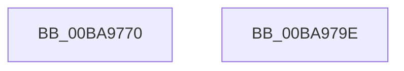

# ViDeadlockKeReleaseInStackQueuedSpinLockForDpc_Entry

- RVA: `0x00BA9770`–`0x00BA979F` (길이 `47` bytes)
- VA: `0x0000000140BA9770`
- 실행 섹션: `PAGEVRFY`
- PDB 이름 있음: `예`; PDB Function 태그: `아니요`
- unwind 정보 RVA: `0x0005C788`
- 디코드: `12`개 명령, `47/47` bytes 표시
- 미해석 바이트: `0` (있으면 어셈블리에 `.byte`로 보존)

> 이 문서는 커널 이미지의 기계어와 PDB 기호를 분석해 생성했습니다. 4번과 5번은 함수 원형과 자료형을 바이너리 사용 방식에서 추정한 C 해석이며 원본 소스 복구 결과는 아닙니다.

## 1. Dependencies

- 직접 호출 지점: **1**; 고유 호출 대상: **1**
- 직접 호출자로 확인된 함수: **0**
- RIP 상대 이미지 참조: **0**

### Outgoing calls
- `0x00BA9794` → [VfDeadlockReleaseResource](../BB/VfDeadlockReleaseResource_function_00BB759C.md) (function, `0x00BB759C`)

### Direct callers
- 이 함수 시작 RVA로 연결되는 직접 call은 확인되지 않았습니다. 간접 호출은 완전히 역산할 수 없습니다.

### Static image references
- 디코드된 RIP-relative 메모리 참조가 없습니다.

## 2. Other-region calls and transfers

- 다른 실행 섹션으로 향하는 call: **0**
- 별도 외부 분기/꼬리 이동을 확인하지 못했습니다.

## 3. Assembly (complete function range)

```asm
00BA9770  48 83 EC 28                     sub rsp, 0x28
00BA9774  48 8B 41 08                     mov rax, qword ptr [rcx + 8]
00BA9778  4C 8B C9                        mov r9, rcx
00BA977B  BA 06 00 00 00                  mov edx, 6
00BA9780  48 8B 48 08                     mov rcx, qword ptr [rax + 8]
00BA9784  65 4C 8B 04 25 88 01 00 00      mov r8, qword ptr gs:[0x188]
00BA978D  48 83 E1 F8                     and rcx, 0xfffffffffffffff8
00BA9791  4D 8B 09                        mov r9, qword ptr [r9]
00BA9794  E8 03 DE 00 00                  call 0x140bb759c
00BA9799  48 83 C4 28                     add rsp, 0x28
00BA979D  C3                              ret
00BA979E  CC                              int3
```

## 4. C-style interpretation (structured pseudocode)

```c
__int64 __fastcall ViDeadlockKeReleaseInStackQueuedSpinLockForDpc_Entry(__int64 a1)
{
    __int64 result;
    __int64 v_rsp;

    v_rsp = (v_rsp) - (40);
    a1 = (*(unsigned __int64 *)(*(unsigned __int64 *)(a1 + 8) + 8)) & (-8);
    result = VfDeadlockReleaseResource(a1, 6, *(unsigned __int64 *)(gs_base + (0 + 392)), *(unsigned __int64 *)(a1));
    v_rsp = (v_rsp) + (40);
    return result;
}
```

## 5. (Beta) C Style

```c
int64_t ViDeadlockKeReleaseInStackQueuedSpinLockForDpc_Entry(void *Arg1)
{
    uint8_t *arg1 = (uint8_t *)Arg1;

    int64_t result;
    int64_t local_rsp;

    local_rsp = (local_rsp) - (40);
    Arg1 = (*(uint64_t *)(*(uint64_t *)(arg1 + 0x8) + 0x8)) & (-8);
    result = VfDeadlockReleaseResource(Arg1, 6, *(uint64_t *)(gs_base + (0 + 0x188)), *(uint64_t *)(arg1));
    local_rsp = (local_rsp) + (40);
    return result;
}
```

### 관측된 메모리 오프셋

구조체 형식이 확인되지 않은 접근은 인자 기준의 오프셋으로만 기록했습니다.

| 기준 인자 | 오프셋 표현 | 폭 (bit) | 접근 |
|---|---:|---:|---|
| `Arg1` | `+ 0x0` | `64` | `R` |
| `Arg1` | `+ 0x8` | `64` | `R` |

## 6. Execution-region graph

[열기: 2D/3D 그래프와 함수 탐색 컨트롤 패널](../../../control-panel.html?section=pagevrfy&rva=0x00BA9770&view=graph)

- 2D 그래프는 위에서 아래로 흐르고, 3D 그래프는 빈 공간을 드래그해 회전합니다. Shift+드래그는 이동, 휠은 확대·축소, 함수 노드 선택은 대상 보고서 이동입니다.

### Static fallback


