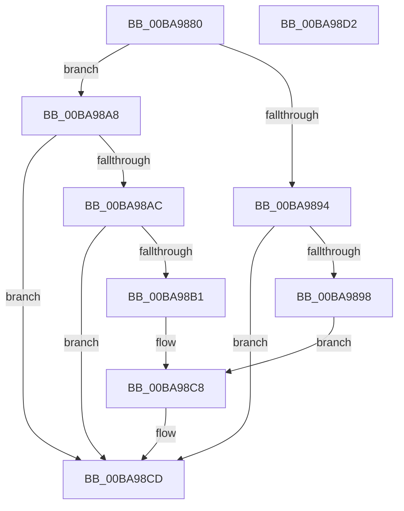

# ViDeadlockKeWaitForMultipleObjects_Exit

- RVA: `0x00BA9880`–`0x00BA98D3` (길이 `83` bytes)
- VA: `0x0000000140BA9880`
- 실행 섹션: `PAGEVRFY`
- PDB 이름 있음: `예`; PDB Function 태그: `아니요`
- unwind 정보 RVA: `0x0005C788`
- 디코드: `27`개 명령, `83/83` bytes 표시
- 미해석 바이트: `0` (있으면 어셈블리에 `.byte`로 보존)

> 이 문서는 커널 이미지의 기계어와 PDB 기호를 분석해 생성했습니다. 4번과 5번은 함수 원형과 자료형을 바이너리 사용 방식에서 추정한 C 해석이며 원본 소스 복구 결과는 아닙니다.

## 1. Dependencies

- 직접 호출 지점: **1**; 고유 호출 대상: **1**
- 직접 호출자로 확인된 함수: **0**
- RIP 상대 이미지 참조: **0**

### Outgoing calls
- `0x00BA98C8` → [ViDeadlockObjectAcquired](ViDeadlockObjectAcquired_function_00BA9AD4.md) (function, `0x00BA9AD4`)

### Direct callers
- 이 함수 시작 RVA로 연결되는 직접 call은 확인되지 않았습니다. 간접 호출은 완전히 역산할 수 없습니다.

### Static image references
- 디코드된 RIP-relative 메모리 참조가 없습니다.

## 2. Other-region calls and transfers

- 다른 실행 섹션으로 향하는 call: **0**
- 별도 외부 분기/꼬리 이동을 확인하지 못했습니다.

## 3. Assembly (complete function range)

```asm
00BA9880  48 83 EC 28                     sub rsp, 0x28
00BA9884  8B 41 34                        mov eax, dword ptr [rcx + 0x34]
00BA9887  4C 8B D1                        mov r10, rcx
00BA988A  0F BA F0 07                     btr eax, 7
00BA988E  80 79 19 00                     cmp byte ptr [rcx + 0x19], 0
00BA9892  75 14                           jne 0x140ba98a8
00BA9894  85 C0                           test eax, eax
00BA9896  75 35                           jne 0x140ba98cd
00BA9898  4C 8B 09                        mov r9, qword ptr [rcx]
00BA989B  4C 8B 41 10                     mov r8, qword ptr [rcx + 0x10]
00BA989F  48 8B 51 28                     mov rdx, qword ptr [rcx + 0x28]
00BA98A3  8B 49 30                        mov ecx, dword ptr [rcx + 0x30]
00BA98A6  EB 20                           jmp 0x140ba98c8
00BA98A8  85 C0                           test eax, eax
00BA98AA  78 21                           js 0x140ba98cd
00BA98AC  3B 41 30                        cmp eax, dword ptr [rcx + 0x30]
00BA98AF  7D 1C                           jge 0x140ba98cd
00BA98B1  4D 8B 0A                        mov r9, qword ptr [r10]
00BA98B4  4D 8B 42 10                     mov r8, qword ptr [r10 + 0x10]
00BA98B8  48 63 C8                        movsxd rcx, eax
00BA98BB  49 8B 42 28                     mov rax, qword ptr [r10 + 0x28]
00BA98BF  48 8D 14 C8                     lea rdx, [rax + rcx*8]
00BA98C3  B9 01 00 00 00                  mov ecx, 1
00BA98C8  E8 07 02 00 00                  call 0x140ba9ad4
00BA98CD  48 83 C4 28                     add rsp, 0x28
00BA98D1  C3                              ret
00BA98D2  CC                              int3
```

## 4. C-style interpretation (structured pseudocode)

```c
__int64 __fastcall ViDeadlockKeWaitForMultipleObjects_Exit(__int64 a1)
{
    __int64 result;
    __int64 v_rsp;

    v_rsp = (v_rsp) - (40);
    if ((*(unsigned __int8 *)(a1 + 25)) != 0) goto loc_00BA98A8;
    if ((unsigned int)((unsigned int)(*(unsigned int *)(a1 + 52))) != 0) goto loc_00BA98CD;
    goto loc_00BA98C8;
loc_00BA98A8:
    if (sign_flag) goto loc_00BA98CD;
    if (((unsigned int)((unsigned int)(*(unsigned int *)(a1 + 52)))) >= (*(unsigned int *)((unsigned int)(*(unsigned int *)(a1 + 48)) + 48))) goto loc_00BA98CD;
loc_00BA98C8:
    result = ViDeadlockObjectAcquired(1, *(unsigned __int64 *)(a1 + 40) + (int)((unsigned int)((unsigned int)(*(unsigned int *)(a1 + 52)))) * 8, *(unsigned __int64 *)(a1 + 16), *(unsigned __int64 *)(a1));
loc_00BA98CD:
    v_rsp = (v_rsp) + (40);
    return result;
}
```

## 5. (Beta) C Style

```c
int64_t ViDeadlockKeWaitForMultipleObjects_Exit(void *Arg1)
{
    uint8_t *arg1 = (uint8_t *)Arg1;

    int64_t result;
    int64_t local_rsp;

    local_rsp = (local_rsp) - (40);
    if ((*(uint8_t *)(arg1 + 0x19)) != 0) goto loc_00BA98A8;
    if ((uint32_t)((uint32_t)(*(uint32_t *)(arg1 + 0x34))) != 0) goto loc_00BA98CD;
    goto loc_00BA98C8;
loc_00BA98A8:
    if (sign_flag) goto loc_00BA98CD;
    if (((uint32_t)((uint32_t)(*(uint32_t *)(arg1 + 0x34)))) >= (*(uint32_t *)((uint32_t)(*(uint32_t *)(arg1 + 0x30)) + 0x30))) goto loc_00BA98CD;
loc_00BA98C8:
    result = ViDeadlockObjectAcquired(1, *(uint64_t *)(arg1 + 0x28) + (int32_t)((uint32_t)((uint32_t)(*(uint32_t *)(arg1 + 0x34)))) * 8, *(uint64_t *)(arg1 + 0x10), *(uint64_t *)(arg1));
loc_00BA98CD:
    local_rsp = (local_rsp) + (40);
    return result;
}
```

### 관측된 메모리 오프셋

구조체 형식이 확인되지 않은 접근은 인자 기준의 오프셋으로만 기록했습니다.

| 기준 인자 | 오프셋 표현 | 폭 (bit) | 접근 |
|---|---:|---:|---|
| `Arg1` | `+ 0x0` | `64` | `R` |
| `Arg1` | `+ 0x10` | `64` | `R` |
| `Arg1` | `+ 0x19` | `8` | `R` |
| `Arg1` | `+ 0x28` | `64` | `R` |
| `Arg1` | `+ 0x30` | `32` | `R` |
| `Arg1` | `+ 0x34` | `32` | `R` |

## 6. Execution-region graph

[열기: 2D/3D 그래프와 함수 탐색 컨트롤 패널](../../../control-panel.html?section=pagevrfy&rva=0x00BA9880&view=graph)

- 2D 그래프는 위에서 아래로 흐르고, 3D 그래프는 빈 공간을 드래그해 회전합니다. Shift+드래그는 이동, 휠은 확대·축소, 함수 노드 선택은 대상 보고서 이동입니다.

### Static fallback


