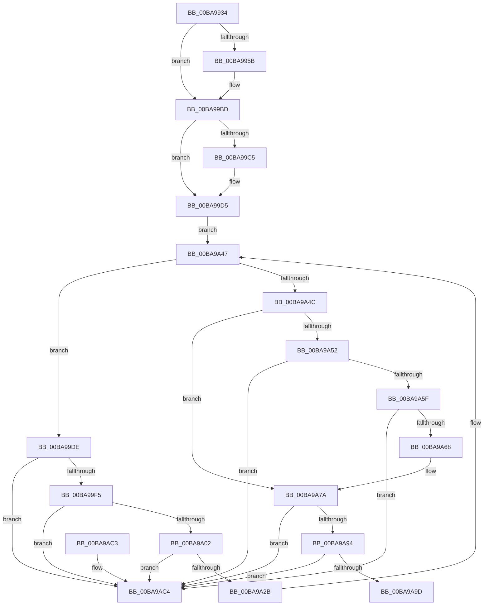

# ViDeadlockMergeNodes

- RVA: `0x00BA9934`–`0x00BA9ACB` (길이 `407` bytes)
- VA: `0x0000000140BA9934`
- 실행 섹션: `PAGEVRFY`
- PDB 이름 있음: `예`; PDB Function 태그: `아니요`
- unwind 정보 RVA: `0x000D260C`
- 디코드: `108`개 명령, `407/407` bytes 표시
- 미해석 바이트: `0` (있으면 어셈블리에 `.byte`로 보존)

> 이 문서는 커널 이미지의 기계어와 PDB 기호를 분석해 생성했습니다. 4번과 5번은 함수 원형과 자료형을 바이너리 사용 방식에서 추정한 C 해석이며 원본 소스 복구 결과는 아닙니다.

## 1. Dependencies

- 직접 호출 지점: **3**; 고유 호출 대상: **1**
- 직접 호출자로 확인된 함수: **2**
- RIP 상대 이미지 참조: **0**

### Outgoing calls
- `0x00BA9A12` → [ViDeadlockUpdateChildrenCount](ViDeadlockUpdateChildrenCount_function_00BAA294.md) (function, `0x00BAA294`)
- `0x00BA9A42` → [ViDeadlockUpdateChildrenCount](ViDeadlockUpdateChildrenCount_function_00BAA294.md) (function, `0x00BAA294`)
- `0x00BA9A75` → [ViDeadlockUpdateChildrenCount](ViDeadlockUpdateChildrenCount_function_00BAA294.md) (function, `0x00BAA294`)

### Direct callers
- [ViDeadlockCheckDuplicatesAmongChildren](ViDeadlockCheckDuplicatesAmongChildren_function_00BA9038.md) at `0x00BA9089`
- [ViDeadlockCheckDuplicatesAmongRoots](ViDeadlockCheckDuplicatesAmongRoots_function_00BA90B8.md) at `0x00BA9113`

### Static image references
- 디코드된 RIP-relative 메모리 참조가 없습니다.

## 2. Other-region calls and transfers

- 다른 실행 섹션으로 향하는 call: **0**
- 별도 외부 분기/꼬리 이동을 확인하지 못했습니다.

## 3. Assembly (complete function range)

```asm
00BA9934  48 89 5C 24 08                  mov qword ptr [rsp + 8], rbx
00BA9939  48 89 74 24 10                  mov qword ptr [rsp + 0x10], rsi
00BA993E  48 89 7C 24 18                  mov qword ptr [rsp + 0x18], rdi
00BA9943  41 56                           push r14
00BA9945  48 83 EC 20                     sub rsp, 0x20
00BA9949  48 8B 42 40                     mov rax, qword ptr [rdx + 0x40]
00BA994D  49 8B F0                        mov rsi, r8
00BA9950  4C 8B CA                        mov r9, rdx
00BA9953  4C 8B D1                        mov r10, rcx
00BA9956  48 85 C0                        test rax, rax
00BA9959  74 62                           je 0x140ba99bd
00BA995B  48 89 41 40                     mov qword ptr [rcx + 0x40], rax
00BA995F  0F 10 42 50                     movups xmm0, xmmword ptr [rdx + 0x50]
00BA9963  0F 11 41 50                     movups xmmword ptr [rcx + 0x50], xmm0
00BA9967  0F 10 4A 60                     movups xmm1, xmmword ptr [rdx + 0x60]
00BA996B  0F 11 49 60                     movups xmmword ptr [rcx + 0x60], xmm1
00BA996F  0F 10 42 70                     movups xmm0, xmmword ptr [rdx + 0x70]
00BA9973  0F 11 41 70                     movups xmmword ptr [rcx + 0x70], xmm0
00BA9977  0F 10 8A 80 00 00 00            movups xmm1, xmmword ptr [rdx + 0x80]
00BA997E  0F 11 89 80 00 00 00            movups xmmword ptr [rcx + 0x80], xmm1
00BA9985  0F 10 82 90 00 00 00            movups xmm0, xmmword ptr [rdx + 0x90]
00BA998C  0F 11 81 90 00 00 00            movups xmmword ptr [rcx + 0x90], xmm0
00BA9993  0F 10 8A A0 00 00 00            movups xmm1, xmmword ptr [rdx + 0xa0]
00BA999A  0F 11 89 A0 00 00 00            movups xmmword ptr [rcx + 0xa0], xmm1
00BA99A1  0F 10 82 B0 00 00 00            movups xmm0, xmmword ptr [rdx + 0xb0]
00BA99A8  0F 11 81 B0 00 00 00            movups xmmword ptr [rcx + 0xb0], xmm0
00BA99AF  0F 10 8A C0 00 00 00            movups xmm1, xmmword ptr [rdx + 0xc0]
00BA99B6  0F 11 89 C0 00 00 00            movups xmmword ptr [rcx + 0xc0], xmm1
00BA99BD  8B 52 48                        mov edx, dword ptr [rdx + 0x48]
00BA99C0  F6 C2 01                        test dl, 1
00BA99C3  74 10                           je 0x140ba99d5
00BA99C5  8B 41 48                        mov eax, dword ptr [rcx + 0x48]
00BA99C8  8B C8                           mov ecx, eax
00BA99CA  33 CA                           xor ecx, edx
00BA99CC  83 E1 01                        and ecx, 1
00BA99CF  33 C8                           xor ecx, eax
00BA99D1  41 89 4A 48                     mov dword ptr [r10 + 0x48], ecx
00BA99D5  49 8D 79 08                     lea rdi, [r9 + 8]
00BA99D9  4C 8B 1F                        mov r11, qword ptr [rdi]
00BA99DC  EB 69                           jmp 0x140ba9a47
00BA99DE  49 8B 03                        mov rax, qword ptr [r11]
00BA99E1  4D 8D 73 E8                     lea r14, [r11 - 0x18]
00BA99E5  49 8B DB                        mov rbx, r11
00BA99E8  4C 8B D8                        mov r11, rax
00BA99EB  48 39 58 08                     cmp qword ptr [rax + 8], rbx
00BA99EF  0F 85 CF 00 00 00               jne 0x140ba9ac4
00BA99F5  48 8B 4B 08                     mov rcx, qword ptr [rbx + 8]
00BA99F9  48 39 19                        cmp qword ptr [rcx], rbx
00BA99FC  0F 85 C2 00 00 00               jne 0x140ba9ac4
00BA9A02  48 89 01                        mov qword ptr [rcx], rax
00BA9A05  48 89 48 08                     mov qword ptr [rax + 8], rcx
00BA9A09  49 8B C9                        mov rcx, r9
00BA9A0C  41 8B 56 4C                     mov edx, dword ptr [r14 + 0x4c]
00BA9A10  F7 D2                           not edx
00BA9A12  E8 7D 08 00 00                  call 0x140baa294
00BA9A17  49 8D 42 08                     lea rax, [r10 + 8]
00BA9A1B  4D 89 16                        mov qword ptr [r14], r10
00BA9A1E  48 8B 48 08                     mov rcx, qword ptr [rax + 8]
00BA9A22  48 39 01                        cmp qword ptr [rcx], rax
00BA9A25  0F 85 99 00 00 00               jne 0x140ba9ac4
00BA9A2B  48 89 4B 08                     mov qword ptr [rbx + 8], rcx
00BA9A2F  48 89 03                        mov qword ptr [rbx], rax
00BA9A32  48 89 19                        mov qword ptr [rcx], rbx
00BA9A35  49 8B CA                        mov rcx, r10
00BA9A38  48 89 58 08                     mov qword ptr [rax + 8], rbx
00BA9A3C  41 8B 56 4C                     mov edx, dword ptr [r14 + 0x4c]
00BA9A40  FF C2                           inc edx
00BA9A42  E8 4D 08 00 00                  call 0x140baa294
00BA9A47  4C 3B DF                        cmp r11, rdi
00BA9A4A  75 92                           jne 0x140ba99de
00BA9A4C  49 83 39 00                     cmp qword ptr [r9], 0
00BA9A50  74 28                           je 0x140ba9a7a
00BA9A52  49 8D 41 18                     lea rax, [r9 + 0x18]
00BA9A56  48 8B 10                        mov rdx, qword ptr [rax]
00BA9A59  48 39 42 08                     cmp qword ptr [rdx + 8], rax
00BA9A5D  75 65                           jne 0x140ba9ac4
00BA9A5F  48 8B 48 08                     mov rcx, qword ptr [rax + 8]
00BA9A63  48 39 01                        cmp qword ptr [rcx], rax
00BA9A66  75 5C                           jne 0x140ba9ac4
00BA9A68  48 89 11                        mov qword ptr [rcx], rdx
00BA9A6B  48 89 4A 08                     mov qword ptr [rdx + 8], rcx
00BA9A6F  83 CA FF                        or edx, 0xffffffff
00BA9A72  49 8B 09                        mov rcx, qword ptr [r9]
00BA9A75  E8 1A 08 00 00                  call 0x140baa294
00BA9A7A  49 8B 41 38                     mov rax, qword ptr [r9 + 0x38]
00BA9A7E  B9 FF FF 00 00                  mov ecx, 0xffff
00BA9A83  66 01 48 04                     add word ptr [rax + 4], cx
00BA9A87  49 8D 41 28                     lea rax, [r9 + 0x28]
00BA9A8B  48 8B 10                        mov rdx, qword ptr [rax]
00BA9A8E  48 39 42 08                     cmp qword ptr [rdx + 8], rax
00BA9A92  75 30                           jne 0x140ba9ac4
00BA9A94  48 8B 48 08                     mov rcx, qword ptr [rax + 8]
00BA9A98  48 39 01                        cmp qword ptr [rcx], rax
00BA9A9B  75 27                           jne 0x140ba9ac4
00BA9A9D  48 8B 06                        mov rax, qword ptr [rsi]
00BA9AA0  48 8B 5C 24 30                  mov rbx, qword ptr [rsp + 0x30]
00BA9AA5  48 8B 7C 24 40                  mov rdi, qword ptr [rsp + 0x40]
00BA9AAA  48 89 11                        mov qword ptr [rcx], rdx
00BA9AAD  48 89 4A 08                     mov qword ptr [rdx + 8], rcx
00BA9AB1  4C 89 0E                        mov qword ptr [rsi], r9
00BA9AB4  48 8B 74 24 38                  mov rsi, qword ptr [rsp + 0x38]
00BA9AB9  49 89 01                        mov qword ptr [r9], rax
00BA9ABC  48 83 C4 20                     add rsp, 0x20
00BA9AC0  41 5E                           pop r14
00BA9AC2  C3                              ret
00BA9AC3  CC                              int3
00BA9AC4  B9 03 00 00 00                  mov ecx, 3
00BA9AC9  CD 29                           int 0x29
```

## 4. C-style interpretation (structured pseudocode)

```c
__int64 __fastcall ViDeadlockMergeNodes(__int64 a1, __int64 a2, __int64 a3)
{
    __int64 result;
    __int64 v_rsp;
    unsigned __int64 v_stack_p10;
    unsigned __int64 v_stack_p18;
    unsigned __int64 v_stack_p8;

    v_stack_p8 = v_rbx;
    v_stack_p10 = v_rsi;
    v_stack_p18 = v_rdi;
    v_rsp = (v_rsp) - (32);
    if (*(unsigned __int64 *)(a2 + 64) != 0) {
        *(unsigned __int64 *)(a1 + 64) = *(unsigned __int64 *)(a2 + 64);
        *(unsigned __int64 *)(a1 + 80) = v_xmm0;
        *(unsigned __int64 *)(a1 + 96) = v_xmm1;
        *(unsigned __int64 *)(a1 + 112) = v_xmm0;
        *(unsigned __int64 *)(a1 + 128) = v_xmm1;
        *(unsigned __int64 *)(a1 + 144) = v_xmm0;
        *(unsigned __int64 *)(a1 + 160) = v_xmm1;
        *(unsigned __int64 *)(a1 + 176) = v_xmm0;
        *(unsigned __int64 *)(a1 + 192) = v_xmm1;
    }
    result = *(unsigned __int64 *)(a2 + 64);
    if ((((unsigned __int8)((unsigned int)(*(unsigned int *)(a2 + 72)))) & (1)) != 0) {
        result = *(unsigned int *)(a1 + 72);
        a1 = (unsigned int)(result);
        a1 = (unsigned int)((a1) ^ ((unsigned int)((unsigned int)(*(unsigned int *)(a2 + 72)))));
        a1 = (unsigned int)((a1) & (1));
        a1 = (unsigned int)((a1) ^ ((unsigned int)(result)));
        *(unsigned int *)(a1 + 72) = (unsigned int)(a1);
    }
    goto loc_00BA9A47;
loc_00BA99DE:
    if ((*(unsigned __int64 *)(*(unsigned __int64 *)(*(unsigned __int64 *)(a2 + 8)) + 8)) != (*(unsigned __int64 *)(a2 + 8))) goto loc_00BA9AC4;
    if ((*(unsigned __int64 *)(*(unsigned __int64 *)(*(unsigned __int64 *)(a2 + 8) + 8))) != (*(unsigned __int64 *)(a2 + 8))) goto loc_00BA9AC4;
    *(unsigned __int64 *)(*(unsigned __int64 *)(*(unsigned __int64 *)(a2 + 8) + 8)) = *(unsigned __int64 *)(*(unsigned __int64 *)(a2 + 8));
    *(unsigned __int64 *)(*(unsigned __int64 *)(*(unsigned __int64 *)(a2 + 8)) + 8) = *(unsigned __int64 *)(*(unsigned __int64 *)(a2 + 8) + 8);
    a2 = (unsigned int)(~((unsigned int)(*(unsigned int *)(*(unsigned __int64 *)(a2 + 8) - 24 + 76))));
    result = ViDeadlockUpdateChildrenCount(a2, a2, a3, a2);
    *(unsigned __int64 *)(*(unsigned __int64 *)(a2 + 8) - 24) = a1;
    if ((*(unsigned __int64 *)(*(unsigned __int64 *)(a1 + 8 + 8))) != (a1 + 8)) goto loc_00BA9AC4;
    *(unsigned __int64 *)(*(unsigned __int64 *)(a2 + 8) + 8) = *(unsigned __int64 *)(a1 + 8 + 8);
    *(unsigned __int64 *)(*(unsigned __int64 *)(a2 + 8)) = a1 + 8;
    *(unsigned __int64 *)(*(unsigned __int64 *)(a1 + 8 + 8)) = *(unsigned __int64 *)(a2 + 8);
    *(unsigned __int64 *)(a1 + 8 + 8) = *(unsigned __int64 *)(a2 + 8);
    a2 = (unsigned int)(((unsigned int)(*(unsigned int *)(*(unsigned __int64 *)(a2 + 8) - 24 + 76))) + 1);
    result = ViDeadlockUpdateChildrenCount(a1, a2, a3, a2);
loc_00BA9A47:
    if ((*(unsigned __int64 *)(*(unsigned __int64 *)(a2 + 8))) != (a2 + 8)) goto loc_00BA99DE;
    if ((*(unsigned __int64 *)(a2)) == 0) goto loc_00BA9A7A;
    if ((*(unsigned __int64 *)(*(unsigned __int64 *)(a2 + 24) + 8)) != (a2 + 24)) goto loc_00BA9AC4;
    if ((*(unsigned __int64 *)(*(unsigned __int64 *)(a2 + 24 + 8))) != (a2 + 24)) goto loc_00BA9AC4;
    *(unsigned __int64 *)(*(unsigned __int64 *)(a2 + 24 + 8)) = *(unsigned __int64 *)(a2 + 24);
    *(unsigned __int64 *)(*(unsigned __int64 *)(a2 + 24) + 8) = *(unsigned __int64 *)(a2 + 24 + 8);
    a2 = (unsigned int)((*(unsigned __int64 *)(a2 + 24)) | (0xFFFFFFFFULL));
    result = ViDeadlockUpdateChildrenCount(*(unsigned __int64 *)(a2), a2, a3, a2);
loc_00BA9A7A:
    if ((*(unsigned __int64 *)(*(unsigned __int64 *)(a2 + 40) + 8)) != (a2 + 40)) goto loc_00BA9AC4;
    if ((*(unsigned __int64 *)(*(unsigned __int64 *)(a2 + 40 + 8))) != (a2 + 40)) goto loc_00BA9AC4;
    *(unsigned __int64 *)(*(unsigned __int64 *)(a2 + 40 + 8)) = *(unsigned __int64 *)(a2 + 40);
    *(unsigned __int64 *)(*(unsigned __int64 *)(a2 + 40) + 8) = *(unsigned __int64 *)(a2 + 40 + 8);
    *(unsigned __int64 *)(a3) = a2;
    *(unsigned __int64 *)(a2) = *(unsigned __int64 *)(a3);
    v_rsp = (v_rsp) + (32);
    return *(unsigned __int64 *)(a3);
loc_00BA9AC4:
    return *(unsigned __int64 *)(a3);
}
```

## 5. (Beta) C Style

```c
int64_t ViDeadlockMergeNodes(void *Arg1, void *Arg2, void *Arg3)
{
    uint8_t *arg1 = (uint8_t *)Arg1;
    uint8_t *arg2 = (uint8_t *)Arg2;
    uint8_t *arg3 = (uint8_t *)Arg3;

    int64_t result;
    int64_t local_rsp;
    uint64_t v_stack_p10;
    uint64_t v_stack_p18;
    uint64_t v_stack_p8;

    v_stack_p8 = local_rbx;
    v_stack_p10 = local_rsi;
    v_stack_p18 = local_rdi;
    local_rsp = (local_rsp) - (32);
    if (*(uint64_t *)(arg2 + 0x40) != 0) {
        *(uint64_t *)(arg1 + 0x40) = *(uint64_t *)(arg2 + 0x40);
        *(uint64_t *)(arg1 + 0x50) = v_xmm0;
        *(uint64_t *)(arg1 + 0x60) = v_xmm1;
        *(uint64_t *)(arg1 + 0x70) = v_xmm0;
        *(uint64_t *)(arg1 + 0x80) = v_xmm1;
        *(uint64_t *)(arg1 + 0x90) = v_xmm0;
        *(uint64_t *)(arg1 + 0xA0) = v_xmm1;
        *(uint64_t *)(arg1 + 0xB0) = v_xmm0;
        *(uint64_t *)(arg1 + 0xC0) = v_xmm1;
    }
    result = *(uint64_t *)(arg2 + 0x40);
    if ((((uint8_t)((uint32_t)(*(uint32_t *)(arg2 + 0x48)))) & (1)) != 0) {
        result = *(uint32_t *)(arg1 + 0x48);
        Arg1 = (uint32_t)(result);
        Arg1 = (uint32_t)((Arg1) ^ ((uint32_t)((uint32_t)(*(uint32_t *)(arg2 + 0x48)))));
        Arg1 = (uint32_t)((Arg1) & (1));
        Arg1 = (uint32_t)((Arg1) ^ ((uint32_t)(result)));
        *(uint32_t *)(arg1 + 0x48) = (uint32_t)(Arg1);
    }
    goto loc_00BA9A47;
loc_00BA99DE:
    if ((*(uint64_t *)(*(uint64_t *)(*(uint64_t *)(arg2 + 0x8)) + 0x8)) != (*(uint64_t *)(arg2 + 0x8))) goto loc_00BA9AC4;
    if ((*(uint64_t *)(*(uint64_t *)(*(uint64_t *)(arg2 + 0x8) + 0x8))) != (*(uint64_t *)(arg2 + 0x8))) goto loc_00BA9AC4;
    *(uint64_t *)(*(uint64_t *)(*(uint64_t *)(arg2 + 0x8) + 0x8)) = *(uint64_t *)(*(uint64_t *)(arg2 + 0x8));
    *(uint64_t *)(*(uint64_t *)(*(uint64_t *)(arg2 + 0x8)) + 0x8) = *(uint64_t *)(*(uint64_t *)(arg2 + 0x8) + 0x8);
    Arg2 = (uint32_t)(~((uint32_t)(*(uint32_t *)(*(uint64_t *)(arg2 + 0x8) - 0x18 + 0x4C))));
    result = ViDeadlockUpdateChildrenCount(Arg2, Arg2, Arg3, Arg2);
    *(void **)(*(uint64_t *)(arg2 + 0x8) - 0x18) = Arg1;
    if ((*(uint64_t *)(*(uint64_t *)(arg1 + 0x8 + 0x8))) != (Arg1 + 8)) goto loc_00BA9AC4;
    *(uint64_t *)(*(uint64_t *)(arg2 + 0x8) + 0x8) = *(uint64_t *)(arg1 + 0x8 + 0x8);
    *(void **)(*(uint64_t *)(arg2 + 0x8)) = Arg1 + 8;
    *(uint64_t *)(*(uint64_t *)(arg1 + 0x8 + 0x8)) = *(uint64_t *)(arg2 + 0x8);
    *(uint64_t *)(arg1 + 0x8 + 0x8) = *(uint64_t *)(arg2 + 0x8);
    Arg2 = (uint32_t)(((uint32_t)(*(uint32_t *)(*(uint64_t *)(arg2 + 0x8) - 0x18 + 0x4C))) + 1);
    result = ViDeadlockUpdateChildrenCount(Arg1, Arg2, Arg3, Arg2);
loc_00BA9A47:
    if ((*(uint64_t *)(*(uint64_t *)(arg2 + 0x8))) != (Arg2 + 8)) goto loc_00BA99DE;
    if ((*(uint64_t *)(arg2)) == 0) goto loc_00BA9A7A;
    if ((*(uint64_t *)(*(uint64_t *)(arg2 + 0x18) + 0x8)) != (Arg2 + 24)) goto loc_00BA9AC4;
    if ((*(uint64_t *)(*(uint64_t *)(arg2 + 0x18 + 0x8))) != (Arg2 + 24)) goto loc_00BA9AC4;
    *(uint64_t *)(*(uint64_t *)(arg2 + 0x18 + 0x8)) = *(uint64_t *)(arg2 + 0x18);
    *(uint64_t *)(*(uint64_t *)(arg2 + 0x18) + 0x8) = *(uint64_t *)(arg2 + 0x18 + 0x8);
    Arg2 = (uint32_t)((*(uint64_t *)(arg2 + 0x18)) | (0xFFFFFFFFULL));
    result = ViDeadlockUpdateChildrenCount(*(uint64_t *)(arg2), Arg2, Arg3, Arg2);
loc_00BA9A7A:
    if ((*(uint64_t *)(*(uint64_t *)(arg2 + 0x28) + 0x8)) != (Arg2 + 40)) goto loc_00BA9AC4;
    if ((*(uint64_t *)(*(uint64_t *)(arg2 + 0x28 + 0x8))) != (Arg2 + 40)) goto loc_00BA9AC4;
    *(uint64_t *)(*(uint64_t *)(arg2 + 0x28 + 0x8)) = *(uint64_t *)(arg2 + 0x28);
    *(uint64_t *)(*(uint64_t *)(arg2 + 0x28) + 0x8) = *(uint64_t *)(arg2 + 0x28 + 0x8);
    *(void **)(arg3) = Arg2;
    *(uint64_t *)(arg2) = *(uint64_t *)(arg3);
    local_rsp = (local_rsp) + (32);
    return *(uint64_t *)(arg3);
loc_00BA9AC4:
    return *(uint64_t *)(arg3);
}
```

### 관측된 메모리 오프셋

구조체 형식이 확인되지 않은 접근은 인자 기준의 오프셋으로만 기록했습니다.

| 기준 인자 | 오프셋 표현 | 폭 (bit) | 접근 |
|---|---:|---:|---|
| `Arg1` | `+ 0x40` | `64` | `W` |
| `Arg1` | `+ 0x48` | `32` | `R` |
| `Arg1` | `+ 0x48` | `32` | `W` |
| `Arg1` | `+ 0x50` | `128` | `R` |
| `Arg1` | `+ 0x60` | `128` | `R` |
| `Arg1` | `+ 0x70` | `128` | `R` |
| `Arg1` | `+ 0x80` | `128` | `R` |
| `Arg1` | `+ 0x90` | `128` | `R` |
| `Arg1` | `+ 0xA0` | `128` | `R` |
| `Arg1` | `+ 0xB0` | `128` | `R` |
| `Arg1` | `+ 0xC0` | `128` | `R` |
| `Arg2` | `+ 0x0` | `64` | `R` |
| `Arg2` | `+ 0x8` | `64` | `R` |
| `Arg2` | `+ 0x40` | `64` | `R` |
| `Arg2` | `+ 0x48` | `32` | `R` |
| `Arg2` | `+ 0x50` | `128` | `R` |
| `Arg2` | `+ 0x60` | `128` | `R` |
| `Arg2` | `+ 0x70` | `128` | `R` |
| `Arg2` | `+ 0x80` | `128` | `R` |
| `Arg2` | `+ 0x90` | `128` | `R` |
| `Arg2` | `+ 0xA0` | `128` | `R` |
| `Arg2` | `+ 0xB0` | `128` | `R` |
| `Arg2` | `+ 0xC0` | `128` | `R` |
| `Arg3` | `+ 0x0` | `64` | `R` |
| `Arg3` | `+ 0x0` | `64` | `W` |

## 6. Execution-region graph

[열기: 2D/3D 그래프와 함수 탐색 컨트롤 패널](../../../control-panel.html?section=pagevrfy&rva=0x00BA9934&view=graph)

- 2D 그래프는 위에서 아래로 흐르고, 3D 그래프는 빈 공간을 드래그해 회전합니다. Shift+드래그는 이동, 휠은 확대·축소, 함수 노드 선택은 대상 보고서 이동입니다.

### Static fallback


