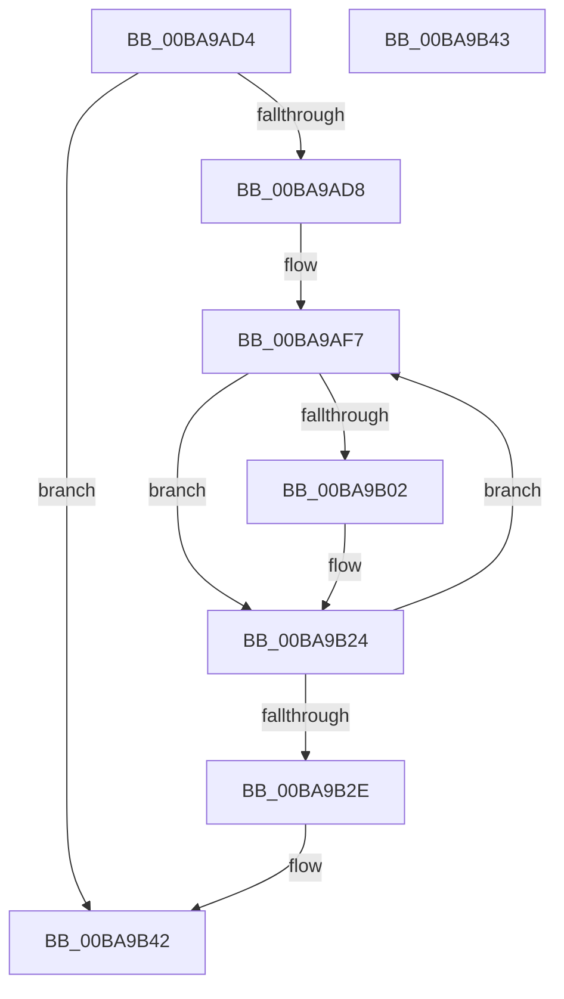

# ViDeadlockObjectAcquired

- RVA: `0x00BA9AD4`–`0x00BA9B44` (길이 `112` bytes)
- VA: `0x0000000140BA9AD4`
- 실행 섹션: `PAGEVRFY`
- PDB 이름 있음: `예`; PDB Function 태그: `아니요`
- unwind 정보 RVA: `0x000D25F4`
- 디코드: `33`개 명령, `112/112` bytes 표시
- 미해석 바이트: `0` (있으면 어셈블리에 `.byte`로 보존)

> 이 문서는 커널 이미지의 기계어와 PDB 기호를 분석해 생성했습니다. 4번과 5번은 함수 원형과 자료형을 바이너리 사용 방식에서 추정한 C 해석이며 원본 소스 복구 결과는 아닙니다.

## 1. Dependencies

- 직접 호출 지점: **1**; 고유 호출 대상: **1**
- 직접 호출자로 확인된 함수: **2**
- RIP 상대 이미지 참조: **0**

### Outgoing calls
- `0x00BA9B1F` → [VfDeadlockAcquireResource](../BB/VfDeadlockAcquireResource_function_00BB83B4.md) (function, `0x00BB83B4`)

### Direct callers
- [ViDeadlockKeWaitForMultipleObjects_Exit](ViDeadlockKeWaitForMultipleObjects_Exit_function_00BA9880.md) at `0x00BA98C8`
- [ViDeadlockKeWaitForSingleObject_Exit](ViDeadlockKeWaitForSingleObject_Exit_function_00BA98E0.md) at `0x00BA98FD`

### Static image references
- 디코드된 RIP-relative 메모리 참조가 없습니다.

## 2. Other-region calls and transfers

- 다른 실행 섹션으로 향하는 call: **0**
- 별도 외부 분기/꼬리 이동을 확인하지 못했습니다.

## 3. Assembly (complete function range)

```asm
00BA9AD4  85 C9                           test ecx, ecx
00BA9AD6  74 6A                           je 0x140ba9b42
00BA9AD8  48 89 5C 24 08                  mov qword ptr [rsp + 8], rbx
00BA9ADD  48 89 6C 24 10                  mov qword ptr [rsp + 0x10], rbp
00BA9AE2  48 89 74 24 18                  mov qword ptr [rsp + 0x18], rsi
00BA9AE7  57                              push rdi
00BA9AE8  48 83 EC 30                     sub rsp, 0x30
00BA9AEC  49 8B F1                        mov rsi, r9
00BA9AEF  8B F9                           mov edi, ecx
00BA9AF1  49 8B E8                        mov rbp, r8
00BA9AF4  48 8B DA                        mov rbx, rdx
00BA9AF7  48 8B 0B                        mov rcx, qword ptr [rbx]
00BA9AFA  8A 01                           mov al, byte ptr [rcx]
00BA9AFC  24 7F                           and al, 0x7f
00BA9AFE  3C 02                           cmp al, 2
00BA9B00  75 22                           jne 0x140ba9b24
00BA9B02  65 4C 8B 04 25 88 01 00 00      mov r8, qword ptr gs:[0x188]
00BA9B0B  45 33 C9                        xor r9d, r9d
00BA9B0E  48 85 ED                        test rbp, rbp
00BA9B11  48 89 74 24 20                  mov qword ptr [rsp + 0x20], rsi
00BA9B16  BA 01 00 00 00                  mov edx, 1
00BA9B1B  41 0F 95 C1                     setne r9b
00BA9B1F  E8 90 E8 00 00                  call 0x140bb83b4
00BA9B24  48 83 C3 08                     add rbx, 8
00BA9B28  48 83 EF 01                     sub rdi, 1
00BA9B2C  75 C9                           jne 0x140ba9af7
00BA9B2E  48 8B 5C 24 40                  mov rbx, qword ptr [rsp + 0x40]
00BA9B33  48 8B 6C 24 48                  mov rbp, qword ptr [rsp + 0x48]
00BA9B38  48 8B 74 24 50                  mov rsi, qword ptr [rsp + 0x50]
00BA9B3D  48 83 C4 30                     add rsp, 0x30
00BA9B41  5F                              pop rdi
00BA9B42  C3                              ret
00BA9B43  CC                              int3
```

## 4. C-style interpretation (structured pseudocode)

```c
__int64 __fastcall ViDeadlockObjectAcquired(int a1, __int64 a2, __int64 a3, __int64 a4)
{
    __int64 result;
    __int64 v_rbx;
    __int64 v_rdi;
    __int64 v_rsp;
    unsigned __int64 v_stack_m18;
    unsigned __int64 v_stack_p10;
    unsigned __int64 v_stack_p18;
    unsigned __int64 v_stack_p8;

    if (a1 == 0) goto loc_00BA9B42;
    v_stack_p8 = v_rbx;
    v_stack_p10 = v_rbp;
    v_stack_p18 = v_rsi;
    v_rsp = (v_rsp) - (48);
loc_00BA9AF7:
    result = (unsigned __int8)((*(unsigned __int8 *)(*(unsigned __int64 *)(a2))) & (127));
    if (((unsigned __int8)(result)) == 2) {
        a3 = *(unsigned __int64 *)(gs_base + (0 + 392));
        a4 = 0;
        v_stack_m18 = 0;
        a2 = 1;
        a4 = (a3 != 0) ? 1 : 0;
        result = VfDeadlockAcquireResource(*(unsigned __int64 *)(a2), a2, a3, a4);
    }
    v_rbx = (a2) + (8);
    v_rdi = ((unsigned int)(a1)) - (1);
    if (condition_is_not_equal) goto loc_00BA9AF7;
    v_rsp = (v_rsp) + (48);
loc_00BA9B42:
    return result;
}
```

## 5. (Beta) C Style

```c
int64_t ViDeadlockObjectAcquired(int32_t Arg1, void *Arg2, int64_t Arg3, int64_t Arg4)
{
    uint8_t *arg2 = (uint8_t *)Arg2;

    int64_t result;
    int64_t local_rbx;
    int64_t local_rdi;
    int64_t local_rsp;
    uint64_t v_stack_m18;
    uint64_t v_stack_p10;
    uint64_t v_stack_p18;
    uint64_t v_stack_p8;

    if (Arg1 == 0) goto loc_00BA9B42;
    v_stack_p8 = local_rbx;
    v_stack_p10 = local_rbp;
    v_stack_p18 = local_rsi;
    local_rsp = (local_rsp) - (48);
loc_00BA9AF7:
    result = (uint8_t)((*(uint8_t *)(*(uint64_t *)(arg2))) & (127));
    if (((uint8_t)(result)) == 2) {
        Arg3 = *(uint64_t *)(gs_base + (0 + 0x188));
        Arg4 = 0;
        v_stack_m18 = 0;
        Arg2 = 1;
        Arg4 = (Arg3 != 0) ? 1 : 0;
        result = VfDeadlockAcquireResource(*(uint64_t *)(arg2), Arg2, Arg3, Arg4);
    }
    local_rbx = (Arg2) + (8);
    local_rdi = ((uint32_t)(Arg1)) - (1);
    if (condition_is_not_equal) goto loc_00BA9AF7;
    local_rsp = (local_rsp) + (48);
loc_00BA9B42:
    return result;
}
```

### 관측된 메모리 오프셋

구조체 형식이 확인되지 않은 접근은 인자 기준의 오프셋으로만 기록했습니다.

| 기준 인자 | 오프셋 표현 | 폭 (bit) | 접근 |
|---|---:|---:|---|
| `Arg2` | `+ 0x0` | `64` | `R` |

## 6. Execution-region graph

[열기: 2D/3D 그래프와 함수 탐색 컨트롤 패널](../../../control-panel.html?section=pagevrfy&rva=0x00BA9AD4&view=graph)

- 2D 그래프는 위에서 아래로 흐르고, 3D 그래프는 빈 공간을 드래그해 회전합니다. Shift+드래그는 이동, 휠은 확대·축소, 함수 노드 선택은 대상 보고서 이동입니다.

### Static fallback


