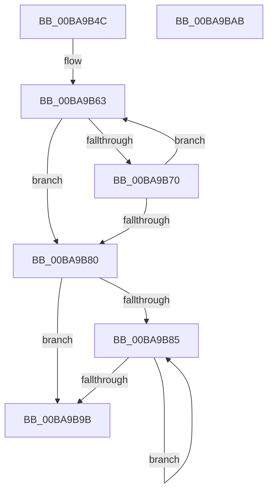

# ViDeadlockPopulateLookasideCache

- RVA: `0x00BA9B4C`–`0x00BA9BAC` (길이 `96` bytes)
- VA: `0x0000000140BA9B4C`
- 실행 섹션: `PAGEVRFY`
- PDB 이름 있음: `예`; PDB Function 태그: `아니요`
- unwind 정보 RVA: `0x00060BC4`
- 디코드: `31`개 명령, `96/96` bytes 표시
- 미해석 바이트: `0` (있으면 어셈블리에 `.byte`로 보존)

> 이 문서는 커널 이미지의 기계어와 PDB 기호를 분석해 생성했습니다. 4번과 5번은 함수 원형과 자료형을 바이너리 사용 방식에서 추정한 C 해석이며 원본 소스 복구 결과는 아닙니다.

## 1. Dependencies

- 직접 호출 지점: **2**; 고유 호출 대상: **2**
- 직접 호출자로 확인된 함수: **1**
- RIP 상대 이미지 참조: **0**

### Outgoing calls
- `0x00BA9B66` → [ExAllocateFromNPagedLookasideList](../../text/38/ExAllocateFromNPagedLookasideList_function_0038E6C0.md) (function, `0x0038E6C0`)
- `0x00BA9B8E` → [ExFreeToNPagedLookasideList](../../text/38/ExFreeToNPagedLookasideList_function_0038D9D0.md) (function, `0x0038D9D0`)

### Direct callers
- [VfDeadlockInitialize](VfDeadlockInitialize_function_00BA7DDC.md) at `0x00BA7FED`
- [VfDeadlockInitialize](VfDeadlockInitialize_function_00BA7DDC.md) at `0x00BA7FFB`
- [VfDeadlockInitialize](VfDeadlockInitialize_function_00BA7DDC.md) at `0x00BA800A`

### Static image references
- 디코드된 RIP-relative 메모리 참조가 없습니다.

## 2. Other-region calls and transfers

- 다른 실행 섹션으로 향하는 call: **2**
  - `0x00BA9B66` → [ExAllocateFromNPagedLookasideList](../../text/38/ExAllocateFromNPagedLookasideList_function_0038E6C0.md) (`PAGEVRFY` → `.text`)
  - `0x00BA9B8E` → [ExFreeToNPagedLookasideList](../../text/38/ExFreeToNPagedLookasideList_function_0038D9D0.md) (`PAGEVRFY` → `.text`)
- 별도 외부 분기/꼬리 이동을 확인하지 못했습니다.

## 3. Assembly (complete function range)

```asm
00BA9B4C  48 89 5C 24 08                  mov qword ptr [rsp + 8], rbx
00BA9B51  48 89 74 24 10                  mov qword ptr [rsp + 0x10], rsi
00BA9B56  57                              push rdi
00BA9B57  48 83 EC 20                     sub rsp, 0x20
00BA9B5B  0F B7 DA                        movzx ebx, dx
00BA9B5E  48 8B F1                        mov rsi, rcx
00BA9B61  33 FF                           xor edi, edi
00BA9B63  48 8B CE                        mov rcx, rsi
00BA9B66  E8 55 4B 7E FF                  call 0x14038e6c0
00BA9B6B  48 85 C0                        test rax, rax
00BA9B6E  74 10                           je 0x140ba9b80
00BA9B70  48 89 38                        mov qword ptr [rax], rdi
00BA9B73  48 8B F8                        mov rdi, rax
00BA9B76  B8 FF FF 00 00                  mov eax, 0xffff
00BA9B7B  66 03 D8                        add bx, ax
00BA9B7E  75 E3                           jne 0x140ba9b63
00BA9B80  48 85 FF                        test rdi, rdi
00BA9B83  74 16                           je 0x140ba9b9b
00BA9B85  48 8B 1F                        mov rbx, qword ptr [rdi]
00BA9B88  48 8B D7                        mov rdx, rdi
00BA9B8B  48 8B CE                        mov rcx, rsi
00BA9B8E  E8 3D 3E 7E FF                  call 0x14038d9d0
00BA9B93  48 8B FB                        mov rdi, rbx
00BA9B96  48 85 DB                        test rbx, rbx
00BA9B99  75 EA                           jne 0x140ba9b85
00BA9B9B  48 8B 5C 24 30                  mov rbx, qword ptr [rsp + 0x30]
00BA9BA0  48 8B 74 24 38                  mov rsi, qword ptr [rsp + 0x38]
00BA9BA5  48 83 C4 20                     add rsp, 0x20
00BA9BA9  5F                              pop rdi
00BA9BAA  C3                              ret
00BA9BAB  CC                              int3
```

## 4. C-style interpretation (structured pseudocode)

```c
__int64 __fastcall ViDeadlockPopulateLookasideCache(__int64 a1, unsigned __int16 a2)
{
    __int64 result;
    __int64 v_rbx;
    __int64 v_rdi;
    __int64 v_rsp;
    unsigned __int64 v_stack_p10;
    unsigned __int64 v_stack_p8;

    v_stack_p8 = v_rbx;
    v_stack_p10 = v_rsi;
    v_rsp = (v_rsp) - (32);
    v_rdi = 0;
loc_00BA9B63:
    result = ExAllocateFromNPagedLookasideList(a1, a2, a3, a4);
    if (result == 0) goto loc_00BA9B80;
    *(unsigned __int64 *)(result) = 0;
    v_rbx = (unsigned __int16)((a2) + ((unsigned __int16)((unsigned int)(0xFFFFULL))));
    if (condition_is_not_equal) goto loc_00BA9B63;
loc_00BA9B80:
    if (result == 0) goto loc_00BA9B9B;
loc_00BA9B85:
    result = ExFreeToNPagedLookasideList(a1, result, a3, a4);
    if (*(unsigned __int64 *)(result) != 0) goto loc_00BA9B85;
loc_00BA9B9B:
    v_rsp = (v_rsp) + (32);
    return result;
}
```

## 5. (Beta) C Style

```c
int64_t ViDeadlockPopulateLookasideCache(int64_t Arg1, uint16_t Arg2)
{
    int64_t result;
    int64_t local_rbx;
    int64_t local_rdi;
    int64_t local_rsp;
    uint64_t v_stack_p10;
    uint64_t v_stack_p8;

    v_stack_p8 = local_rbx;
    v_stack_p10 = local_rsi;
    local_rsp = (local_rsp) - (32);
    local_rdi = 0;
loc_00BA9B63:
    result = ExAllocateFromNPagedLookasideList(Arg1, Arg2, a3, a4);
    if (result == 0) goto loc_00BA9B80;
    *(uint64_t *)(result) = 0;
    local_rbx = (uint16_t)((Arg2) + ((uint16_t)((uint32_t)(0xFFFFULL))));
    if (condition_is_not_equal) goto loc_00BA9B63;
loc_00BA9B80:
    if (result == 0) goto loc_00BA9B9B;
loc_00BA9B85:
    result = ExFreeToNPagedLookasideList(Arg1, result, a3, a4);
    if (*(uint64_t *)(result) != 0) goto loc_00BA9B85;
loc_00BA9B9B:
    local_rsp = (local_rsp) + (32);
    return result;
}
```

## 6. Execution-region graph

[열기: 2D/3D 그래프와 함수 탐색 컨트롤 패널](../../../control-panel.html?section=pagevrfy&rva=0x00BA9B4C&view=graph)

- 2D 그래프는 위에서 아래로 흐르고, 3D 그래프는 빈 공간을 드래그해 회전합니다. Shift+드래그는 이동, 휠은 확대·축소, 함수 노드 선택은 대상 보고서 이동입니다.

### Static fallback


