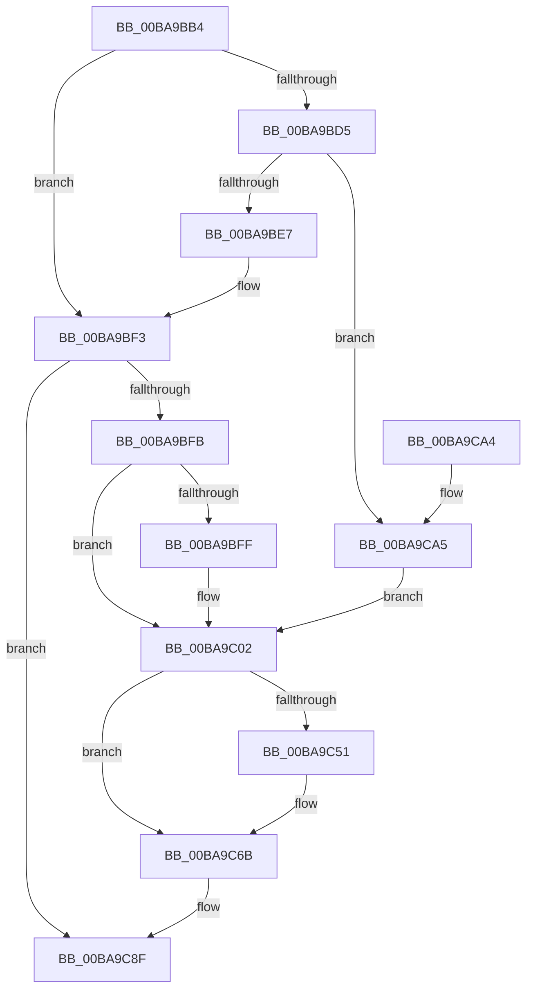

# ViDeadlockPreprocessOptions

- RVA: `0x00BA9BB4`–`0x00BA9CB0` (길이 `252` bytes)
- VA: `0x0000000140BA9BB4`
- 실행 섹션: `PAGEVRFY`
- PDB 이름 있음: `예`; PDB Function 태그: `아니요`
- unwind 정보 RVA: `0x00073008`
- 디코드: `58`개 명령, `252/252` bytes 표시
- 미해석 바이트: `0` (있으면 어셈블리에 `.byte`로 보존)

> 이 문서는 커널 이미지의 기계어와 PDB 기호를 분석해 생성했습니다. 4번과 5번은 함수 원형과 자료형을 바이너리 사용 방식에서 추정한 C 해석이며 원본 소스 복구 결과는 아닙니다.

## 1. Dependencies

- 직접 호출 지점: **7**; 고유 호출 대상: **2**
- 직접 호출자로 확인된 함수: **6**
- RIP 상대 이미지 참조: **10**

### Outgoing calls
- `0x00BA9C2F` → [VfUtilDbgPrint](../../text/61/VfUtilDbgPrint_function_006122AC.md) (function, `0x006122AC`)
- `0x00BA9C3B` → [VfUtilDbgPrint](../../text/61/VfUtilDbgPrint_function_006122AC.md) (function, `0x006122AC`)
- `0x00BA9C47` → [VfUtilDbgPrint](../../text/61/VfUtilDbgPrint_function_006122AC.md) (function, `0x006122AC`)
- `0x00BA9C66` → [DbgPrintEx](../../text/35/DbgPrintEx_function_00359290.md) (function, `0x00359290`)
- `0x00BA9C72` → [VfUtilDbgPrint](../../text/61/VfUtilDbgPrint_function_006122AC.md) (function, `0x006122AC`)
- `0x00BA9C7E` → [VfUtilDbgPrint](../../text/61/VfUtilDbgPrint_function_006122AC.md) (function, `0x006122AC`)
- `0x00BA9C8A` → [VfUtilDbgPrint](../../text/61/VfUtilDbgPrint_function_006122AC.md) (function, `0x006122AC`)

### Direct callers
- [ViDeadlockAddResource](ViDeadlockAddResource_function_00BA8870.md) at `0x00BA88F4`
- [ViDeadlockAddResource](ViDeadlockAddResource_function_00BA8870.md) at `0x00BA8946`
- [ViDeadlockAnalyze](ViDeadlockAnalyze_function_00BA8BD4.md) at `0x00BA8DCD`
- [ViDeadlockRemoveResource](ViDeadlockRemoveResource_function_00BA9DEC.md) at `0x00BA9E69`
- [ViDeadlockRemoveThread](ViDeadlockRemoveThread_function_00BA9F8C.md) at `0x00BA9FED`
- [VfDeadlockReleaseResource](../BB/VfDeadlockReleaseResource_function_00BB759C.md) at `0x00BB7747`
- [VfDeadlockReleaseResource](../BB/VfDeadlockReleaseResource_function_00BB759C.md) at `0x00BB77AB`
- [VfDeadlockReleaseResource](../BB/VfDeadlockReleaseResource_function_00BB759C.md) at `0x00BB78A8`
- [VfDeadlockAcquireResource](../BB/VfDeadlockAcquireResource_function_00BB83B4.md) at `0x00BB8683`
- [VfDeadlockAcquireResource](../BB/VfDeadlockAcquireResource_function_00BB83B4.md) at `0x00BB871A`

### Static image references
- `0x00BA9BE7` → RVA `0x00B8B1E0` (`ViDeadlockDefaultActions`; read)
- `0x00BA9C07` → RVA `0x00BBAE80` (` ?? ::JKADOLAD::`string'`; read)
- `0x00BA9C13` → RVA `0x00F04000` (`.data`; write)
- `0x00BA9C1A` → RVA `0x00F04008` (`.data`; write)
- `0x00BA9C21` → RVA `0x00F04010` (`.data`; write)
- `0x00BA9C28` → RVA `0x00F04018` (`.data`; write)
- `0x00BA9C34` → RVA `0x00BBA3D0` (` ?? ::JKADOLAD::`string'`; read)
- `0x00BA9C40` → RVA `0x00BBAE70` (` ?? ::JKADOLAD::`string'`; read)
- `0x00BA9C6B` → RVA `0x00BBA2B0` (` ?? ::JKADOLAD::`string'`; read)
- `0x00BA9C83` → RVA `0x00BBA2E0` (` ?? ::JKADOLAD::`string'`; read)

## 2. Other-region calls and transfers

- 다른 실행 섹션으로 향하는 call: **7**
  - `0x00BA9C2F` → [VfUtilDbgPrint](../../text/61/VfUtilDbgPrint_function_006122AC.md) (`PAGEVRFY` → `.text`)
  - `0x00BA9C3B` → [VfUtilDbgPrint](../../text/61/VfUtilDbgPrint_function_006122AC.md) (`PAGEVRFY` → `.text`)
  - `0x00BA9C47` → [VfUtilDbgPrint](../../text/61/VfUtilDbgPrint_function_006122AC.md) (`PAGEVRFY` → `.text`)
  - `0x00BA9C66` → [DbgPrintEx](../../text/35/DbgPrintEx_function_00359290.md) (`PAGEVRFY` → `.text`)
  - `0x00BA9C72` → [VfUtilDbgPrint](../../text/61/VfUtilDbgPrint_function_006122AC.md) (`PAGEVRFY` → `.text`)
  - `0x00BA9C7E` → [VfUtilDbgPrint](../../text/61/VfUtilDbgPrint_function_006122AC.md) (`PAGEVRFY` → `.text`)
  - `0x00BA9C8A` → [VfUtilDbgPrint](../../text/61/VfUtilDbgPrint_function_006122AC.md) (`PAGEVRFY` → `.text`)
- 별도 외부 분기/꼬리 이동을 확인하지 못했습니다.

## 3. Assembly (complete function range)

```asm
00BA9BB4  48 89 5C 24 08                  mov qword ptr [rsp + 8], rbx
00BA9BB9  48 89 6C 24 10                  mov qword ptr [rsp + 0x10], rbp
00BA9BBE  48 89 74 24 18                  mov qword ptr [rsp + 0x18], rsi
00BA9BC3  57                              push rdi
00BA9BC4  48 83 EC 30                     sub rsp, 0x30
00BA9BC8  8B 01                           mov eax, dword ptr [rcx]
00BA9BCA  49 8B F1                        mov rsi, r9
00BA9BCD  48 8B EA                        mov rbp, rdx
00BA9BD0  83 F8 FF                        cmp eax, -1
00BA9BD3  75 1E                           jne 0x140ba9bf3
00BA9BD5  49 8B C0                        mov rax, r8
00BA9BD8  25 FF 0F 00 00                  and eax, 0xfff
00BA9BDD  48 83 F8 0C                     cmp rax, 0xc
00BA9BE1  0F 83 BE 00 00 00               jae 0x140ba9ca5
00BA9BE7  48 8D 15 F2 15 FE FF            lea rdx, [rip - 0x1ea0e]
00BA9BEE  8B 04 82                        mov eax, dword ptr [rdx + rax*4]
00BA9BF1  89 01                           mov dword ptr [rcx], eax
00BA9BF3  85 C0                           test eax, eax
00BA9BF5  0F 84 94 00 00 00               je 0x140ba9c8f
00BA9BFB  A8 10                           test al, 0x10
00BA9BFD  74 03                           je 0x140ba9c02
00BA9BFF  83 21 00                        and dword ptr [rcx], 0
00BA9C02  48 8B 5C 24 60                  mov rbx, qword ptr [rsp + 0x60]
00BA9C07  48 8D 0D 72 12 01 00            lea rcx, [rip + 0x11272]
00BA9C0E  48 8B 7C 24 68                  mov rdi, qword ptr [rsp + 0x68]
00BA9C13  4C 89 05 E6 A3 35 00            mov qword ptr [rip + 0x35a3e6], r8
00BA9C1A  48 89 35 E7 A3 35 00            mov qword ptr [rip + 0x35a3e7], rsi
00BA9C21  48 89 1D E8 A3 35 00            mov qword ptr [rip + 0x35a3e8], rbx
00BA9C28  48 89 3D E9 A3 35 00            mov qword ptr [rip + 0x35a3e9], rdi
00BA9C2F  E8 78 86 A6 FF                  call 0x1406122ac
00BA9C34  48 8D 0D 95 07 01 00            lea rcx, [rip + 0x10795]
00BA9C3B  E8 6C 86 A6 FF                  call 0x1406122ac
00BA9C40  48 8D 0D 29 12 01 00            lea rcx, [rip + 0x11229]
00BA9C47  E8 60 86 A6 FF                  call 0x1406122ac
00BA9C4C  48 85 ED                        test rbp, rbp
00BA9C4F  74 1A                           je 0x140ba9c6b
00BA9C51  33 D2                           xor edx, edx
00BA9C53  48 89 7C 24 28                  mov qword ptr [rsp + 0x28], rdi
00BA9C58  4C 8B CE                        mov r9, rsi
00BA9C5B  48 89 5C 24 20                  mov qword ptr [rsp + 0x20], rbx
00BA9C60  4C 8B C5                        mov r8, rbp
00BA9C63  8D 4A 65                        lea ecx, [rdx + 0x65]
00BA9C66  E8 25 F6 7A FF                  call 0x140359290
00BA9C6B  48 8D 0D 3E 06 01 00            lea rcx, [rip + 0x1063e]
00BA9C72  E8 35 86 A6 FF                  call 0x1406122ac
00BA9C77  48 8D 0D 52 07 01 00            lea rcx, [rip + 0x10752]
00BA9C7E  E8 29 86 A6 FF                  call 0x1406122ac
00BA9C83  48 8D 0D 56 06 01 00            lea rcx, [rip + 0x10656]
00BA9C8A  E8 1D 86 A6 FF                  call 0x1406122ac
00BA9C8F  48 8B 5C 24 40                  mov rbx, qword ptr [rsp + 0x40]
00BA9C94  48 8B 6C 24 48                  mov rbp, qword ptr [rsp + 0x48]
00BA9C99  48 8B 74 24 50                  mov rsi, qword ptr [rsp + 0x50]
00BA9C9E  48 83 C4 30                     add rsp, 0x30
00BA9CA2  5F                              pop rdi
00BA9CA3  C3                              ret
00BA9CA4  CC                              int3
00BA9CA5  C7 01 04 00 00 00               mov dword ptr [rcx], 4
00BA9CAB  E9 52 FF FF FF                  jmp 0x140ba9c02
```

## 4. C-style interpretation (structured pseudocode)

```c
__int64 __fastcall ViDeadlockPreprocessOptions(__int64 a1, __int64 a2, __int64 a3, __int64 a4, __int64 a5, __int64 a6)
{
    __int64 result;
    __int64 v_rsp;
    unsigned __int64 v_stack_m10;
    unsigned __int64 v_stack_m18;
    unsigned __int64 v_stack_p10;
    unsigned __int64 v_stack_p18;
    unsigned __int64 v_stack_p8;

    v_stack_p8 = v_rbx;
    v_stack_p10 = v_rbp;
    v_stack_p18 = v_rsi;
    v_rsp = (v_rsp) - (48);
    if (((unsigned int)((unsigned int)(*(unsigned int *)(a1)))) != -1) goto loc_00BA9BF3;
    result = (unsigned int)((a3) & (0xFFFULL));
    if (result >= 12) goto loc_00BA9CA5;
    *(unsigned int *)(a1) = (unsigned int)((unsigned int)(*(unsigned int *)(v_rip - 125454 + result * 4)));
loc_00BA9BF3:
    if ((unsigned int)((unsigned int)(*(unsigned int *)(v_rip - 125454 + result * 4))) == 0) goto loc_00BA9C8F;
    if ((((unsigned __int8)((unsigned int)(*(unsigned int *)(v_rip - 125454 + result * 4)))) & (16)) != 0) {
    }
    *(unsigned __int64 *)(v_rip + 3515366) = a3;
    *(unsigned __int64 *)(v_rip + 3515367) = a4;
    *(unsigned __int64 *)(v_rip + 3515368) = a5;
    *(unsigned __int64 *)(v_rip + 3515369) = a6;
    result = VfUtilDbgPrint(v_rip + 70258, v_rip - 125454, a3, a4);
    result = VfUtilDbgPrint(v_rip + 67477, v_rip - 125454, a3, a4);
    result = VfUtilDbgPrint(v_rip + 70185, v_rip - 125454, a3, a4);
    if (a2 != 0) {
        a2 = 0;
        v_stack_m10 = a6;
        a4 = a4;
        v_stack_m18 = a5;
        a3 = 0;
        a1 = a2 + 101;
        result = DbgPrintEx(a1, a2, a3, a4);
    }
    result = VfUtilDbgPrint(v_rip + 67134, a2, a3, a4);
    result = VfUtilDbgPrint(v_rip + 67410, a2, a3, a4);
    result = VfUtilDbgPrint(v_rip + 67158, a2, a3, a4);
loc_00BA9C8F:
    v_rsp = (v_rsp) + (48);
    return result;
loc_00BA9CA5:
    *(unsigned int *)(v_rip + 67158) = 4;
    goto loc_00BA9C02;
}
```

## 5. (Beta) C Style

```c
int64_t ViDeadlockPreprocessOptions(void *Arg1, int64_t Arg2, int64_t Arg3, int64_t Arg4, int64_t Arg5, int64_t Arg6)
{
    uint8_t *arg1 = (uint8_t *)Arg1;

    int64_t result;
    int64_t local_rsp;
    uint64_t v_stack_m10;
    uint64_t v_stack_m18;
    uint64_t v_stack_p10;
    uint64_t v_stack_p18;
    uint64_t v_stack_p8;

    v_stack_p8 = local_rbx;
    v_stack_p10 = local_rbp;
    v_stack_p18 = local_rsi;
    local_rsp = (local_rsp) - (48);
    if (((uint32_t)((uint32_t)(*(uint32_t *)(arg1)))) != -1) goto loc_00BA9BF3;
    result = (uint32_t)((Arg3) & (0xFFFULL));
    if (result >= 12) goto loc_00BA9CA5;
    *(uint32_t *)(arg1) = (uint32_t)((uint32_t)(*(uint32_t *)(v_rip - 0x1EA0E + result * 4)));
loc_00BA9BF3:
    if ((uint32_t)((uint32_t)(*(uint32_t *)(v_rip - 0x1EA0E + result * 4))) == 0) goto loc_00BA9C8F;
    if ((((uint8_t)((uint32_t)(*(uint32_t *)(v_rip - 0x1EA0E + result * 4)))) & (16)) != 0) {
    }
    *(uint64_t *)(v_rip + 0x35A3E6) = Arg3;
    *(uint64_t *)(v_rip + 0x35A3E7) = Arg4;
    *(uint64_t *)(v_rip + 0x35A3E8) = Arg5;
    *(uint64_t *)(v_rip + 0x35A3E9) = Arg6;
    result = VfUtilDbgPrint(v_rip + 70258, v_rip - 125454, Arg3, Arg4);
    result = VfUtilDbgPrint(v_rip + 67477, v_rip - 125454, Arg3, Arg4);
    result = VfUtilDbgPrint(v_rip + 70185, v_rip - 125454, Arg3, Arg4);
    if (Arg2 != 0) {
        Arg2 = 0;
        v_stack_m10 = Arg6;
        Arg4 = Arg4;
        v_stack_m18 = Arg5;
        Arg3 = 0;
        Arg1 = Arg2 + 101;
        result = DbgPrintEx(Arg1, Arg2, Arg3, Arg4);
    }
    result = VfUtilDbgPrint(v_rip + 67134, Arg2, Arg3, Arg4);
    result = VfUtilDbgPrint(v_rip + 67410, Arg2, Arg3, Arg4);
    result = VfUtilDbgPrint(v_rip + 67158, Arg2, Arg3, Arg4);
loc_00BA9C8F:
    local_rsp = (local_rsp) + (48);
    return result;
loc_00BA9CA5:
    *(uint32_t *)(v_rip + 0x10656) = 4;
    goto loc_00BA9C02;
}
```

### 관측된 메모리 오프셋

구조체 형식이 확인되지 않은 접근은 인자 기준의 오프셋으로만 기록했습니다.

| 기준 인자 | 오프셋 표현 | 폭 (bit) | 접근 |
|---|---:|---:|---|
| `Arg1` | `+ 0x0` | `32` | `R` |
| `Arg1` | `+ 0x0` | `32` | `R/W` |
| `Arg1` | `+ 0x0` | `32` | `W` |

## 6. Execution-region graph

[열기: 2D/3D 그래프와 함수 탐색 컨트롤 패널](../../../control-panel.html?section=pagevrfy&rva=0x00BA9BB4&view=graph)

- 2D 그래프는 위에서 아래로 흐르고, 3D 그래프는 빈 공간을 드래그해 회전합니다. Shift+드래그는 이동, 휠은 확대·축소, 함수 노드 선택은 대상 보고서 이동입니다.

### Static fallback


