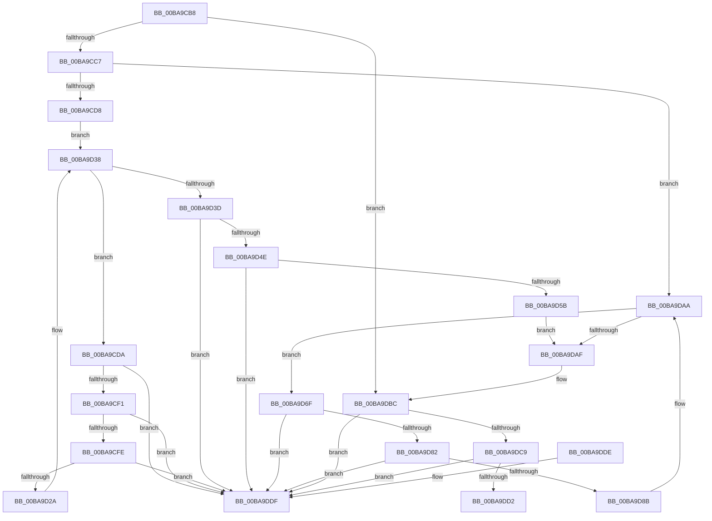

# ViDeadlockRemoveNode

- RVA: `0x00BA9CB8`–`0x00BA9DE6` (길이 `302` bytes)
- VA: `0x0000000140BA9CB8`
- 실행 섹션: `PAGEVRFY`
- PDB 이름 있음: `예`; PDB Function 태그: `아니요`
- unwind 정보 RVA: `0x0005CEE8`
- 디코드: `85`개 명령, `302/302` bytes 표시
- 미해석 바이트: `0` (있으면 어셈블리에 `.byte`로 보존)

> 이 문서는 커널 이미지의 기계어와 PDB 기호를 분석해 생성했습니다. 4번과 5번은 함수 원형과 자료형을 바이너리 사용 방식에서 추정한 C 해석이며 원본 소스 복구 결과는 아닙니다.

## 1. Dependencies

- 직접 호출 지점: **1**; 고유 호출 대상: **1**
- 직접 호출자로 확인된 함수: **2**
- RIP 상대 이미지 참조: **0**

### Outgoing calls
- `0x00BA9D68` → [ViDeadlockUpdateChildrenCount](ViDeadlockUpdateChildrenCount_function_00BAA294.md) (function, `0x00BAA294`)

### Direct callers
- [ViDeadlockForgetResourceHistory](ViDeadlockForgetResourceHistory_function_00BA955C.md) at `0x00BA95E2`
- [ViDeadlockForgetResourceHistory](ViDeadlockForgetResourceHistory_function_00BA955C.md) at `0x00BA9627`
- [ViDeadlockRemoveResource](ViDeadlockRemoveResource_function_00BA9DEC.md) at `0x00BA9EAD`

### Static image references
- 디코드된 RIP-relative 메모리 참조가 없습니다.

## 2. Other-region calls and transfers

- 다른 실행 섹션으로 향하는 call: **0**
- 별도 외부 분기/꼬리 이동을 확인하지 못했습니다.

## 3. Assembly (complete function range)

```asm
00BA9CB8  48 83 EC 28                     sub rsp, 0x28
00BA9CBC  4C 8B C9                        mov r9, rcx
00BA9CBF  85 D2                           test edx, edx
00BA9CC1  0F 85 F5 00 00 00               jne 0x140ba9dbc
00BA9CC7  49 83 39 00                     cmp qword ptr [r9], 0
00BA9CCB  4C 8D 41 08                     lea r8, [rcx + 8]
00BA9CCF  49 8B 08                        mov rcx, qword ptr [r8]
00BA9CD2  0F 84 D2 00 00 00               je 0x140ba9daa
00BA9CD8  EB 5E                           jmp 0x140ba9d38
00BA9CDA  48 8B 01                        mov rax, qword ptr [rcx]
00BA9CDD  4C 8D 59 E8                     lea r11, [rcx - 0x18]
00BA9CE1  48 8B D1                        mov rdx, rcx
00BA9CE4  48 8B C8                        mov rcx, rax
00BA9CE7  48 39 50 08                     cmp qword ptr [rax + 8], rdx
00BA9CEB  0F 85 EE 00 00 00               jne 0x140ba9ddf
00BA9CF1  4C 8B 52 08                     mov r10, qword ptr [rdx + 8]
00BA9CF5  49 39 12                        cmp qword ptr [r10], rdx
00BA9CF8  0F 85 E1 00 00 00               jne 0x140ba9ddf
00BA9CFE  49 89 02                        mov qword ptr [r10], rax
00BA9D01  4C 89 50 08                     mov qword ptr [rax + 8], r10
00BA9D05  83 C8 FF                        or eax, 0xffffffff
00BA9D08  41 2B 43 4C                     sub eax, dword ptr [r11 + 0x4c]
00BA9D0C  41 01 41 4C                     add dword ptr [r9 + 0x4c], eax
00BA9D10  49 8B 01                        mov rax, qword ptr [r9]
00BA9D13  49 89 03                        mov qword ptr [r11], rax
00BA9D16  49 8B 01                        mov rax, qword ptr [r9]
00BA9D19  48 83 C0 08                     add rax, 8
00BA9D1D  4C 8B 50 08                     mov r10, qword ptr [rax + 8]
00BA9D21  49 39 02                        cmp qword ptr [r10], rax
00BA9D24  0F 85 B5 00 00 00               jne 0x140ba9ddf
00BA9D2A  48 89 02                        mov qword ptr [rdx], rax
00BA9D2D  4C 89 52 08                     mov qword ptr [rdx + 8], r10
00BA9D31  49 89 12                        mov qword ptr [r10], rdx
00BA9D34  48 89 50 08                     mov qword ptr [rax + 8], rdx
00BA9D38  49 3B C8                        cmp rcx, r8
00BA9D3B  75 9D                           jne 0x140ba9cda
00BA9D3D  49 8D 41 18                     lea rax, [r9 + 0x18]
00BA9D41  4C 8B 00                        mov r8, qword ptr [rax]
00BA9D44  49 39 40 08                     cmp qword ptr [r8 + 8], rax
00BA9D48  0F 85 91 00 00 00               jne 0x140ba9ddf
00BA9D4E  48 8B 48 08                     mov rcx, qword ptr [rax + 8]
00BA9D52  48 39 01                        cmp qword ptr [rcx], rax
00BA9D55  0F 85 84 00 00 00               jne 0x140ba9ddf
00BA9D5B  4C 89 01                        mov qword ptr [rcx], r8
00BA9D5E  83 CA FF                        or edx, 0xffffffff
00BA9D61  49 89 48 08                     mov qword ptr [r8 + 8], rcx
00BA9D65  49 8B 09                        mov rcx, qword ptr [r9]
00BA9D68  E8 27 05 00 00                  call 0x140baa294
00BA9D6D  EB 40                           jmp 0x140ba9daf
00BA9D6F  48 8B 01                        mov rax, qword ptr [rcx]
00BA9D72  4C 8D 59 E8                     lea r11, [rcx - 0x18]
00BA9D76  48 8B D1                        mov rdx, rcx
00BA9D79  48 8B C8                        mov rcx, rax
00BA9D7C  48 39 50 08                     cmp qword ptr [rax + 8], rdx
00BA9D80  75 5D                           jne 0x140ba9ddf
00BA9D82  4C 8B 52 08                     mov r10, qword ptr [rdx + 8]
00BA9D86  49 39 12                        cmp qword ptr [r10], rdx
00BA9D89  75 54                           jne 0x140ba9ddf
00BA9D8B  49 89 02                        mov qword ptr [r10], rax
00BA9D8E  4C 89 50 08                     mov qword ptr [rax + 8], r10
00BA9D92  83 C8 FF                        or eax, 0xffffffff
00BA9D95  41 2B 43 4C                     sub eax, dword ptr [r11 + 0x4c]
00BA9D99  41 01 41 4C                     add dword ptr [r9 + 0x4c], eax
00BA9D9D  49 83 23 00                     and qword ptr [r11], 0
00BA9DA1  48 83 22 00                     and qword ptr [rdx], 0
00BA9DA5  49 83 63 20 00                  and qword ptr [r11 + 0x20], 0
00BA9DAA  49 3B C8                        cmp rcx, r8
00BA9DAD  75 C0                           jne 0x140ba9d6f
00BA9DAF  49 8B 41 38                     mov rax, qword ptr [r9 + 0x38]
00BA9DB3  B9 FF FF 00 00                  mov ecx, 0xffff
00BA9DB8  66 01 48 04                     add word ptr [rax + 4], cx
00BA9DBC  49 83 C1 28                     add r9, 0x28
00BA9DC0  49 8B 09                        mov rcx, qword ptr [r9]
00BA9DC3  4C 39 49 08                     cmp qword ptr [rcx + 8], r9
00BA9DC7  75 16                           jne 0x140ba9ddf
00BA9DC9  49 8B 41 08                     mov rax, qword ptr [r9 + 8]
00BA9DCD  4C 39 08                        cmp qword ptr [rax], r9
00BA9DD0  75 0D                           jne 0x140ba9ddf
00BA9DD2  48 89 08                        mov qword ptr [rax], rcx
00BA9DD5  48 89 41 08                     mov qword ptr [rcx + 8], rax
00BA9DD9  48 83 C4 28                     add rsp, 0x28
00BA9DDD  C3                              ret
00BA9DDE  CC                              int3
00BA9DDF  B9 03 00 00 00                  mov ecx, 3
00BA9DE4  CD 29                           int 0x29
```

## 4. C-style interpretation (structured pseudocode)

```c
__int64 __fastcall ViDeadlockRemoveNode(__int64 a1, int a2)
{
    __int64 result;
    __int64 v_rsp;

    v_rsp = (v_rsp) - (40);
    if (a2 != 0) goto loc_00BA9DBC;
    if ((*(unsigned __int64 *)(a1)) == 0) goto loc_00BA9DAA;
    goto loc_00BA9D38;
loc_00BA9CDA:
    if ((*(unsigned __int64 *)(*(unsigned __int64 *)(*(unsigned __int64 *)(a1 + 8)) + 8)) != (*(unsigned __int64 *)(a1 + 8))) goto loc_00BA9DDF;
    if ((*(unsigned __int64 *)(*(unsigned __int64 *)(*(unsigned __int64 *)(a1 + 8) + 8))) != (*(unsigned __int64 *)(a1 + 8))) goto loc_00BA9DDF;
    *(unsigned __int64 *)(*(unsigned __int64 *)(*(unsigned __int64 *)(a1 + 8) + 8)) = *(unsigned __int64 *)(*(unsigned __int64 *)(a1 + 8));
    *(unsigned __int64 *)(*(unsigned __int64 *)(*(unsigned __int64 *)(a1 + 8)) + 8) = *(unsigned __int64 *)(*(unsigned __int64 *)(a1 + 8) + 8);
    result = (unsigned int)((*(unsigned __int64 *)(*(unsigned __int64 *)(a1 + 8))) | (0xFFFFFFFFULL));
    result = (unsigned int)((result) - (*(unsigned int *)(*(unsigned __int64 *)(a1 + 8) - 24 + 76)));
    *(unsigned __int64 *)(*(unsigned __int64 *)(a1 + 8) - 24) = *(unsigned __int64 *)(a1);
    result = (*(unsigned __int64 *)(a1)) + (8);
    if ((*(unsigned __int64 *)(*(unsigned __int64 *)(result + 8))) != result) goto loc_00BA9DDF;
    *(unsigned __int64 *)(*(unsigned __int64 *)(a1 + 8)) = result;
    *(unsigned __int64 *)(*(unsigned __int64 *)(a1 + 8) + 8) = *(unsigned __int64 *)(result + 8);
    *(unsigned __int64 *)(*(unsigned __int64 *)(result + 8)) = *(unsigned __int64 *)(a1 + 8);
    *(unsigned __int64 *)(result + 8) = *(unsigned __int64 *)(a1 + 8);
loc_00BA9D38:
    if ((*(unsigned __int64 *)(*(unsigned __int64 *)(a1 + 8))) != (a1 + 8)) goto loc_00BA9CDA;
    if ((*(unsigned __int64 *)(*(unsigned __int64 *)(a1 + 24) + 8)) != (a1 + 24)) goto loc_00BA9DDF;
    if ((*(unsigned __int64 *)(*(unsigned __int64 *)(a1 + 24 + 8))) != (a1 + 24)) goto loc_00BA9DDF;
    *(unsigned __int64 *)(*(unsigned __int64 *)(a1 + 24 + 8)) = *(unsigned __int64 *)(a1 + 24);
    a2 = (unsigned int)((*(unsigned __int64 *)(a1 + 8)) | (0xFFFFFFFFULL));
    *(unsigned __int64 *)(*(unsigned __int64 *)(a1 + 24) + 8) = *(unsigned __int64 *)(a1 + 24 + 8);
    result = ViDeadlockUpdateChildrenCount(*(unsigned __int64 *)(a1), a2, *(unsigned __int64 *)(a1 + 24), a1);
    goto loc_00BA9DAF;
loc_00BA9D6F:
    if ((*(unsigned __int64 *)(*(unsigned __int64 *)(*(unsigned __int64 *)(a1)) + 8)) != (*(unsigned __int64 *)(a1))) goto loc_00BA9DDF;
    if ((*(unsigned __int64 *)(*(unsigned __int64 *)(*(unsigned __int64 *)(a1) + 8))) != (*(unsigned __int64 *)(a1))) goto loc_00BA9DDF;
    *(unsigned __int64 *)(*(unsigned __int64 *)(*(unsigned __int64 *)(a1) + 8)) = *(unsigned __int64 *)(*(unsigned __int64 *)(a1));
    *(unsigned __int64 *)(*(unsigned __int64 *)(*(unsigned __int64 *)(a1)) + 8) = *(unsigned __int64 *)(*(unsigned __int64 *)(a1) + 8);
    result = (unsigned int)((*(unsigned __int64 *)(*(unsigned __int64 *)(a1))) | (0xFFFFFFFFULL));
    result = (unsigned int)((result) - (*(unsigned int *)(*(unsigned __int64 *)(a1) - 24 + 76)));
loc_00BA9DAA:
    if ((*(unsigned __int64 *)(*(unsigned __int64 *)(a1))) != (*(unsigned __int64 *)(a1 + 24))) goto loc_00BA9D6F;
loc_00BA9DAF:
loc_00BA9DBC:
    a4 = (a1) + (40);
    if ((*(unsigned __int64 *)(*(unsigned __int64 *)(a4) + 8)) != a4) goto loc_00BA9DDF;
    if ((*(unsigned __int64 *)(*(unsigned __int64 *)(a4 + 8))) != a4) goto loc_00BA9DDF;
    *(unsigned __int64 *)(*(unsigned __int64 *)(a4 + 8)) = *(unsigned __int64 *)(a4);
    *(unsigned __int64 *)(*(unsigned __int64 *)(a4) + 8) = *(unsigned __int64 *)(a4 + 8);
    v_rsp = (v_rsp) + (40);
    return *(unsigned __int64 *)(a4 + 8);
loc_00BA9DDF:
    return *(unsigned __int64 *)(a4 + 8);
}
```

## 5. (Beta) C Style

```c
int64_t ViDeadlockRemoveNode(void *Arg1, int32_t Arg2)
{
    uint8_t *arg1 = (uint8_t *)Arg1;

    int64_t result;
    int64_t local_rsp;

    local_rsp = (local_rsp) - (40);
    if (Arg2 != 0) goto loc_00BA9DBC;
    if ((*(uint64_t *)(arg1)) == 0) goto loc_00BA9DAA;
    goto loc_00BA9D38;
loc_00BA9CDA:
    if ((*(uint64_t *)(*(uint64_t *)(*(uint64_t *)(arg1 + 0x8)) + 0x8)) != (*(uint64_t *)(arg1 + 0x8))) goto loc_00BA9DDF;
    if ((*(uint64_t *)(*(uint64_t *)(*(uint64_t *)(arg1 + 0x8) + 0x8))) != (*(uint64_t *)(arg1 + 0x8))) goto loc_00BA9DDF;
    *(uint64_t *)(*(uint64_t *)(*(uint64_t *)(arg1 + 0x8) + 0x8)) = *(uint64_t *)(*(uint64_t *)(arg1 + 0x8));
    *(uint64_t *)(*(uint64_t *)(*(uint64_t *)(arg1 + 0x8)) + 0x8) = *(uint64_t *)(*(uint64_t *)(arg1 + 0x8) + 0x8);
    result = (uint32_t)((*(uint64_t *)(*(uint64_t *)(arg1 + 0x8))) | (0xFFFFFFFFULL));
    result = (uint32_t)((result) - (*(uint32_t *)(*(uint64_t *)(arg1 + 0x8) - 0x18 + 0x4C)));
    *(uint64_t *)(*(uint64_t *)(arg1 + 0x8) - 0x18) = *(uint64_t *)(arg1);
    result = (*(uint64_t *)(arg1)) + (8);
    if ((*(uint64_t *)(*(uint64_t *)(result + 0x8))) != result) goto loc_00BA9DDF;
    *(uint64_t *)(*(uint64_t *)(arg1 + 0x8)) = result;
    *(uint64_t *)(*(uint64_t *)(arg1 + 0x8) + 0x8) = *(uint64_t *)(result + 0x8);
    *(uint64_t *)(*(uint64_t *)(result + 0x8)) = *(uint64_t *)(arg1 + 0x8);
    *(uint64_t *)(result + 0x8) = *(uint64_t *)(arg1 + 0x8);
loc_00BA9D38:
    if ((*(uint64_t *)(*(uint64_t *)(arg1 + 0x8))) != (Arg1 + 8)) goto loc_00BA9CDA;
    if ((*(uint64_t *)(*(uint64_t *)(arg1 + 0x18) + 0x8)) != (Arg1 + 24)) goto loc_00BA9DDF;
    if ((*(uint64_t *)(*(uint64_t *)(arg1 + 0x18 + 0x8))) != (Arg1 + 24)) goto loc_00BA9DDF;
    *(uint64_t *)(*(uint64_t *)(arg1 + 0x18 + 0x8)) = *(uint64_t *)(arg1 + 0x18);
    Arg2 = (uint32_t)((*(uint64_t *)(arg1 + 0x8)) | (0xFFFFFFFFULL));
    *(uint64_t *)(*(uint64_t *)(arg1 + 0x18) + 0x8) = *(uint64_t *)(arg1 + 0x18 + 0x8);
    result = ViDeadlockUpdateChildrenCount(*(uint64_t *)(arg1), Arg2, *(uint64_t *)(arg1 + 0x18), Arg1);
    goto loc_00BA9DAF;
loc_00BA9D6F:
    if ((*(uint64_t *)(*(uint64_t *)(*(uint64_t *)(arg1)) + 0x8)) != (*(uint64_t *)(arg1))) goto loc_00BA9DDF;
    if ((*(uint64_t *)(*(uint64_t *)(*(uint64_t *)(arg1) + 0x8))) != (*(uint64_t *)(arg1))) goto loc_00BA9DDF;
    *(uint64_t *)(*(uint64_t *)(*(uint64_t *)(arg1) + 0x8)) = *(uint64_t *)(*(uint64_t *)(arg1));
    *(uint64_t *)(*(uint64_t *)(*(uint64_t *)(arg1)) + 0x8) = *(uint64_t *)(*(uint64_t *)(arg1) + 0x8);
    result = (uint32_t)((*(uint64_t *)(*(uint64_t *)(arg1))) | (0xFFFFFFFFULL));
    result = (uint32_t)((result) - (*(uint32_t *)(*(uint64_t *)(arg1) - 0x18 + 0x4C)));
loc_00BA9DAA:
    if ((*(uint64_t *)(*(uint64_t *)(arg1))) != (*(uint64_t *)(arg1 + 0x18))) goto loc_00BA9D6F;
loc_00BA9DAF:
loc_00BA9DBC:
    a4 = (Arg1) + (40);
    if ((*(uint64_t *)(*(uint64_t *)(a4) + 0x8)) != a4) goto loc_00BA9DDF;
    if ((*(uint64_t *)(*(uint64_t *)(a4 + 0x8))) != a4) goto loc_00BA9DDF;
    *(uint64_t *)(*(uint64_t *)(a4 + 0x8)) = *(uint64_t *)(a4);
    *(uint64_t *)(*(uint64_t *)(a4) + 0x8) = *(uint64_t *)(a4 + 0x8);
    local_rsp = (local_rsp) + (40);
    return *(uint64_t *)(a4 + 0x8);
loc_00BA9DDF:
    return *(uint64_t *)(a4 + 0x8);
}
```

### 관측된 메모리 오프셋

구조체 형식이 확인되지 않은 접근은 인자 기준의 오프셋으로만 기록했습니다.

| 기준 인자 | 오프셋 표현 | 폭 (bit) | 접근 |
|---|---:|---:|---|
| `Arg1` | `+ 0x0` | `64` | `R` |
| `Arg1` | `+ 0x8` | `64` | `R` |
| `Arg1` | `+ 0x18` | `64` | `R` |
| `Arg1` | `+ 0x4C` | `32` | `R/W` |

## 6. Execution-region graph

[열기: 2D/3D 그래프와 함수 탐색 컨트롤 패널](../../../control-panel.html?section=pagevrfy&rva=0x00BA9CB8&view=graph)

- 2D 그래프는 위에서 아래로 흐르고, 3D 그래프는 빈 공간을 드래그해 회전합니다. Shift+드래그는 이동, 휠은 확대·축소, 함수 노드 선택은 대상 보고서 이동입니다.

### Static fallback


