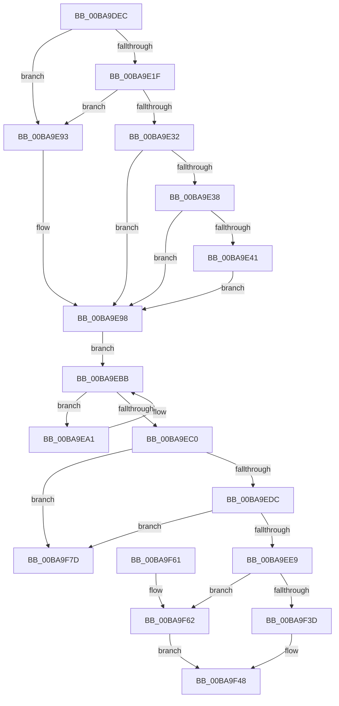

# ViDeadlockRemoveResource

- RVA: `0x00BA9DEC`–`0x00BA9F84` (길이 `408` bytes)
- VA: `0x0000000140BA9DEC`
- 실행 섹션: `PAGEVRFY`
- PDB 이름 있음: `예`; PDB Function 태그: `아니요`
- unwind 정보 RVA: `0x000D2624`
- 디코드: `109`개 명령, `408/408` bytes 표시
- 미해석 바이트: `0` (있으면 어셈블리에 `.byte`로 보존)

> 이 문서는 커널 이미지의 기계어와 PDB 기호를 분석해 생성했습니다. 4번과 5번은 함수 원형과 자료형을 바이너리 사용 방식에서 추정한 C 해석이며 원본 소스 복구 결과는 아닙니다.

## 1. Dependencies

- 직접 호출 지점: **4**; 고유 호출 대상: **4**
- 직접 호출자로 확인된 함수: **3**
- RIP 상대 이미지 참조: **4**

### Outgoing calls
- `0x00BA9E69` → [ViDeadlockPreprocessOptions](ViDeadlockPreprocessOptions_function_00BA9BB4.md) (function, `0x00BA9BB4`)
- `0x00BA9E8A` → [VfReportIssueWithOptions](../../text/61/VfReportIssueWithOptions_function_00614444.md) (function, `0x00614444`)
- `0x00BA9EAD` → [ViDeadlockRemoveNode](ViDeadlockRemoveNode_function_00BA9CB8.md) (function, `0x00BA9CB8`)
- `0x00BA9F76` → [VfUtilAddressRangeRemove](../B9/VfUtilAddressRangeRemove_function_00B9317C.md) (function, `0x00B9317C`)

### Direct callers
- [ViDeadlockRemoveMemoryRangeResources](../../text/61/ViDeadlockRemoveMemoryRangeResources_function_00615FE8.md) at `0x006160B9`
- [ViDeadlockAddResource](ViDeadlockAddResource_function_00BA8870.md) at `0x00BA897B`
- [ViDeadlockEmptyDatabase](ViDeadlockEmptyDatabase_function_00BA922C.md) at `0x00BA929E`

### Static image references
- `0x00BA9E04` → RVA `0x00FFDA00` (`PAGEVRFD`; read)
- `0x00BA9E44` → RVA `0x00E0EA38` (`.data`; read)
- `0x00BA9E4F` → RVA `0x00BBAF10` (` ?? ::JKADOLAD::`string'`; read)
- `0x00BA9F65` → RVA `0x00B8B160` (`ViDeadlockResourceTypeSizeInfo`; read)

## 2. Other-region calls and transfers

- 다른 실행 섹션으로 향하는 call: **1**
  - `0x00BA9E8A` → [VfReportIssueWithOptions](../../text/61/VfReportIssueWithOptions_function_00614444.md) (`PAGEVRFY` → `.text`)
- 별도 외부 분기/꼬리 이동을 확인하지 못했습니다.

## 3. Assembly (complete function range)

```asm
00BA9DEC  4C 8B DC                        mov r11, rsp
00BA9DEF  49 89 5B 08                     mov qword ptr [r11 + 8], rbx
00BA9DF3  49 89 6B 10                     mov qword ptr [r11 + 0x10], rbp
00BA9DF7  49 89 73 18                     mov qword ptr [r11 + 0x18], rsi
00BA9DFB  57                              push rdi
00BA9DFC  41 56                           push r14
00BA9DFE  41 57                           push r15
00BA9E00  48 83 EC 30                     sub rsp, 0x30
00BA9E04  48 8B 05 F5 3B 45 00            mov rax, qword ptr [rip + 0x453bf5]
00BA9E0B  4D 8B F8                        mov r15, r8
00BA9E0E  8B DA                           mov ebx, edx
00BA9E10  48 8B F9                        mov rdi, rcx
00BA9E13  44 8B 88 10 80 00 00            mov r9d, dword ptr [rax + 0x8010]
00BA9E1A  45 85 C9                        test r9d, r9d
00BA9E1D  75 74                           jne 0x140ba9e93
00BA9E1F  48 8B 05 DA 3B 45 00            mov rax, qword ptr [rip + 0x453bda]
00BA9E26  81 B8 68 81 00 00 00 04 00 00   cmp dword ptr [rax + 0x8168], 0x400
00BA9E30  7F 61                           jg 0x140ba9e93
00BA9E32  8B EA                           mov ebp, edx
00BA9E34  85 D2                           test edx, edx
00BA9E36  75 60                           jne 0x140ba9e98
00BA9E38  48 8B 41 10                     mov rax, qword ptr [rcx + 0x10]
00BA9E3C  48 85 C0                        test rax, rax
00BA9E3F  74 57                           je 0x140ba9e98
00BA9E41  48 8B 00                        mov rax, qword ptr [rax]
00BA9E44  48 8D 35 ED 4B 26 00            lea rsi, [rip + 0x264bed]
00BA9E4B  4C 8B 49 08                     mov r9, qword ptr [rcx + 8]
00BA9E4F  48 8D 15 BA 10 01 00            lea rdx, [rip + 0x110ba]
00BA9E56  49 89 4B E0                     mov qword ptr [r11 - 0x20], rcx
00BA9E5A  BD 0B 10 00 00                  mov ebp, 0x100b
00BA9E5F  44 8B C5                        mov r8d, ebp
00BA9E62  49 89 43 D8                     mov qword ptr [r11 - 0x28], rax
00BA9E66  48 8B CE                        mov rcx, rsi
00BA9E69  E8 46 FD FF FF                  call 0x140ba9bb4
00BA9E6E  4C 8B 4F 10                     mov r9, qword ptr [rdi + 0x10]
00BA9E72  8B D5                           mov edx, ebp
00BA9E74  4C 8B 47 08                     mov r8, qword ptr [rdi + 8]
00BA9E78  B9 C4 00 00 00                  mov ecx, 0xc4
00BA9E7D  48 89 74 24 28                  mov qword ptr [rsp + 0x28], rsi
00BA9E82  48 89 7C 24 20                  mov qword ptr [rsp + 0x20], rdi
00BA9E87  4D 8B 09                        mov r9, qword ptr [r9]
00BA9E8A  E8 B5 A5 A6 FF                  call 0x140614444
00BA9E8F  8B EB                           mov ebp, ebx
00BA9E91  EB 05                           jmp 0x140ba9e98
00BA9E93  BD 01 00 00 00                  mov ebp, 1
00BA9E98  4C 8D 77 18                     lea r14, [rdi + 0x18]
00BA9E9C  49 8B 36                        mov rsi, qword ptr [r14]
00BA9E9F  EB 1A                           jmp 0x140ba9ebb
00BA9EA1  48 8D 5E D8                     lea rbx, [rsi - 0x28]
00BA9EA5  8B D5                           mov edx, ebp
00BA9EA7  48 8B 36                        mov rsi, qword ptr [rsi]
00BA9EAA  48 8B CB                        mov rcx, rbx
00BA9EAD  E8 06 FE FF FF                  call 0x140ba9cb8
00BA9EB2  49 8B 07                        mov rax, qword ptr [r15]
00BA9EB5  48 89 03                        mov qword ptr [rbx], rax
00BA9EB8  49 89 1F                        mov qword ptr [r15], rbx
00BA9EBB  49 3B F6                        cmp rsi, r14
00BA9EBE  75 E1                           jne 0x140ba9ea1
00BA9EC0  4C 8B 0D 39 3B 45 00            mov r9, qword ptr [rip + 0x453b39]
00BA9EC7  48 8D 47 28                     lea rax, [rdi + 0x28]
00BA9ECB  49 FF 49 18                     dec qword ptr [r9 + 0x18]
00BA9ECF  48 8B 10                        mov rdx, qword ptr [rax]
00BA9ED2  48 39 42 08                     cmp qword ptr [rdx + 8], rax
00BA9ED6  0F 85 A1 00 00 00               jne 0x140ba9f7d
00BA9EDC  48 8B 48 08                     mov rcx, qword ptr [rax + 8]
00BA9EE0  48 39 01                        cmp qword ptr [rcx], rax
00BA9EE3  0F 85 94 00 00 00               jne 0x140ba9f7d
00BA9EE9  48 89 11                        mov qword ptr [rcx], rdx
00BA9EEC  48 B8 11 40 00 01 04 10 40 00   movabs rax, 0x40100401004011
00BA9EF6  48 89 4A 08                     mov qword ptr [rdx + 8], rcx
00BA9EFA  4C 8B 57 08                     mov r10, qword ptr [rdi + 8]
00BA9EFE  4D 8B C2                        mov r8, r10
00BA9F01  49 C1 E8 0C                     shr r8, 0xc
00BA9F05  49 F7 E0                        mul r8
00BA9F08  49 8B C0                        mov rax, r8
00BA9F0B  48 2B C2                        sub rax, rdx
00BA9F0E  48 D1 E8                        shr rax, 1
00BA9F11  48 03 C2                        add rax, rdx
00BA9F14  49 8B 51 10                     mov rdx, qword ptr [r9 + 0x10]
00BA9F18  48 C1 E8 09                     shr rax, 9
00BA9F1C  48 69 C0 FF 03 00 00            imul rax, rax, 0x3ff
00BA9F23  4C 2B C0                        sub r8, rax
00BA9F26  49 8B C8                        mov rcx, r8
00BA9F29  48 C1 E1 04                     shl rcx, 4
00BA9F2D  48 03 D1                        add rdx, rcx
00BA9F30  49 8D 48 02                     lea rcx, [r8 + 2]
00BA9F34  48 C1 E1 04                     shl rcx, 4
00BA9F38  48 39 12                        cmp qword ptr [rdx], rdx
00BA9F3B  75 25                           jne 0x140ba9f62
00BA9F3D  4A 83 24 09 00                  and qword ptr [rcx + r9], 0
00BA9F42  4A 83 64 09 08 00               and qword ptr [rcx + r9 + 8], 0
00BA9F48  48 8B 5C 24 50                  mov rbx, qword ptr [rsp + 0x50]
00BA9F4D  48 8B 6C 24 58                  mov rbp, qword ptr [rsp + 0x58]
00BA9F52  48 8B 74 24 60                  mov rsi, qword ptr [rsp + 0x60]
00BA9F57  48 83 C4 30                     add rsp, 0x30
00BA9F5B  41 5F                           pop r15
00BA9F5D  41 5E                           pop r14
00BA9F5F  5F                              pop rdi
00BA9F60  C3                              ret
00BA9F61  CC                              int3
00BA9F62  48 63 07                        movsxd rax, dword ptr [rdi]
00BA9F65  48 8D 15 F4 11 FE FF            lea rdx, [rip - 0x1ee0c]
00BA9F6C  49 03 C9                        add rcx, r9
00BA9F6F  44 8B 04 82                     mov r8d, dword ptr [rdx + rax*4]
00BA9F73  49 8B D2                        mov rdx, r10
00BA9F76  E8 01 92 FE FF                  call 0x140b9317c
00BA9F7B  EB CB                           jmp 0x140ba9f48
00BA9F7D  B9 03 00 00 00                  mov ecx, 3
00BA9F82  CD 29                           int 0x29
```

## 4. C-style interpretation (structured pseudocode)

```c
__int64 __fastcall ViDeadlockRemoveResource(__int64 a1, int a2, __int64 a3)
{
    __int64 result;
    __int64 v_rsp;
    unsigned __int64 v_stack_m20;
    unsigned __int64 v_stack_m28;
    unsigned __int64 v_stack_p10;
    unsigned __int64 v_stack_p18;
    unsigned __int64 v_stack_p8;

    *(unsigned __int64 *)(v_rsp + 8) = v_rbx;
    *(unsigned __int64 *)(v_rsp + 16) = v_rbp;
    *(unsigned __int64 *)(v_rsp + 24) = v_rsi;
    v_rsp = (v_rsp) - (48);
    if ((unsigned int)((unsigned int)(*(unsigned int *)(*(unsigned __int64 *)(v_rip + 4537333) + 32784))) != 0) goto loc_00BA9E93;
    if ((*(unsigned int *)(*(unsigned __int64 *)(v_rip + 4537306) + 33128)) > 0x400ULL) goto loc_00BA9E93;
    if (a2 != 0) goto loc_00BA9E98;
    if (*(unsigned __int64 *)(a1 + 16) == 0) goto loc_00BA9E98;
    *(unsigned __int64 *)(v_rsp - 32) = a1;
    *(unsigned __int64 *)(v_rsp - 40) = *(unsigned __int64 *)(*(unsigned __int64 *)(a1 + 16));
    result = ViDeadlockPreprocessOptions(v_rip + 2509805, v_rip + 69818, (unsigned int)((unsigned int)((unsigned int)(0x100BULL))), *(unsigned __int64 *)(a1 + 8));
    v_stack_m20 = v_rip + 2509805;
    v_stack_m28 = a1;
    result = VfReportIssueWithOptions(196, (unsigned int)((unsigned int)((unsigned int)(0x100BULL))), *(unsigned __int64 *)(a1 + 8), *(unsigned __int64 *)(*(unsigned __int64 *)(a1 + 16)));
    goto loc_00BA9E98;
loc_00BA9E93:
loc_00BA9E98:
    goto loc_00BA9EBB;
loc_00BA9EA1:
    result = ViDeadlockRemoveNode(*(unsigned __int64 *)(a1 + 24) - 40, 1, *(unsigned __int64 *)(a1 + 8), *(unsigned __int64 *)(*(unsigned __int64 *)(a1 + 16)));
    *(unsigned __int64 *)(*(unsigned __int64 *)(a1 + 24) - 40) = *(unsigned __int64 *)(a3);
    *(unsigned __int64 *)(a3) = *(unsigned __int64 *)(a1 + 24) - 40;
loc_00BA9EBB:
    if ((*(unsigned __int64 *)(*(unsigned __int64 *)(a1 + 24))) != (a1 + 24)) goto loc_00BA9EA1;
    if ((*(unsigned __int64 *)(*(unsigned __int64 *)(a1 + 40) + 8)) != (a1 + 40)) goto loc_00BA9F7D;
    if ((*(unsigned __int64 *)(*(unsigned __int64 *)(a1 + 40 + 8))) != (a1 + 40)) goto loc_00BA9F7D;
    *(unsigned __int64 *)(*(unsigned __int64 *)(a1 + 40 + 8)) = *(unsigned __int64 *)(a1 + 40);
    *(unsigned __int64 *)(*(unsigned __int64 *)(a1 + 40) + 8) = *(unsigned __int64 *)(a1 + 40 + 8);
    a3 = (*(unsigned __int64 *)(a1 + 8)) >> (12);
    result = (a3) - (*(unsigned __int64 *)(a1 + 40));
    result = (result) >> (1);
    result = (result) + (*(unsigned __int64 *)(a1 + 40));
    result = (result) >> (9);
    result = (result) * (result);
    a3 = (a3) - (result);
    a1 = (a3) << (4);
    a2 = (*(unsigned __int64 *)(*(unsigned __int64 *)(v_rip + 4537145) + 16)) + (a1);
    a1 = (a3 + 2) << (4);
    if ((*(unsigned __int64 *)(a2)) != a2) goto loc_00BA9F62;
loc_00BA9F48:
    v_rsp = (v_rsp) + (48);
    return result;
loc_00BA9F62:
    a1 = (a1) + (*(unsigned __int64 *)(v_rip + 4537145));
    result = VfUtilAddressRangeRemove(a1, *(unsigned __int64 *)(a1 + 8), (unsigned int)(*(unsigned int *)(v_rip - 126476 + (int)(*(unsigned int *)(a1)) * 4)), *(unsigned __int64 *)(v_rip + 4537145));
    goto loc_00BA9F48;
loc_00BA9F7D:
    return result;
}
```

## 5. (Beta) C Style

```c
int64_t ViDeadlockRemoveResource(void *Arg1, int32_t Arg2, void *Arg3)
{
    uint8_t *arg1 = (uint8_t *)Arg1;
    uint8_t *arg3 = (uint8_t *)Arg3;

    int64_t result;
    int64_t local_rsp;
    uint64_t v_stack_m20;
    uint64_t v_stack_m28;
    uint64_t v_stack_p10;
    uint64_t v_stack_p18;
    uint64_t v_stack_p8;

    *(uint64_t *)(local_rsp + 0x8) = local_rbx;
    *(uint64_t *)(local_rsp + 0x10) = local_rbp;
    *(uint64_t *)(local_rsp + 0x18) = local_rsi;
    local_rsp = (local_rsp) - (48);
    if ((uint32_t)((uint32_t)(*(uint32_t *)(*(uint64_t *)(v_rip + 0x453BF5) + 0x8010))) != 0) goto loc_00BA9E93;
    if ((*(uint32_t *)(*(uint64_t *)(v_rip + 0x453BDA) + 0x8168)) > 0x400ULL) goto loc_00BA9E93;
    if (Arg2 != 0) goto loc_00BA9E98;
    if (*(uint64_t *)(arg1 + 0x10) == 0) goto loc_00BA9E98;
    *(void **)(local_rsp - 0x20) = Arg1;
    *(uint64_t *)(local_rsp - 0x28) = *(uint64_t *)(*(uint64_t *)(arg1 + 0x10));
    result = ViDeadlockPreprocessOptions(v_rip + 2509805, v_rip + 69818, (uint32_t)((uint32_t)((uint32_t)(0x100BULL))), *(uint64_t *)(arg1 + 0x8));
    v_stack_m20 = v_rip + 2509805;
    v_stack_m28 = Arg1;
    result = VfReportIssueWithOptions(196, (uint32_t)((uint32_t)((uint32_t)(0x100BULL))), *(uint64_t *)(arg1 + 0x8), *(uint64_t *)(*(uint64_t *)(arg1 + 0x10)));
    goto loc_00BA9E98;
loc_00BA9E93:
loc_00BA9E98:
    goto loc_00BA9EBB;
loc_00BA9EA1:
    result = ViDeadlockRemoveNode(*(uint64_t *)(arg1 + 0x18) - 40, 1, *(uint64_t *)(arg1 + 0x8), *(uint64_t *)(*(uint64_t *)(arg1 + 0x10)));
    *(uint64_t *)(*(uint64_t *)(arg1 + 0x18) - 0x28) = *(uint64_t *)(arg3);
    *(uint64_t *)(arg3) = *(uint64_t *)(arg1 + 0x18) - 40;
loc_00BA9EBB:
    if ((*(uint64_t *)(*(uint64_t *)(arg1 + 0x18))) != (Arg1 + 24)) goto loc_00BA9EA1;
    if ((*(uint64_t *)(*(uint64_t *)(arg1 + 0x28) + 0x8)) != (Arg1 + 40)) goto loc_00BA9F7D;
    if ((*(uint64_t *)(*(uint64_t *)(arg1 + 0x28 + 0x8))) != (Arg1 + 40)) goto loc_00BA9F7D;
    *(uint64_t *)(*(uint64_t *)(arg1 + 0x28 + 0x8)) = *(uint64_t *)(arg1 + 0x28);
    *(uint64_t *)(*(uint64_t *)(arg1 + 0x28) + 0x8) = *(uint64_t *)(arg1 + 0x28 + 0x8);
    Arg3 = (*(uint64_t *)(arg1 + 0x8)) >> (12);
    result = (Arg3) - (*(uint64_t *)(arg1 + 0x28));
    result = (result) >> (1);
    result = (result) + (*(uint64_t *)(arg1 + 0x28));
    result = (result) >> (9);
    result = (result) * (result);
    Arg3 = (Arg3) - (result);
    Arg1 = (Arg3) << (4);
    Arg2 = (*(uint64_t *)(*(uint64_t *)(v_rip + 0x453B39) + 0x10)) + (Arg1);
    Arg1 = (Arg3 + 2) << (4);
    if ((*(uint64_t *)(Arg2)) != Arg2) goto loc_00BA9F62;
loc_00BA9F48:
    local_rsp = (local_rsp) + (48);
    return result;
loc_00BA9F62:
    Arg1 = (Arg1) + (*(uint64_t *)(v_rip + 0x453B39));
    result = VfUtilAddressRangeRemove(Arg1, *(uint64_t *)(arg1 + 0x8), (uint32_t)(*(uint32_t *)(v_rip - 0x1EE0C + (int32_t)(*(uint32_t *)(arg1)) * 4)), *(uint64_t *)(v_rip + 0x453B39));
    goto loc_00BA9F48;
loc_00BA9F7D:
    return result;
}
```

### 관측된 메모리 오프셋

구조체 형식이 확인되지 않은 접근은 인자 기준의 오프셋으로만 기록했습니다.

| 기준 인자 | 오프셋 표현 | 폭 (bit) | 접근 |
|---|---:|---:|---|
| `Arg1` | `+ 0x0` | `32` | `R` |
| `Arg1` | `+ 0x0` | `64` | `R` |
| `Arg1` | `+ 0x8` | `64` | `R` |
| `Arg1` | `+ 0x10` | `64` | `R` |
| `Arg1` | `+ 0x18` | `64` | `R` |
| `Arg1` | `+ 0x28` | `64` | `R` |
| `Arg3` | `+ 0x0` | `64` | `R` |
| `Arg3` | `+ 0x0` | `64` | `W` |

## 6. Execution-region graph

[열기: 2D/3D 그래프와 함수 탐색 컨트롤 패널](../../../control-panel.html?section=pagevrfy&rva=0x00BA9DEC&view=graph)

- 2D 그래프는 위에서 아래로 흐르고, 3D 그래프는 빈 공간을 드래그해 회전합니다. Shift+드래그는 이동, 휠은 확대·축소, 함수 노드 선택은 대상 보고서 이동입니다.

### Static fallback


