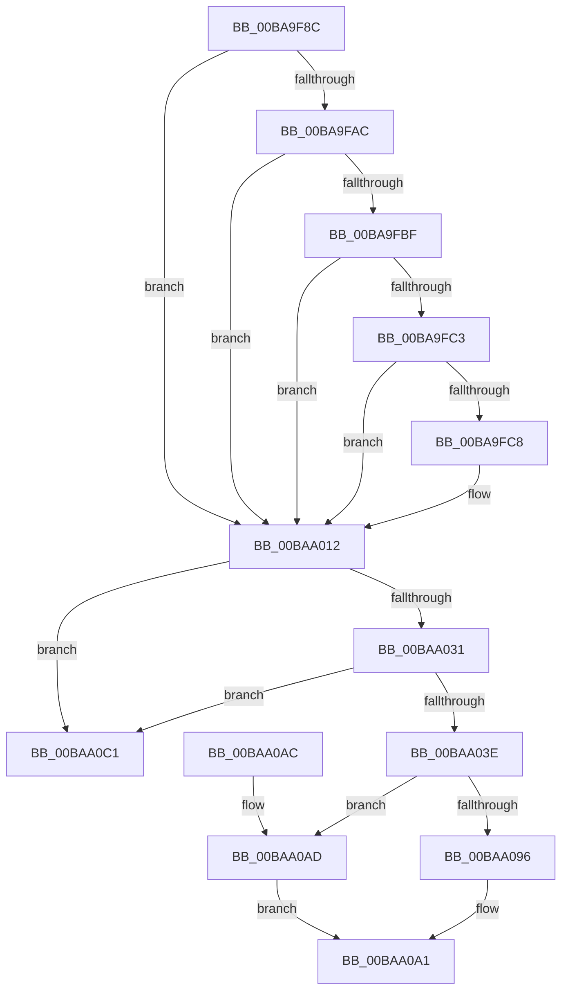

# ViDeadlockRemoveThread

- RVA: `0x00BA9F8C`–`0x00BAA0C8` (길이 `316` bytes)
- VA: `0x0000000140BA9F8C`
- 실행 섹션: `PAGEVRFY`
- PDB 이름 있음: `예`; PDB Function 태그: `아니요`
- unwind 정보 RVA: `0x0007DDD4`
- 디코드: `75`개 명령, `316/316` bytes 표시
- 미해석 바이트: `0` (있으면 어셈블리에 `.byte`로 보존)

> 이 문서는 커널 이미지의 기계어와 PDB 기호를 분석해 생성했습니다. 4번과 5번은 함수 원형과 자료형을 바이너리 사용 방식에서 추정한 C 해석이며 원본 소스 복구 결과는 아닙니다.

## 1. Dependencies

- 직접 호출 지점: **3**; 고유 호출 대상: **3**
- 직접 호출자로 확인된 함수: **4**
- RIP 상대 이미지 참조: **3**

### Outgoing calls
- `0x00BA9FED` → [ViDeadlockPreprocessOptions](ViDeadlockPreprocessOptions_function_00BA9BB4.md) (function, `0x00BA9BB4`)
- `0x00BAA00D` → [VfReportIssueWithOptions](../../text/61/VfReportIssueWithOptions_function_00614444.md) (function, `0x00614444`)
- `0x00BAA0BA` → [VfUtilAddressRangeRemove](../B9/VfUtilAddressRangeRemove_function_00B9317C.md) (function, `0x00B9317C`)

### Direct callers
- [ViDeadlockRemoveMemoryRangeThreads](../../text/61/ViDeadlockRemoveMemoryRangeThreads_function_00616148.md) at `0x00616211`
- [ViDeadlockEmptyDatabase](ViDeadlockEmptyDatabase_function_00BA922C.md) at `0x00BA92F8`
- [VfDeadlockReleaseResource](../BB/VfDeadlockReleaseResource_function_00BB759C.md) at `0x00BB798D`
- [VfDeadlockAcquireResource](../BB/VfDeadlockAcquireResource_function_00BB83B4.md) at `0x00BB864F`

### Static image references
- `0x00BA9F96` → RVA `0x00FFDA00` (`PAGEVRFD`; read)
- `0x00BA9FCB` → RVA `0x00E0EA30` (`.data`; read)
- `0x00BA9FD8` → RVA `0x00BBAFF0` (` ?? ::JKADOLAD::`string'`; read)

## 2. Other-region calls and transfers

- 다른 실행 섹션으로 향하는 call: **1**
  - `0x00BAA00D` → [VfReportIssueWithOptions](../../text/61/VfReportIssueWithOptions_function_00614444.md) (`PAGEVRFY` → `.text`)
- 별도 외부 분기/꼬리 이동을 확인하지 못했습니다.

## 3. Assembly (complete function range)

```asm
00BA9F8C  48 89 5C 24 08                  mov qword ptr [rsp + 8], rbx
00BA9F91  57                              push rdi
00BA9F92  48 83 EC 30                     sub rsp, 0x30
00BA9F96  48 8B 05 63 3A 45 00            mov rax, qword ptr [rip + 0x453a63]
00BA9F9D  48 8B D9                        mov rbx, rcx
00BA9FA0  44 8B 80 10 80 00 00            mov r8d, dword ptr [rax + 0x8010]
00BA9FA7  45 85 C0                        test r8d, r8d
00BA9FAA  75 66                           jne 0x140baa012
00BA9FAC  48 8B 05 4D 3A 45 00            mov rax, qword ptr [rip + 0x453a4d]
00BA9FB3  81 B8 68 81 00 00 00 04 00 00   cmp dword ptr [rax + 0x8168], 0x400
00BA9FBD  7F 53                           jg 0x140baa012
00BA9FBF  85 D2                           test edx, edx
00BA9FC1  75 4F                           jne 0x140baa012
00BA9FC3  39 51 28                        cmp dword ptr [rcx + 0x28], edx
00BA9FC6  74 4A                           je 0x140baa012
00BA9FC8  4C 8B 09                        mov r9, qword ptr [rcx]
00BA9FCB  48 8D 3D 5E 4A 26 00            lea rdi, [rip + 0x264a5e]
00BA9FD2  48 83 64 24 28 00               and qword ptr [rsp + 0x28], 0
00BA9FD8  48 8D 15 11 10 01 00            lea rdx, [rip + 0x11011]
00BA9FDF  48 89 4C 24 20                  mov qword ptr [rsp + 0x20], rcx
00BA9FE4  41 B8 0A 10 00 00               mov r8d, 0x100a
00BA9FEA  48 8B CF                        mov rcx, rdi
00BA9FED  E8 C2 FB FF FF                  call 0x140ba9bb4
00BA9FF2  4C 8B 03                        mov r8, qword ptr [rbx]
00BA9FF5  4C 8B CB                        mov r9, rbx
00BA9FF8  48 89 7C 24 28                  mov qword ptr [rsp + 0x28], rdi
00BA9FFD  BA 0A 10 00 00                  mov edx, 0x100a
00BAA002  48 83 64 24 20 00               and qword ptr [rsp + 0x20], 0
00BAA008  B9 C4 00 00 00                  mov ecx, 0xc4
00BAA00D  E8 32 A4 A6 FF                  call 0x140614444
00BAA012  4C 8B 0D E7 39 45 00            mov r9, qword ptr [rip + 0x4539e7]
00BAA019  48 8D 43 18                     lea rax, [rbx + 0x18]
00BAA01D  49 FF 89 18 40 00 00            dec qword ptr [r9 + 0x4018]
00BAA024  48 8B 10                        mov rdx, qword ptr [rax]
00BAA027  48 39 42 08                     cmp qword ptr [rdx + 8], rax
00BAA02B  0F 85 90 00 00 00               jne 0x140baa0c1
00BAA031  48 8B 48 08                     mov rcx, qword ptr [rax + 8]
00BAA035  48 39 01                        cmp qword ptr [rcx], rax
00BAA038  0F 85 83 00 00 00               jne 0x140baa0c1
00BAA03E  48 89 11                        mov qword ptr [rcx], rdx
00BAA041  48 B8 11 40 00 01 04 10 40 00   movabs rax, 0x40100401004011
00BAA04B  48 89 4A 08                     mov qword ptr [rdx + 8], rcx
00BAA04F  4C 8B 13                        mov r10, qword ptr [rbx]
00BAA052  4D 8B C2                        mov r8, r10
00BAA055  49 C1 E8 0C                     shr r8, 0xc
00BAA059  49 F7 E0                        mul r8
00BAA05C  49 8B C0                        mov rax, r8
00BAA05F  48 2B C2                        sub rax, rdx
00BAA062  48 D1 E8                        shr rax, 1
00BAA065  48 03 C2                        add rax, rdx
00BAA068  49 8B 91 10 40 00 00            mov rdx, qword ptr [r9 + 0x4010]
00BAA06F  48 C1 E8 09                     shr rax, 9
00BAA073  48 69 C0 FF 03 00 00            imul rax, rax, 0x3ff
00BAA07A  4C 2B C0                        sub r8, rax
00BAA07D  49 8B C8                        mov rcx, r8
00BAA080  49 81 C0 02 04 00 00            add r8, 0x402
00BAA087  48 C1 E1 04                     shl rcx, 4
00BAA08B  4D 03 C0                        add r8, r8
00BAA08E  48 03 D1                        add rdx, rcx
00BAA091  48 39 12                        cmp qword ptr [rdx], rdx
00BAA094  75 17                           jne 0x140baa0ad
00BAA096  4B 83 24 C1 00                  and qword ptr [r9 + r8*8], 0
00BAA09B  4B 83 64 C1 08 00               and qword ptr [r9 + r8*8 + 8], 0
00BAA0A1  48 8B 5C 24 40                  mov rbx, qword ptr [rsp + 0x40]
00BAA0A6  48 83 C4 30                     add rsp, 0x30
00BAA0AA  5F                              pop rdi
00BAA0AB  C3                              ret
00BAA0AC  CC                              int3
00BAA0AD  4B 8D 0C C1                     lea rcx, [r9 + r8*8]
00BAA0B1  49 8B D2                        mov rdx, r10
00BAA0B4  41 B8 98 07 00 00               mov r8d, 0x798
00BAA0BA  E8 BD 90 FE FF                  call 0x140b9317c
00BAA0BF  EB E0                           jmp 0x140baa0a1
00BAA0C1  B9 03 00 00 00                  mov ecx, 3
00BAA0C6  CD 29                           int 0x29
```

## 4. C-style interpretation (structured pseudocode)

```c
__int64 __fastcall ViDeadlockRemoveThread(__int64 a1, int a2)
{
    __int64 result;
    __int64 v_rdi;
    __int64 v_rsp;
    unsigned __int64 v_stack_m10;
    unsigned __int64 v_stack_m18;
    unsigned __int64 v_stack_p8;

    v_stack_p8 = v_rbx;
    v_rsp = (v_rsp) - (48);
    if ((unsigned int)((unsigned int)(*(unsigned int *)(*(unsigned __int64 *)(v_rip + 4536931) + 32784))) != 0) goto loc_00BAA012;
    if ((*(unsigned int *)(*(unsigned __int64 *)(v_rip + 4536909) + 33128)) > 0x400ULL) goto loc_00BAA012;
    if (a2 != 0) goto loc_00BAA012;
    result = *(unsigned __int64 *)(v_rip + 4536909);
    if ((*(unsigned int *)(a1 + 40)) != a2) {
        a4 = *(unsigned __int64 *)(a1);
        v_rdi = v_rip + 2509406;
        a2 = v_rip + 69649;
        v_stack_m18 = a1;
        a3 = 0x100AULL;
        a1 = v_rdi;
        result = ViDeadlockPreprocessOptions(a1, a2, a3, a4);
        a3 = *(unsigned __int64 *)(a1);
        a4 = a1;
        v_stack_m10 = v_rdi;
        a2 = 0x100AULL;
        a1 = 196;
        result = VfReportIssueWithOptions(a1, a2, a3, a4);
    }
    if ((*(unsigned __int64 *)(*(unsigned __int64 *)(a1 + 24) + 8)) != (a1 + 24)) goto loc_00BAA0C1;
    if ((*(unsigned __int64 *)(*(unsigned __int64 *)(a1 + 24 + 8))) != (a1 + 24)) goto loc_00BAA0C1;
    *(unsigned __int64 *)(*(unsigned __int64 *)(a1 + 24 + 8)) = *(unsigned __int64 *)(a1 + 24);
    *(unsigned __int64 *)(*(unsigned __int64 *)(a1 + 24) + 8) = *(unsigned __int64 *)(a1 + 24 + 8);
    a3 = (*(unsigned __int64 *)(a1)) >> (12);
    result = (a3) - (*(unsigned __int64 *)(a1 + 24));
    result = (result) >> (1);
    result = (result) + (*(unsigned __int64 *)(a1 + 24));
    result = (result) >> (9);
    result = (result) * (result);
    a3 = (a3) - (result);
    a3 = (a3) + (0x402ULL);
    a1 = (a3) << (4);
    a3 = (a3) + (a3);
    a2 = (*(unsigned __int64 *)(*(unsigned __int64 *)(v_rip + 4536807) + 16400)) + (a1);
    if ((*(unsigned __int64 *)(a2)) != a2) goto loc_00BAA0AD;
loc_00BAA0A1:
    v_rsp = (v_rsp) + (48);
    return result;
loc_00BAA0AD:
    result = VfUtilAddressRangeRemove(*(unsigned __int64 *)(v_rip + 4536807) + a3 * 8, *(unsigned __int64 *)(a1), (unsigned int)(0x798ULL), *(unsigned __int64 *)(v_rip + 4536807));
    goto loc_00BAA0A1;
loc_00BAA0C1:
    return result;
}
```

## 5. (Beta) C Style

```c
int64_t ViDeadlockRemoveThread(void *Arg1, int32_t Arg2)
{
    uint8_t *arg1 = (uint8_t *)Arg1;

    int64_t result;
    int64_t local_rdi;
    int64_t local_rsp;
    uint64_t v_stack_m10;
    uint64_t v_stack_m18;
    uint64_t v_stack_p8;

    v_stack_p8 = local_rbx;
    local_rsp = (local_rsp) - (48);
    if ((uint32_t)((uint32_t)(*(uint32_t *)(*(uint64_t *)(v_rip + 0x453A63) + 0x8010))) != 0) goto loc_00BAA012;
    if ((*(uint32_t *)(*(uint64_t *)(v_rip + 0x453A4D) + 0x8168)) > 0x400ULL) goto loc_00BAA012;
    if (Arg2 != 0) goto loc_00BAA012;
    result = *(uint64_t *)(v_rip + 0x453A4D);
    if ((*(uint32_t *)(arg1 + 0x28)) != Arg2) {
        a4 = *(uint64_t *)(arg1);
        local_rdi = v_rip + 2509406;
        Arg2 = v_rip + 69649;
        v_stack_m18 = Arg1;
        a3 = 0x100AULL;
        Arg1 = local_rdi;
        result = ViDeadlockPreprocessOptions(Arg1, Arg2, a3, a4);
        a3 = *(uint64_t *)(arg1);
        a4 = Arg1;
        v_stack_m10 = local_rdi;
        Arg2 = 0x100AULL;
        Arg1 = 196;
        result = VfReportIssueWithOptions(Arg1, Arg2, a3, a4);
    }
    if ((*(uint64_t *)(*(uint64_t *)(arg1 + 0x18) + 0x8)) != (Arg1 + 24)) goto loc_00BAA0C1;
    if ((*(uint64_t *)(*(uint64_t *)(arg1 + 0x18 + 0x8))) != (Arg1 + 24)) goto loc_00BAA0C1;
    *(uint64_t *)(*(uint64_t *)(arg1 + 0x18 + 0x8)) = *(uint64_t *)(arg1 + 0x18);
    *(uint64_t *)(*(uint64_t *)(arg1 + 0x18) + 0x8) = *(uint64_t *)(arg1 + 0x18 + 0x8);
    a3 = (*(uint64_t *)(arg1)) >> (12);
    result = (a3) - (*(uint64_t *)(arg1 + 0x18));
    result = (result) >> (1);
    result = (result) + (*(uint64_t *)(arg1 + 0x18));
    result = (result) >> (9);
    result = (result) * (result);
    a3 = (a3) - (result);
    a3 = (a3) + (0x402ULL);
    Arg1 = (a3) << (4);
    a3 = (a3) + (a3);
    Arg2 = (*(uint64_t *)(*(uint64_t *)(v_rip + 0x4539E7) + 0x4010)) + (Arg1);
    if ((*(uint64_t *)(Arg2)) != Arg2) goto loc_00BAA0AD;
loc_00BAA0A1:
    local_rsp = (local_rsp) + (48);
    return result;
loc_00BAA0AD:
    result = VfUtilAddressRangeRemove(*(uint64_t *)(v_rip + 0x4539E7) + a3 * 8, *(uint64_t *)(arg1), (uint32_t)(0x798ULL), *(uint64_t *)(v_rip + 0x4539E7));
    goto loc_00BAA0A1;
loc_00BAA0C1:
    return result;
}
```

### 관측된 메모리 오프셋

구조체 형식이 확인되지 않은 접근은 인자 기준의 오프셋으로만 기록했습니다.

| 기준 인자 | 오프셋 표현 | 폭 (bit) | 접근 |
|---|---:|---:|---|
| `Arg1` | `+ 0x0` | `64` | `R` |
| `Arg1` | `+ 0x8` | `64` | `R` |
| `Arg1` | `+ 0x18` | `64` | `R` |
| `Arg1` | `+ 0x28` | `32` | `R` |

## 6. Execution-region graph

[열기: 2D/3D 그래프와 함수 탐색 컨트롤 패널](../../../control-panel.html?section=pagevrfy&rva=0x00BA9F8C&view=graph)

- 2D 그래프는 위에서 아래로 흐르고, 3D 그래프는 빈 공간을 드래그해 회전합니다. Shift+드래그는 이동, 휠은 확대·축소, 함수 노드 선택은 대상 보고서 이동입니다.

### Static fallback


