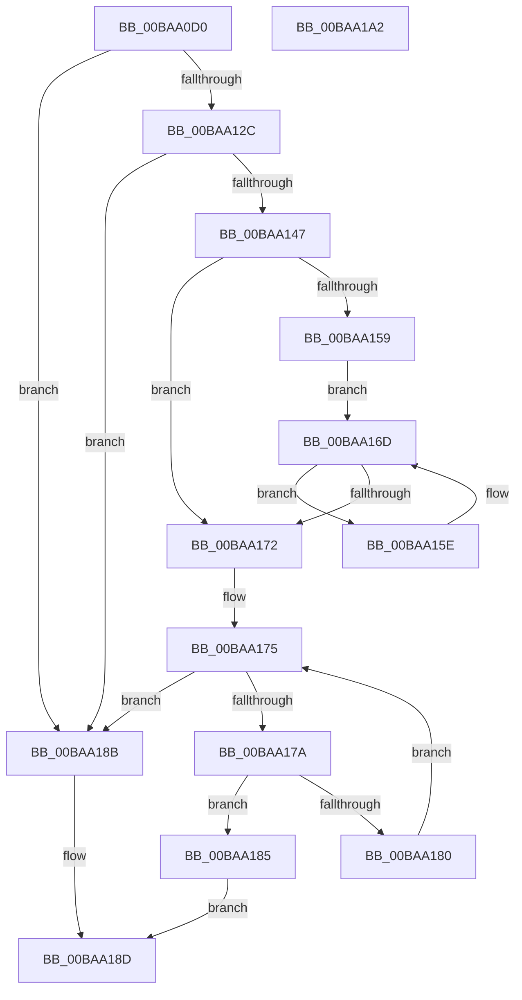

# ViDeadlockSearchResource

- RVA: `0x00BAA0D0`–`0x00BAA1A3` (길이 `211` bytes)
- VA: `0x0000000140BAA0D0`
- 실행 섹션: `PAGEVRFY`
- PDB 이름 있음: `예`; PDB Function 태그: `아니요`
- unwind 정보 RVA: `0x0005C954`
- 디코드: `60`개 명령, `211/211` bytes 표시
- 미해석 바이트: `0` (있으면 어셈블리에 `.byte`로 보존)

> 이 문서는 커널 이미지의 기계어와 PDB 기호를 분석해 생성했습니다. 4번과 5번은 함수 원형과 자료형을 바이너리 사용 방식에서 추정한 C 해석이며 원본 소스 복구 결과는 아닙니다.

## 1. Dependencies

- 직접 호출 지점: **2**; 고유 호출 대상: **2**
- 직접 호출자로 확인된 함수: **3**
- RIP 상대 이미지 참조: **1**

### Outgoing calls
- `0x00BAA13E` → [VfUtilAddressRangeFit](../B9/VfUtilAddressRangeFit_function_00B93138.md) (function, `0x00B93138`)
- `0x00BAA168` → [ViDeadlockForgetResourceHistory](ViDeadlockForgetResourceHistory_function_00BA955C.md) (function, `0x00BA955C`)

### Direct callers
- [ViDeadlockAddResource](ViDeadlockAddResource_function_00BA8870.md) at `0x00BA88A9`
- [VfDeadlockReleaseResource](../BB/VfDeadlockReleaseResource_function_00BB759C.md) at `0x00BB76A9`
- [VfDeadlockAcquireResource](../BB/VfDeadlockAcquireResource_function_00BB83B4.md) at `0x00BB85AC`
- [VfDeadlockAcquireResource](../BB/VfDeadlockAcquireResource_function_00BB83B4.md) at `0x00BB85F7`

### Static image references
- `0x00BAA0E4` → RVA `0x00FFDA00` (`PAGEVRFD`; read)

## 2. Other-region calls and transfers

- 다른 실행 섹션으로 향하는 call: **0**
- 별도 외부 분기/꼬리 이동을 확인하지 못했습니다.

## 3. Assembly (complete function range)

```asm
00BAA0D0  48 89 5C 24 08                  mov qword ptr [rsp + 8], rbx
00BAA0D5  48 89 6C 24 10                  mov qword ptr [rsp + 0x10], rbp
00BAA0DA  48 89 74 24 18                  mov qword ptr [rsp + 0x18], rsi
00BAA0DF  57                              push rdi
00BAA0E0  48 83 EC 20                     sub rsp, 0x20
00BAA0E4  4C 8B 1D 15 39 45 00            mov r11, qword ptr [rip + 0x453915]
00BAA0EB  48 8B F1                        mov rsi, rcx
00BAA0EE  48 C1 E9 0C                     shr rcx, 0xc
00BAA0F2  48 B8 11 40 00 01 04 10 40 00   movabs rax, 0x40100401004011
00BAA0FC  48 8B EA                        mov rbp, rdx
00BAA0FF  48 F7 E1                        mul rcx
00BAA102  48 8B C1                        mov rax, rcx
00BAA105  48 2B C2                        sub rax, rdx
00BAA108  48 D1 E8                        shr rax, 1
00BAA10B  48 03 C2                        add rax, rdx
00BAA10E  48 C1 E8 09                     shr rax, 9
00BAA112  48 69 C0 FF 03 00 00            imul rax, rax, 0x3ff
00BAA119  48 2B C8                        sub rcx, rax
00BAA11C  48 8B D9                        mov rbx, rcx
00BAA11F  48 C1 E3 04                     shl rbx, 4
00BAA123  49 03 5B 10                     add rbx, qword ptr [r11 + 0x10]
00BAA127  48 39 1B                        cmp qword ptr [rbx], rbx
00BAA12A  74 5F                           je 0x140baa18b
00BAA12C  48 83 C1 02                     add rcx, 2
00BAA130  4C 8D 46 01                     lea r8, [rsi + 1]
00BAA134  48 C1 E1 04                     shl rcx, 4
00BAA138  48 8B D6                        mov rdx, rsi
00BAA13B  49 03 CB                        add rcx, r11
00BAA13E  E8 F5 8F FE FF                  call 0x140b93138
00BAA143  85 C0                           test eax, eax
00BAA145  74 44                           je 0x140baa18b
00BAA147  41 FF 83 50 80 00 00            inc dword ptr [r11 + 0x8050]
00BAA14E  41 8B 83 50 80 00 00            mov eax, dword ptr [r11 + 0x8050]
00BAA155  A8 0F                           test al, 0xf
00BAA157  75 19                           jne 0x140baa172
00BAA159  48 8B 3B                        mov rdi, qword ptr [rbx]
00BAA15C  EB 0F                           jmp 0x140baa16d
00BAA15E  48 8D 4F D8                     lea rcx, [rdi - 0x28]
00BAA162  4C 8B CD                        mov r9, rbp
00BAA165  48 8B 3F                        mov rdi, qword ptr [rdi]
00BAA168  E8 EF F3 FF FF                  call 0x140ba955c
00BAA16D  48 3B FB                        cmp rdi, rbx
00BAA170  75 EC                           jne 0x140baa15e
00BAA172  48 8B 03                        mov rax, qword ptr [rbx]
00BAA175  48 3B C3                        cmp rax, rbx
00BAA178  74 11                           je 0x140baa18b
00BAA17A  48 39 70 E0                     cmp qword ptr [rax - 0x20], rsi
00BAA17E  74 05                           je 0x140baa185
00BAA180  48 8B 00                        mov rax, qword ptr [rax]
00BAA183  EB F0                           jmp 0x140baa175
00BAA185  48 83 C0 D8                     add rax, -0x28
00BAA189  EB 02                           jmp 0x140baa18d
00BAA18B  33 C0                           xor eax, eax
00BAA18D  48 8B 5C 24 30                  mov rbx, qword ptr [rsp + 0x30]
00BAA192  48 8B 6C 24 38                  mov rbp, qword ptr [rsp + 0x38]
00BAA197  48 8B 74 24 40                  mov rsi, qword ptr [rsp + 0x40]
00BAA19C  48 83 C4 20                     add rsp, 0x20
00BAA1A0  5F                              pop rdi
00BAA1A1  C3                              ret
00BAA1A2  CC                              int3
```

## 4. C-style interpretation (structured pseudocode)

```c
__int64 __fastcall ViDeadlockSearchResource(__int64 a1, __int64 a2)
{
    __int64 result;
    __int64 v_rbx;
    __int64 v_rsp;
    unsigned __int64 v_stack_p10;
    unsigned __int64 v_stack_p18;
    unsigned __int64 v_stack_p8;

    v_stack_p8 = v_rbx;
    v_stack_p10 = v_rbp;
    v_stack_p18 = v_rsi;
    v_rsp = (v_rsp) - (32);
    a1 = (a1) >> (12);
    result = (a1) - (a2);
    result = (result) >> (1);
    result = (result) + (a2);
    result = (result) >> (9);
    result = (result) * (result);
    a1 = (a1) - (result);
    v_rbx = (a1) << (4);
    v_rbx = (v_rbx) + (*(unsigned __int64 *)(*(unsigned __int64 *)(v_rip + 4536597) + 16));
    if ((*(unsigned __int64 *)(v_rbx)) == v_rbx) goto loc_00BAA18B;
    a1 = (a1) + (2);
    a1 = (a1) << (4);
    a1 = (a1) + (*(unsigned __int64 *)(v_rip + 4536597));
    result = VfUtilAddressRangeFit(a1, a1, a1 + 1, a4);
    if ((unsigned int)(result) == 0) goto loc_00BAA18B;
    if ((((unsigned __int8)((unsigned int)(*(unsigned int *)(*(unsigned __int64 *)(v_rip + 4536597) + 32848)))) & (15)) != 0) goto loc_00BAA172;
    goto loc_00BAA16D;
loc_00BAA15E:
    result = ViDeadlockForgetResourceHistory(*(unsigned __int64 *)(v_rbx) - 40, a1, a1 + 1, a2);
loc_00BAA16D:
    if ((*(unsigned __int64 *)(*(unsigned __int64 *)(v_rbx))) != v_rbx) goto loc_00BAA15E;
loc_00BAA172:
loc_00BAA175:
    if ((*(unsigned __int64 *)(v_rbx)) == v_rbx) goto loc_00BAA18B;
    if ((*(unsigned __int64 *)(*(unsigned __int64 *)(v_rbx) - 32)) == a1) goto loc_00BAA185;
    goto loc_00BAA175;
loc_00BAA185:
    result = (*(unsigned __int64 *)(*(unsigned __int64 *)(v_rbx))) + (-40);
    goto loc_00BAA18D;
loc_00BAA18B:
    result = 0;
loc_00BAA18D:
    v_rsp = (v_rsp) + (32);
    return result;
}
```

## 5. (Beta) C Style

```c
int64_t ViDeadlockSearchResource(void *Arg1, int64_t Arg2)
{
    uint8_t *arg1 = (uint8_t *)Arg1;

    int64_t result;
    int64_t local_rbx;
    int64_t local_rsp;
    uint64_t v_stack_p10;
    uint64_t v_stack_p18;
    uint64_t v_stack_p8;

    v_stack_p8 = local_rbx;
    v_stack_p10 = local_rbp;
    v_stack_p18 = local_rsi;
    local_rsp = (local_rsp) - (32);
    Arg1 = (Arg1) >> (12);
    result = (Arg1) - (Arg2);
    result = (result) >> (1);
    result = (result) + (Arg2);
    result = (result) >> (9);
    result = (result) * (result);
    Arg1 = (Arg1) - (result);
    local_rbx = (Arg1) << (4);
    local_rbx = (local_rbx) + (*(uint64_t *)(*(uint64_t *)(v_rip + 0x453915) + 0x10));
    if ((*(uint64_t *)(local_rbx)) == local_rbx) goto loc_00BAA18B;
    Arg1 = (Arg1) + (2);
    Arg1 = (Arg1) << (4);
    Arg1 = (Arg1) + (*(uint64_t *)(v_rip + 0x453915));
    result = VfUtilAddressRangeFit(Arg1, Arg1, Arg1 + 1, a4);
    if ((uint32_t)(result) == 0) goto loc_00BAA18B;
    if ((((uint8_t)((uint32_t)(*(uint32_t *)(*(uint64_t *)(v_rip + 0x453915) + 0x8050)))) & (15)) != 0) goto loc_00BAA172;
    goto loc_00BAA16D;
loc_00BAA15E:
    result = ViDeadlockForgetResourceHistory(*(uint64_t *)(local_rbx) - 40, Arg1, Arg1 + 1, Arg2);
loc_00BAA16D:
    if ((*(uint64_t *)(*(uint64_t *)(local_rbx))) != local_rbx) goto loc_00BAA15E;
loc_00BAA172:
loc_00BAA175:
    if ((*(uint64_t *)(local_rbx)) == local_rbx) goto loc_00BAA18B;
    if ((*(uint64_t *)(*(uint64_t *)(local_rbx) - 0x20)) == Arg1) goto loc_00BAA185;
    goto loc_00BAA175;
loc_00BAA185:
    result = (*(uint64_t *)(*(uint64_t *)(local_rbx))) + (-40);
    goto loc_00BAA18D;
loc_00BAA18B:
    result = 0;
loc_00BAA18D:
    local_rsp = (local_rsp) + (32);
    return result;
}
```

### 관측된 메모리 오프셋

구조체 형식이 확인되지 않은 접근은 인자 기준의 오프셋으로만 기록했습니다.

| 기준 인자 | 오프셋 표현 | 폭 (bit) | 접근 |
|---|---:|---:|---|
| `Arg1` | `+ 0x1` | `64` | `R` |

## 6. Execution-region graph

[열기: 2D/3D 그래프와 함수 탐색 컨트롤 패널](../../../control-panel.html?section=pagevrfy&rva=0x00BAA0D0&view=graph)

- 2D 그래프는 위에서 아래로 흐르고, 3D 그래프는 빈 공간을 드래그해 회전합니다. Shift+드래그는 이동, 휠은 확대·축소, 함수 노드 선택은 대상 보고서 이동입니다.

### Static fallback


