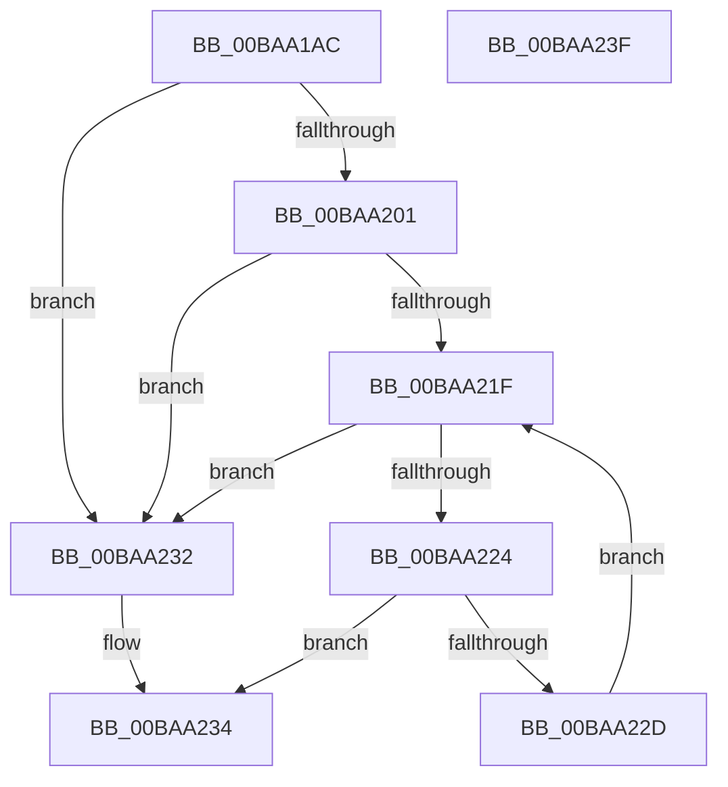

# ViDeadlockSearchThread

- RVA: `0x00BAA1AC`–`0x00BAA240` (길이 `148` bytes)
- VA: `0x0000000140BAA1AC`
- 실행 섹션: `PAGEVRFY`
- PDB 이름 있음: `예`; PDB Function 태그: `아니요`
- unwind 정보 RVA: `0x0005CAAC`
- 디코드: `42`개 명령, `148/148` bytes 표시
- 미해석 바이트: `0` (있으면 어셈블리에 `.byte`로 보존)

> 이 문서는 커널 이미지의 기계어와 PDB 기호를 분석해 생성했습니다. 4번과 5번은 함수 원형과 자료형을 바이너리 사용 방식에서 추정한 C 해석이며 원본 소스 복구 결과는 아닙니다.

## 1. Dependencies

- 직접 호출 지점: **1**; 고유 호출 대상: **1**
- 직접 호출자로 확인된 함수: **3**
- RIP 상대 이미지 참조: **1**

### Outgoing calls
- `0x00BAA216` → [VfUtilAddressRangeFit](../B9/VfUtilAddressRangeFit_function_00B93138.md) (function, `0x00B93138`)

### Direct callers
- [ViIsThreadInsidePagingCodePaths](ViIsThreadInsidePagingCodePaths_function_00BAA2D4.md) at `0x00BAA300`
- [VfDeadlockReleaseResource](../BB/VfDeadlockReleaseResource_function_00BB759C.md) at `0x00BB771C`
- [VfDeadlockReleaseResource](../BB/VfDeadlockReleaseResource_function_00BB759C.md) at `0x00BB774F`
- [VfDeadlockAcquireResource](../BB/VfDeadlockAcquireResource_function_00BB83B4.md) at `0x00BB8552`

### Static image references
- `0x00BAA1E4` → RVA `0x00FFDA00` (`PAGEVRFD`; read)

## 2. Other-region calls and transfers

- 다른 실행 섹션으로 향하는 call: **0**
- 별도 외부 분기/꼬리 이동을 확인하지 못했습니다.

## 3. Assembly (complete function range)

```asm
00BAA1AC  48 89 5C 24 08                  mov qword ptr [rsp + 8], rbx
00BAA1B1  57                              push rdi
00BAA1B2  48 83 EC 20                     sub rsp, 0x20
00BAA1B6  48 8B D9                        mov rbx, rcx
00BAA1B9  48 B8 11 40 00 01 04 10 40 00   movabs rax, 0x40100401004011
00BAA1C3  48 C1 E9 0C                     shr rcx, 0xc
00BAA1C7  48 F7 E1                        mul rcx
00BAA1CA  48 8B C1                        mov rax, rcx
00BAA1CD  48 2B C2                        sub rax, rdx
00BAA1D0  48 D1 E8                        shr rax, 1
00BAA1D3  48 03 C2                        add rax, rdx
00BAA1D6  48 C1 E8 09                     shr rax, 9
00BAA1DA  48 69 C0 FF 03 00 00            imul rax, rax, 0x3ff
00BAA1E1  48 2B C8                        sub rcx, rax
00BAA1E4  48 8B 05 15 38 45 00            mov rax, qword ptr [rip + 0x453815]
00BAA1EB  48 8B F9                        mov rdi, rcx
00BAA1EE  48 C1 E7 04                     shl rdi, 4
00BAA1F2  48 03 B8 10 40 00 00            add rdi, qword ptr [rax + 0x4010]
00BAA1F9  4C 8B 1F                        mov r11, qword ptr [rdi]
00BAA1FC  4C 3B DF                        cmp r11, rdi
00BAA1FF  74 31                           je 0x140baa232
00BAA201  48 81 C1 02 04 00 00            add rcx, 0x402
00BAA208  4C 8D 43 01                     lea r8, [rbx + 1]
00BAA20C  48 C1 E1 04                     shl rcx, 4
00BAA210  48 8B D3                        mov rdx, rbx
00BAA213  48 03 C8                        add rcx, rax
00BAA216  E8 1D 8F FE FF                  call 0x140b93138
00BAA21B  85 C0                           test eax, eax
00BAA21D  74 13                           je 0x140baa232
00BAA21F  4C 3B DF                        cmp r11, rdi
00BAA222  74 0E                           je 0x140baa232
00BAA224  49 8D 43 E8                     lea rax, [r11 - 0x18]
00BAA228  48 39 18                        cmp qword ptr [rax], rbx
00BAA22B  74 07                           je 0x140baa234
00BAA22D  4D 8B 1B                        mov r11, qword ptr [r11]
00BAA230  EB ED                           jmp 0x140baa21f
00BAA232  33 C0                           xor eax, eax
00BAA234  48 8B 5C 24 30                  mov rbx, qword ptr [rsp + 0x30]
00BAA239  48 83 C4 20                     add rsp, 0x20
00BAA23D  5F                              pop rdi
00BAA23E  C3                              ret
00BAA23F  CC                              int3
```

## 4. C-style interpretation (structured pseudocode)

```c
__int64 __fastcall ViDeadlockSearchThread(__int64 a1, __int64 a2)
{
    __int64 result;
    __int64 v_rdi;
    __int64 v_rsp;
    unsigned __int64 v_stack_p8;

    v_stack_p8 = v_rbx;
    v_rsp = (v_rsp) - (32);
    a1 = (a1) >> (12);
    result = (a1) - (a2);
    result = (result) >> (1);
    result = (result) + (a2);
    result = (result) >> (9);
    result = (result) * (result);
    a1 = (a1) - (result);
    v_rdi = (a1) << (4);
    v_rdi = (v_rdi) + (*(unsigned __int64 *)(*(unsigned __int64 *)(v_rip + 4536341) + 16400));
    if ((*(unsigned __int64 *)(v_rdi)) == v_rdi) goto loc_00BAA232;
    a1 = (a1) + (0x402ULL);
    a1 = (a1) << (4);
    a1 = (a1) + (*(unsigned __int64 *)(v_rip + 4536341));
    result = VfUtilAddressRangeFit(a1, a1, a1 + 1, a4);
    if ((unsigned int)(result) == 0) goto loc_00BAA232;
loc_00BAA21F:
    if ((*(unsigned __int64 *)(v_rdi)) == v_rdi) goto loc_00BAA232;
    if ((*(unsigned __int64 *)(*(unsigned __int64 *)(v_rdi) - 24)) == a1) goto loc_00BAA234;
    goto loc_00BAA21F;
loc_00BAA232:
    result = 0;
loc_00BAA234:
    v_rsp = (v_rsp) + (32);
    return result;
}
```

## 5. (Beta) C Style

```c
int64_t ViDeadlockSearchThread(void *Arg1, int64_t Arg2)
{
    uint8_t *arg1 = (uint8_t *)Arg1;

    int64_t result;
    int64_t local_rdi;
    int64_t local_rsp;
    uint64_t v_stack_p8;

    v_stack_p8 = local_rbx;
    local_rsp = (local_rsp) - (32);
    Arg1 = (Arg1) >> (12);
    result = (Arg1) - (Arg2);
    result = (result) >> (1);
    result = (result) + (Arg2);
    result = (result) >> (9);
    result = (result) * (result);
    Arg1 = (Arg1) - (result);
    local_rdi = (Arg1) << (4);
    local_rdi = (local_rdi) + (*(uint64_t *)(*(uint64_t *)(v_rip + 0x453815) + 0x4010));
    if ((*(uint64_t *)(local_rdi)) == local_rdi) goto loc_00BAA232;
    Arg1 = (Arg1) + (0x402ULL);
    Arg1 = (Arg1) << (4);
    Arg1 = (Arg1) + (*(uint64_t *)(v_rip + 0x453815));
    result = VfUtilAddressRangeFit(Arg1, Arg1, Arg1 + 1, a4);
    if ((uint32_t)(result) == 0) goto loc_00BAA232;
loc_00BAA21F:
    if ((*(uint64_t *)(local_rdi)) == local_rdi) goto loc_00BAA232;
    if ((*(uint64_t *)(*(uint64_t *)(local_rdi) - 0x18)) == Arg1) goto loc_00BAA234;
    goto loc_00BAA21F;
loc_00BAA232:
    result = 0;
loc_00BAA234:
    local_rsp = (local_rsp) + (32);
    return result;
}
```

### 관측된 메모리 오프셋

구조체 형식이 확인되지 않은 접근은 인자 기준의 오프셋으로만 기록했습니다.

| 기준 인자 | 오프셋 표현 | 폭 (bit) | 접근 |
|---|---:|---:|---|
| `Arg1` | `+ 0x1` | `64` | `R` |

## 6. Execution-region graph

[열기: 2D/3D 그래프와 함수 탐색 컨트롤 패널](../../../control-panel.html?section=pagevrfy&rva=0x00BAA1AC&view=graph)

- 2D 그래프는 위에서 아래로 흐르고, 3D 그래프는 빈 공간을 드래그해 회전합니다. Shift+드래그는 이동, 휠은 확대·축소, 함수 노드 선택은 대상 보고서 이동입니다.

### Static fallback


